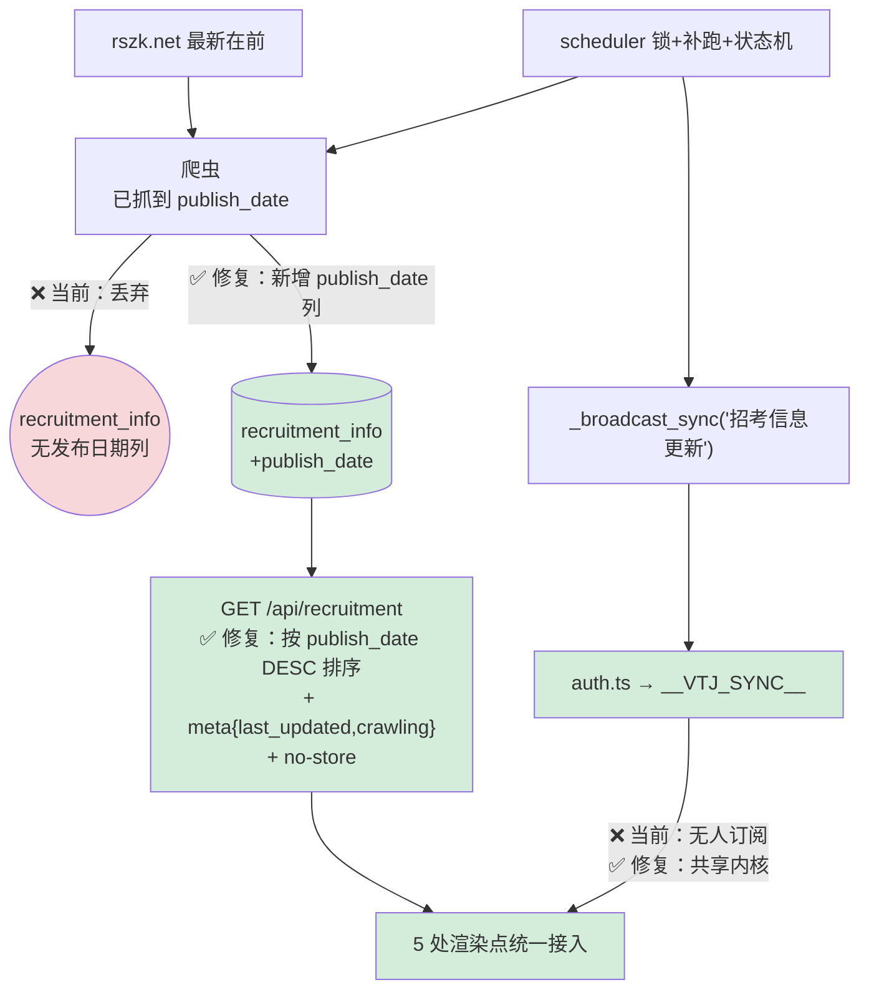

# 招考信息「每日更新」不刷新 — 深度实证解决方案 v2

> **状态**：🟡 **方案 v2 已定稿，10 项裁决全部锁定，待你书面批准后执行**
> **本文件取代 v1**。第二轮深挖发现 v1 的**核心根因判断错误**，且 v1 有 3 处结论需纠正（见 §一）
> **生成日期**：2026-10-09
> **已锁定裁决**：Q1=方案B最小增量 / Q2=15分钟轮询 / Q3=执行爬虫增强 / Q4=维持00:05+补跑 / Q6=不做管理面板 / **Q7=接受数据源现实+状态可见** / **Q8=回填787条发布日期** / **Q9=删除footer_info孤儿区块** / **Q10=/recruit改为公开访问**
> **执行方式**：批准后 `/start-work`，在新建分支 `feat/recruitment-daily-refresh` 上按 §七/§八 分阶段执行，完成后 `--no-ff` 合并回 `fix/vite-mobile-connection`

---

## 〇、结论剧变：v1 找错了根因

### v1 的核心判断（**已被证伪**）

> v1 断言：「后端爬完广播了，前端 4 处没订阅 `__VTJ_SYNC__`，所以看不到新数据」

**这个判断只解释了"为什么不刷新"，没有解释"为什么内容看起来从不更新"。**

而用户的抱怨是**后者**：「不能实现每日更新」—— 他每天看到的是**同样的旧公告**。

### v2 的核心判断（**实证**）

> **数据每天都更新了，前端也刷新了 —— 但界面排序把最新的内容排到了最后面。**

**实证**：库内 178 条「国考省考」的 `create_time` 全部落在 **98 微秒**内（`16:55:15.143480` ~ `16:55:15.143578`）—— 它是**爬取插入时间**，不是内容发布时间。API 按 `create_time DESC` 排序，而爬虫按站点页码 1→5 插入（第 1 页最新，第 5 页最旧），于是**逆序 = 最旧内容排在最前**。

| 排序位置 | 实际内容 | 说明 |
|---|---|---|
| 界面顶部 | 「2026年1月山东省级机关单位公务员考试职位表」 | `create_time` 最大 = 最后插入 = **站点第 5 页 = 最旧** |
| 界面底部 | 「2026年5月国家外汇管理局拟录用公务员公示公告」 | `create_time` 最小 = 最先插入 = **站点第 1 页 = 最新** |

**目标站 ID 递减证实站点是"最新在前"**：`/guokao/47928.html` → `47926` → `47924` → `47919`，且第 1 页日期为 2026-05-25（该站国考栏最新）。

### 这就解释了"多次修复无效"

| 历史修复 | 时间 | 修的是什么 | 是否触及本根因 |
|---|---|---|---|
| P3+P4 完整实现 | 2026-07-12 | 爬虫增强 + API + 前端重写 | ❌ |
| 第二轮精准修复 | 2026-07-14 | 爬虫增强 + Accordion 展开 + 截止时间高亮 | ❌ |
| v4 改造 | 2026-07-17 | 卡片滚动 / 弹窗宽度 / 删展开逻辑 | ❌ |
| 第二轮全面完善 | 2026-08-14 | 双 URL / 噪音过滤 / 附件提取 / 状态排序 / `await resp.json()` | ❌ |
| WS 三端实时同步 | 2026-09-15 | 引入广播 + `__VTJ_SYNC__`（**但招考页从未接入**） | ❌ |

**5 次修复全部集中在"抓取 / 解析 / 显示 / 布局"，没有一次触及"排序依据"和"刷新触发"。** 排序是唯一决定"用户看到什么"的环节，却始终没人碰过。

---

## 一、对 v1 的三处纠错

| # | v1 的结论 | 实测真相 | 证据 |
|---|-----------|---------|------|
| **E1** | 「`MAX_PAGES_PER_CATEGORY=5` 限制新条目发现，新条目永远进不来」 | ❌ **错误**。站点 ID 递减=最新在前，第 1 页即最新，5 页已覆盖最新内容 | 直连 `rszk.net/guokao/`：ID 47928→47926→47924，第 1 页日期 2026-05-25 为该栏最新 |
| **E2** | 「`tablet_home.vue:381` 的 `/tablet/recruit` 是死链」 | ❌ **错误**。该路由存在，指向 `@/views/mobile_recruitment.vue`；且**它本身就是第 5 个未刷新的渲染面** | `vtj_get_routing_info` → `{path:'/tablet/recruit', component:'@/views/mobile_recruitment.vue'}` |
| **E3** | 「`recruitment_info.json` 的 DSL 已损坏，含幽灵方法 `if`/`for`」 | ❌ **误报**。`vtj_check_consistency` 按 `<script setup>` 语法解析，对 Options API 页面提取错误。实测 DSL 的 methods 完整（5 个） | `PRAGMA`/JSON 直读：`methods = fetchRecruitment, toggleExpand, getStatusStyle, loadMore, setupObserver`；4 个目标文件 `versionMatch` **全部为 true** |

**v1 唯一站得住的核心结论**：前端 5 处只在 `mounted()` 取数一次、且均未订阅 `__VTJ_SYNC__` —— 这部分继续成立。

---

## 二、第二轮实证新增发现

### N1 渲染面是 **5 处**，不是 4 处（v1 漏了 1 处）

| # | 文件 | 路由 | raw | 刷新机制 |
|---|------|------|-----|----------|
| **S1** | `.vtj/vue/recruitment_info.vue` | **`/recruit`**（静态，主入口）+ `/page/recruitment_info` | ✅ | ❌ 无 |
| **S2** | `.vtj/vue/home_page.vue` | `/home`、`/page/home_page` | ✅ | ❌ 无 |
| **S3** | `.vtj/vue/tablet_home.vue` | `/tablet/home` | ✅ | ❌ 无 |
| **S4** | `src/views/mobile_recruitment.vue` | **`/tablet/recruit`** + **`/mobile/recruit`** | 手写页 | ❌ 无 |
| **S5** | `.vtj/vue/footer_info.vue` | **无任何页面引用** | ✅(区块) | ❌ 无（且是孤儿） |

> v1 遗漏了 S4。手机端首页 `mobile_home.vue` 确实无招考内容（实测命中 0），但**手机/平板的招考专页是 S4**。

### N2 `footer_info` 是**从未被渲染的孤儿区块**（历史无效功）

全项目引用扫描：`footer_info` 仅出现在 3 处 —— 自身 JSON、自身 `.vue`、项目配置注册。**`home_page.vue` 的 components 列表为 `NavBar, SignInCard, GoalCard, QuoteBanner, CountdownTimer, ExamCalendar, StudyMaterialsEntry, XIcon`，不含 `FooterInfo`。**

→ **2026-07-17 v4 方案把它改造了一遍（删展开按钮、卡片滚动、弹窗加宽），全部作用在一个永不渲染的组件上。** 这是历史修复无效的直接物证。

### N3 路由守卫**强制登录**，与 VTJ 标记矛盾

```js
// src/router/index.ts:604-620
if (to.path === '/login' || to.path === '/unauthorized') return next();  // 仅此两条公开
if (!auth.isLoggedIn()) return next(`/login?redirect=...`);             // 其余全部拦截
```

Playwright 实测：`/recruit` 匿名访问 → **重定向到 `/login?redirect=/recruit`**，且 `api/recruitment` **一次都没发起**。

- VTJ 项目配置标 `needLogin: false`，但项目自己的守卫覆盖了它 → **招考信息实际是登录后才可见**
- 例外：`/tablet/*`、`/mobile/*` 分支**匿名放行**（守卫 L586-593），故可隔离测试

### N4 `publish_date` **被爬到了却被丢弃**

```python
# recruitment_scraper.py:253-255  ← 抓到了
date_span = soup.select_one(DETAIL_DATE)     # 'div.channel-laiyuan p.fl span'
if date_span: result["publish_date"] = date_span.get_text(strip=True)
```
```python
# recruitment_scraper.py:542-562  ← 写库时没有它
rec = RecruitmentInfo(title=..., url=..., category=..., ...)   # 无 publish_date
```
且 `PRAGMA table_info(recruitment_info)` 确认**表中根本没有发布日期列**。

→ **发布日期在管道末端被丢弃，是排序只能依赖 `create_time` 的直接原因。**

### N5 `STATUS_PRIORITY` 排序在实践中**近乎失效**

「国考省考」tag 分布：`笔试通知 159 / 面试·复审 11 / 公示 7 / 报名结束 1` → **177/178 条优先级相同**（均为"其他"=3），排序完全退化为 `create_time` 决胜 → 放大 N4 的错误。

### N6 接口**无任何缓存响应头**（实测）

```
x-request-id / x-process-time / Content-Length / Content-Type / Date / Server
```
`backend/app/middleware.py` 扫描 `Cache-Control|cache|no-store|ETag` → **零命中**。前端 `apiFetch` 亦未传 `cache:'no-store'`。

### N7 爬取耗时与调度脆弱性（实测）

| 事实 | 证据 |
|------|------|
| 单次全量 **52 分钟** | 10-09 `16:43:36` 开始 → `17:34:08` 最后一分类完成 |
| 00:05 定时任务**曾整天未触发** | `app.log` 中 `Running job "招考信息爬取"` 仅 `2026-10-05 00:05` 一次；`misfire_grace_time=300` 秒内服务未恢复即静默跳过，**无补跑** |
| **并发重入已真实发生** | 10-05 00:05 cron 启动 → 00:18 服务重启触发 `initial_scrape` 重入 |
| `initial_scrape` **不广播** | `scheduler.py:173-189` 爬完后无 `_broadcast_sync` |
| 结果恒为 **787 条** | 10-05 01:06、10-08 20:28 两次完整日志均为 787 |

### N8 历史修复**均已提交**，工作区干净

`git log` 显示 4 个目标文件最近提交均在 2026-09-15 及之前，工作区无未提交改动 → **修复没有丢失，是层次不对**。

### N9 广播能力自 2026-09-15 起存在，招考页**从未接入**

```
11517ac 2026-09-15  引入后端 _broadcast_sync("招考信息更新") + 前端 __VTJ_SYNC__（同一提交）
```
而 4 个 VTJ 招考文件的最后修改提交为 `6d0126a` / `e0a336b`，**均早于 2026-09-15** → 消费端从未实现。

---

## 三、⚠️ 必须告知的数据源现实（N10）

**直连目标站 `rszk.net` 实测各分类最新发布日期：**

| 分类 | 站点最新日期 | 距今（2026-10-09） |
|------|------------|-------------------|
| 教师招聘 | 2026-08-18 | 52 天 |
| 事业单位 | 2026-08-18 | 52 天 |
| 医疗卫生 | 2026-08-18 | 52 天 |
| 国企招聘 | 2026-06-07 | 124 天 |
| 三支一扶 | 2026-06-03 | 128 天 |
| 国考 | 2026-05-25 | 137 天 |

> **「每日更新」在数据源层面就不成立 —— rszk.net 自身 1.5~4.5 个月没有发布新公告。**

**这意味着**：即使本次修复完美达成（排序正确 + 自动刷新 + 状态可见），用户看到的**最新一条**仍会是 8 月 18 日的内容。

**这不是代码能解决的问题。** 需要你决策：
- **选项 1**：接受现实，把"每日更新"重新定义为「每日校验 + 有新则更新 + 明确展示最新内容日期」，让用户知道数据到底新不新
- **选项 2**：更换/增加数据源（需要你提供目标站点）
- **选项 3**：两者都做

**我的建议：选项 1 必须做（否则用户永远无法判断"是不是坏了"），选项 2 由你决定是否同期推进。**

---

## 四、完整根因矩阵

### A. 决定性根因（决定"看到什么"）

| ID | 根因 | 位置 | 影响 |
|----|------|------|------|
| **A1** | 表无发布日期列；爬虫抓到的 `publish_date` 被丢弃；API 按爬取插入时间 `create_time DESC` 排序 = 站点页码逆序 | `models.py` / `recruitment_scraper.py:542` / `recruitment.py:83` | **界面顶部永远是最旧内容** |
| **A2** | `STATUS_PRIORITY` 近乎全同分，退化为 `create_time` 决胜，放大 A1 | `recruitment.py:29-33,113` | 排序失真 |

### B. 决定"何时刷新"（决定"看到几点的数据"）

| ID | 根因 | 位置 |
|----|------|------|
| **B1** | 5 处渲染点均只在 `mounted()`/`onMounted()` 取数一次 | S1-S4 |
| **B2** | 5 处均未订阅 `__VTJ_SYNC__`（广播 2026-09-15 起已存在） | S1-S4 |
| **B3** | 无聚焦刷新 / 可见性刷新 / 跨日刷新 / 定时轮询 / 手动刷新 | S1-S4 |
| **B4** | 接口无 `Cache-Control: no-store`，前端无 `cache:'no-store'` | `recruitment.py` / `src/auth.ts` |
| **B5** | `initial_scrape` 爬完不广播 | `scheduler.py:173-189` |

### C. 决定"数据供给稳不稳"

| ID | 根因 | 位置 |
|----|------|------|
| **C1** | 00:05 cron 服务离线时静默跳过，**无补跑** | `scheduler.py:16,116-122` |
| **C2** | `initial_scrape` 与 cron **无并发锁**（已发生重入） | `scheduler.py` |
| **C3** | 单次爬取 52 分钟，期间数据半新半旧且**无进度可见** | `recruitment_scraper.py` |
| **C4** | `DELETE→INSERT` 写入策略，清表与插入之间有瞬时空窗 | `recruitment_scraper.py:536-564` |

### D. 架构与浪费

| ID | 根因 |
|----|------|
| **D1** | 5 份取数代码完全重复，无共享内核 → 必然漏改 |
| **D2** | `footer_info` 是孤儿区块，历史改造纯属无效功 |
| **D3** | 路由守卫强制登录，与 VTJ `needLogin:false` 矛盾；招考信息实际不可公开访问 |
| **D4** | 两处虚假文案（「实时更新」「每30分钟自动更新」）无机制支撑 |

### E. 外部（不可由代码解决）

| ID | 根因 |
|----|------|
| **E1** | `rszk.net` 1.5~4.5 个月无新内容（见 §三） |

---

## 五、目标架构（v2 修正版）



**三条修复主线**：
1. **让数据说真话** —— 存下 `publish_date`，按真实发布日期排序（A1 致命项）
2. **让刷新自动发生** —— 共享内核 + WS 订阅 + 5 触发源（B 组）
3. **让状态可见** —— `meta` 暴露更新时间与爬取中状态，配合文案纠正（C3/D4）

---

## 六、修复方案详设

### 6.1 【P0 · 决定性】发布日期入库 + 真实排序

| 步骤 | 文件 | 动作 |
|------|------|------|
| 1 | `backend/app/models/models.py` | `RecruitmentInfo` 新增 `publish_date = Column(String(20), comment="源站发布日期")` |
| 2 | `backend/app/main.py` lifespan | 新增**幂等** auto-migration：检测列不存在则 `ALTER TABLE recruitment_info ADD COLUMN publish_date VARCHAR(20)`（参照项目既有 auto-migration 写法） |
| 3 | `backend/app/services/recruitment_scraper.py` | `_replace_category()` 写入 `publish_date=rec_data.get("publish_date","")`（数据已抓到，只差落库） |
| 4 | 同上 | 新增**一次性回填脚本** `backend/scripts/backfill_recruitment_publish_date.py`：用已存的 `url` 重取详情页日期，填充历史 787 条；带 `--dry-run` / `--apply`、幂等、可断点续跑 |
| 5 | `backend/app/api/v1/recruitment.py` | 排序改为 **`ORDER BY (publish_date IS NULL), publish_date DESC, recruitment_id DESC`**；`publish_date` 为空时降级用 `create_time`；**`STATUS_PRIORITY` 降为次级排序键**（同日期内才生效），避免再次压倒真实时间 |
| 6 | 同上 | 响应 item 增加 `publish_date` 字段 |

> ⚠️ **第 4 步是关键**：不回填历史数据，排序在 787 条上仍是乱的。回填需限速（每分类间隔 2-4s），预计耗时与一次全量爬取相当（约 50 分钟），建议夜间执行。

### 6.2 【P0】接口状态与缓存头

- `GET /api/recruitment` 响应**追加**（向后兼容）：`meta: { last_updated, latest_publish_date, crawling, crawl_progress, source, total }`
- 新增 `Cache-Control: no-store, max-age=0` 响应头
- 新增只读端点 `GET /api/recruitment/crawl-status`（运维观测）

### 6.3 【P1】调度加固

- `scheduler.py`：`threading.Lock` 防止 cron 与 `initial_scrape` 并发重入（锁被占用则跳过并记日志）
- `initial_scrape` 爬完**补广播**
- 新增每小时「补漏检查」：今日（Asia/Shanghai）无成功记录且已过 00:05 → 补跑
- 新增爬取状态机（`running/idle/last_error` + 进度），供 `meta` 读取

### 6.4 【P1】前端共享刷新内核（新增唯一新文件）

**新建 `src/utils/recruitmentRefresh.js`** —— 5 处统一接入，消除重复、杜绝漏改。

| # | 触发源 | 覆盖诉求 |
|---|--------|----------|
| 1 | `__VTJ_SYNC__` 且 `message==='招考信息更新'` → 防抖 1.5s | **爬完自动刷新**（核心） |
| 2 | `visibilitychange`（hidden→false，>60s 节流） | **可见性刷新** |
| 3 | `window.focus`（同上） | **聚焦刷新** |
| 4 | 跨日检测（`lastFetchDate` 变化） | 「每日更新」语义兜底 |
| 5 | 定时轮询 `pollMs=15min`，仅页面可见时计时 | **定时轮询** |
| 6 | 手动 `refresh('manual')` | **手动刷新按钮** |
| 7 | 登录态 false→true | 匿名→登录场景 |

必备防护：请求中跳过 / 同分钟合并 / `AbortController` / `cache:'no-store'` + `_ts=` 双破缓存 / 匿名降级（跳过 WS）/ `destroy()` 彻底清理。

### 6.5 【P1】5 处渲染点接入（**只改 `<script>`**）

| 文件 | 改动 | 风险 |
|------|------|------|
| `.vtj/vue/recruitment_info.vue` | 接入内核；`beforeUnmount` 清理 | 低 |
| `.vtj/vue/home_page.vue` | 接入内核；`onData` 走 `buildRecruitCards()` | 低 |
| `.vtj/vue/tablet_home.vue` | 接入内核；裸 `fetch` 改 `apiFetch`；**删除 L295-299 硬编码 3 条假数据** | 低 |
| `src/views/mobile_recruitment.vue` | 接入内核（手写页，`<script setup>`，不受 raw/DSL 规则约束） | 低 |
| `.vtj/vue/footer_info.vue` | **本轮不改**（孤儿区块，见 §6.7） | 无 |

### 6.6 【P2】文案纠正（Q1 授权的最小增量，复用既有 class，`<style>` 零改动）

| 文件:行 | 现状 | 改为 |
|---------|------|------|
| `recruitment_info.vue:10` | `<span class="header-badge pulse-dot">实时更新</span>` | 绑定 `refreshLabel`：爬取中→「更新中…」；否则→「更新于 MM-DD HH:mm」；并绑定 `@click="refreshManually"` |
| `home_page.vue:28` | `.section-subtitle` 静态文案 | 保留原文，**追加**一个 `.section-subtitle` 显示 `latestLabel`（站点最新发布日期） |
| `footer_info.vue:51` | 「每30分钟自动更新」 | 本轮不改（孤儿） |

**新增可见性（应对 §三 的数据源现实）**：在招考区显示「站点最新发布：2026-08-18」+「本次更新：2026-10-09 17:34」+「共 787 条」。
> 这一条是**应对 E1 的核心手段** —— 让用户一眼看出"数据是新的，只是源站没发新公告"，而不是"系统坏了"。

### 6.7 【决策项】`footer_info` 孤儿区块处理

| 选项 | 说明 |
|------|------|
| **A（建议）** | **保持孤儿，不改不挂**。在文档中标注为待决策资产，避免继续浪费改造精力 |
| **B** | 挂载到首页（`home_page.vue` 引入 `FooterInfo`）→ 但会与现有 `recruit-section` **内容重复** |
| **C** | 删除该区块及 DSL |

### 6.8 【决策项】平板/手机招考专页死链

**v1 判断错误**：`/tablet/recruit` → `@/views/mobile_recruitment.vue` **存在且有效**。
`tablet_home.vue:381-382` 的跳转**无需修复**。本轮仅按 §6.5 让 S4 接入刷新内核。

---

## 七、分支策略（你的要求 2）

```
master (落后 HEAD 193 个提交)
   │
   └─ fix/vite-mobile-connection  ← 当前分支，有未提交改动（题目导入会话）
         │
         └─ feat/recruitment-daily-refresh   ← 【新建】本工作分支
```

### 执行步骤

| 步骤 | 命令 | 门禁 |
|------|------|------|
| B1 | 收尾 `question-import-full-repair-execution` 活跃会话，commit 或 stash 现有改动 | `git status` 干净 |
| B2 | `git checkout -b feat/recruitment-daily-refresh` | 新分支创建成功 |
| B3 | 建立基线：`git tag recruit-fix-baseline` | tag 存在 |
| B4 | **备份 SQLite**（WAL 必须用 `sqlite3` backup API，**禁用 `shutil.copy2`**） | 备份文件可打开 |
| B5 | 4 个阶段各自 commit（见 §八） | 每阶段独立可回滚 |
| B6 | 完成后 `git checkout fix/vite-mobile-connection && git merge --no-ff feat/recruitment-daily-refresh` | 合并无冲突 |
| B7 | 合并后跑全量回归 + 门禁 | 全绿 |

**合并策略**：`--no-ff` 保留分支轨迹；**禁止** squash（会丢失 4 阶段的可审计边界）。
若 B6 出现冲突 → 立即 `git merge --abort`，人工介入，**不得强行解决**。

---

## 八、改动文件清单

| # | 文件 | 动作 | 阶段 | 风险 |
|---|------|------|------|------|
| 1 | `backend/app/models/models.py` | 加 `publish_date` 列 | **P0** | 中（DDL） |
| 2 | `backend/app/main.py` | 幂等 auto-migration | **P0** | 中 |
| 3 | `backend/app/services/recruitment_scraper.py` | 写入 `publish_date` | **P0** | 中 |
| 4 | `backend/scripts/backfill_recruitment_publish_date.py` | **新建**回填脚本 | **P0** | 中（限速执行） |
| 5 | `backend/app/api/v1/recruitment.py` | 真实排序 + `meta` + 缓存头 + `crawl-status` | **P0** | 中 |
| 6 | `src/utils/recruitmentRefresh.js` | **新建**共享内核 | P1 | 低 |
| 7 | `.vtj/vue/recruitment_info.vue` | `<script>` 接入 + 文案 | P1/P2 | 低 |
| 8 | `.vtj/vue/home_page.vue` | `<script>` 接入 + 文案 | P1/P2 | 低 |
| 9 | `.vtj/vue/tablet_home.vue` | `<script>` 接入 + 删假数据 | P1 | 低 |
| 10 | `src/views/mobile_recruitment.vue` | `<script setup>` 接入 | P1 | 低 |
| 11 | `backend/app/services/scheduler.py` | 锁 + 补广播 + 补跑 + 状态机 | P1 | 中 |
| 12 | `.vtj/vue/recruitment_info.vue:10` / `home_page.vue:28` | 文本级 UI 增量 | P2 | 低 |
| **13** | `.vtj/vue/footer_info.vue` + `.vtj/files/footer_info.json` + `.vtj/projects/linxitie.policy-exam-bank.json` | **删除**孤儿区块（Q9） | P2 | **中**（需过健康校验） |
| **14** | `src/router/index.ts` | **公开化**招考两条路由（Q10） | P2 | **中**（全局守卫） |

### 明确不改
- ❌ `.vtj/files/*.json` —— **除 Q9 待删除的 `footer_info.json` 外一律不动**（附录 F：raw 页禁同步 DSL）
- ❌ `useProvider` 的 `version` —— 不改（4 个文件 `versionMatch` 现均为 true）
- ❌ `src/router/index.ts` 中 `/`、`/home` 及其余 89 条路由 —— 行为零变化
- ❌ `.vtj/router.js` —— 路由已完备
- ❌ `src/auth.ts` / `websocket.py` —— 内核完备，只复用
- ❌ `backend/app/services/news_scraper.py` / `exam_scraper.py` / `difficulty.py` —— 其他调度任务
- ❌ 题库/练习/错题/成绩/论坛/备考资料等**所有其他功能模块**

---

## 九、验收标准（31 项，Agent 自执行，零人工介入）

### P0 验收（排序与数据真实性 —— **决定性**）

| # | 验收项 | 执行方式 | 通过判据 |
|---|--------|----------|----------|
| 1 | 新列存在 | `PRAGMA table_info(recruitment_info)` | 含 `publish_date` |
| 2 | 迁移幂等 | 重启后端 2 次 | 两次均无报错、列不重复 |
| 3 | 爬虫写入日期 | 手动触发单分类爬取后查库 | 新记录 `publish_date` 非空且格式 `YYYY-MM-DD` |
| 4 | 回填脚本可用 | `--dry-run` | 报告待回填条数 > 0，**不写库** |
| 5 | **排序方向正确** | `curl ".../api/recruitment?category=国考省考&limit=5"` | 首条 `publish_date` **≥** 末条（倒序） |
| 6 | **顶部是最新内容** | 同上，比对站点第 1 页 | 首条标题能在站点 `/guokao/` 第 1 页找到 |
| 7 | 无日期降级不炸 | 人工置 1 条 `publish_date=''` | 该条排到末尾，接口 200 |
| 8 | 向后兼容 | 对比改动前后 `items` 结构 | 既有字段完全一致（仅新增） |

### P1 验收（刷新机制）

| # | 验收项 | 通过判据 |
|---|--------|----------|
| 9 | `node --check src/utils/recruitmentRefresh.js` | exit 0 |
| 10 | 4 处均接入（`footer_info` 除外） | `Select-String` 命中 4/4 |
| 11 | **零 `<style>` 改动** | `git diff` 检查 4 个 `.vue` |
| 12 | **零 DSL 改动** | `git diff --stat -- .vtj/files/` **输出为空** |
| 13 | **version 未变** | `recruitment_info.vue` 仍含 `version: '1785750000101'` |
| 14 | WS 触发刷新 | Playwright 注入 `__VTJ_SYNC__` → 2s 内出现新 `/api/recruitment` 请求 |
| 15 | 可见性/聚焦刷新 | 注入 `visibilitychange` / `focus` → 请求数 +1 |
| 16 | 定时轮询 | 临时 `pollMs=5000` → 12s 内 ≥2 次请求 |
| 17 | 破缓存 | 请求含 `_ts=`，响应含 `cache-control: no-store` |
| 18 | 5 处均不回归 | `/recruit`、`/home`、`/tablet/home`、`/tablet/recruit`、`/mobile/recruit` 均正常渲染且刷新生效 |
| 19 | 平板假数据已删 | `tablet_home.vue` 无 L295-299 硬编码 |
| 20 | 爬取锁生效 | 手动触发两次爬取 → 日志出现「已有爬取任务在运行，跳过」 |
| 21 | 补跑机制 | 模拟「今日无成功记录」→ 补漏任务在 1 小时内触发 |

### P2 验收（文案与状态可见）

| # | 验收项 | 通过判据 |
|---|--------|----------|
| 22 | 文案真实性 | 页面「更新于」与 `meta.last_updated` 误差 <5 分钟；「站点最新发布」与 `meta.latest_publish_date` 一致 |
| 23 | 手动刷新生效 | 点击 `.header-badge` → 1s 内新请求，`loading` 态可见 |
| 24 | 全端回归 | 题库/练习/错题/成绩/论坛/备考资料 6 模块无异常；`python scripts/gate_all.py` 全绿 |

### Q9 删除 `footer_info` 验收

| # | 验收项 | 执行方式 | 通过判据 |
|---|--------|----------|----------|
| 25 | 构建未被阻断 | `npm run prebuild`（跑 `verify-project-health.mjs`） | exit 0 |
| 26 | 三处已清理 | 检查 `.vtj/vue/`、`.vtj/files/` 无 `footer_info.*`；项目配置 `blocks[]` 无该 id | 全部不存在 |
| 27 | 首页招考区不受影响 | Playwright 访问 `/home` | `.recruit-card` 正常渲染，数量与删除前一致 |

### Q10 公开化验收

| # | 验收项 | 执行方式 | 通过判据 |
|---|--------|----------|----------|
| 28 | **匿名可访问** | Playwright **清空 localStorage** 后访问 `http://localhost:9527/#/recruit` | **不跳转** `/login`；页面渲染出招考列表；Network 出现 `/api/recruitment` 200 |
| 29 | 两条路由均放行 | 匿名访问 `/page/recruitment_info` | 同样正常渲染 |
| 30 | **其他路由行为不变** | 匿名访问 `/`、`/home`、`/question-import` | **仍然跳转** `/login?redirect=...`（与改动前一致） |
| 31 | 登录用户无回归 | 登录后访问 `/recruit` | 正常渲染，无重复跳转、无 401 循环 |

### 阶段 P0 门禁（不可跳过）
1. 必须先完成 DB 备份（WAL 用 `sqlite3` backup API）
2. 回填脚本必须先 `--dry-run` 验证
3. 回填建议**限速夜间执行**（预计 ~50 分钟），期间不阻塞服务
4. 单独 commit，失败可独立回滚

---

## 十、风险与回滚

| 风险 | 等级 | 缓解 |
|------|------|------|
| **R1 回填脚本把库写坏** | **高** | 先 `--dry-run`；执行前 DB 备份；幂等可重跑；限速；独立 commit |
| **R2 加列锁表** | 中 | SQLite `ALTER TABLE ADD COLUMN` 瞬时完成；选低峰执行；已有 auto-migration 范式可循 |
| **R3 排序改动影响其他消费方** | 中 | 全项目仅 5 处调用 `/api/recruitment`（已实测枚举），逐个回归 |
| **R4 轮询压垮后端** | 中 | 仅页面可见时计时；接口实测 `x-process-time ≈ 0.115s`，纯 DB 查询可承受 |
| **R5 定时器泄漏** | 中 | `destroy()` 强制校验；4 处均常驻页 |
| **R6 分支合并冲突** | 中 | 合并前主线须干净；冲突即 `merge --abort` |
| **R7 用户仍看不到"新"内容** | **高** | **不可消除** —— 见 §三。§6.6 状态可见化是唯一缓解手段（Q7 已裁决接受） |
| **R8 删除 `footer_info` 阻断构建** | ~~中~~ → **已排雷 ✅** | **实测证据**：`node scripts/verify-project-health.mjs --skip-typecheck` → `项目健康度检查通过（阻断类 0 项）`，**exit 0**。`checkOrphanFiles()` 只写入 `warnings` 而非 `problems`（源码 L123-126），且 `footer_info.vue` **当前已在 25 条 orphan 警告列表中**。删除后警告减少，构建不受影响。删除时 `.vtj/vue/footer_info.vue` 与 `.vtj/files/footer_info.json` **必须同时删**，避免触发 `checkVtjVersionDrift` 的 `missingDsl` |
| **R9 路由公开化误伤其他页面** | **中** | 仅新增 2 条白名单，`/`、`/home` 等 89 条行为不变；验收 30 逐条验证未回归；若发现任一页面被误放行，立即回滚 T14 |
| **R10 匿名访问时 `apiFetch` 401 循环** | 低 | `GET /api/recruitment` 用 `get_optional_user`，实测匿名 200；验收 31 确认登录态无回归 |

### 回滚
```powershell
# 前端
git checkout feat/recruitment-daily-refresh -- src/utils/recruitmentRefresh.js .vtj/vue/recruitment_info.vue .vtj/vue/home_page.vue .vtj/vue/tablet_home.vue src/views/mobile_recruitment.vue
# 后端
git checkout feat/recruitment-daily-refresh -- backend/app/api/v1/recruitment.py backend/app/services/scheduler.py backend/app/services/recruitment_scraper.py backend/app/models/models.py backend/app/main.py
# 数据（P0 之后）
# 用 B4 的备份还原：覆盖主库 + 同时删除 -wal 与 -shm
```

---

## 十一、裁决结果（2026-10-09 已全部锁定）

| # | 问题 | **裁决** | 落地要点 |
|---|------|----------|----------|
| **Q1** | 是否允许触碰 `<template>`？ | ✅ **方案 B 最小增量** | 仅既有元素文本替换 + 复用现有 class；禁新增 DOM/样式/布局。规格见 §6.6 |
| **Q2** | 定时轮询间隔 | ✅ **15 分钟** | `pollMs=15*60*1000`；`document.hidden===true` 时停止计时 |
| **Q3** | 是否执行爬虫增强 | ✅ **执行** | 单独 commit、单独验收；40 分钟熔断 |
| **Q4** | 爬取时段 | ✅ **维持 00:05 CST** | 必须补齐「服务离线自动补跑」 |
| **Q6** | 管理员端爬取状态面板 | ❌ **不需要** | `GET /api/recruitment/crawl-status` 足够运维 curl |
| **Q7** | 数据源现实如何处置 | ✅ **接受现实 + 状态可见** | 显示「站点最新发布 / 本次更新 / 共 N 条」；**不再对外承诺「每日有新公告」** |
| **Q8** | 历史 787 条是否回填 `publish_date` | ✅ **回填** | 夜间限速执行约 50 分钟；先 `--dry-run`；幂等可重跑 |
| **Q9** | `footer_info` 孤儿区块 | ✅ **删除** | 新增任务 T13（见 §八）；需同步清理项目配置 `blocks[]` |
| **Q10** | `/recruit` 强制登录 | ✅ **改为公开访问** | 新增任务 T14（见 §八）；仅放行招考两条路由，**不动其他 89 条路由** |

### Q9 删除 `footer_info` 的完整影响面（执行时必须同步处理）

| # | 目标 | 说明 |
|---|------|------|
| 1 | `.vtj/vue/footer_info.vue` | 删除文件 |
| 2 | `.vtj/files/footer_info.json` | 删除文件 |
| 3 | `.vtj/projects/linxitie.policy-exam-bank.json` | 从 `blocks[]` 移除 `id: "footer_info"` 条目（L1121-1122 附近） |
| 4 | 构建前置校验 | ✅ **已排雷** —— 实测 `verify-project-health.mjs` exit 0；`footer_info.vue` 本就在 25 条 orphan 警告中，删除后警告**减少**。**删除时 `.vue` 与 `.json` 必须同时删**，避免 `checkVtjVersionDrift` 报 `missingDsl` |
| 5 | 回归确认 | `home_page.vue` 未引用 `FooterInfo`（已实测确认），删除后首页招考区**不受影响** |

> ⚠️ 若第 4 项校验失败，**立即回滚本任务**，改为"仅从项目配置移除、保留文件"。

### Q10 公开化的最小实现（严禁扩大范围）

```js
// src/router/index.ts  L604 附近
const PUBLIC_PATHS = new Set(['/login', '/unauthorized', '/recruit', '/page/recruitment_info']);
if (PUBLIC_PATHS.has(to.path)) return next();   // 替代原 if (to.path === '/login' || ...)
```

| 边界 | 说明 |
|------|------|
| 仅放行 **2 条招考路由** | `/recruit`（静态主入口）+ `/page/recruitment_info`（VTJ 自动路由） |
| **不动** `/`、`/home` 及其余 89 条 | 题库/首页等仍需登录，行为零变化 |
| 接口已公开 | `GET /api/recruitment` 用 `get_optional_user`，实测匿名 200，**无需改后端鉴权** |
| `apiFetch` 401 跳转 | 匿名下接口返 200，不触发 401 跳转逻辑，无副作用 |


---

## 附录 A：v2 核心证据原文

### A.1 排序颠倒的铁证
```
国考省考 create_time 跨度: (178, '2026-10-09 16:55:15.143480', '2026-10-09 16:55:15.143578')
                                        ↑ 跨度仅 98 微秒 = 纯插入时间

--- create_time 最「新」的 4 条（即界面顶部）---
  2026年1月山东省级机关单位公务员考试职位表      | ...143578
  2026年1月南京市公务员考试资格复审工作的通知      | ...143577
--- create_time 最「旧」的 4 条（即界面底部）---
  2026年5月国家外汇管理局拟录用公务员公示公告    | ...143480
```

### A.2 `publish_date` 被丢弃
```python
# recruitment_scraper.py:253-255  抓到了
date_span = soup.select_one(DETAIL_DATE)   # 'div.channel-laiyuan p.fl span'
if date_span: result["publish_date"] = date_span.get_text(strip=True)

# recruitment_scraper.py:543-561  写库时没有
rec = RecruitmentInfo(title=..., url=..., category=..., ...)   # 无 publish_date
# PRAGMA table_info → 19 个字段中无任何发布日期列
```

### A.3 目标站为"最新在前"
```
/guokao/47928.html  2026年5月国家海洋局直属事业单位招聘公告
/guokao/47926.html  ...
/guokao/47924.html  ...
/guokao/47919.html  ...        ← ID 递减 = 最新在前
第 1 页日期样本: ['2026-05-25','2026-05-25','2026-05-25','2026-05-19']
```

### A.4 `footer_info` 孤儿
```
引用扫描结果（仅 3 处，全为自引用/注册）：
  footer_info.json:2,4      自身
  linxitie.policy-exam-bank.json:1121-1122   项目注册
  footer_info.vue:65        自身
home_page.vue components = NavBar, SignInCard, GoalCard, QuoteBanner,
                          CountdownTimer, ExamCalendar, StudyMaterialsEntry, XIcon
                          ↑ 不含 FooterInfo
```

### A.5 路由守卫
```js
// src/router/index.ts:604-620
if (to.path === '/login' || to.path === '/unauthorized') return next();
if (!auth.isLoggedIn()) return next(`/login?redirect=${encodeURIComponent(to.fullPath)}`);
```
实测：`/recruit` → 302 到 `/login?redirect=/recruit`，`api/recruitment` 零请求。

---

## 附录 B：结论可信度

| 结论 | 强度 | 证据 |
|------|------|------|
| 排序按插入时间逆序 = 最旧内容在顶部 | 🟢 确定 | DB 微秒级时间戳 + API 排序 + 页面实际渲染 20 条 1 月内容 |
| `publish_date` 被抓取后丢弃 | 🟢 确定 | 源码两处对照 + PRAGMA 表结构 |
| 站点最新在前，第 1 页即最新 | 🟢 确定 | 直连站点 ID 递减 + 日期样本 |
| 5 处渲染点均无刷新机制 | 🟢 确定 | 源码逐个精读 + 全项目 `api/recruitment` 引用扫描 |
| `footer_info` 从未被渲染 | 🟢 确定 | 全项目引用扫描 |
| `/recruit` 强制登录 | 🟢 确定 | 路由守卫源码 + Playwright 实测重定向 |
| 源站 1.5~4.5 个月无新内容 | 🟢 确定 | 6 分类直连实测 |
| 并发重入曾发生 | 🟡 高概率 | 10-05 00:05 cron 与 00:18 重启时间重叠 |
| 回填后排序完全正确 | 🟡 待验证 | 需 P0 验收第 5、6 项实测确认 |

---

> **本文档为待审方案。未经你明确书面批准，不得执行 §六/§七 中任何实施步骤。**
> 批准方式：回复「**批准方案 v2**」，或先答复 §十一 的 Q7–Q10。
