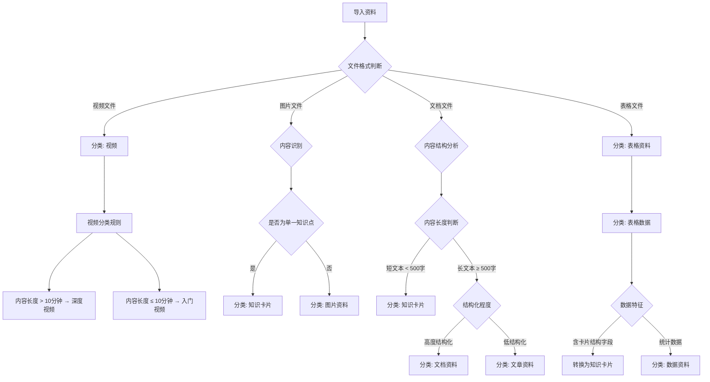
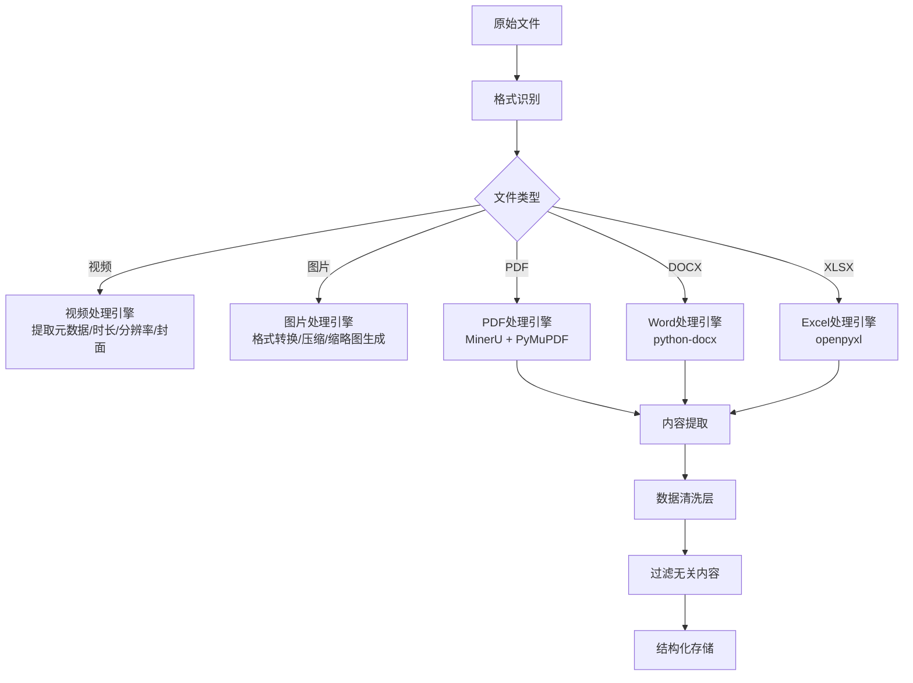
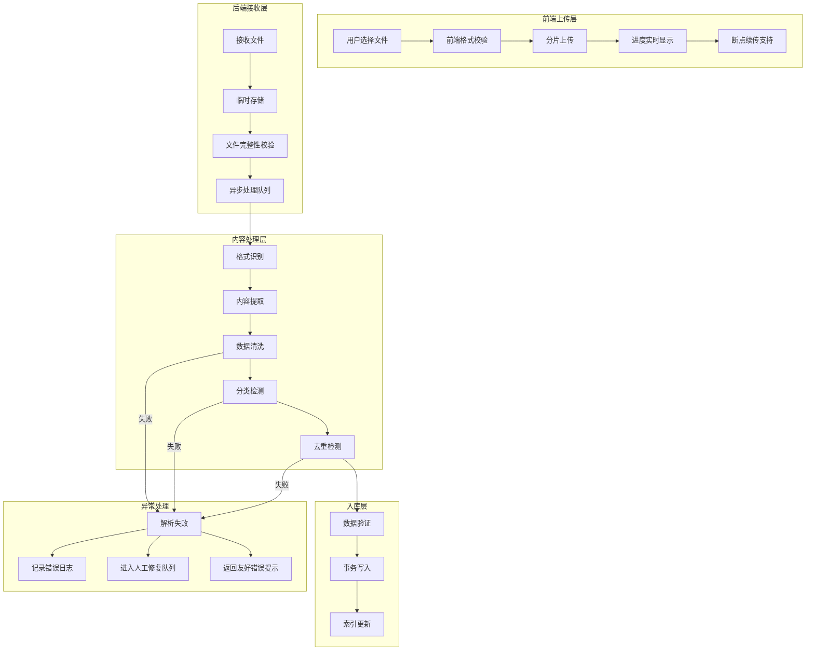

在原有“备考资料”设计方案的基础上，补充管理员端“备考资料导入”功能模块的完整设计如下。

---

## 管理员端“备考资料导入”功能模块设计（新增）
# 文档说明
# 文档版本：v2.0
# 编写日期：2026年8月
# 主要内容：功能模块设计、分类机制、内容识别引擎、数据过滤、去重机制、稳定性保障
# 适用对象：前后端开发人员、系统架构师

### 一、入口位置设计

**结论：在管理员端导航栏中新增独立的“资料管理”一级菜单，下设“备考资料”子菜单作为统一入口。**

#### 1.1 设计理由

| 考量维度 | 分析 |
|---------|------|
| **功能独立性** | 备考资料导入涉及视频、图片、文档、PDF、Excel等多种格式，操作链路长、交互复杂，不适合嵌入其他模块 |
| **操作频率** | 资料更新是周期性工作（如每季度更新一批视频），需要独立、专注的操作空间 |
| **权限隔离** | 资料管理通常由内容管理员负责，与用户管理、系统设置的权限应区分开 |
| **可扩展性** | 未来可能增加资料分类、标签管理、批量处理等子功能，独立菜单便于扩展 |
| **行业惯例** | 主流CMS系统（如阿里云素材中心、Strapi媒体库）均采用独立菜单管理多媒体资料 |

#### 1.2 菜单结构

```
管理员端导航栏
│
├── 📊 系统总览
├── 👤 用户管理
├── 📄 试卷审批
├── 📚 资料管理 ← 新增一级菜单
│   ├── 📖 备考资料 ← 本次设计重点
├── ⚙️ 系统设置
├── 📋 日志审计
└── 💾 数据管理
```

### 1.3 页面布局设计

#### 1.3.1 整体布局

```
┌─────────────────────────────────────────────────────────────────────┐
│  📚 资料管理 / 备考资料                    [导入资料] [刷新]       │
├─────────────────────────────────────────────────────────────────────┤
│  筛选区：                                                          │
│  科目 [全部 ▼]  类型 [全部 ▼]  状态 [全部 ▼]  搜索 [________] [🔍]│
├─────────────────────────────────────────────────────────────────────┤
│  ┌─────────────────────────────────────────────────────────────┐   │
│  │  📊 统计概览                                                │   │
│  │  ┌─────────┐ ┌─────────┐ ┌─────────┐ ┌─────────┐         │   │
│  │  │ 总资料数 │ │ 视频    │ │ 文档    │ │ 卡片    │         │   │
│  │  │ 156     │ │ 32     │ │ 68     │ │ 56     │         │   │
│  │  └─────────┘ └─────────┘ └─────────┘ └─────────┘         │   │
│  └─────────────────────────────────────────────────────────────┘   │
│                                                                     │
│  ┌─────────────────────────────────────────────────────────────┐   │
│  │  资料列表                                                    │   │
│  │  ┌────┬──────────┬────────┬──────────┬────────┬──────────┐ │   │
│  │  │  # │ 标题     │ 科目   │ 类型     │ 状态   │ 操作       │ │   │
│  │  │ 1  │ 行测导学  │ 行测   │ 视频     │ 已发布 │ [预览] [编辑]  │ │   │
│  │  │ 2  │ 申论写作  │ 申论   │ 文档     │ 草稿   │ [发布] [编辑]   │ │   │
│  │  │ 3  │ 职业素养  │ 公专   │ 卡片     │ 已发布 │ [预览] [编辑]│ │   │
│  │  └────┴──────────┴────────┴──────────┴────────┴──────────┘ │   │
│  └─────────────────────────────────────────────────────────────┘   │
│  共 156 条  第 1/8 页  [1] [2] [3] ... [8]  每页 20 条           │
└─────────────────────────────────────────────────────────────────────┘
```

#### 1.3.2 “导入资料”弹窗设计

点击“导入资料”按钮后，弹出全屏/大尺寸对话框：

```
┌─────────────────────────────────────────────────────────────────────┐
│  📤 导入备考资料                                    [✕ 关闭]      │
├─────────────────────────────────────────────────────────────────────┤
│  步骤 1/3：选择文件                                                │
│  ┌─────────────────────────────────────────────────────────────┐   │
│  │                                                             │   │
│  │              📁 拖拽文件到此处或点击上传                    │   │
│  │                                                             │   │
│  │  支持格式：视频(MP4/MOV/AVI) | 图片(JPG/PNG/GIF/WebP)    │   │
│  │  文档(PDF/DOCX) | 表格(XLSX) | 压缩包(ZIP/RAR)            │   │
│  │  单个文件不超过 500MB，总大小不超过 2GB                    │   │
│  │                                                             │   │
│  └─────────────────────────────────────────────────────────────┘   │
│                                                                     │
│  ┌─────────────────────────────────────────────────────────────┐   │
│  │  已选文件 (5个)                                             │   │
│  │  ┌──────────────────────────────────────────────────────┐   │   │
│  │  │  ✅ 行测导学.mp4          156.3 MB  [移除]           │   │   │
│  │  │  ✅ 申论写作技巧.pdf       2.4 MB  [移除]           │   │   │
│  │  │  ✅ 公专职业素养卡片.xlsx   1.8 MB  [移除]           │   │   │
│  │  │  ⏳ 行测高频考点.docx       3.2 MB  [移除]           │   │   │
│  │  │  ⏳ 判断推理思维导图.png    4.5 MB  [移除]           │   │   │
│  │  └──────────────────────────────────────────────────────┘   │   │
│  └─────────────────────────────────────────────────────────────┘   │
│                                                                     │
│  [← 上一步]                          [下一步：设置属性 →]          │
└─────────────────────────────────────────────────────────────────────┘
```

```
┌─────────────────────────────────────────────────────────────────────┐
│  📤 导入备考资料                                    [✕ 关闭]      │
├─────────────────────────────────────────────────────────────────────┤
│  步骤 2/3：设置资料属性                                            │
│  ┌─────────────────────────────────────────────────────────────┐   │
│  │  文件：行测导学.mp4                                        │   │
│  │  标题：[行测导学：考什么、怎么考________________]          │   │
│  │  科目：[行测 ▼]  类型：[入门讲解视频 ▼]                    │   │
│  │  分类：[考情分析 ▼]  难度：[入门 ▼]                        │   │
│  │  标签：[行测] [导学] [入门] [+ 添加]                       │   │
│  │  摘要：[本视频全面介绍行测考试内容、题型分布...________]   │   │
│  │  封面图：[选择图片]  当前：[无]                             │   │
│  │  发布时间：[立即发布] ○ [定时发布：2026-09-01 08:00]      │   │
│  └─────────────────────────────────────────────────────────────┘   │
│                                                                     │
│  ┌─────────────────────────────────────────────────────────────┐   │
│  │  📋 文件列表 (5个)                                         │   │
│  │  [行测导学.mp4] [申论写作技巧.pdf] [公专职业素养卡片.xlsx]  │   │
│  │  [行测高频考点.docx] [判断推理思维导图.png]                │   │
│  └─────────────────────────────────────────────────────────────┘   │
│                                                                     │
│  [← 上一步]              [应用到全部]              [下一步：确认 →]│
└─────────────────────────────────────────────────────────────────────┘
```

```
┌─────────────────────────────────────────────────────────────────────┐
│  📤 导入备考资料                                    [✕ 关闭]      │
├─────────────────────────────────────────────────────────────────────┤
│  步骤 3/3：确认导入                                                │
│  ┌─────────────────────────────────────────────────────────────┐   │
│  │  ✅ 准备导入 5 个文件                                       │   │
│  │                                                             │   │
│  │  ┌──────────────────────────────────────────────────────┐   │   │
│  │  │  行测导学.mp4         视频   入门讲解视频  行测     │   │   │
│  │  │  申论写作技巧.pdf     文档   备考指南      申论     │   │   │
│  │  │  公专职业素养卡片.xlsx 表格   知识卡片      公专     │   │   │
│  │  │  行测高频考点.docx     文档   备考指南      行测     │   │   │
│  │  │  判断推理思维导图.png   图片   知识卡片      行测     │   │   │
│  │  └──────────────────────────────────────────────────────┘   │   │
│  │                                                             │   │
│  │  ⚠️ 检测到 2 个文件可能重复，是否跳过？                    │   │
│  │  [跳过重复] [覆盖更新] [保留两者]                          │   │
│  └─────────────────────────────────────────────────────────────┘   │
│                                                                     │
│  [← 上一步]                          [确认导入]                    │
└─────────────────────────────────────────────────────────────────────┘
```

### 1.4 支持导入的文件格式

| 文件类型 | 具体格式 | 处理方式 | 前端展示 |
|---------|---------|---------|---------|
| **视频** | MP4, MOV, AVI, WEBM | 存储至服务器/OSS，自动生成封面缩略图 | 视频卡片播放 |
| **图片** | JPG, PNG, GIF, WebP, SVG | 存储至服务器/OSS，支持缩放裁剪 | 卡片插图/封面 |
| **文档** | PDF, DOCX, TXT | 存储源文件，提取文本内容用于搜索索引 | 文章详情页 |
| **表格** | XLSX, CSV | 解析表格数据，转换为结构化数据 | 卡片数据展示 |
| **压缩包** | ZIP, RAR | 解压后逐个处理内部文件 | 同单个文件 |
| **PDF扫描件** | PDF（扫描版） | 存储源文件 + 调用OCR提取文字 | 文章详情页 |
| **Markdown** | MD | 直接解析为富文本内容 | 文章详情页 |

### 1.5 交互功能细节

#### 1.5.1 拖拽上传

| 功能点 | 说明 |
|--------|------|
| **拖拽区域** | 支持从文件管理器直接拖拽文件到上传区 |
| **批量上传** | 单次支持最多50个文件同时上传 |
| **进度显示** | 每个文件独立显示上传进度条，总体显示汇总进度 |
| **断点续传** | 大文件（>100MB）支持分片上传，网络中断后可续传 |
| **格式校验** | 实时校验文件格式，不符合的即时提示并阻止上传 |
| **大小限制** | 单个文件不超过500MB，单次总大小不超过2GB |
| **重复检测** | 上传前检测文件名和MD5，提示可能重复的文件 |

#### 1.5.2 批量属性设置

| 功能点 | 说明 |
|--------|------|
| **批量应用** | 选中多个文件，统一设置科目、类型、分类等属性 |
| **智能识别** | 根据文件扩展名和文件名自动推荐类型（如.mp4 → 视频） |
| **模板保存** | 将常用属性组合保存为模板，一键应用 |
| **草稿保存** | 未完成的导入可保存为草稿，稍后继续 |

#### 1.5.3 导入后处理

| 处理项 | 说明 |
|--------|------|
| **自动缩略图** | 视频自动截取关键帧作为封面 |
| **元数据提取** | 自动提取文件大小、分辨率、时长等信息 |
| **文本索引** | 对PDF/DOCX提取文本内容，支持全文搜索 |
| **状态标记** | 导入完成后标记为“草稿”，管理员编辑完善后可“发布” |
| **通知机制** | 导入完成后发送站内消息通知管理员 |

#### 1.5.4 资料列表管理

| 功能点 | 说明 |
|--------|------|
| **筛选** | 按科目、类型、状态、时间范围筛选 |
| **搜索** | 支持按标题、文件名、标签关键词搜索 |
| **排序** | 支持按创建时间、更新时间、标题排序 |
| **批量操作** | 批量删除、批量发布、批量归档 |
| **预览** | 视频/图片支持在线预览，文档提供快速预览 |
| **编辑** | 点击资料行进入详情编辑页，修改所有属性 |
| **版本管理** | 支持更换文件，保留历史版本记录 |

### 1.6 权限控制

| 角色 | 查看列表 | 导入资料 | 编辑资料 | 删除资料 | 发布资料 |
|------|---------|---------|---------|---------|---------|
| **超级管理员** | ✅ | ✅ | ✅ | ✅ | ✅ |
| **内容管理员** | ✅ | ✅ | ✅ | ❌ | ✅（需审核） |
| **普通管理员** | ✅ | ❌ | ❌ | ❌ | ❌ |

### 1.7 数据表设计补充

**资料导入记录表 `material_import_records`**

| 字段 | 类型 | 描述 |
|------|------|------|
| `id` | BIGINT PK | |
| `admin_id` | INT | 操作管理员ID |
| `file_count` | INT | 导入文件总数 |
| `success_count` | INT | 成功导入数 |
| `fail_count` | INT | 失败数 |
| `fail_details` | JSON | 失败文件详情及原因 |
| `status` | VARCHAR(20) | processing / completed / failed |
| `created_at` | DATETIME | |

### 1.8 API接口设计（新增）

**注意：为保持与现有系统一致性，接口路径统一使用 `/api/materials/admin/` 前缀。**

| 接口 | 方法 | 路径 | 描述 | 状态 |
|------|------|------|------|------|
| 上传文件 | POST | `/api/materials/admin/import/upload` | 单文件上传并解析 | ✅ 已实现 |
| 获取上传进度 | GET | `/api/materials/admin/import/{import_id}/status` | 查询导入进度 | ✅ 已实现 |
| 获取导入预览 | GET | `/api/materials/admin/import/{import_id}/preview` | 获取解析预览 | ✅ 已实现 |
| 确认入库 | POST | `/api/materials/admin/import/{import_id}/confirm` | 确认导入入库 | ✅ 已实现 |
| 创建资料 | POST | `/api/materials/admin` | 创建资料记录（含属性） | ✅ 已实现 |
| 批量创建资料 | POST | `/api/materials/admin/batch` | 批量创建资料记录 | ❌ 待实现 |
| 获取资料列表 | GET | `/api/materials/admin/list` | 分页获取资料列表（含下架） | ✅ 已实现 |
| 获取资料详情 | GET | `/api/materials/{id}` | 获取单条资料详情 | ✅ 已实现 |
| 更新资料 | PUT | `/api/materials/admin/{id}` | 编辑资料 | ✅ 已实现 |
| 删除资料 | DELETE | `/api/materials/admin/{id}` | 删除资料 | ✅ 已实现 |
| 批量删除 | DELETE | `/api/materials/admin/batch` | 批量删除 | ❌ 待实现 |
| 上架/下架 | PUT | `/api/materials/admin/{id}/status` | 切换资料状态 | ✅ 已实现 |
| 获取导入记录 | GET | `/api/materials/admin/import-records` | 获取导入历史记录 | ❌ 待实现 |
| 上传图片 | POST | `/api/materials/admin/upload/image` | 上传封面/插图 | ✅ 已实现 |


## 二、智能分类机制设计

### 2.1 分类核心原则

| 原则 | 说明 |
|------|------|
| **自动优先** | 系统自动识别资料类型，减少管理员手动选择 |
| **规则驱动** | 基于文件特征和内容特征建立明确的分类规则 |
| **可配置** | 分类规则支持后台配置，可根据实际需求调整 |
| **可追溯** | 分类结果记录日志，便于审计和优化 |

### 2.2 资料类型分类标准

#### 2.2.1 分类决策树



#### 2.2.2 详细分类规则表

| 资料类型 | 判断依据 | 文件格式 | 内容特征 | 处理方式 |
|---------|---------|---------|---------|---------|
| **入门讲解视频** | 视频时长 ≤ 15分钟 + 标题含“入门/导学/基础/考什么” | MP4/MOV/AVI/WEBM | 内容偏重概述、基础概念 | 存入`type='video_intro'` |
| **深度拓展视频** | 视频时长 > 15分钟 + 标题含“进阶/高分/技巧/深度/解析” | MP4/MOV/AVI/WEBM | 内容偏重解题技巧、深度分析 | 存入`type='video_advanced'` |
| **知识卡片** | 内容 ≤ 500字 + 高度结构化 + 独立知识点 | PDF/DOCX/MD/图片 | 碎片化、便于记忆、有标题和内容结构 | 存入`type='card'` |
| **文章/文档** | 内容 > 500字 + 体系化知识 + 非结构化 | PDF/DOCX/TXT | 体系化、有章节、有论述 | 存入`type='article'` |
| **表格资料** | 文件格式为 XLSX/CSV + 含表格数据 | XLSX/CSV | 结构化数据、行列组织 | 存入`type='table'` |
| **图片资料** | 文件格式为图片 + 非知识点型内容 | JPG/PNG/GIF/WEBP | 插图、思维导图、流程图 | 存入`type='image'` |
| **扫描件PDF** | PDF + 无文本层 + 图像内容 | PDF | 扫描版文档 | 存入`type='scanned_doc'` |
| **文本PDF** | PDF + 有文本层 + 可复制 | PDF | 文本型文档 | 存入`type='pdf_text'` |

#### 2.2.3 分类置信度机制

| 置信度等级 | 阈值 | 处理方式 |
|-----------|------|---------|
| **高置信度** | ≥90% | 自动分类，无需人工干预 |
| **中置信度** | 70%-89% | 自动分类但标记“建议确认”，管理员可快速审核 |
| **低置信度** | <70% | 不自动分类，进入人工分类界面 |

**置信度计算公式**：
```
综合置信度 = 格式匹配度 × 40% + 内容特征匹配度 × 35% + 标题关键词匹配度 × 25%
```

### 2.3 管理员手动分类界面

当系统无法自动分类时，提供便捷的手动分类界面：

```
┌─────────────────────────────────────────────────────────────────────┐
│  🔍 待分类资料（3项）                                             │
├─────────────────────────────────────────────────────────────────────┤
│  资料1：行测思维导图.png                                          │
│  ┌─────────────────────────────────────────────────────────────┐   │
│  │  系统推荐：知识卡片（置信度 68%）                          │   │
│  │  请确认分类：                                               │   │
│  │  ○ 入门讲解视频  ○ 深度拓展视频  ● 知识卡片              │   │
│  │  ○ 文章/文档     ○ 表格资料     ○ 图片资料               │   │
│  │  ○ 扫描件PDF     ○ 文本PDF                                │   │
│  │  [确认分类]                                                │   │
│  └─────────────────────────────────────────────────────────────┘   │
│                                                                     │
│  资料2：申论写作进阶技巧.pdf                                        │
│  ┌─────────────────────────────────────────────────────────────┐   │
│  │  系统推荐：文章/文档（置信度 92%）                         │   │
│  │  [确认分类] ✅                                             │   │
│  └─────────────────────────────────────────────────────────────┘   │
│                                                                     │
│  [全部确认] [全部跳过] [稍后处理]                                  │
└─────────────────────────────────────────────────────────────────────┘
```


## 三、内容识别与数据清洗增强

### 3.1 集成开源库方案

| 开源库 | 用途 | 说明 |
|--------|------|------|
| **MinerU** | 一站式文档解析 | 支持PDF、DOCX、PPTX、XLSX、图片等格式，输出结构化Markdown/JSON，支持109种语言，带VLM+OCR双引擎 |
| **PyMuPDF (fitz)** | PDF底层操作 | 提取文本、图片、元数据，支持PDF合并拆分 |
| **python-docx** | Word文档解析 | 提取DOCX中的文本、表格、图片 |
| **openpyxl** | Excel表格解析 | 读取XLSX，提取表格数据和元数据 |
| **Pillow** | 图片处理 | 图片格式转换、压缩、尺寸调整 |
| **Tesseract OCR** | 图片文字识别 | 识别扫描件、图片中的文字 |
| **pdfplumber** | PDF表格提取 | 精准提取PDF中的表格数据 |

### 3.2 内容提取与清洗流程



### 3.3 数据清洗规则

#### 3.3.1 需要过滤的内容类型

| 过滤类型 | 识别规则 | 处理方式 |
|---------|---------|---------|
| **无关字段** | 页眉、页脚、页码、水印 | 正则匹配删除 |
| **乱码字符** | 非UTF-8字符、特殊控制字符 | 字符集校验与清理 |
| **公众号二维码** | 二维码特征识别 + URL匹配（如“mp.weixin.qq.com”） | 图片识别后移除关联区域 |
| **收款二维码** | 二维码特征识别 + 金额/收款关键词 | 图片识别后移除关联区域 |
| **广告内容** | 包含“扫码关注”、“添加微信”、“加好友”等关键词 | 正则匹配删除 |
| **空内容** | 内容长度为0或仅含空白字符 | 直接丢弃，记录日志 |
| **重复内容** | 文本相似度 > 95% | 去重处理 |
| **版权声明** | “版权所有”、“未经许可不得转载”等 | 正则匹配删除 |
| **联系方式** | 手机号、微信号、QQ号模式 | 正则匹配脱敏或删除 |

#### 3.3.2 清洗实现示例

```python
import re
import hashlib
from PIL import Image
import pytesseract

class ContentCleaner:
    """内容清洗引擎"""
    
    # 需要过滤的正则模式
    PATTERNS = {
        'phone': r'1[3-9]\d{9}',
        'wechat': r'[wW]echat[:\s]*[a-zA-Z0-9_]+',
        'qq': r'[Qq]{2}[:\s]*\d{5,11}',
        'copyright': r'(版权所有|未经许可不得转载|Copyright|©)',
        'ad_keywords': r'(扫码关注|添加微信|加好友|点击关注|关注公众号)',
        'qrcode_pattern': r'二维码|QR码|QR Code',
        'page_number': r'第\s*\d+\s*页|Page\s*\d+',
        'footer': r'[\s]*[-]{3,}[\s]*$'
    }
    
    def clean_text(self, text: str) -> str:
        """清洗文本内容"""
        # 1. 移除空字符和特殊控制字符
        text = re.sub(r'[\x00-\x08\x0b\x0c\x0e-\x1f\x7f]', '', text)
        
        # 2. 应用所有过滤模式
        for key, pattern in self.PATTERNS.items():
            text = re.sub(pattern, '', text, flags=re.IGNORECASE)
        
        # 3. 移除多余的空白行（连续换行 > 2）
        text = re.sub(r'\n\s*\n\s*\n+', '\n\n', text)
        
        # 4. 去除首尾空白
        text = text.strip()
        
        return text
    
    def detect_qrcode(self, image_path: str) -> bool:
        """检测图片中是否包含二维码"""
        try:
            from pyzbar.pyzbar import decode
            from PIL import Image
            img = Image.open(image_path)
            decoded = decode(img)
            return len(decoded) > 0
        except:
            # 备选方案：使用OpenCV检测
            return False
    
    def extract_clean_content(self, file_path: str) -> dict:
        """提取并清洗内容"""
        # 使用MinerU进行文档解析
        from mineru import MinerU
        miner = MinerU()
        result = miner.parse(file_path)
        
        raw_content = result.get('markdown', '')
        clean_content = self.clean_text(raw_content)
        
        return {
            'clean_content': clean_content,
            'original_content': raw_content,
            'metadata': result.get('metadata', {}),
            'images': result.get('images', [])
        }
```

### 3.4 后端数据库过滤增强

```sql
-- 建立全文索引，支持内容检索和去重
CREATE INDEX idx_content_search ON study_materials 
USING GIN (to_tsvector('simple', clean_content));

-- 添加内容哈希字段用于快速去重
ALTER TABLE study_materials 
ADD COLUMN content_hash VARCHAR(64) GENERATED ALWAYS AS (
    MD5(clean_content)
) STORED;

-- 创建唯一索引防止完全重复
CREATE UNIQUE INDEX idx_content_hash_unique ON study_materials(content_hash) 
WHERE status != 'deleted';
```


## 四、去重机制设计

### 4.1 去重策略总览

| 去重层级 | 策略 | 适用场景 | 准确率 |
|---------|------|---------|--------|
| **第一层：精确去重** | MD5哈希匹配 | 完全相同的内容 | 100% |
| **第二层：指纹去重** | SimHash相似度 > 95% | 文本型资料 | >98% |
| **第三层：语义去重** | Sentence-BERT向量相似度 > 95% | 语义相近但表达不同 | >95% |
| **第四层：人工审核** | 标记为“疑似重复” | 算法无法判断 | 100% |

### 4.2 去重流程

```mermaid
flowchart TD
    A[导入资料] --> B[提取清洗后内容]
    B --> C[计算MD5哈希]
    C --> D[查询数据库是否存在]
    D -->|存在| E[标记为"重复-精确匹配"]
    E --> F[跳过导入/提示用户]
    
    D -->|不存在| G[计算SimHash指纹]
    G --> H[查询相似指纹]
    H --> I{相似度 > 95%?}
    I -->|是| J[标记为"重复-高度相似"]
    J --> K[进入人工审核队列]
    
    I -->|否| L[计算Sentence-BERT向量]
    L --> M[向量相似度计算]
    M --> N{相似度 > 95%?}
    N -->|是| O[标记为"重复-语义相似"]
    O --> K
    
    N -->|否| P[确定为新资料]
    P --> Q[入库存储]
```

### 4.3 去重算法实现

```python
import hashlib
import numpy as np
from simhash import Simhash
from sentence_transformers import SentenceTransformer

class DuplicateDetector:
    """去重检测引擎"""
    
    def __init__(self):
        # 加载语义模型（轻量级）
        self.model = SentenceTransformer('paraphrase-multilingual-MiniLM-L12-v2')
        self.sim_threshold = 0.95
    
    def md5_hash(self, content: str) -> str:
        """精确去重 - MD5哈希"""
        return hashlib.md5(content.encode('utf-8')).hexdigest()
    
    def simhash_fingerprint(self, content: str) -> int:
        """指纹去重 - SimHash"""
        return Simhash(content.split()).value
    
    def semantic_similarity(self, content1: str, content2: str) -> float:
        """语义去重 - 向量相似度"""
        emb1 = self.model.encode(content1)
        emb2 = self.model.encode(content2)
        # 余弦相似度
        return np.dot(emb1, emb2) / (np.linalg.norm(emb1) * np.linalg.norm(emb2))
    
    def check_duplicate(self, content: str) -> dict:
        """综合去重检测"""
        clean_content = self.clean_content(content)
        
        # 第一层：精确去重
        md5 = self.md5_hash(clean_content)
        existing = db.query("SELECT id FROM study_materials WHERE content_hash = ?", md5)
        if existing:
            return {'is_duplicate': True, 'level': 'exact', 'existing_id': existing[0].id}
        
        # 第二层：指纹去重
        fingerprint = self.simhash_fingerprint(clean_content)
        candidates = db.query(
            "SELECT id, content FROM study_materials WHERE simhash_fingerprint IS NOT NULL"
        )
        for cand in candidates:
            sim = 1 - (fingerprint ^ cand.simhash_fingerprint) / 64  # 归一化相似度
            if sim > 0.95:
                return {'is_duplicate': True, 'level': 'fingerprint', 'existing_id': cand.id, 'similarity': sim}
        
        # 第三层：语义去重（仅对候选内容执行）
        if len(clean_content) > 50:  # 内容足够长才进行语义检测
            # 从数据库获取最近1000条资料进行批量相似度检测
            recent = db.query(
                "SELECT id, clean_content FROM study_materials ORDER BY created_at DESC LIMIT 1000"
            )
            for item in recent:
                sim = self.semantic_similarity(clean_content, item.clean_content)
                if sim > 0.95:
                    return {'is_duplicate': True, 'level': 'semantic', 'existing_id': item.id, 'similarity': sim}
        
        return {'is_duplicate': False}
```

### 4.4 去重结果处理策略

| 检测结果 | 处理策略 | 用户反馈 |
|---------|---------|---------|
| **精确重复** | 自动跳过，记录日志 | “该资料已存在，已自动跳过” |
| **高度相似（指纹）** | 标记“疑似重复”，进入审核队列 | “检测到高度相似内容，请确认是否重复” |
| **语义相似** | 标记“疑似重复”，进入审核队列 | “检测到语义相似内容，请确认是否重复” |
| **无重复** | 正常入库 | “导入成功” |

### 4.5 去重审核界面

```
┌─────────────────────────────────────────────────────────────────────┐
│  🔍 去重审核队列（5项待审核）                                     │
├─────────────────────────────────────────────────────────────────────┤
│  审核项 1                                                         │
│  ┌─────────────────────────────────────────────────────────────┐   │
│  │  新导入资料：行测言语理解逻辑填空高频考点                  │   │
│  │  ──────────────────────────────────────────────────────────│   │
│  │  已有资料：行测逻辑填空必背成语大全（相似度 97%）          │   │
│  │  ┌──────────────────────────────────────────────────────┐  │   │
│  │  │  标题：行测逻辑填空必背成语大全                      │  │   │
│  │  │  内容：1. 南辕北辙：比喻...                        │  │   │
│  │  └──────────────────────────────────────────────────────┘  │   │
│  │  操作：[确认为重复] [保留两者] [查看更多]                  │   │
│  └─────────────────────────────────────────────────────────────┘   │
│                                                                     │
│  审核项 2                                                          │
│  ...                                                               │
│                                                                     │
│  [全部确认] [全部保留] [导出审核报告]                              │
└─────────────────────────────────────────────────────────────────────┘
```


## 五、稳定性与容错保障方案

### 5.1 全流程容错设计



### 5.2 导入失败处理机制

| 失败类型 | 识别方式 | 处理策略 | 用户感知 |
|---------|---------|---------|---------|
| **格式不支持** | 文件扩展名校验失败 | 提示支持格式列表，拒绝上传 | 明确提示“格式不支持，请转换为支持格式” |
| **文件损坏** | 打开文件异常 | 记录错误，返回友好提示 | “文件可能已损坏，请重新获取” |
| **解析超时** | 处理时间 > 60秒 | 切换异步处理模式 | 提示“内容较大，正在后台处理，完成后将通知您” |
| **内存溢出** | 文件 > 200MB | 限制文件大小，强制分片 | “文件过大，请拆分后上传或使用压缩包” |
| **网络中断** | 上传进度停滞 | 自动重试3次，仍失败则暂停 | “网络连接异常，已自动重试” |
| **内容为空** | 解析后内容长度为0 | 标记“无效内容”，进入审核 | “未提取到有效内容，请确认文件是否包含文字” |
| **数据库写入失败** | 事务回滚 | 重试3次，仍失败则记录待处理队列 | “系统繁忙，稍后自动重试” |

### 5.3 数据完整性校验

#### 5.3.1 导入前校验

| 校验项 | 校验规则 | 校验失败处理 |
|--------|---------|-------------|
| 文件格式 | 在支持格式白名单中 | 拒绝上传，提示支持格式 |
| 文件大小 | ≤ 500MB | 拒绝上传，提示大小限制 |
| 文件完整性 | MD5校验 | 拒绝上传，提示文件可能损坏 |
| 内容有效性 | 提取内容长度 > 10字符 | 标记“无效内容”，进入人工审核 |
| 敏感词检测 | 命中敏感词库 | 标记“待审核”，进入人工审核 |

#### 5.3.2 导入后校验

| 校验项 | 校验规则 | 校验失败处理 |
|--------|---------|-------------|
| 必填字段 | 标题/类型/科目 非空 | 自动补充默认值，标记“待完善” |
| 数据库存储 | 确认记录已成功写入 | 失败则回滚事务，重试 |
| 索引更新 | 确认搜索索引已更新 | 异步重试 |
| 图片/附件存储 | 确认文件已成功存储 | 失败则重试，仍失败则记录待处理 |

### 5.4 监控与告警机制

| 监控项 | 告警阈值 | 告警方式 | 处理建议 |
|--------|---------|---------|---------|
| 导入失败率 | > 5% | 站内消息 + 邮件 | 检查文件格式和系统状态 |
| 解析超时率 | > 10% | 站内消息 | 优化解析引擎或增加超时时间 |
| 存储空间 | < 10%剩余 | 站内消息 | 清理临时文件或扩容 |
| 导入队列积压 | > 100个 | 站内消息 | 增加Worker处理能力 |
| 去重匹配率 | > 20% | 站内消息 | 检查是否为重复导入 |

### 5.5 降级与恢复策略

| 场景 | 降级策略 | 恢复策略 |
|------|---------|---------|
| MinerU服务不可用 | 切换至备用解析引擎（PyMuPDF + Tesseract） | 服务恢复后自动切换 |
| 数据库连接异常 | 使用本地缓存，延迟写入 | 连接恢复后自动重放 |
| 存储服务异常 | 暂时使用本地临时目录 | 服务恢复后自动同步 |
| 去重服务超时 | 跳过去重，标记“待去重” | 后台异步执行去重 |

### 5.6 导入日志与审计

```sql
-- 导入日志表
CREATE TABLE import_logs (
    id BIGINT PRIMARY KEY AUTO_INCREMENT,
    admin_id INT NOT NULL,
    file_name VARCHAR(500) NOT NULL,
    file_size BIGINT,
    file_type VARCHAR(50),
    import_status VARCHAR(20),  -- success / failed / partial / pending
    processed_count INT DEFAULT 0,
    success_count INT DEFAULT 0,
    failed_count INT DEFAULT 0,
    duplicate_count INT DEFAULT 0,
    error_details JSON,
    processing_time_ms INT,
    created_at DATETIME DEFAULT CURRENT_TIMESTAMP
);

-- 导入失败详情表
CREATE TABLE import_fail_details (
    id BIGINT PRIMARY KEY AUTO_INCREMENT,
    log_id BIGINT,
    file_name VARCHAR(500),
    fail_reason VARCHAR(200),
    fail_stage VARCHAR(50),  -- upload / parse / clean / classify / dedup / store
    retry_count INT DEFAULT 0,
    resolved BOOLEAN DEFAULT FALSE,
    created_at DATETIME DEFAULT CURRENT_TIMESTAMP
);
```


## 六、实施优先级

| 优先级 | 功能 | 说明 |
|--------|------|------|
| **P0** | 基础分类机制（文件格式识别 + 简单规则） | 核心功能 |
| **P0** | 内容提取（MinerU集成，支持PDF/DOCX） | 核心功能 |
| **P0** | 数据清洗（过滤无关内容、乱码） | 核心功能 |
| **P0** | 精确去重（MD5哈希） | 核心功能 |
| **P1** | 智能分类增强（置信度机制） | 提升准确率 |
| **P1** | 指纹去重（SimHash） | 提升去重率 |
| **P1** | 导入失败重试机制 | 提升稳定性 |
| **P1** | 导入日志与审计 | 运营保障 |
| **P2** | 语义去重（Sentence-BERT） | 提升去重率 |
| **P2** | 监控与告警 | 运营保障 |
| **P2** | 图片二维码识别与过滤 | 增强清洗能力 |
| **P3** | 降级与恢复策略 | 高可用保障 |
| **P3** | 表格资料自动转换为卡片 | 扩展功能 |


## 七、总结


| 能力 | 核心设计 |
|------|---------|
| **智能分类** | 基于文件格式、内容长度、结构化程度的三级分类决策树，配置信度机制 |
| **内容识别** | 集成MinerU等开源库，支持PDF/DOCX/XLSX/图片等多格式，统一内容提取与清洗 |
| **多层去重** | MD5精确去重 → SimHash指纹去重 → Sentence-BERT语义去重 → 人工审核兜底 |
| **稳定性保障** | 全流程容错设计、导入失败处理、数据校验、监控告警、降级恢复 |

通过以上设计，备考资料导入功能将具备：

- **精准分类**：资料自动归入正确的类型（视频/卡片/文档等）
- **内容纯净**：自动过滤无关字段、乱码、广告、二维码等
- **无重复入库**：智能去重，避免资料冗余
- **稳定可靠**：完善的容错机制，确保导入不丢失、不失败