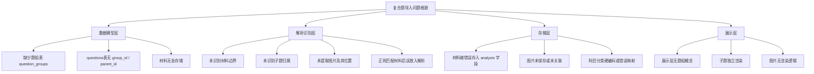
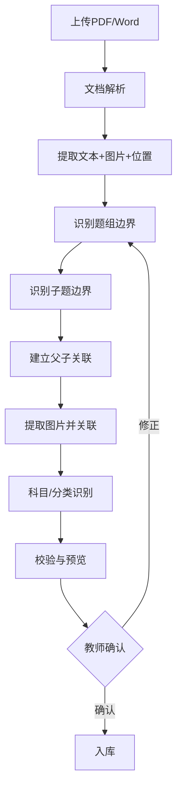

# 复合题（资料分析/材料题）导入匹配与展示完整设计方案


## 文档说明

- **文档版本**：v1.0
- **编写日期**：2026年10月
- **编写目的**：针对行测资料分析、申论材料题、公专情境题等复合题在导入、识别、匹配、展示各环节存在的问题，制定全方位、可落地的完整方案
- **适用对象**：前端开发人员、后端开发人员、AI辅助开发人员


## 第一部分：问题深度诊断

### 一、现有截图暴露的核心问题

| 问题编号 | 问题描述 | 截图证据 | 严重程度 |
|---------|---------|---------|---------|
| **P1** | 复合题被拆分为独立子题 | 第96、97、98题各自独立展示，无父子关联 | 🔴 致命 |
| **P2** | 主材料被错误塞进每道子题的解析中 | 每道题的"题目解析"区域都重复了同一段材料 | 🔴 致命 |
| **P3** | 材料内容被分割缺失 | 解析中的材料只显示了一部分，后续段落丢失 | 🔴 致命 |
| **P4** | 题目中的图片完全丢失 | 截图4中图1、图2是统计图，但导入后没有任何图片展示 | 🔴 致命 |
| **P5** | 科目分类错误 | 资料分析题显示为"公专"，实际应为"行测" | 🟠 高 |
| **P6** | 子题答案正确但归属关系错误 | 96/97/98各自独立，无法体现"96-98共用材料" | 🔴 致命 |
| **P7** | 缺少题组整体预览 | 教师无法核对材料是否完整 | 🟠 高 |
| **P8** | 无解析时提示但无引导 | 第102题显示"暂无论答案解析"，但缺少一键补充入口 | 🟡 中 |

### 二、问题根因分析




## 第二部分：数据模型重构

### 一、核心表结构

**表1：`question_groups`（题组/材料表）**

| 字段 | 类型 | 描述 |
|------|------|------|
| `id` | BIGINT PK | 题组ID |
| `group_type` | VARCHAR(20) | 类型：`data_analysis` / `material` / `scenario` / `passage` |
| `title` | VARCHAR(200) | 题组标题（如“根据以下资料，回答96-98题”） |
| `shared_content` | TEXT | 材料纯文本内容 |
| `shared_content_html` | TEXT | 材料HTML内容（含图片占位） |
| `shared_images` | JSON | 材料图片列表：`[{"id":"img_001","url":"/uploads/m1.png","position":0}]` |
| `shared_tables` | JSON | 材料中的表格数据 |
| `subject` | VARCHAR(20) | 科目：`行测` / `申论` / `公专` |
| `category` | VARCHAR(50) | 分类：`资料分析` / `归纳概括` / `情境题` |
| `source_paper` | VARCHAR(200) | 来源试卷名称 |
| `source_year` | INT | 年份 |
| `import_batch_id` | BIGINT | 导入批次ID |
| `created_at` | DATETIME | |
| `updated_at` | DATETIME | |

**表2：`questions`（子题表）- 扩展字段**

| 字段 | 类型 | 描述 |
|------|------|------|
| `id` | BIGINT PK | 子题ID |
| `group_id` | INT | 所属题组ID（FK → question_groups.id） |
| `group_sort` | INT | 在题组中的排序（如1=96题，2=97题） |
| `question_number` | VARCHAR(10) | 原题号（如“96”） |
| `content` | TEXT | 子题题干纯文本 |
| `content_html` | TEXT | 子题题干HTML（含图片占位） |
| `content_images` | JSON | 题干图片列表 |
| `options` | JSON | 选项列表，每项含 `text` 和 `images` |
| `answer` | VARCHAR(50) | 正确答案 |
| `type` | VARCHAR(20) | 题型：`single` / `multiple` / `judge` / `subjective` |
| `score` | DECIMAL(5,2) | 分值 |
| `analysis` | TEXT | 解析纯文本 |
| `analysis_html` | TEXT | 解析HTML |
| `analysis_images` | JSON | 解析图片列表 |
| `knowledge_point_id` | INT | 知识点ID |
| `created_at` | DATETIME | |

**表3：`question_images`（题目图片表）**

| 字段 | 类型 | 描述 |
|------|------|------|
| `id` | BIGINT PK | 图片ID |
| `question_id` | INT | 所属子题ID（可为空） |
| `group_id` | INT | 所属题组ID（可为空） |
| `image_type` | VARCHAR(20) | 类型：`material` / `content` / `option` / `analysis` |
| `image_url` | VARCHAR(300) | 图片存储路径 |
| `image_alt` | VARCHAR(200) | 图片说明 |
| `position` | INT | 在所属字段中的位置索引 |
| `created_at` | DATETIME | |


## 第三部分：导入识别算法设计

### 一、整体识别流程



### 二、题组边界识别算法

#### 2.1 材料起始识别规则

```python
import re

class GroupBoundaryDetector:
    """题组边界检测器"""
    
    # 题组标题模式（高优先级）
    GROUP_TITLE_PATTERNS = [
        r'根据以下(?:资料|材料|文字|图表|情境).*?回答\s*(\d+)\s*[-～~]\s*(\d+)\s*题',
        r'根据(?:上述|以下|给定)(?:资料|材料|文字|图表|情境).*?回答',
        r'阅读以下(?:资料|材料|文字|图表).*?回答',
        r'(?:请)?根据(?:资料|材料|文字|图表)回答',
    ]
    
    # 大题号模式（如“五、资料分析”）
    SECTION_PATTERNS = [
        r'^[一二三四五六七八九十]+[、\.]\s*(?:资料分析|归纳概括|综合分析)',
        r'^第[一二三四五六七八九十]+部分',
    ]
    
    # 子题号模式（用于判断是否离开题组范围）
    QUESTION_NUMBER_PATTERN = r'^\s*(\d{2,3})\s*[、\.]\s*'
    
    def detect_group_start(self, text: str) -> dict:
        """检测题组起始位置"""
        for pattern in self.GROUP_TITLE_PATTERNS:
            match = re.search(pattern, text)
            if match:
                return {
                    'found': True,
                    'title': match.group(0),
                    'start_pos': match.start(),
                    'question_range': (match.group(1), match.group(2)) if match.groups() else None,
                    'type': 'group_title'
                }
        return {'found': False}
    
    def detect_section_start(self, text: str) -> dict:
        """检测大题号（如“五、资料分析”）"""
        for pattern in self.SECTION_PATTERNS:
            match = re.search(pattern, text, re.MULTILINE)
            if match:
                return {
                    'found': True,
                    'section_title': match.group(0),
                    'start_pos': match.start()
                }
        return {'found': False}
```

#### 2.2 材料内容提取

```python
class MaterialExtractor:
    """材料内容提取器"""
    
    def extract_material(self, text: str, group_start: int, first_question_pos: int) -> dict:
        """
        提取材料内容
        材料范围：从题组标题之后，到第一道子题之前
        """
        material_text = text[group_start:first_question_pos].strip()
        
        # 清理材料中的页眉页脚
        material_text = self._clean_material(material_text)
        
        # 识别材料中的图片位置标记
        material_text, images = self._extract_image_markers(material_text)
        
        return {
            'text': material_text,
            'html': self._text_to_html(material_text, images),
            'images': images
        }
    
    def _clean_material(self, text: str) -> str:
        """清理材料中的无关内容"""
        # 移除页码
        text = re.sub(r'\n\s*\d+\s*\n', '\n', text)
        # 移除页眉页脚
        text = re.sub(r'第\s*\d+\s*页', '', text)
        # 合并多余换行
        text = re.sub(r'\n{3,}', '\n\n', text)
        return text.strip()
    
    def _extract_image_markers(self, text: str) -> tuple:
        """提取图片标记"""
        images = []
        # 匹配 [图片]、[图1]、[图2] 等标记
        pattern = r'\[(?:图片|图\d+)\]'
        # 在实际实现中，这里需要与文档解析层联动，
        # 根据图片在文档中的实际位置插入占位符
        return text, images
```

### 三、子题识别与关联算法

```python
class ChildQuestionParser:
    """子题解析器"""
    
    QUESTION_PATTERN = re.compile(r'^\s*(\d{2,3})\s*[、\.]\s*(.+)', re.MULTILINE)
    OPTION_PATTERN = re.compile(r'^\s*([A-F])\s*[、\.]\s*(.+)', re.MULTILINE)
    ANSWER_PATTERN = re.compile(r'(?:答案|正确答案)[：:]\s*([A-F、,，\s]+)')
    ANALYSIS_PATTERN = re.compile(r'(?:解析|答案解析)[：:]\s*(.+)', re.DOTALL)
    
    def parse_questions(self, text: str, question_range: tuple) -> list:
        """
        解析题组内的子题
        question_range: (起始题号, 结束题号)，如 ('96', '98')
        """
        questions = []
        start_num = int(question_range[0])
        end_num = int(question_range[1])
        
        # 按题号分割文本
        segments = self._split_by_question_number(text, start_num, end_num)
        
        for num, segment in segments:
            question = self._parse_single_question(num, segment)
            if question:
                questions.append(question)
        
        return questions
    
    def _split_by_question_number(self, text: str, start: int, end: int) -> list:
        """按题号分割文本"""
        segments = []
        current_num = None
        current_text = []
        
        for line in text.split('\n'):
            match = self.QUESTION_PATTERN.match(line)
            if match:
                num = int(match.group(1))
                if start <= num <= end:
                    # 保存上一题
                    if current_num is not None:
                        segments.append((current_num, '\n'.join(current_text)))
                    current_num = num
                    current_text = [line]
                else:
                    # 超出范围，停止
                    if current_num is not None:
                        segments.append((current_num, '\n'.join(current_text)))
                        current_num = None
                        current_text = []
            elif current_num is not None:
                current_text.append(line)
        
        # 保存最后一题
        if current_num is not None:
            segments.append((current_num, '\n'.join(current_text)))
        
        return segments
    
    def _parse_single_question(self, num: int, text: str) -> dict:
        """解析单道子题"""
        # 提取题干
        content_match = self.QUESTION_PATTERN.match(text)
        content = content_match.group(2) if content_match else text
        
        # 提取选项
        options = []
        for match in self.OPTION_PATTERN.finditer(text):
            option_text = match.group(2).strip()
            options.append({
                'label': match.group(1),
                'text': option_text,
                'images': []  # 图片后续关联
            })
        
        # 提取答案
        answer_match = self.ANSWER_PATTERN.search(text)
        answer = answer_match.group(1).strip() if answer_match else ''
        
        # 提取解析
        analysis_match = self.ANALYSIS_PATTERN.search(text)
        analysis = analysis_match.group(1).strip() if analysis_match else ''
        
        return {
            'question_number': str(num),
            'content': content,
            'options': options,
            'answer': answer,
            'analysis': analysis,
            'type': self._detect_type(options, answer)
        }
    
    def _detect_type(self, options: list, answer: str) -> str:
        """检测题型"""
        if not options:
            return 'subjective'
        if ',' in answer or '、' in answer:
            return 'multiple'
        return 'single'
```

### 四、图片提取与关联算法

```python
class ImageExtractor:
    """图片提取与关联器"""
    
    def extract_images_with_position(self, docx_path: str) -> list:
        """
        从Word文档中提取图片及其位置
        返回：[{blob, position, context}]
        """
        from docx import Document
        doc = Document(docx_path)
        
        images = []
        para_index = 0
        
        for para in doc.paragraphs:
            # 检测段落中的图片
            for run in para.runs:
                if run._element.findall('.//{http://schemas.openxmlformats.org/drawingml/2006/main}blip'):
                    # 该段落包含图片
                    for rel_id in self._get_image_rel_ids(run):
                        rel = doc.part.rels.get(rel_id)
                        if rel and "image" in rel.target_ref:
                            images.append({
                                'blob': rel.target_part.blob,
                                'position': para_index,
                                'context': para.text,  # 图片所在段落的文字
                                'index_in_para': 0
                            })
            para_index += 1
        
        return images
    
    def associate_images_to_fields(self, images: list, group: dict, questions: list) -> dict:
        """
        将图片关联到对应字段
        根据图片在文档中的位置和上下文判断归属
        """
        for img in images:
            context = img.get('context', '')
            
            # 判断图片归属
            if self._is_material_image(img, group):
                group['shared_images'].append(img)
            elif self._is_option_image(img, questions):
                self._attach_to_option(img, questions)
            elif self._is_analysis_image(img, questions):
                self._attach_to_analysis(img, questions)
            else:
                # 默认归属到最近的子题题干
                self._attach_to_content(img, questions)
        
        return {'group': group, 'questions': questions}
    
    def _is_material_image(self, img: dict, group: dict) -> bool:
        """判断是否为材料图片"""
        # 图片位置在材料范围内
        material_start = group.get('material_start_pos', 0)
        material_end = group.get('material_end_pos', 0)
        return material_start <= img['position'] <= material_end
```

### 五、科目与分类识别

```python
class SubjectClassifier:
    """科目分类器"""
    
    SUBJECT_KEYWORDS = {
        '行测': ['资料分析', '数量关系', '判断推理', '言语理解', '常识判断', '政治理论', '知觉速度'],
        '申论': ['归纳概括', '综合分析', '提出对策', '应用文写作', '议论文写作', '给定资料'],
        '公专': ['职业素养', '基本警务能力', '基础知识', '情境材料', '公安专业'],
    }
    
    CATEGORY_KEYWORDS = {
        '资料分析': ['资料分析', '统计', '图表', '增长率', '比重'],
        '归纳概括': ['归纳概括', '概括', '总结'],
        '情境题': ['情境材料', '情境', '案例'],
    }
    
    def classify(self, text: str, title: str = '') -> dict:
        """分类科目和题型"""
        full_text = title + ' ' + text
        
        # 科目识别
        subject_scores = {}
        for subject, keywords in self.SUBJECT_KEYWORDS.items():
            score = sum(1 for kw in keywords if kw in full_text)
            subject_scores[subject] = score
        
        subject = max(subject_scores, key=subject_scores.get)
        
        # 分类识别
        category = '未分类'
        for cat, keywords in self.CATEGORY_KEYWORDS.items():
            if any(kw in full_text for kw in keywords):
                category = cat
                break
        
        return {
            'subject': subject,
            'category': category,
            'confidence': subject_scores[subject] / max(len(self.SUBJECT_KEYWORDS[subject]), 1)
        }
```

**关键修复**：在截图中，资料分析题被错误分类为“公专”，此算法可正确识别为“行测-资料分析”。


## 第四部分：导入预览与教师确认界面

### 一、题组预览页面设计

```
┌─────────────────────────────────────────────────────────────────────────────┐
│  ← 返回    导入预览 - 2024公基学霸三色笔记.pdf                            │
├─────────────────────────────────────────────────────────────────────────────┤
│  📊 导入统计：识别 3 个题组 | 12 道子题 | 4 张图片 | 0 个错误 | 1 个警告   │
├─────────────────────────────────────────────────────────────────────────────┤
│                                                                             │
│  ┌─────────────────────────────────────────────────────────────────────┐   │
│  │  📖 题组 1 · 资料分析 · 行测                                      │   │
│  │  ┌──────────────────────────────────────────────────────────────┐  │   │
│  │  │  【材料】                                                    │  │   │
│  │  │  2021年中国雨季特征为华南前汛期于4月26日开始，7月2日结束... │  │   │
│  │  │  （完整材料内容展示，确保不缺失）                            │  │   │
│  │  └──────────────────────────────────────────────────────────────┘  │   │
│  │                                                                     │   │
│  │  ┌──────────────────────────────────────────────────────────────┐  │   │
│  │  │  [子题1 96] [子题2 97] [子题3 98]  ← Tab切换                │  │   │
│  │  ├──────────────────────────────────────────────────────────────┤  │   │
│  │  │  第96题（单选题，2分）                                      │  │   │
│  │  │  正常年份雨季长度最长的地区是：                             │  │   │
│  │  │  A. 华南  B. 西南  C. 东北  D. 华西                        │  │   │
│  │  │  ✅ 正确答案：B                                              │  │   │
│  │  │  📝 解析：定位文字材料第一段可得...                          │  │   │
│  │  │  🖼️ 图片：无                                                │  │   │
│  │  └──────────────────────────────────────────────────────────────┘  │   │
│  │                                                                     │   │
│  │  [编辑材料] [调整子题顺序] [删除题组] [确认入库]                   │   │
│  └─────────────────────────────────────────────────────────────────────┘   │
│                                                                             │
│  ┌─────────────────────────────────────────────────────────────────────┐   │
│  │  📖 题组 2 · 资料分析 · 行测                                      │   │
│  │  ┌──────────────────────────────────────────────────────────────┐  │   │
│  │  │  【材料】                                                    │  │   │
│  │  │  2021年，全国城市供水总量673.34亿立方米...                   │  │   │
│  │  │  [图片1：2012-2021年全国城市人均日生活用水量]                │  │   │
│  │  │  [图片2：2021年全国部分省（区、市）城市人均日生活用水量]     │  │   │
│  │  └──────────────────────────────────────────────────────────────┘  │   │
│  │                                                                     │   │
│  │  [子题1 101] [子题2 102] [子题3 103] [子题4 104]                  │   │
│  │                                                                     │   │
│  │  ⚠️ 警告：第102题缺少文字解析，但有图片解析                       │   │
│  │  [查看图片解析] [补充文字解析]                                      │   │
│  └─────────────────────────────────────────────────────────────────────┘   │
│                                                                             │
│  [全部确认入库] [逐个确认] [取消导入]                                      │
└─────────────────────────────────────────────────────────────────────────────┘
```

### 二、图片预览组件

```
┌─────────────────────────────────────────────────────────────────────────────┐
│  🖼️ 图片预览 - 题组2 材料图片                                             │
├─────────────────────────────────────────────────────────────────────────────┤
│                                                                             │
│  ┌─────────────────────────────────────────────────────────────────────┐   │
│  │                                                                     │   │
│  │                     [图片1：柱状图]                                 │   │
│  │                                                                     │   │
│  │              图1：2012—2021年全国城市人均日生活用水量              │   │
│  │                                                                     │   │
│  └─────────────────────────────────────────────────────────────────────┘   │
│                                                                             │
│  ┌─────────────────────────────────────────────────────────────────────┐   │
│  │                                                                     │   │
│  │                     [图片2：柱状图]                                 │   │
│  │                                                                     │   │
│  │      图2：2021年全国部分省（区、市）城市人均日生活用水量           │   │
│  │                                                                     │   │
│  └─────────────────────────────────────────────────────────────────────┘   │
│                                                                             │
│  [确认图片正确] [替换图片] [删除图片] [添加图片说明]                       │
└─────────────────────────────────────────────────────────────────────────────┘
```


## 第五部分：学生端答题展示设计

### 一、题组答题页面（材料吸顶 + 子题滚动）

```
┌─────────────────────────────────────────────────────────────────────────────┐
│  ← 返回    2024年行测真题 - 资料分析          ⏱️ 01:23:45   [交卷]        │
├─────────────────────────────────────────────────────────────────────────────┤
│  第 96-98 题 · 资料分析 · 共6分            进度 ████████░░░░ 20%          │
├───────────────────────────────┬─────────────────────────────────────────────┤
│  ┌─────────────────────────┐  │  ┌─────────────────────────────────────┐   │
│  │  📖 材料（可折叠）       │  │  │  📋 答题卡                        │   │
│  │  ┌─────────────────────┐│  │  │  96 97 98                         │   │
│  │  │ 2021年中国雨季特征  ││  │  │  ●  ●  ○                          │   │
│  │  │ 为华南前汛期于4月   ││  │  └─────────────────────────────────────┘   │
│  │  │ 26日开始...         ││  │                                         │
│  │  │ （完整材料）        ││  │  ┌─────────────────────────────────────┐   │
│  │  └─────────────────────┘│  │  │  📝 笔记                          │   │
│  └─────────────────────────┘  │  │  在此记录你的思考...              │   │
│                                │  └─────────────────────────────────────┘   │
│  ┌─────────────────────────┐  │                                         │
│  │  第96题（单选题，2分）   │  │                                         │
│  │  正常年份雨季长度最长   │  │                                         │
│  │  的地区是：             │  │                                         │
│  │  ○ A. 华南              │  │                                         │
│  │  ○ B. 西南              │  │                                         │
│  │  ○ C. 东北              │  │                                         │
│  │  ○ D. 华西              │  │                                         │
│  └─────────────────────────┘  │                                         │
│                                │                                         │
│  ┌─────────────────────────┐  │                                         │
│  │  第97题（单选题，2分）   │  │                                         │
│  │  2021年雨季开始时间最   │  │                                         │
│  │  迟的两个地区在雨季开   │  │                                         │
│  │  始时间上相差了：       │  │                                         │
│  │  ○ A. 34天  ○ B. 35天   │  │                                         │
│  │  ○ C. 41天  ○ D. 42天   │  │                                         │
│  └─────────────────────────┘  │                                         │
│                                │                                         │
│  ┌─────────────────────────┐  │                                         │
│  │  第98题（单选题，2分）   │  │                                         │
│  │  下列地区中2021年雨季   │  │                                         │
│  │  期平均每天降雨量最大   │  │                                         │
│  │  的地区是：             │  │                                         │
│  │  ○ A. 西南  ○ B. 华北   │  │                                         │
│  │  ○ C. 东北  ○ D. 华西   │  │                                         │
│  └─────────────────────────┘  │                                         │
├───────────────────────────────┴─────────────────────────────────────────────┤
│  [← 上一题]  [下一题 →]  [⭐ 收藏]  [🚩 标记]          [提交答案]       │
└─────────────────────────────────────────────────────────────────────────────┘
```

### 二、材料吸顶实现

```vue
<template>
  <div class="composite-question">
    <!-- 材料区域（吸顶） -->
    <div class="material-section" :class="{ sticky: isSticky }">
      <div class="material-header" @click="toggleMaterial">
        <span>📖 材料</span>
        <span>{{ isExpanded ? '▼' : '▶' }}</span>
      </div>
      <div v-show="isExpanded" class="material-content">
        <div v-html="group.shared_content_html"></div>
        
      </div>
    </div>
    
    <!-- 子题列表 -->
    <div class="child-questions">
      <div v-for="(q, idx) in group.questions" :key="q.id" :id="`q-${q.id}`">
        <QuestionItem :question="q" :index="idx" />
      </div>
    </div>
  </div>
</template>

<script setup>
import { ref, onMounted, onUnmounted } from 'vue'

const isSticky = ref(false)
const isExpanded = ref(true)

const handleScroll = () => {
  const materialSection = document.querySelector('.material-section')
  if (materialSection) {
    const rect = materialSection.getBoundingClientRect()
    isSticky.value = rect.top <= 0
  }
}

onMounted(() => {
  window.addEventListener('scroll', handleScroll)
})

onUnmounted(() => {
  window.removeEventListener('scroll', handleScroll)
})
</script>

<style scoped>
.material-section.sticky {
  position: sticky;
  top: 0;
  z-index: 10;
  background: white;
  box-shadow: 0 2px 8px rgba(0,0,0,0.1);
}
.material-content img {
  max-width: 100%;
  height: auto;
  cursor: pointer;
  border-radius: 4px;
  margin: 8px 0;
}
</style>
```


## 第六部分：教师端/管理员端展示设计

### 一、题目管理列表（题组整体展示）

```
┌─────────────────────────────────────────────────────────────────────────────┐
│  📝 题目管理                     [+ 自设计题目] [批量导入] [导出]           │
├─────────────────────────────────────────────────────────────────────────────┤
│  筛选：科目[全部▼] 题型[全部▼] 难度[全部▼] 知识点[全部▼] 搜索[____]      │
├─────────────────────────────────────────────────────────────────────────────┤
│                                                                             │
│  ┌─────────────────────────────────────────────────────────────────────┐   │
│  │  ☐ 📖 题组 · 资料分析 · 行测 · 3子题                          ▼   │   │
│  │  ┌──────────────────────────────────────────────────────────────┐  │   │
│  │  │  材料：2021年中国雨季特征为华南前汛期于4月26日开始...       │  │   │
│  │  │  子题：96、97、98（共3题，6分）                            │  │   │
│  │  │  图片：0张 | 解析：3/3 | 来源：2024公基学霸三色笔记.pdf    │  │   │
│  │  │  状态：✅ 已审核 | 创建者：张老师 | 2026-10-11             │  │   │
│  │  │  [展开查看子题] [编辑材料] [调整顺序] [删除题组]           │  │   │
│  │  └──────────────────────────────────────────────────────────────┘  │   │
│  │                                                                     │   │
│  │  展开后：                                                           │   │
│  │  ┌──────────────────────────────────────────────────────────────┐  │   │
│  │  │  第96题（单选）正常年份雨季长度最长的地区是... [编辑] [删除]│  │   │
│  │  │  第97题（单选）2021年雨季开始时间最迟...      [编辑] [删除]│  │   │
│  │  │  第98题（单选）下列地区中2021年雨季期平均...  [编辑] [删除]│  │   │
│  │  └──────────────────────────────────────────────────────────────┘  │   │
│  └─────────────────────────────────────────────────────────────────────┘   │
│                                                                             │
│  ┌─────────────────────────────────────────────────────────────────────┐   │
│  │  ☐ 📖 题组 · 资料分析 · 行测 · 4子题                          ▼   │   │
│  │  ┌──────────────────────────────────────────────────────────────┐  │   │
│  │  │  材料：2021年，全国城市供水总量673.34亿立方米...            │  │   │
│  │  │  🖼️ 图片：2张（图1、图2）                                  │  │   │
│  │  │  子题：101、102、103、104（共4题，8分）                    │  │   │
│  │  │  状态：⚠️ 第102题缺文字解析 | 创建者：张老师 | 2026-10-11   │  │   │
│  │  │  [展开查看子题] [编辑材料] [补充解析] [删除题组]           │  │   │
│  │  └──────────────────────────────────────────────────────────────┘  │   │
│  └─────────────────────────────────────────────────────────────────────┘   │
│                                                                             │
│  共 156 个题组 + 1,256 道单题  第 1/63 页  [1] [2] [3] ... [63]           │
└─────────────────────────────────────────────────────────────────────────────┘
```

### 二、题组编辑页面

```
┌─────────────────────────────────────────────────────────────────────────────┐
│  ✏️ 编辑题组 - 资料分析 · 行测                              [保存] [取消]  │
├─────────────────────────────────────────────────────────────────────────────┤
│                                                                             │
│  ┌─ 题组信息 ──────────────────────────────────────────────────────────┐   │
│  │  科目：[行测 ▼]  分类：[资料分析 ▼]  难度：[中等 ▼]                │   │
│  │  来源：[2024公基学霸三色笔记.pdf]  年份：[2024]                     │   │
│  └─────────────────────────────────────────────────────────────────────┘   │
│                                                                             │
│  ┌─ 材料内容 ──────────────────────────────────────────────────────────┐   │
│  │  [富文本编辑器]                                                     │   │
│  │  2021年中国雨季特征为华南前汛期于4月26日开始，7月2日结束...        │   │
│  │  [插入图片] [插入表格] [插入公式]                                   │   │
│  └─────────────────────────────────────────────────────────────────────┘   │
│                                                                             │
│  ┌─ 材料图片 ──────────────────────────────────────────────────────────┐   │
│  │  ┌─────────────┐ ┌─────────────┐                                   │   │
│  │  │  [图片1]    │ │  [图片2]    │  [+ 添加图片]                     │   │
│  │  │  图1说明    │ │  图2说明    │                                   │   │
│  │  └─────────────┘ └─────────────┘                                   │   │
│  └─────────────────────────────────────────────────────────────────────┘   │
│                                                                             │
│  ┌─ 子题列表 ──────────────────────────────────────────────────────────┐   │
│  │  ┌──────────────────────────────────────────────────────────────┐   │   │
│  │  │  [第96题] 正常年份雨季长度最长的地区是：                    │   │   │
│  │  │  A. 华南  B. 西南  C. 东北  D. 华西                        │   │   │
│  │  │  答案：B  解析：定位文字材料第一段可得...                  │   │   │
│  │  │  [编辑] [上移] [下移] [删除]                               │   │   │
│  │  └──────────────────────────────────────────────────────────────┘   │   │
│  │  ┌──────────────────────────────────────────────────────────────┐   │   │
│  │  │  [第97题] 2021年雨季开始时间最迟的两个地区...              │   │   │
│  │  │  ...                                                        │   │   │
│  │  │  [编辑] [上移] [下移] [删除]                               │   │   │
│  │  └──────────────────────────────────────────────────────────────┘   │   │
│  │  [+ 添加子题]                                                      │   │
│  └─────────────────────────────────────────────────────────────────────┘   │
│                                                                             │
│  [保存并继续编辑] [保存并关闭]                                             │
└─────────────────────────────────────────────────────────────────────────────┘
```


## 第七部分：图片全链路处理方案

### 一、图片处理流程

```mermaid
flowchart TD
    A[文档中的图片] --> B[提取图片二进制]
    B --> C[保存到文件存储]
    C --> D[生成缩略图]
    D --> E[记录图片元数据]
    E --> F[关联到字段]
    
    F --> G{图片类型}
    G -->|材料图片| H[group.shared_images]
    G -->|题干图片| I[question.content_images]
    G -->|选项图片| J[question.options[].images]
    G -->|解析图片| K[question.analysis_images]
    
    H --> L[前端渲染]
    I --> L
    J --> L
    K --> L
```

### 二、图片存储规范

| 存储项 | 路径规范 | 示例 |
|--------|---------|------|
| **原图** | `/uploads/questions/{year}/{month}/{uuid}.png` | `/uploads/questions/2026/10/abc123.png` |
| **缩略图** | `/uploads/questions/{year}/{month}/thumb_{uuid}.png` | `/uploads/questions/2026/10/thumb_abc123.png` |
| **材料图** | `/uploads/materials/{year}/{month}/{uuid}.png` | `/uploads/materials/2026/10/def456.png` |

### 三、图片渲染组件

```vue
<template>
  <div class="image-container">
    <!-- 题干图片 -->
    <div v-if="contentImages.length" class="content-images">
      
    </div>
    
    <!-- 选项图片 -->
    <div v-for="opt in options" :key="opt.label" class="option-item">
      <span class="option-label">{{ opt.label }}.</span>
      <span v-if="opt.text">{{ opt.text }}</span>
      
    </div>
    
    <!-- 解析图片 -->
    <div v-if="analysisImages.length" class="analysis-images">
      
    </div>
  </div>
</template>

<script setup>
const props = defineProps({
  contentImages: { type: Array, default: () => [] },
  options: { type: Array, default: () => [] },
  analysisImages: { type: Array, default: () => [] }
})

const previewImage = (img) => {
  // 打开图片预览弹窗
  emit('preview', img)
}

const handleImageError = (e) => {
  e.target.src = '/images/placeholder.png'
}
</script>
```


## 第八部分：完整实施优先级

| 优先级 | 任务 | 说明 |
|--------|------|------|
| **P0** | 创建 `question_groups` 表 | 数据模型基础 |
| **P0** | 为 `questions` 表增加 `group_id` / `group_sort` | 父子关联 |
| **P0** | 创建 `question_images` 表 | 图片存储 |
| **P0** | 实现题组边界识别算法 | 材料识别 |
| **P0** | 实现子题识别与关联算法 | 子题归属 |
| **P0** | 实现图片提取与关联算法 | 图片不丢失 |
| **P0** | 修复科目分类算法 | 资料分析→行测 |
| **P0** | 学生端题组答题页面（材料吸顶+子题滚动） | 核心展示 |
| **P1** | 导入预览页面（题组整体展示） | 教师确认 |
| **P1** | 教师端题组管理（整体展示+子题展开） | 管理界面 |
| **P1** | 题组编辑页面 | 内容修正 |
| **P2** | 图片预览组件 | 增强体验 |
| **P2** | 题组搜索与筛选 | 增强功能 |
| **P3** | 题组版本管理 | 增强功能 |


## 第九部分：总结

| 设计维度 | 核心内容 |
|---------|---------|
| **数据模型** | `question_groups`（题组）+ `questions`（子题，含`group_id`）+ `question_images`（图片） |
| **导入识别** | 题组边界识别 → 材料提取 → 子题分割 → 父子关联 → 图片提取 → 科目分类 |
| **材料处理** | 独立存储于`question_groups.shared_content`，不再塞入解析 |
| **图片处理** | 按位置和上下文关联到材料/题干/选项/解析，存储于`question_images`表 |
| **科目分类** | 基于关键词的自动分类，资料分析→行测 |
| **学生端展示** | 材料吸顶 + 子题滚动，保持上下文完整 |
| **教师端展示** | 题组整体展示，子题可展开编辑，支持调整顺序 |
| **导入预览** | 完整展示材料+所有子题+图片，教师确认后入库 |

通过以上方案，复合题的导入、识别、匹配、展示全链路问题将得到系统性解决，确保题目内容完整、图片不丢失、科目分类正确、学生和教师都能获得良好的使用体验。