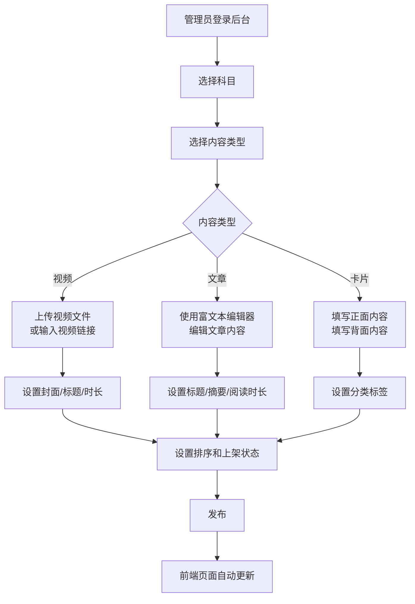
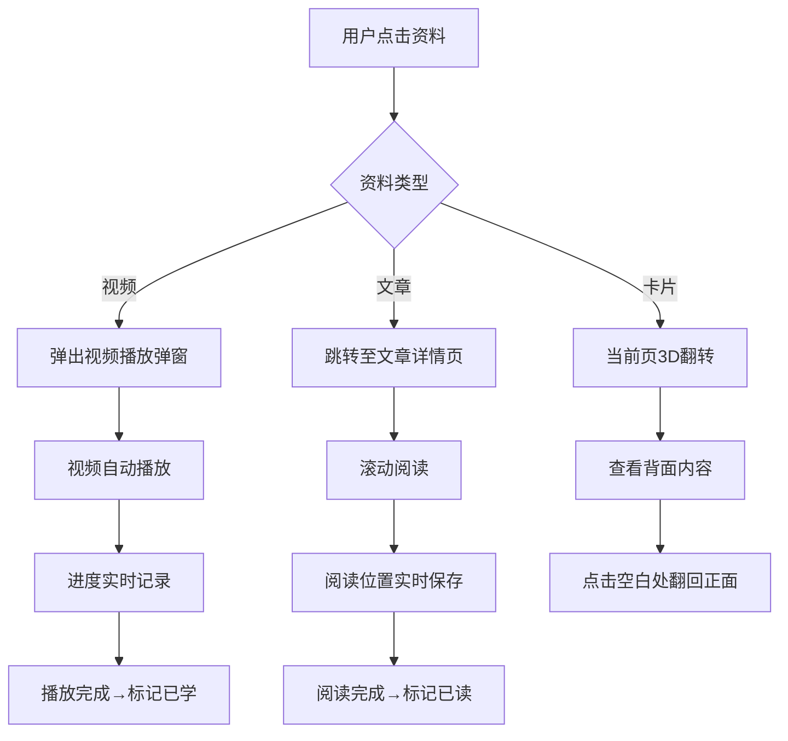

# 学生端“备考资料”功能模块设计方案


## 文档说明

- **文档版本**：v1.0
- **编写日期**：2026年8月
- **编写目的**：针对学生端“备考资料”功能模块进行从零到一的完整设计，涵盖内容组织、交互体验、管理后台、技术实现等全方位方案，确保学生能够高效获取备考知识，提升学习体验。
- **适用对象**：前后端开发人员、产品设计师


## 一、功能定位与设计理念

### 1.1 功能定位

“备考资料”是学生端**知识学习与入门引导**的核心入口，定位为“联考知识的第一站”，旨在帮助学生：

| 目标 | 说明 |
|------|------|
| **快速入门** | 通过入门视频和知识卡片，快速了解各科目“考什么、怎么考” |
| **深度拓展** | 通过深度解析视频和进阶内容，掌握解题规律和高分技巧 |
| **碎片化学习** | 通过卡片式设计，支持碎片时间高效学习 |
| **沉浸式体验** | 通过卡片翻转动效、视觉引导等，提升学习趣味性和沉浸感 |

### 1.2 设计理念

| 理念 | 说明 |
|------|------|
| **渐进式引导** | 从“入门→进阶→实战”渐进式内容组织，符合学习认知规律 |
| **多媒体融合** | 视频+图文+卡片+思维导图多模态内容，适配不同学习偏好 |
| **轻量交互** | 卡片翻转、折叠展开、弹窗播放，减少页面跳转，保持沉浸感 |
| **可管理性** | 内容通过后台管理，避免前端硬编码，支持动态更新 |
| **移动优先** | 适配手机端，支持碎片化学习场景 |

### 1.3 补充功能建议

在用户原有需求基础上，建议补充以下功能，提升完整性和实用性：

| 补充功能 | 说明 |
|---------|------|
| **学习进度追踪** | 记录每个资料的学习状态（未学/学习中/已完成），显示学习进度百分比 |
| **收藏功能** | 支持收藏重要资料，在“我的收藏”中集中查看 |
| **资料搜索** | 支持按关键词搜索所有备考资料 |
| **相关推荐** | 当前资料页底部推荐相关内容，形成学习路径 |
| **学习笔记** | 支持在学习资料页面添加个人笔记，关联到“我的笔记” |
| **资料更新标识** | 新增或更新的资料显示“NEW”或“更新”标签，吸引用户关注 |
| **学习排行榜** | 展示学习时长排行榜，增加社交激励 |


## 二、整体功能架构

# 学生端“备考资料”功能模块设计方案（修订版）


## 二、整体功能架构设计（修订版）

### 2.1 模块结构

> **设计说明**：行测、申论、公专三个科目已分别作为独立的一级入口模块设计，不再共存在同一个备考资料页面中。每个科目模块独立承载其完整的资料体系，用户从首页或导航栏分别进入各科目备考资料页面。

#### 2.1.1 整体入口结构

```
备考资料入口（首页/导航）
│
├── 📘 行测备考资料（独立模块）
│   └── 行测资料完整页面
│
├── 📗 申论备考资料（独立模块）
│   └── 申论资料完整页面
│
└── 📕 公专备考资料（独立模块）
    └── 公专资料完整页面
```

#### 2.1.2 单个科目模块内部结构（以行测为例）

```
行测备考资料（独立页面）
│
├── 🎯 模块头部
│   ├── 科目标识（图标+名称+主题色）
│   ├── 科目简介（一句话定位）
│   └── 学习进度概览（X%）
│
├── 🎬 入门讲解视频（独立区块）
│   ├── 区块标题 + 查看全部
│   └── 视频卡片列表（横向滚动）
│
├── 🎬 深度拓展视频（独立区块）
│   ├── 区块标题 + 查看全部
│   └── 视频卡片列表（横向滚动）
│
├── 📋 文字讲解/备考指南（独立区块）
│   ├── 区块标题 + 查看全部
│   └── 文章列表（纵向排列）
│
└── 🃏 知识卡片（独立区块）
    ├── 区块标题 + 查看全部
    └── 卡片网格（网格布局，点击翻转）
```

#### 2.1.3 三科独立模块对比

| 科目 | 模块标识色 | 模块入口 | 资料特色 |
|------|-----------|---------|---------|
| **行测** | 蓝色 `#3B82F6` | 首页/导航 → 行测备考 | 侧重解题规律、速算技巧、高频考点 |
| **申论** | 绿色 `#10B981` | 首页/导航 → 申论备考 | 侧重写作技巧、材料分析、热点素材 |
| **公专** | 橙色 `#F59E0B` | 首页/导航 → 公专备考 | 侧重职业素养卡片、警务技能卡片、基础知识卡片 |


### 2.2 页面布局设计（修订版）

> **设计说明**：以下为**单个科目独立页面**的布局设计，行测、申论、公专各自独立使用此布局模板，仅内容不同。

#### 2.2.1 页面整体布局

```
┌─────────────────────────────────────────────────────────────────────┐
│  ← 返回首页        📘 行测备考资料          [搜索] [收藏] [进度]  │
├─────────────────────────────────────────────────────────────────────┤
│  ┌─────────────────────────────────────────────────────────────┐   │
│  │  行测·行政职业能力测验                                     │   │
│  │  掌握行测五大模块解题规律，快速提升答题速度与准确率         │   │
│  │  学习进度 ████████░░ 72% (已完成 18/25项)                   │   │
│  └─────────────────────────────────────────────────────────────┘   │
├─────────────────────────────────────────────────────────────────────┤
│                                                                     │
│  ┌─ 🎬 入门讲解视频 ────────────────────────────────────────────┐ │
│  │  ┌──────────────┐  ┌──────────────┐  ┌──────────────┐      │ │
│  │  │  [封面图]    │  │  [封面图]    │  │  [封面图]    │      │ │
│  │  │  行测导学     │  │  言语理解    │  │  判断推理    │      │ │
│  │  │  12:30       │  │  18:45      │  │  15:20      │      │ │
│  │  │  ✅ 已学     │  │  ⏳ 进行中   │  │  📌 未学     │      │ │
│  │  └──────────────┘  └──────────────┘  └──────────────┘      │ │
│  │  [更多 →]                                                   │ │
│  └─────────────────────────────────────────────────────────────────┘ │
│                                                                     │
│  ┌─ 🎯 深度拓展视频 ────────────────────────────────────────────┐ │
│  │  ┌──────────────┐  ┌──────────────┐  ┌──────────────┐      │ │
│  │  │  [封面图]    │  │  [封面图]    │  │  [封面图]    │      │ │
│  │  │  资料分析速算 │  │  图形推理    │  │  逻辑判断    │      │ │
│  │  │  25:30 ⭐⭐  │  │  32:15 ⭐⭐  │  │  28:40 ⭐⭐  │      │ │
│  │  └──────────────┘  └──────────────┘  └──────────────┘      │ │
│  │  [更多 →]                                                   │ │
│  └─────────────────────────────────────────────────────────────────┘ │
│                                                                     │
│  ┌─ 📋 备考指南 ──────────────────────────────────────────────────┐ │
│  │  ┌─────────────────────────────────────────────────────────┐  │ │
│  │  │  📄 行测考什么？一篇带你了解行测全貌    阅读 5min   ›  │  │ │
│  │  │  📄 行测各模块分值分布与时间分配策略    阅读 8min   ›  │  │ │
│  │  │  📄 行测高频考点汇总（2026版）         阅读 10min  ›  │  │ │
│  │  └─────────────────────────────────────────────────────────┘  │ │
│  │  [更多 →]                                                   │ │
│  └─────────────────────────────────────────────────────────────────┘ │
│                                                                     │
│  ┌─ 🃏 知识卡片 ──────────────────────────────────────────────────┐ │
│  │  ┌──────┐ ┌──────┐ ┌──────┐ ┌──────┐ ┌──────┐ ┌──────┐  │ │
│  │  │逻辑填空│ │中心理解│ │图形推理│ │类比推理│ │定义判断│ │资料分析│  │ │
│  │  │ 12/20 │ │ 8/15  │ │ 6/12  │ │ 10/18│ │ 5/10 │ │ 8/14 │  │ │
│  │  └──────┘ └──────┘ └──────┘ └──────┘ └──────┘ └──────┘  │ │
│  │  [更多 →]                                                   │ │
│  └─────────────────────────────────────────────────────────────────┘ │
└─────────────────────────────────────────────────────────────────────┘
```

#### 2.2.2 各科目独立模块的差异化设计

**行测科目独特元素**

| 设计元素 | 说明 |
|---------|------|
| 模块标识色 | 蓝色 `#3B82F6` |
| 背景氛围 | 浅蓝色渐变背景 + 几何装饰 |
| 知识卡片分类 | 逻辑填空 / 中心理解 / 图形推理 / 类比推理 / 定义判断 / 资料分析 |
| 特色内容 | 速算技巧视频、高频成语卡片、做题规律总结 |

**申论科目独特元素**

| 设计元素 | 说明 |
|---------|------|
| 模块标识色 | 绿色 `#10B981` |
| 背景氛围 | 浅绿色渐变背景 + 线条装饰 |
| 知识卡片分类 | 规范表达用语 / 热点话题素材 / 高分金句 / 写作框架 |
| 特色内容 | 材料阅读方法视频、写作模板卡片、热点预测 |

**公专科目独特元素**

| 设计元素 | 说明 |
|---------|------|
| 模块标识色 | 橙色 `#F59E0B` |
| 背景氛围 | 浅橙色渐变背景 + 警徽元素 |
| 知识卡片分类 | 职业素养卡片 / 基本警务技能卡片 / 基础知识卡片 |
| 特色内容 | 警务情景模拟视频、法条速记卡片、实战案例卡片 |
| 特殊交互 | 真实卡片翻转效果（模拟警用卡片） |

#### 2.2.3 区块折叠与展开设计

为提升页面浏览效率，每个内容区块支持折叠/展开：

| 状态 | 显示内容 | 操作 |
|------|---------|------|
| **展开（默认）** | 显示前3-4项内容 + “更多”按钮 | 点击“更多”跳转至分类详情页 |
| **折叠** | 仅显示区块标题 + 缩略预览 | 点击区块标题展开 |

#### 2.2.4 空状态设计

当某科目下暂无资料时，显示空状态：

```
┌─────────────────────────────────────────────────────────────────────┐
│  ┌─────────────────────────────────────────────────────────────┐   │
│  │                                                             │   │
│  │              📚 暂无备考资料                               │   │
│  │                                                             │   │
│  │       该科目备考资料正在加紧制作中，敬请期待...             │   │
│  │                                                             │   │
│  │          [返回首页]  [查看其他科目]                         │   │
│  │                                                             │   │
│  └─────────────────────────────────────────────────────────────┘   │
└─────────────────────────────────────────────────────────────────────┘
```


### 2.3 科目独立入口设计

### 2.3.1 入口展示方式

在首页或导航栏中，三个科目以独立入口卡片形式展示：

```
┌─────────────────────────────────────────────────────────────────────┐
│  📚 备考资料                                                       │
├─────────────────────────────────────────────────────────────────────┤
│  ┌──────────────┐  ┌──────────────┐  ┌──────────────┐            │
│  │  📘 行测     │  │  📗 申论     │  │  📕 公专     │            │
│  │  行政职业     │  │  申论写作     │  │  公安专业     │            │
│  │  能力测验     │  │  专项突破     │  │  知识提升     │            │
│  │  进度 72%    │  │  进度 45%    │  │  进度 60%    │            │
│  │  [进入学习]   │  │  [进入学习]   │  │  [进入学习]   │            │
│  └──────────────┘  └──────────────┘  └──────────────┘            │
└─────────────────────────────────────────────────────────────────────┘
```

### 2.3.2 入口交互说明

| 交互行为 | 效果 |
|---------|------|
| 点击卡片 | 跳转至对应科目的独立资料页面 |
| 悬停卡片 | 卡片上浮、阴影加深、显示“进入学习”按钮高亮 |
| 进度显示 | 实时显示该科目学习完成百分比 |

---


## 三、详细功能设计

### 3.1 科目导航设计

| 设计要素 | 说明 |
|---------|------|
| **Tab切换** | 顶部Tab切换行测/申论/公专，切换时内容平滑过渡 |
| **进度显示** | 每个科目Tab旁显示学习进度百分比，如“行测 35%” |
| **视觉区分** | 三个科目使用不同主题色：行测-蓝色、申论-绿色、公专-橙色 |
| **默认选中** | 进入页面时默认选中“行测”Tab |

**交互细节**：
- Tab切换时内容区域淡入淡出动画
- 进度数字实时更新（基于已完成资料/总资料数）
- 有新增资料时Tab显示红点提示

### 3.2 内容分类与展示设计

#### 3.2.1 入门讲解视频

**内容定位**：零基础入门，帮助用户快速了解科目全貌和基本方法

| 展示元素 | 说明 |
|---------|------|
| 视频封面 | 统一尺寸（16:9），显示视频标题和时长 |
| 视频标题 | 简明扼要，如“行测导学：考什么、怎么考” |
| 视频时长 | 显示总时长，如“12:30” |
| 学习状态 | 已看完显示✅，未看显示进度条 |
| 播放按钮 | 鼠标悬停显示▶播放图标 |

**交互方式**：点击视频卡片 → 弹窗播放视频（详见第五章）

#### 3.2.2 深度拓展/进阶视频

**内容定位**：深度解析、解题技巧、高分策略

| 展示元素 | 说明 |
|---------|------|
| 视频封面 | 统一尺寸，左上角显示“进阶”标签 |
| 视频标题 | 如“资料分析速算技巧大全” |
| 视频时长 | 显示总时长 |
| 难度标识 | 显示“⭐”等级（3星为进阶） |
| 学习状态 | 已看完/进行中/未学 |

**交互方式**：点击视频卡片 → 弹窗播放视频

#### 3.2.3 文字讲解/备考指南

**内容定位**：系统化知识讲解、备考策略、考情分析

| 展示元素 | 说明 |
|---------|------|
| 文章标题 | 简明扼要 |
| 内容摘要 | 显示前80字，帮助用户判断是否需要阅读 |
| 阅读时长 | 估算阅读时间，如“阅读 5min” |
| 文章分类 | 显示标签：考情分析/方法指导/高频考点/备考规划 |
| 阅读状态 | 已读/未读 |

**交互方式**：点击文章卡片 → 进入详情页（独立页面，支持滚动阅读、图文混排、图片放大）

**详情页内容结构**：
```
文章标题
├── 元信息（发布时间、阅读时长、分类标签）
├── 正文（富文本）
│   ├── 文字
│   ├── 图片
│   ├── 表格
│   └── 高亮重点
├── 底部操作
│   ├── 收藏
│   ├── 笔记
│   └── 相关推荐（3篇）
└── 学习状态标记
```

#### 3.2.4 知识卡片（带翻转效果）

**内容定位**：碎片化知识，适合快速记忆和复习

| 设计要素 | 说明 |
|---------|------|
| **卡片正面** | 显示知识卡片标题、关键词、分类标签、科目标识色 |
| **卡片背面** | 显示详细知识点、记忆口诀、示例、使用场景 |
| **翻转效果** | 3D CSS翻转动画（Y轴旋转），模拟真实卡片翻动 |
| **卡片尺寸** | 桌面端：120px × 160px；移动端：100px × 140px（适配手机屏幕） |
| **间距与排序** | 卡片之间留16px间距，支持自定义排序（后台管理） |

**交互方式**：
- 点击卡片 → 3D翻转显示背面内容
- 再次点击 → 翻回正面
- 左右滑动 → 切换前后卡片（移动端支持）
- 长按 → 进入“编辑”或“收藏”模式（桌面端支持）

**卡片翻转实现示例**：

```vue
<template>
  <div class="card-container" @click="flipCard">
    <div class="card" :class="{ 'is-flipped': isFlipped }">
      <!-- 卡片正面 -->
      <div class="card-face card-front">
        <div class="card-title">{{ card.title }}</div>
        <div class="card-tag">{{ card.tag }}</div>
        <div class="card-hint">👆 点击翻转</div>
      </div>
      <!-- 卡片背面 -->
      <div class="card-face card-back">
        <div class="card-content">{{ card.content }}</div>
        <div class="card-memory">{{ card.memory_tip }}</div>
      </div>
    </div>
  </div>
</template>

<script setup>
import { ref } from 'vue'

const props = defineProps(['card'])
const isFlipped = ref(false)

const flipCard = () => {
  isFlipped.value = !isFlipped.value
}
</script>

<style scoped>
.card-container {
  perspective: 1000px;
  cursor: pointer;
}

.card {
  width: 100%;
  height: 100%;
  transition: transform 0.6s;
  transform-style: preserve-3d;
  position: relative;
}

.card.is-flipped {
  transform: rotateY(180deg);
}

.card-face {
  position: absolute;
  width: 100%;
  height: 100%;
  backface-visibility: hidden;
  border-radius: 12px;
  padding: 16px;
}

.card-front {
  background: linear-gradient(135deg, #f5f7fa 0%, #c3cfe2 100%);
}

.card-back {
  transform: rotateY(180deg);
  background: #ffffff;
  border: 1px solid #e8ecf1;
}
</style>
```

### 3.3 三科资料内容规划

#### 3.3.1 行测资料内容

| 内容类型 | 具体内容 | 数量建议 |
|---------|---------|---------|
| **入门讲解视频** | 行测导学：考什么、怎么考 | 1-2个 |
| | 行测各模块介绍与分值分布 | 1个 |
| **深度解析视频** | 言语理解高分技巧 | 2-3个 |
| | 判断推理解题套路 | 2-3个 |
| | 资料分析速算技巧 | 2-3个 |
| | 数量关系核心公式 | 2-3个 |
| **文字讲解** | 行测考情分析报告 | 1篇 |
| | 行测各模块备考规划 | 5篇 |
| | 行测高频考点汇总 | 5篇 |
| **知识卡片** | 逻辑填空高频成语 | 10-15张 |
| | 中心理解关键词 | 10-15张 |
| | 图形推理规律速记 | 10-15张 |
| | 类比推理关系分类 | 10-15张 |
| | 资料分析速算公式 | 10-15张 |

#### 3.3.2 申论资料内容

| 内容类型 | 具体内容 | 数量建议 |
|---------|---------|---------|
| **入门讲解视频** | 申论导学：出题规律与评分标准 | 1-2个 |
| | 申论材料阅读方法 | 1个 |
| **进阶视频** | 归纳概括题高分技巧 | 2-3个 |
| | 综合分析题答题逻辑 | 2-3个 |
| | 对策题思维框架 | 2-3个 |
| | 应用文写作模板 | 2-3个 |
| **文字讲解** | 申论考情深度分析 | 1篇 |
| | 申论素材积累指南 | 1篇 |
| | 申论写作常见误区 | 1篇 |
| **知识卡片** | 申论规范表达用语 | 15-20张 |
| | 申论热点话题素材 | 10-15张 |
| | 申论高分金句 | 10-15张 |

#### 3.3.3 公专资料内容

| 内容类型 | 具体内容 | 数量建议 |
|---------|---------|---------|
| **入门讲解视频** | 公专导学：考什么、怎么考 | 1-2个 |
| | 公专题型解析 | 1个 |
| **深度解析视频** | 职业素养考点精讲 | 2-3个 |
| | 公安基础知识精讲 | 2-3个 |
| | 基本警务能力精讲 | 2-3个 |
| **文字讲解** | 公专考情分析报告 | 1篇 |
| | 公专核心法条解读 | 1篇 |
| **知识卡片** | 职业素养知识卡片 | 15-20张 |
| | 基本警务技能卡片 | 15-20张 |
| | 基础知识卡片 | 15-20张 |


## 四、后台管理设计（解决“怎么导入”问题）

### 4.1 管理后台功能

| 功能模块 | 说明 |
|---------|------|
| **资料管理** | 添加、编辑、删除、排序备考资料 |
| **视频管理** | 上传视频、设置封面、填写标题/时长/描述 |
| **文章管理** | 富文本编辑器编辑文章内容，支持图片/表格 |
| **卡片管理** | 创建知识卡片，设置正反面内容、分类标签 |
| **分类管理** | 管理内容分类（入门视频/进阶视频/文字讲解/知识卡片） |
| **发布控制** | 设置发布时间、上下架状态 |
| **数据统计** | 查看各资料的浏览量、学习完成率 |

### 4.2 数据模型设计

**资料主表 `study_materials`**

| 字段 | 类型 | 描述 |
|------|------|------|
| `id` | BIGINT PK | |
| `subject` | VARCHAR(20) | 所属科目：行测/申论/公专 |
| `type` | VARCHAR(20) | 类型：video_intro/video_advanced/article/card |
| `category` | VARCHAR(50) | 分类标签 |
| `title` | VARCHAR(200) | 标题 |
| `summary` | VARCHAR(500) | 摘要 |
| `content` | TEXT | 详细内容（富文本/卡片内容） |
| `cover_image` | VARCHAR(200) | 封面图URL |
| `video_url` | VARCHAR(200) | 视频URL |
| `duration` | INT | 视频时长（秒） |
| `read_time` | INT | 阅读时长（分钟） |
| `difficulty_level` | TINYINT | 难度等级（1-3） |
| `tags` | JSON | 标签列表 |
| `sort_order` | INT | 排序 |
| `status` | TINYINT | 状态：1上架/0下架 |
| `view_count` | INT | 浏览量 |
| `study_count` | INT | 学习完成数 |
| `created_at` | DATETIME | |
| `updated_at` | DATETIME | |

**学习记录表 `user_material_progress`**

| 字段 | 类型 | 描述 |
|------|------|------|
| `id` | BIGINT PK | |
| `user_id` | INT | 用户ID |
| `material_id` | INT | 资料ID |
| `status` | VARCHAR(20) | 未学/学习中/已完成 |
| `progress_percent` | DECIMAL(5,2) | 学习进度（视频播放百分比/文章阅读位置） |
| `is_favorite` | BOOLEAN | 是否收藏 |
| `note` | TEXT | 个人笔记 |
| `completed_at` | DATETIME | 完成时间 |
| `created_at` | DATETIME | |
| `updated_at` | DATETIME | |

### 4.3 内容导入流程




## 五、交互方式设计（解决“弹窗还是跳转”问题）

### 5.1 决策矩阵

| 内容类型 | 交互方式 | 理由 |
|---------|---------|------|
| **视频（入门/进阶）** | **弹窗播放** | 视频播放需要专注沉浸，弹窗可避免页面跳转打断学习节奏；支持画中画、倍速播放 |
| **文字讲解/备考指南** | **页面跳转（详情页）** | 文字内容较长，需要独立的阅读空间；支持滚动阅读、图文排版 |
| **知识卡片** | **当前页翻转** | 卡片翻转是最自然的交互方式，保持沉浸感；无需跳转即可查看全部内容 |

### 5.2 视频弹窗播放器设计

```
┌─────────────────────────────────────────────────────────────────────┐
│  🎬 行测导学：考什么、怎么考                    [✕ 关闭]          │
├─────────────────────────────────────────────────────────────────────┤
│                                                                     │
│  ┌─────────────────────────────────────────────────────────────┐   │
│  │                                                             │   │
│  │          [▶ 播放器 16:9]                                   │   │
│  │                                                             │   │
│  │                                                             │   │
│  └─────────────────────────────────────────────────────────────┘   │
│                                                                     │
│  时长：12:30  │  已学习：45%  │  ⭐收藏  │  📝笔记               │
│                                                                     │
│  视频简介：本视频带你全面了解行测的考试内容、题型分布...          │
├─────────────────────────────────────────────────────────────────────┤
│  相关推荐：                                                         │
│  [数量关系入门]  [言语理解技巧]  [资料分析速算]                   │
└─────────────────────────────────────────────────────────────────────┘
```

### 5.3 交互流程




## 六、用户体验细节优化

### 6.1 视觉与交互增强

| 优化点 | 实现方式 |
|--------|---------|
| **卡片悬停动效** | 鼠标悬停时卡片上浮、阴影加深，增强可点击感知 |
| **卡片翻转反馈** | 翻转时显示轻微光影变化，模拟真实卡片质感 |
| **学习进度可视化** | 视频卡片显示进度条，文章卡片显示“已读”标记 |
| **内容更新提示** | 新内容显示“NEW”标签，更新内容显示“UPDATED”标签 |
| **完成庆祝动画** | 用户完成一个完整章节学习时，显示🎉庆祝动效 |
| **夜间模式适配** | 支持跟随系统切换深色模式 |

### 6.2 学习引导设计

| 引导方式 | 说明 |
|---------|------|
| **学习路径推荐** | 根据用户当前学习进度，推荐“下一步学习”内容 |
| **新手引导** | 首次进入显示引导浮层，介绍各模块功能 |
| **进度追踪** | 页面顶部显示当前科目总学习进度 |
| **连续学习激励** | 连续学习天数展示，激励用户坚持 |

### 6.3 响应式设计

| 屏幕尺寸 | 适配策略 |
|---------|---------|
| **桌面端（≥1024px）** | 完整展示所有内容，网格布局（视频3列、卡片5列） |
| **平板（768-1023px）** | 网格布局（视频2列、卡片4列），卡片尺寸适中 |
| **手机（<768px）** | 垂直列表布局（视频1列、卡片3列），卡片尺寸缩小，Tab导航改为底部导航 |


## 七、API接口设计

| 接口 | 方法 | 路径 | 描述 |
|------|------|------|------|
| 获取备考资料列表 | GET | `/api/student/materials` | 按科目/类型获取资料列表 |
| 获取资料详情 | GET | `/api/student/materials/{id}` | 获取单条资料详情（含学习状态） |
| 记录学习进度 | POST | `/api/student/materials/progress` | 记录用户学习进度 |
| 获取学习进度 | GET | `/api/student/materials/progress` | 获取用户所有资料学习进度 |
| 收藏资料 | POST | `/api/student/materials/favorite` | 收藏/取消收藏 |
| 获取收藏列表 | GET | `/api/student/materials/favorites` | 获取用户收藏的资料列表 |
| 添加学习笔记 | POST | `/api/student/materials/note` | 为资料添加个人笔记 |
| 获取学习统计 | GET | `/api/student/materials/statistics` | 获取学习时长、完成率等统计 |

### 接口响应示例

**GET `/api/student/materials?subject=行测&type=card`**：

```json
{
  "code": 200,
  "data": {
    "list": [
      {
        "id": 1,
        "title": "逻辑填空高频成语",
        "summary": "行测言语理解必备高频成语200个",
        "card_front": "逻辑填空·高频成语",
        "card_back": "1. 南辕北辙：比喻行动和目的相反\\n2. 大相径庭：比喻相差很大...",
        "tag": "言语理解",
        "is_studied": false,
        "is_favorite": false
      }
    ],
    "total": 15,
    "progress": {
      "studied": 5,
      "total": 15,
      "percentage": 33.3
    }
  }
}
```


## 八、实施优先级

| 优先级 | 功能 | 说明 |
|--------|------|------|
| **P0** | 科目Tab切换 + 内容分类展示 | 基础框架，必须优先 |
| **P0** | 视频弹窗播放 | 核心交互 |
| **P0** | 知识卡片翻转效果 | 核心交互 |
| **P0** | 后台资料管理（增删改查） | 内容管理基础 |
| **P1** | 文章详情页 | 核心交互 |
| **P1** | 学习进度记录 | 用户体验关键 |
| **P1** | 收藏功能 | 用户体验关键 |
| **P2** | 搜索功能 | 增强功能 |
| **P2** | 学习笔记 | 增强功能 |
| **P2** | 相关推荐 | 增强功能 |


## 九、技术实现要点

### 9.1 前端技术选型

| 技术点 | 推荐方案 |
|--------|---------|
| 卡片翻转 | CSS 3D Transforms + Vue transition |
| 视频播放 | Video.js 或原生HTML5 Video + 自定义控件 |
| 富文本渲染 | Vue 3 v-html + marked/Markdown-it（文章内容） |
| 状态管理 | Pinia（学习进度、收藏状态） |
| 持久化存储 | localStorage（学习进度缓存） |

### 9.2 视频内容方案

| 方案 | 说明 | 适用场景 |
|------|------|---------|
| **自建视频存储** | 上传视频文件到服务器或对象存储（OSS） | 视频数量少、预算充足 |
| **嵌入视频链接** | 支持B站/腾讯视频/优酷等平台嵌入链接 | 已有视频资源 |
| **云视频服务** | 使用阿里云/腾讯云视频点播服务 | 大规模视频管理 |

### 9.3 性能优化

| 优化点 | 策略 |
|--------|------|
| 图片懒加载 | 使用Vue的v-lazy或Intersection Observer |
| 卡片列表虚拟滚动 | 卡片数量超过50张时启用 |
| 视频预加载 | 只加载封面图，点击后再加载视频 |
| API缓存 | 资料列表缓存5分钟，减少重复请求 |


## 十、总结

本方案围绕学生端“备考资料”功能模块，从以下维度构建了完整的可落地方案：

| 维度 | 设计要点 |
|------|---------|
| **内容组织** | 三科（行测/申论/公专）+ 四类（视频入门/视频进阶/文字讲解/知识卡片） |
| **交互体验** | 视频弹窗播放 + 文章跳转阅读 + 卡片原地翻转 |
| **视觉设计** | 科目分色 + 卡片悬停 + 翻转动效 + 进度可视化 |
| **内容管理** | 后台统一管理，支持视频/文章/卡片的上传、编辑、发布 |
| **学习追踪** | 学习进度记录、收藏功能、学习笔记 |
| **用户激励** | 学习进度展示、连续学习激励、完成庆祝动画 |

通过本方案，学生可以通过“备考资料”功能模块快速入门联考知识，碎片化学习核心考点，系统化掌握备考技巧，显著提升学习效率和备考体验。

---

**文档结束**