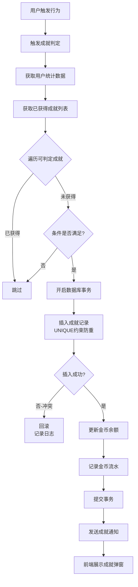

# 学生端“我的”功能模块设计方案（优化版）


## 文档说明

- **文档版本**：v2.0
- **编写日期**：2026年9月
- **优化说明**：根据实际系统界面调整导航栏设计，丰富成就与激励体系，扩展设备管理兼容性，深化交互细节与功能落地
- **适用对象**：前端开发人员、UI/UX设计师、产品经理


## 一、导航栏适配设计

### 1.1 实际导航栏结构

根据系统实际界面，电脑端采用 **顶部水平导航栏** 布局：

```
┌─────────────────────────────────────────────────────────────────────────────────────────┐
│  🛡️ 警大砺安        首页    题库    关于砺安题库    论坛        [📥 下载客户端]  👤 202516001 ▼ │
└─────────────────────────────────────────────────────────────────────────────────────────┘
```

### 1.2 导航栏元素说明

| 元素 | 位置 | 交互行为 |
|------|------|---------|
| **Logo** | 左侧 | 点击返回首页 |
| **首页** | 中部 | 跳转首页（当前选中高亮） |
| **题库** | 中部 | 跳转题库页面 |
| **关于砺安题库** | 中部 | 跳转关于页面 |
| **论坛** | 中部 | 跳转论坛页面 |
| **下载客户端** | 右侧 | 跳转下载页（红色按钮突出） |
| **用户账号** | 右侧 | 点击展开下拉菜单 |

### 1.3 用户账号下拉菜单

点击右上角账号区域，展开下拉菜单：

```
┌─────────────────────────────┐
│  👤 202516001 ▼             │
├─────────────────────────────┤
│  👤 我的                    │
│  🪙 我的金币：1,286         │
│  📊 学习数据                │
│  🏆 我的成就                │
│  ⚙️ 设置                    │
│  ─────────────────────────  │
│  🚪 退出登录                │
└─────────────────────────────┘
```

**交互细节**：
- 下拉菜单从右上角滑出，带淡入动画
- 显示金币余额（实时更新）
- 点击“我的”进入个人中心页面
- 退出登录需二次确认


## 二、电脑端“我的”页面布局

### 2.1 整体布局

电脑端采用 **“顶部导航 + 三栏内容区”** 布局，充分参考系统实际界面风格：

```
┌─────────────────────────────────────────────────────────────────────────────────────────┐
│  🛡️ 警大砺安        首页    题库    关于砺安题库    论坛        [📥 下载客户端]  👤 202516001 ▼ │
├─────────────────────────────────────────────────────────────────────────────────────────┤
│                                                                                         │
│  ┌─────────────────────┐  ┌─────────────────────────────────┐  ┌─────────────────────┐ │
│  │  👤 个人资料         │  │  📊 学习数据                    │  │  🏆 成就与激励      │ │
│  │                     │  │                                 │  │                     │ │
│  │  ┌───────────────┐  │  │  ┌────────┐ ┌────────┐        │  │  已获得 8 枚勋章    │ │
│  │  │   [头像]      │  │  │  │ 总做题  │ │ 正确率 │        │  │                     │ │
│  │  │               │  │  │  │ 3,562  │ │ 72.4%  │        │  │  🥇 连续学习7天    │ │
│  │  │   张三        │  │  │  └────────┘ └────────┘        │  │  🥈 做题1000题     │ │
│  │  │   202516001   │  │  │  ┌────────┐ ┌────────┐        │  │  🥉 满分王         │ │
│  │  │   刑侦2201班  │  │  │  │ 学习时长│ │ 完成试卷│        │  │  🏅 错题终结者     │ │
│  │  │               │  │  │  │ 42.5h  │ │ 18套   │        │  │  🎖️ 论坛活跃者    │ │
│  │  │  连续学习15天🔥│  │  │  └────────┘ └────────┘        │  │  [查看全部 →]      │ │
│  │  └───────────────┘  │  │                                 │  │                     │ │
│  │                     │  │  [查看详细成绩分析 →]           │  │  ┌───────────────┐  │ │
│  │  [编辑资料]         │  │                                 │  │  │ 📈 学习等级    │  │ │
│  │                     │  │                                 │  │  │ Lv.8 资深学员  │  │ │
│  │  ┌───────────────┐  │  │                                 │  │  │ ████████░░ 80% │  │ │
│  │  │ 🪙 我的金币   │  │  │                                 │  │  └───────────────┘  │ │
│  │  │ 1,286 🪙     │  │  │                                 │  │                     │ │
│  │  │ +520 / -180  │  │  │                                 │  │  ┌───────────────┐  │ │
│  │  │ [充值][明细]  │  │  │                                 │  │  │ 🎯 下一成就    │  │ │
│  │  │ [兑换商城]    │  │  │                                 │  │  │ 还差3天获得    │  │ │
│  │  └───────────────┘  │  │                                 │  │  │ “月度学霸”     │  │ │
│  │                     │  │                                 │  │  └───────────────┘  │ │
│  └─────────────────────┘  └─────────────────────────────────┘  └─────────────────────┘ │
│                                                                                         │
│  ┌─────────────────────────────────────────────────────────────────────────────────┐   │
│  │  📚 学习内容管理                                                                 │   │
│  │  ┌──────────┐ ┌──────────┐ ┌──────────┐ ┌──────────┐ ┌──────────┐             │   │
│  │  │ 📝 练习记录│ │ ❌ 错题集 │ │ ⭐ 收藏   │ │ 📓 笔记   │ │ 🎯 我的斩题│             │   │
│  │  │ 45条     │ │ 23道     │ │ 12题     │ │ 8条      │ │ 5道      │             │   │
│  │  └──────────┘ └──────────┘ └──────────┘ └──────────┘ └──────────┘             │   │
│  └─────────────────────────────────────────────────────────────────────────────────┘   │
│                                                                                         │
│  ┌───────────────────────────────┐ ┌───────────────────────────────────────────────┐   │
│  │  📖 备考资料                   │ │  ⚙️ 设置                                      │   │
│  │  [📘 行测] [📗 申论] [📕 公专] │ │  [个人设置] [通知设置] [隐私设置]              │   │
│  │                               │ │  [设备管理] [关于砺安题库]                     │   │
│  │                               │ │  [退出登录]                                    │   │
│  └───────────────────────────────┘ └───────────────────────────────────────────────┘   │
│                                                                                         │
└─────────────────────────────────────────────────────────────────────────────────────────┘
```

### 2.2 三栏布局说明

| 栏目 | 宽度 | 内容 |
|------|------|------|
| **左栏** | 280px | 个人资料 + 金币概况 |
| **中栏** | 自适应 | 学习数据概览 |
| **右栏** | 320px | 成就与激励 + 学习等级 |


## 三、成就与激励体系（丰富版）

### 3.1 成就分类体系

将成就分为 **六大类**，覆盖学习全场景：

| 分类 | 图标 | 说明 | 成就数量 |
|------|------|------|---------|
| **学习坚持类** | 🔥 | 连续学习、签到打卡 | 8项 |
| **做题数量类** | 📝 | 累计做题数量里程碑 | 10项 |
| **正确率类** | 🎯 | 正确率、满分成就 | 8项 |
| **错题管理类** | ❌ | 错题复习、斩题成就 | 6项 |
| **社交互动类** | 💬 | 论坛发帖、评论、获赞 | 6项 |
| **综合成就类** | 🏆 | 等级、全能、特殊成就 | 7项 |

### 3.2 完整成就列表

#### 3.2.1 学习坚持类（8项）

| 成就名称 | 获得条件 | 奖励金币 | 图标 |
|---------|---------|---------|------|
| 初来乍到 | 首次登录系统 | 10 | 🌱 |
| 连续学习3天 | 连续3天有学习记录 | 30 | 🔥 |
| 连续学习7天 | 连续7天有学习记录 | 80 | 🔥 |
| 连续学习15天 | 连续15天有学习记录 | 150 | 🔥 |
| 连续学习30天 | 连续30天有学习记录 | 300 | 🔥 |
| 月度学霸 | 单月学习≥25天 | 200 | 📅 |
| 早起鸟 | 连续7天8:00前学习 | 50 | 🐦 |
| 夜猫子 | 连续7天22:00后学习 | 50 | 🦉 |

#### 3.2.2 做题数量类（10项）

| 成就名称 | 获得条件 | 奖励金币 | 图标 |
|---------|---------|---------|------|
| 初试身手 | 累计做题10道 | 10 | 📝 |
| 小试牛刀 | 累计做题50道 | 20 | 📝 |
| 渐入佳境 | 累计做题100道 | 40 | 📝 |
| 勤学苦练 | 累计做题500道 | 80 | 📝 |
| 千题斩 | 累计做题1,000道 | 150 | ⚔️ |
| 三千题 | 累计做题3,000道 | 300 | ⚔️ |
| 五千题 | 累计做题5,000道 | 500 | ⚔️ |
| 万题王 | 累计做题10,000道 | 1,000 | 👑 |
| 单日百题 | 单日做题100道 | 50 | 🚀 |
| 周做题达人 | 单周做题500道 | 100 | 🏃 |

#### 3.2.3 正确率类（8项）

| 成就名称 | 获得条件 | 奖励金币 | 图标 |
|---------|---------|---------|------|
| 首战告捷 | 首次全部答对 | 20 | ✅ |
| 满分王 | 单次练习全部答对（≥20题） | 50 | 🥉 |
| 精准射手 | 单次练习正确率≥90% | 40 | 🎯 |
| 稳如泰山 | 连续3次练习正确率≥80% | 60 | 🧘 |
| 正确率之星 | 周正确率≥85%（≥100题） | 80 | ⭐ |
| 常胜将军 | 连续10次练习正确率≥80% | 100 | 🏆 |
| 完美主义 | 连续5次练习全部答对 | 150 | 💎 |
| 正确率大师 | 月正确率≥85%（≥500题） | 200 | 👑 |

#### 3.2.4 错题管理类（6项）

| 成就名称 | 获得条件 | 奖励金币 | 图标 |
|---------|---------|---------|------|
| 直面错误 | 首次查看错题集 | 10 | 👀 |
| 错题复习者 | 完成10道错题重练 | 30 | 🔄 |
| 错题终结者 | 完成50道错题重练 | 80 | 🏅 |
| 斩题新手 | 首次斩题 | 20 | 🎯 |
| 斩题达人 | 累计斩题50道 | 100 | 🎖️ |
| 斩题大师 | 累计斩题200道 | 300 | 👑 |

#### 3.2.5 社交互动类（6项）

| 成就名称 | 获得条件 | 奖励金币 | 图标 |
|---------|---------|---------|------|
| 初次发声 | 首次发布帖子/评论 | 15 | 💬 |
| 论坛活跃者 | 发布10条帖子/评论 | 50 | 🎖️ |
| 热门楼主 | 单帖获得50个赞 | 80 | 🔥 |
| 获赞达人 | 累计获得100个赞 | 100 | ⭐ |
| 解答高手 | 回答被采纳10次 | 150 | 🏆 |
| 社区领袖 | 发布100条帖子/评论 | 200 | 👑 |

#### 3.2.6 综合成就类（7项）

| 成就名称 | 获得条件 | 奖励金币 | 图标 |
|---------|---------|---------|------|
| 全能选手 | 完成行测/申论/公专各100题 | 150 | 🌟 |
| 三科精通 | 三科正确率均≥75% | 200 | 🎓 |
| 等级达人 | 学习等级达到Lv.10 | 300 | 📈 |
| 金币富翁 | 累计获得10,000金币 | 200 | 💰 |
| 收藏家 | 收藏100道题目 | 100 | ⭐ |
| 笔记达人 | 添加50条学习笔记 | 80 | 📓 |
| 金句收藏家 | 收藏100条金句 | 60 | 📚 |

### 3.3 成就发放算法（精准无误）

#### 3.3.1 核心设计原则

| 原则 | 说明 |
|------|------|
| **幂等性** | 同一成就同一用户只能获得一次，防止重复发放 |
| **原子性** | 成就判定与金币发放在同一事务中完成 |
| **实时性** | 用户完成条件后立即触发判定，无需等待 |
| **可追溯** | 每次成就发放记录日志，可审计 |
| **容错性** | 判定失败自动重试，不丢失成就 |

#### 3.3.2 数据库唯一约束

```sql
-- 用户成就表添加唯一约束，防止重复发放
CREATE TABLE user_achievements (
    id BIGINT PRIMARY KEY AUTO_INCREMENT,
    user_id INT NOT NULL,
    achievement_id INT NOT NULL,
    achievement_name VARCHAR(50) NOT NULL,
    reward_coins INT DEFAULT 0,
    obtained_at DATETIME DEFAULT CURRENT_TIMESTAMP,
    UNIQUE KEY uk_user_achievement (user_id, achievement_id)  -- 核心：唯一约束
);
```

#### 3.3.3 成就判定算法

```python
# backend/app/services/achievement_service.py
from sqlalchemy import select, func
from sqlalchemy.exc import IntegrityError
import logging

logger = logging.getLogger(__name__)

class AchievementService:
    """成就判定与发放服务"""
    
    async def check_and_grant_achievements(self, user_id: int, trigger_type: str):
        """
        检查并发放成就
        trigger_type: 触发类型（do_question / sign_in / post / comment 等）
        """
        # 1. 获取用户当前统计数据
        stats = await self._get_user_stats(user_id)
        
        # 2. 获取用户已获得的成就ID列表
        obtained_ids = await self._get_obtained_achievement_ids(user_id)
        
        # 3. 获取所有可判定的成就
        achievements = await self._get_achievements_by_trigger(trigger_type)
        
        # 4. 逐一判定
        for achievement in achievements:
            if achievement.id in obtained_ids:
                continue  # 已获得，跳过（幂等性保证）
            
            if await self._check_condition(user_id, achievement, stats):
                await self._grant_achievement(user_id, achievement)
    
    async def _grant_achievement(self, user_id: int, achievement):
        """发放成就（事务保证）"""
        try:
            async with db.begin():
                # 1. 插入成就记录（唯一约束防止重复）
                await db.execute(
                    insert(UserAchievement).values(
                        user_id=user_id,
                        achievement_id=achievement.id,
                        achievement_name=achievement.name,
                        reward_coins=achievement.reward_coins
                    )
                )
                
                # 2. 发放金币（原子操作）
                await db.execute(
                    update(UserCoin)
                    .where(UserCoin.user_id == user_id)
                    .values(
                        available_coins=UserCoin.available_coins + achievement.reward_coins,
                        total_coins=UserCoin.total_coins + achievement.reward_coins
                    )
                )
                
                # 3. 记录金币流水
                await db.execute(
                    insert(CoinTransaction).values(
                        user_id=user_id,
                        type='income',
                        source='achievement',
                        source_id=achievement.id,
                        amount=achievement.reward_coins,
                        description=f'获得成就：{achievement.name}'
                    )
                )
                
                logger.info(f"用户{user_id}获得成就：{achievement.name}，奖励{achievement.reward_coins}金币")
                
        except IntegrityError:
            # 唯一约束冲突，说明已发放过（并发场景）
            logger.warning(f"成就重复发放被拦截：user_id={user_id}, achievement_id={achievement.id}")
            await db.rollback()
```

#### 3.3.4 成就判定流程图



#### 3.3.5 防错机制

| 错误场景 | 防护措施 |
|---------|---------|
| **重复发放** | 数据库唯一约束 `(user_id, achievement_id)` |
| **并发冲突** | 数据库事务 + `SELECT ... FOR UPDATE` 行锁 |
| **判定失败** | 自动重试3次，失败记录日志待人工处理 |
| **金币未到账** | 事务保证成就与金币同时成功或同时失败 |
| **前端未显示** | WebSocket推送 + 轮询兜底，确保通知到达 |
| **统计错误** | 每日定时任务重新计算统计，修正异常 |


## 四、设备管理页面（全平台兼容）

### 4.1 设备类型识别

支持识别所有主流设备类型：

| 设备类型 | 识别方式 | 示例 |
|---------|---------|------|
| **手机** | User-Agent + 屏幕尺寸 | iPhone、华为、小米、OPPO、vivo、三星、荣耀 |
| **平板** | User-Agent + 屏幕尺寸 | iPad、华为MatePad、小米平板、三星Tab |
| **电脑** | User-Agent + 屏幕尺寸 | Windows、macOS、Linux |
| **浏览器** | User-Agent | Chrome、Edge、Firefox、Safari、UC、QQ浏览器 |

### 4.2 设备管理页面设计

```
┌─────────────────────────────────────────────────────────────────────────────────────────┐
│  ← 返回    设备管理                                                                     │
├─────────────────────────────────────────────────────────────────────────────────────────┤
│                                                                                         │
│  ┌─────────────────────────────────────────────────────────────────────────────────┐   │
│  │  📱 当前设备（本机）                                                            │   │
│  │  ┌─────────────────────────────────────────────────────────────────────────┐   │   │
│  │  │  📱 华为 Mate 60 Pro                                                    │   │   │
│  │  │  HarmonyOS 4.0 · 华为浏览器                                             │   │   │
│  │  │  首次登录：2026-09-01 14:23                                             │   │   │
│  │  │  当前在线 ●                                                             │   │   │
│  │  └─────────────────────────────────────────────────────────────────────────┘   │   │
│  └─────────────────────────────────────────────────────────────────────────────────┘   │
│                                                                                         │
│  ┌─────────────────────────────────────────────────────────────────────────────────┐   │
│  │  📱 其他设备                                                                     │   │
│  │  ┌─────────────────────────────────────────────────────────────────────────┐   │   │
│  │  │  💻 Windows 11 · Chrome 120.0                                          │   │   │
│  │  │  北京 · 海淀                                                            │   │   │
│  │  │  最后活跃：2026-09-04 20:15                                             │   │   │
│  │  │  [移除设备]                                                             │   │   │
│  │  └─────────────────────────────────────────────────────────────────────────┘   │   │
│  │  ┌─────────────────────────────────────────────────────────────────────────┐   │   │
│  │  │  📱 小米 14 · MIUI 15                                                  │   │   │
│  │  │  上海 · 浦东                                                            │   │   │
│  │  │  最后活跃：2026-09-03 10:30                                             │   │   │
│  │  │  [移除设备]                                                             │   │   │
│  │  └─────────────────────────────────────────────────────────────────────────┘   │   │
│  │  ┌─────────────────────────────────────────────────────────────────────────┐   │   │
│  │  │  📟 iPad Pro 12.9 · iPadOS 17.4                                        │   │   │
│  │  │  广州 · 天河                                                            │   │   │
│  │  │  最后活跃：2026-09-02 08:45                                             │   │   │
│  │  │  [移除设备]                                                             │   │   │
│  │  └─────────────────────────────────────────────────────────────────────────┘   │   │
│  │  ┌─────────────────────────────────────────────────────────────────────────┐   │   │
│  │  │  📱 OPPO Find X7 · ColorOS 14                                          │   │   │
│  │  │  深圳 · 南山                                                            │   │   │
│  │  │  最后活跃：2026-09-01 16:20                                             │   │   │
│  │  │  [移除设备]                                                             │   │   │
│  │  └─────────────────────────────────────────────────────────────────────────┘   │   │
│  └─────────────────────────────────────────────────────────────────────────────────┘   │
│                                                                                         │
│  [ 退出所有设备 ]                                                                       │
│                                                                                         │
└─────────────────────────────────────────────────────────────────────────────────────────┘
```

### 4.3 设备识别与展示逻辑

```python
# backend/app/services/device_service.py

DEVICE_TYPE_MAP = {
    # 手机品牌识别
    'iphone': ('iPhone', '📱'),
    'huawei': ('华为', '📱'),
    'xiaomi': ('小米', '📱'),
    'oppo': ('OPPO', '📱'),
    'vivo': ('vivo', '📱'),
    'samsung': ('三星', '📱'),
    'honor': ('荣耀', '📱'),
    'oneplus': ('一加', '📱'),
    'realme': ('realme', '📱'),
    'meizu': ('魅族', '📱'),
    'zte': ('中兴', '📱'),
    'lenovo': ('联想', '📱'),
    
    # 平板识别
    'ipad': ('iPad', '📟'),
    'matepad': ('华为MatePad', '📟'),
    'mi pad': ('小米平板', '📟'),
    'galaxy tab': ('三星Tab', '📟'),
    
    # 电脑识别
    'windows': ('Windows', '💻'),
    'macintosh': ('macOS', '💻'),
    'linux': ('Linux', '💻'),
}

def parse_device_info(user_agent: str, screen_size: str) -> dict:
    """解析设备信息"""
    ua_lower = user_agent.lower()
    
    # 1. 识别设备类型和品牌
    device_name = '未知设备'
    device_icon = '📱'
    device_type = 'mobile'
    
    for key, (name, icon) in DEVICE_TYPE_MAP.items():
        if key in ua_lower:
            device_name = name
            device_icon = icon
            break
    
    # 2. 判断设备类型
    if any(k in ua_lower for k in ['ipad', 'tablet', 'pad']):
        device_type = 'tablet'
    elif any(k in ua_lower for k in ['windows', 'macintosh', 'linux']):
        device_type = 'desktop'
    
    # 3. 识别操作系统版本
    os_version = extract_os_version(user_agent)
    
    # 4. 识别浏览器
    browser = extract_browser(user_agent)
    
    return {
        'device_name': device_name,
        'device_icon': device_icon,
        'device_type': device_type,
        'os_version': os_version,
        'browser': browser,
        'screen_size': screen_size,
    }
```

### 4.4 设备管理交互

| 操作 | 行为 | 反馈 |
|------|------|------|
| **查看设备列表** | 加载所有已登录设备 | 显示设备名称、类型、最后活跃时间 |
| **移除设备** | 点击“移除设备” | 二次确认 → 移除 → Toast提示 |
| **退出所有设备** | 点击“退出所有设备” | 二次确认 → 清除所有Token → 跳转登录页 |
| **当前设备标记** | 自动识别 | 显示“当前设备”标签，不可移除 |


## 五、交互细节与体验优化

### 5.1 数据实时刷新

| 数据项 | 刷新方式 | 刷新频率 |
|--------|---------|---------|
| 金币余额 | WebSocket推送 + 轮询 | 实时 |
| 学习数据 | 轮询 | 30秒 |
| 成就进度 | WebSocket推送 | 实时 |
| 设备列表 | 手动刷新 | 按需 |
| 通知消息 | WebSocket推送 | 实时 |

### 5.2 操作反馈规范

| 操作 | 成功反馈 | 失败反馈 |
|------|---------|---------|
| 编辑资料 | ✅ Toast "保存成功" | ❌ Toast "保存失败，请重试" |
| 上传头像 | ✅ 头像立即更新 | ❌ Toast "上传失败，请检查网络" |
| 充值金币 | ✅ Toast "充值成功，获得XXX金币" | ❌ Toast "支付失败，请重试" |
| 兑换商品 | ✅ Toast "兑换成功" | ❌ Toast "金币不足" |
| 领取成就 | ✅ 🎉 成就弹窗动画 | ❌ Toast "领取失败" |
| 移除设备 | ✅ Toast "设备已移除" | ❌ Toast "移除失败" |

### 5.3 空状态设计

| 场景 | 展示内容 |
|------|---------|
| 无成就 | 插画 + "还没有获得成就，快去学习吧！" + [去学习]按钮 |
| 无金币记录 | 插画 + "暂无金币记录" + [去赚金币]按钮 |
| 无设备 | 不应出现（至少当前设备） |
| 无学习数据 | 插画 + "还没有学习记录" + [开始练习]按钮 |

### 5.4 加载状态

| 场景 | 展示方式 |
|------|---------|
| 页面加载 | 骨架屏（Skeleton） |
| 数据刷新 | 顶部加载条 |
| 按钮操作 | 按钮置灰 + 加载图标 |
| 列表加载更多 | 底部加载圈 + "加载中..." |

### 5.5 动画效果

| 场景 | 动画 |
|------|------|
| 成就获得 | 🎉 彩带飘落 + 成就卡片弹出 |
| 金币增加 | 🪙 金币飞入钱包 + 数字滚动 |
| 页面切换 | 淡入淡出（300ms） |
| 下拉菜单 | 从右上角滑出（200ms） |
| 按钮点击 | 缩放反馈（0.95倍，100ms） |


## 六、前端功能与实际效果一致性保障

### 6.1 前端显示与实际效果一致性检查清单

| 功能 | 前端显示 | 实际效果 | 一致性保障 |
|------|---------|---------|-----------|
| 金币余额 | 1,286 🪙 | 数据库 `available_coins` | API实时查询 + WebSocket推送 |
| 学习数据 | 3,562题 | 数据库 `total_questions` | 定时任务每日重算 |
| 成就获得 | 弹出成就卡片 | `user_achievements`记录 | 事务保证 + 唯一约束 |
| 头像上传 | 头像更新 | 文件存储 + URL更新 | 上传成功后才更新前端 |
| 设备移除 | 设备消失 | Token清除 | 后端确认后才更新前端 |
| 充值成功 | 金币增加 | 支付回调 + 金币到账 | 支付回调验证后才发放 |

### 6.2 前后端一致性校验机制

```python
# 每日定时任务：校验数据一致性
async def verify_data_consistency():
    """校验前端显示数据与数据库实际数据的一致性"""
    
    # 1. 校验金币余额
    users = await db.query(User).all()
    for user in users:
        coin = await db.query(UserCoin).filter_by(user_id=user.id).first()
        if coin:
            # 计算实际金币 = 所有收入 - 所有支出
            actual = await db.query(
                func.sum(CoinTransaction.amount)
            ).filter_by(user_id=user.id).scalar() or 0
            
            if actual != coin.available_coins:
                logger.error(f"金币不一致：user_id={user.id}, 显示={coin.available_coins}, 实际={actual}")
                # 自动修正
                coin.available_coins = actual
                await db.commit()
    
    # 2. 校验学习数据
    for user in users:
        stats = await calculate_user_stats(user.id)
        if stats['total_questions'] != user.total_questions:
            logger.error(f"学习数据不一致：user_id={user.id}")
            user.total_questions = stats['total_questions']
            await db.commit()
```


## 七、API接口设计

| 接口 | 方法 | 路径 | 描述 |
|------|------|------|------|
| 获取个人资料 | GET | `/api/user/profile` | 获取用户个人信息 |
| 更新个人资料 | PUT | `/api/user/profile` | 更新姓名、手机号等 |
| 上传头像 | POST | `/api/user/avatar` | 上传头像图片 |
| 修改密码 | POST | `/api/user/change-password` | 修改密码 |
| 获取学习数据 | GET | `/api/user/study-stats` | 获取学习统计 |
| 获取金币概况 | GET | `/api/user/coins/overview` | 获取金币余额和本月统计 |
| 获取金币明细 | GET | `/api/user/coins/transactions` | 分页获取金币流水 |
| 获取成就列表 | GET | `/api/user/achievements` | 获取已获得勋章 |
| 获取成就进度 | GET | `/api/user/achievements/progress` | 获取未获得成就的进度 |
| 获取设备列表 | GET | `/api/user/devices` | 获取已登录设备 |
| 移除设备 | DELETE | `/api/user/devices/{id}` | 移除指定设备 |
| 退出所有设备 | POST | `/api/user/devices/logout-all` | 退出所有设备 |
| 获取通知设置 | GET | `/api/user/notification-settings` | 获取通知偏好 |
| 更新通知设置 | PUT | `/api/user/notification-settings` | 更新通知偏好 |
| 获取隐私设置 | GET | `/api/user/privacy-settings` | 获取隐私偏好 |
| 更新隐私设置 | PUT | `/api/user/privacy-settings` | 更新隐私偏好 |


## 八、实施优先级

| 优先级 | 功能 | 说明 |
|--------|------|------|
| **P0** | 导航栏适配（顶部水平导航） | 核心布局 |
| **P0** | 个人资料区（头像+编辑） | 核心功能 |
| **P0** | 学习数据概览 | 核心功能 |
| **P0** | 金币模块（余额+明细+充值） | 核心功能 |
| **P0** | 学习内容管理入口 | 核心功能 |
| **P0** | 设置模块（个人设置+退出） | 核心功能 |
| **P1** | 成就与激励体系（完整列表+发放算法） | 核心功能 |
| **P1** | 设备管理（全平台兼容） | 安全功能 |
| **P1** | 通知设置/隐私设置 | 增强功能 |
| **P2** | 数据一致性校验 | 质量保障 |
| **P2** | 动画效果优化 | 体验优化 |
| **P3** | 学习等级系统 | 增强功能 |


## 九、总结

本优化方案在原有设计基础上，完成了以下核心升级：

| 优化维度 | 核心内容 |
|---------|---------|
| **导航栏适配** | 根据实际系统界面，采用顶部水平导航栏 + 用户账号下拉菜单 |
| **成就与激励** | 六大类共45项成就，完整的发放算法（幂等性+原子性+可追溯），防错机制 |
| **设备管理** | 支持所有主流手机/平板/电脑品牌（华为、小米、OPPO、vivo、三星、荣耀等） |
| **交互体验** | 实时刷新、操作反馈、空状态、加载状态、动画效果全套规范 |
| **功能一致性** | 前后端一致性校验清单 + 每日定时校验机制，确保前端显示与实际效果一致 |

通过以上设计，“我的”功能模块将成为学生端**功能最完整、体验最流畅、数据最可靠**的个人中心，满足用户在电脑端、平板端、手机端三端的完整使用需求。