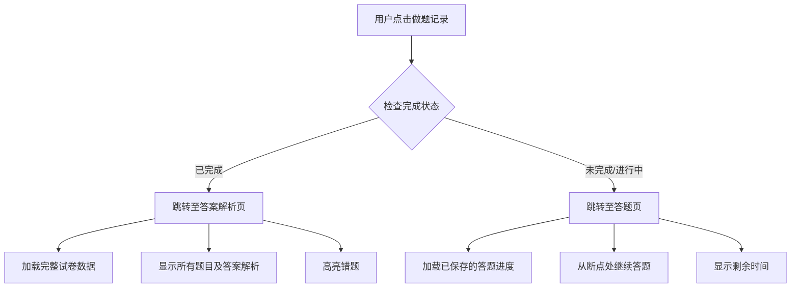

# “练习记录”功能模块优化设计方案


## 文档说明

- **文档版本**：v1.0
- **编写日期**：2026年8月
- **编写目的**：针对学生端“练习记录”功能模块进行全面优化，细化题目类型进度至知识点层级，整合多来源做题记录，实现点击跳转和自动刷新，提升学生使用体验。
- **适用对象**：前后端开发人员


## 一、现状分析与优化方向

### 1.1 现有功能回顾

| 现有功能 | 描述 |
|---------|------|
| 今日做题数量 | 统计当日完成的题目总数 |
| 本周做题数量 | 统计本周（周一至周日）完成的题目总数 |
| 累计做题数量 | 统计用户注册至今完成的题目总数 |
| 做题用时 | 统计所有练习累计用时 |
| 正确率 | 整体正确率（答对总数/答题总数） |
| 题目类型进度 | 按科目-题型记录进度（如“公专-职业素养”） |
| 本周做题趋势图 | 柱状图+折线图展示本周每日做题量 |
| 刷新数据按钮 | 手动刷新所有统计数据 |

### 1.2 当前存在的问题

| 问题编号 | 问题描述 | 影响 |
|---------|---------|------|
| P1 | “题目类型进度”仅记录到科目-题型，未细化到知识点 | 学生无法精准定位薄弱知识点 |
| P2 | “题目类型进度”仅记录“快速练习”数据 | 历年试卷、小模考、智能组卷等数据未被整合 |
| P3 | “题目类型进度”无法点击跳转 | 学生只能查看统计，无法直接进入练习或查看解析 |
| P4 | “本周做题趋势图”需手动点击“刷新数据” | 体验不流畅，数据更新滞后 |

### 1.3 优化方向

| 方向 | 说明 |
|------|------|
| **细化到知识点** | 将“题目类型进度”从“科目-题型”细化到“科目-题型-知识点”三级结构 |
| **整合多来源记录** | 统一记录“快速练习”、“历年试卷”、“小模考”、“智能组卷”四种来源的做题数据 |
| **点击跳转** | 未完成记录 → 跳转继续答题；已完成记录 → 跳转答案解析 |
| **自动刷新** | 趋势图数据由系统定时自动刷新，移除手动刷新按钮 |


## 二、整体功能架构设计

### 2.1 优化后页面布局

```
┌─────────────────────────────────────────────────────────────────────┐
│  📊 练习记录                                                       │
├─────────────────────────────────────────────────────────────────────┤
│  ┌──────────┐ ┌──────────┐ ┌──────────┐ ┌──────────┐ ┌─────────┐ │
│  │今日做题   │ │本周做题   │ │累计做题   │ │做题用时   │ │正确率   │ │
│  │ 23 题    │ │ 156 题   │ │ 3,562 题 │ │ 42h 18m  │ │ 72.4%   │ │
│  └──────────┘ └──────────┘ └──────────┘ └──────────┘ └─────────┘ │
│                                                                     │
│  ┌─────────────────────────────────────────────────────────────┐   │
│  │  📈 本周做题趋势（自动刷新）                                │   │
│  │  [柱状图 + 折线图]                                         │   │
│  │  周一 周二 周三 周四 周五 周六 周日                       │   │
│  └─────────────────────────────────────────────────────────────┘   │
│                                                                     │
│  ┌─────────────────────────────────────────────────────────────┐   │
│  │  📚 题目类型进度（细化到知识点）                            │   │
│  │  ┌─────────────────────────────────────────────────────┐   │   │
│  │  │  行测                                              │   │   │
│  │  │  政治理论 (85%  ████████░░)  15/18                │   │   │
│  │  │  常识判断 (72%  ██████░░░░)  23/32                │   │   │
│  │  │  言语理解 (78%  ███████░░░)  31/40                │   │   │
│  │  │  判断推理 (65%  ██████░░░░)  18/28                │   │   │
│  │  │  资料分析 (70%  ███████░░░)  22/31                │   │   │
│  │  └─────────────────────────────────────────────────────┘   │   │
│  │  ┌─────────────────────────────────────────────────────┐   │   │
│  │  │  公专                                              │   │   │
│  │  │  政治立场与忠诚度 (90% █████████░)  9/10           │   │   │
│  │  │  人民警察职业道德 (75% ███████░░░) 12/16           │   │   │
│  │  │  行政执法基础知识 (68% ██████░░░░) 15/22           │   │   │
│  │  └─────────────────────────────────────────────────────┘   │   │
│  └─────────────────────────────────────────────────────────────┘   │
│                                                                     │
│  ┌─────────────────────────────────────────────────────────────┐   │
│  │  📋 最近做题记录                                            │   │
│  │  ┌─────────────────────────────────────────────────────┐   │   │
│  │  │  2025年公安联考行测真题   历年试卷  已做 85分  ▶   │   │   │
│  │  │  智能组卷_20260820        智能组卷  未完成  ▶      │   │   │
│  │  │  政治立场与忠诚度练习     快速练习  已完成  ▶   │   │   │
│  │  │  第3次小模考              小模考    已做 72分  ▶   │   │   │
│  │  └─────────────────────────────────────────────────────┘   │   │
│  │  共 45 条记录                     [加载更多]                │   │
│  └─────────────────────────────────────────────────────────────┘   │
└─────────────────────────────────────────────────────────────────────┘
```

### 2.2 数据来源整合

| 来源类型 | 来源标识 | 记录内容 | 数据范围 |
|---------|---------|---------|---------|
| 快速练习 | `quick_practice` | 知识点、题目数、正确数、用时 | 每次练习记录 |
| 历年试卷 | `past_paper` | 试卷名称、得分、正确率、用时、完成状态 | 每次试卷作答 |
| 小模考 | `mock_exam` | 试卷名称、得分、正确率、用时、完成状态 | 每次模考作答 |
| 智能组卷 | `ai_paper` | 试卷名称、得分、正确率、用时、完成状态 | 每次AI组卷作答 |


## 三、详细功能设计

### 3.1 题目类型进度（细化到知识点）

#### 3.1.1 数据层级结构

| 层级 | 示例 | 说明 |
|------|------|------|
| **科目** | 行测 / 公专 / 申论 | 一级分类 |
| **题型** | 言语理解 / 职业素养 / 归纳概括 | 二级分类 |
| **知识点** | 逻辑填空 / 政治立场与忠诚度 / 问题概括 | 三级分类（最细粒度） |

#### 3.1.2 显示方式

考虑到页面宽度有限，**直接显示知识点名称**（最细粒度），并包含以下信息：

| 显示信息 | 格式 | 示例 |
|---------|------|------|
| 知识点名称 | 纯文本 | “政治立场与忠诚度” |
| 完成进度 | 进度条 + 数字 | `████████░░ 90% (9/10)` |
| 来源标识 | 小图标 | 📚 📝 🎯 |

**知识点名称显示规则**：
- 知识点名称 ≤ 8个字符：完整显示
- 知识点名称 > 8个字符：缩写显示，鼠标悬停显示完整名称

```
┌─────────────────────────────────────────────────────────────────────┐
│  行测                                                               │
│  ┌────────────────────────────────────────────────────────────┐    │
│  │  习近平新时代中国特色社会主义思想  ████████░░ 85%  15/18 │    │
│  │  党的二十大精神                  ██████░░░░ 72%  23/32 │    │
│  │  马克思主义基本原理              ███████░░░ 78%  31/40 │    │
│  │  党和国家方针政策                ██████░░░░ 65%  18/28 │    │
│  └────────────────────────────────────────────────────────────┘    │
│  公专                                                               │
│  ┌────────────────────────────────────────────────────────────┐    │
│  │  政治立场与忠诚度              █████████░ 90%  9/10    │    │
│  │  人民警察核心价值观            ███████░░░ 75%  12/16   │    │
│  │  行政执法基础知识              ██████░░░░ 68%  15/22   │    │
│  └────────────────────────────────────────────────────────────┘    │
└─────────────────────────────────────────────────────────────────────┘
```

#### 3.1.3 知识点进度计算规则

```python
def calculate_knowledge_progress(user_id, knowledge_point_id):
    """计算某个知识点的学习进度"""
    # 获取该知识点下的所有题目
    total_questions = get_questions_by_knowledge(knowledge_point_id)
    
    # 获取用户已完成（答对）的题目数
    completed_questions = get_completed_questions(user_id, knowledge_point_id)
    
    progress = {
        "total": total_questions.count(),
        "completed": completed_questions.count(),
        "percentage": (completed / total * 100) if total > 0 else 0,
        "status": "completed" if completed == total else "in_progress"
    }
    return progress
```

### 3.2 多来源做题记录整合

#### 3.2.1 记录展示格式

每条做题记录包含以下信息：

| 字段 | 格式 | 示例 |
|------|------|------|
| 来源徽章 | 彩色标签 | `历年试卷`（蓝色）/ `小模考`（橙色）/ `智能组卷`（紫色）/ `快速练习`（绿色） |
| 名称 | 文本 | “2025年公安联考行测真题” |
| 状态 | 图标 + 文本 | ✅ 已完成 / ⏳ 未完成 / 📝 进行中 |
| 分数（如有） | 数字 + “分” | “85分” |
| 用时（如有） | 时间格式 | “1h 32min” |
| 跳转按钮 | 图标 | `▶` 点击跳转 |

```
┌─────────────────────────────────────────────────────────────────────┐
│  📋 最近做题记录                                                    │
├─────────────────────────────────────────────────────────────────────┤
│  ┌──────────────────────────────────────────────────────────────┐  │
│  │  [历年试卷] 2025年公安联考行测真题    ✅ 已完成  85分  ▶  │  │
│  │  [智能组卷] 智能组卷_20260820        ⏳ 未完成       ▶  │  │
│  │  [小模考] 第3次小模考                ✅ 已完成  72分  ▶  │  │
│  │  [快速练习] 政治立场与忠诚度练习      📝 进行中     ▶  │  │
│  └──────────────────────────────────────────────────────────────┘  │
│  共 45 条记录                     [加载更多]                       │
└─────────────────────────────────────────────────────────────────────┘
```

#### 3.2.2 来源徽章配色方案

| 来源 | 颜色 | 色值 | 图标 |
|------|------|------|------|
| 历年试卷 | 蓝色 | `#409EFF` | 📄 |
| 小模考 | 橙色 | `#E6A23C` | 🎯 |
| 智能组卷 | 紫色 | `#9B59B6` | 🤖 |
| 快速练习 | 绿色 | `#67C23A` | ⚡ |

### 3.3 点击跳转功能

#### 3.3.1 跳转逻辑



#### 3.3.2 不同来源的跳转路径

| 来源 | 未完成跳转 | 已完成跳转 |
|------|-----------|-----------|
| 快速练习 | `/practice/continue?recordId={id}` | `/practice/review?recordId={id}` |
| 历年试卷 | `/past-paper/continue?recordId={id}` | `/past-paper/review?recordId={id}` |
| 小模考 | `/mock-exam/continue?recordId={id}` | `/mock-exam/review?recordId={id}` |
| 智能组卷 | `/ai-paper/continue?recordId={id}` | `/ai-paper/review?recordId={id}` |

#### 3.3.3 跳转参数说明

```javascript
// 跳转示例
const navigateToRecord = (record) => {
  const basePath = getSourcePath(record.source)
  const mode = record.status === 'completed' ? 'review' : 'continue'
  const url = `${basePath}/${mode}?recordId=${record.id}`
  router.push(url)
}

// 各来源路径映射
const sourcePathMap = {
  'quick_practice': '/practice',
  'past_paper': '/past-paper',
  'mock_exam': '/mock-exam',
  'ai_paper': '/ai-paper'
}
```

### 3.4 趋势图自动刷新

#### 3.4.1 刷新策略

| 场景 | 刷新方式 | 说明 |
|------|---------|------|
| 页面加载 | 自动加载 | 进入页面时立即获取最新数据 |
| 页面可见性变化 | 自动刷新 | 用户从其他标签页切回时刷新 |
| 定时刷新 | 每5分钟 | 长时间停留页面时自动更新 |
| 做题完成后 | 立即刷新 | 从答题页返回时自动更新数据 |

#### 3.4.2 实现方式

```vue
<script setup>
import { onMounted, onUnmounted, onActivated } from 'vue'
import { useVisibilityChange } from '@/composables/useVisibilityChange'

const refreshTrendData = async () => {
  const data = await getTrendData()
  trendData.value = data
}

// 页面加载时刷新
onMounted(() => {
  refreshTrendData()
  // 启动定时刷新（5分钟）
  timer = setInterval(refreshTrendData, 5 * 60 * 1000)
})

// 页面可见性变化时刷新（用户切回页面时）
const { isVisible } = useVisibilityChange()
watch(isVisible, (visible) => {
  if (visible) refreshTrendData()
})

// 组件卸载时清除定时器
onUnmounted(() => {
  clearInterval(timer)
})
</script>
```

#### 3.4.3 移除“刷新数据”按钮

原“刷新数据”按钮移除，由系统自动刷新替代，减少用户操作步骤。


## 四、数据模型设计

### 4.1 统一练习记录表（核心表）

将四种来源的数据统一存储，便于统一查询和展示。

**表名**：`exercise_records`

| 字段 | 类型 | 描述 |
|------|------|------|
| `id` | BIGINT PK | 主键 |
| `user_id` | INT | 用户ID |
| `source` | VARCHAR(20) | 来源：quick_practice / past_paper / mock_exam / ai_paper |
| `source_id` | INT | 来源ID（如试卷ID） |
| `source_name` | VARCHAR(200) | 来源名称（如试卷名称） |
| `knowledge_point_id` | INT | 知识点ID（快速练习时记录） |
| `total_questions` | INT | 总题数 |
| `completed_questions` | INT | 已完成题数 |
| `correct_questions` | INT | 正确题数 |
| `score` | DECIMAL(5,2) | 得分（试卷/模考） |
| `accuracy` | DECIMAL(3,2) | 正确率 |
| `time_spent` | INT | 用时（秒） |
| `status` | VARCHAR(20) | not_started / in_progress / completed |
| `answers_snapshot` | JSON | 答案快照（用于断点续答） |
| `started_at` | DATETIME | 开始时间 |
| `completed_at` | DATETIME | 完成时间 |
| `created_at` | DATETIME | 创建时间 |
| `updated_at` | DATETIME | 更新时间 |

**索引设计**：
- `(user_id, source, status)` 复合索引
- `(user_id, created_at)` 复合索引
- `(user_id, knowledge_point_id)` 复合索引

### 4.2 知识点进度统计表（缓存表）

用于快速查询知识点进度，避免实时计算。

**表名**：`knowledge_progress_cache`

| 字段 | 类型 | 描述 |
|------|------|------|
| `id` | BIGINT PK | |
| `user_id` | INT | 用户ID |
| `knowledge_point_id` | INT | 知识点ID |
| `total_questions` | INT | 总题数 |
| `completed_questions` | INT | 已答题数 |
| `correct_questions` | INT | 正确题数 |
| `progress_percentage` | DECIMAL(5,2) | 完成百分比 |
| `updated_at` | DATETIME | 更新时间 |


## 五、API接口设计

### 5.1 新增/优化接口

| 接口 | 方法 | 路径 | 描述 |
|------|------|------|------|
| 获取练习记录总览 | GET | `/api/student/records/overview` | 获取今日/本周/累计做题数、用时、正确率 |
| 获取知识点进度 | GET | `/api/student/records/knowledge-progress` | 获取细化到知识点的进度数据 |
| 获取做题记录列表 | GET | `/api/student/records/list` | 获取整合后的最近做题记录（分页） |
| 获取本周趋势 | GET | `/api/student/records/trend` | 获取本周每日做题数据（自动刷新） |
| 获取记录详情 | GET | `/api/student/records/{id}` | 获取单条记录详情（用于跳转） |
| 继续做题 | GET | `/api/student/records/{id}/continue` | 获取未完成记录的断点数据 |
| 查看解析 | GET | `/api/student/records/{id}/review` | 获取已完成记录的解析数据 |

### 5.2 接口响应示例

**GET `/api/student/records/overview`**：

```json
{
  "code": 200,
  "data": {
    "today_count": 23,
    "week_count": 156,
    "total_count": 3562,
    "total_time": "42h 18m",
    "accuracy": 72.4
  }
}
```

**GET `/api/student/records/knowledge-progress`**：

```json
{
  "code": 200,
  "data": [
    {
      "subject": "行测",
      "knowledge_points": [
        {
          "id": 1,
          "name": "习近平新时代中国特色社会主义思想",
          "total": 18,
          "completed": 15,
          "percentage": 85
        },
        {
          "id": 2,
          "name": "党的二十大精神",
          "total": 32,
          "completed": 23,
          "percentage": 72
        }
      ]
    },
    {
      "subject": "公专",
      "knowledge_points": [
        {
          "id": 10,
          "name": "政治立场与忠诚度",
          "total": 10,
          "completed": 9,
          "percentage": 90
        }
      ]
    }
  ]
}
```

**GET `/api/student/records/list`**：

```json
{
  "code": 200,
  "data": {
    "total": 45,
    "page": 1,
    "pageSize": 20,
    "list": [
      {
        "id": 1,
        "source": "past_paper",
        "source_name": "2025年公安联考行测真题",
        "status": "completed",
        "score": 85,
        "accuracy": 78.2,
        "time_spent": 5520,
        "completed_at": "2026-08-20 10:30:00"
      },
      {
        "id": 2,
        "source": "ai_paper",
        "source_name": "智能组卷_20260820",
        "status": "in_progress",
        "completed_questions": 12,
        "total_questions": 45,
        "started_at": "2026-08-20 14:00:00"
      }
    ]
  }
}
```


## 六、用户交互体验优化

### 6.1 加载状态与空状态

| 场景 | 展示内容 |
|------|---------|
| 加载中 | 骨架屏 + 加载动画 |
| 无记录 | 空状态插图 + “暂无练习记录，快去刷题吧！” + [立即刷题]按钮 |
| 无知识点进度 | “暂无知识点数据，完成练习后查看进度” |

### 6.2 操作反馈

| 操作 | 反馈方式 |
|------|---------|
| 点击记录跳转 | 加载过渡动画 + 跳转 |
| 趋势图更新 | 数据平滑变化动画 |
| 刷新数据 | 顶部数据卡片数字滚动动画 |


## 七、补充功能建议

### 7.1 筛选与排序

| 筛选方式 | 说明 |
|---------|------|
| 按来源筛选 | 全部 / 快速练习 / 历年试卷 / 小模考 / 智能组卷 |
| 按状态筛选 | 全部 / 已完成 / 未完成 / 进行中 |
| 按科目筛选 | 全部 / 行测 / 公专 / 申论 |
| 按时间排序 | 最新优先 / 最旧优先 |

### 7.2 学习建议

根据练习记录数据，系统自动生成学习建议：

| 数据特征 | 学习建议 |
|---------|---------|
| 某知识点正确率 < 60% | “建议重点复习：XXX知识点” |
| 连续3天未练习 | “坚持每日练习，保持学习节奏” |
| 本周做题量下降 | “本周练习量较上周下降XX%，加油！” |

### 7.3 练习记录导出

支持将练习记录导出为 Excel/PDF 格式，方便学生打印或分享。


## 八、实施优先级

| 优先级 | 功能 | 说明 |
|--------|------|------|
| **P0** | 细化知识点进度（数据模型 + 展示） | 核心功能 |
| **P0** | 多来源记录整合（数据模型 + 列表展示） | 核心功能 |
| **P0** | 点击跳转功能（继续做题 + 解析查看） | 核心功能 |
| **P1** | 趋势图自动刷新 | 核心功能 |
| **P1** | 来源徽章 + 状态显示 | 用户体验 |
| **P2** | 筛选与排序 | 增强功能 |
| **P2** | 学习建议 | 增强功能 |
| **P3** | 练习记录导出 | 增强功能 |


## 九、总结

本优化方案围绕“练习记录”功能模块，从以下维度实现了全面升级：

| 优化点 | 原方案 | 新方案 |
|--------|--------|--------|
| **进度颗粒度** | 科目-题型 | 科目-题型-知识点（三级细化） |
| **数据来源** | 仅快速练习 | 快速练习 + 历年试卷 + 小模考 + 智能组卷 |
| **展示方式** | 静态列表 | 来源徽章 + 状态图标 + 分数显示 |
| **交互能力** | 仅查看 | 点击跳转（继续做题/答案解析） |
| **数据刷新** | 手动点击按钮 | 自动刷新（页面加载 + 定时 + 可见性变化） |

通过以上优化，练习记录从“被动查看的统计数据”升级为“主动引导学习的智能工具”，学生可以：
1. **精准定位**薄弱知识点
2. **统一查看**所有来源的学习记录
3. **一键跳转**继续学习或查看解析
4. **无感刷新**数据，专注学习本身