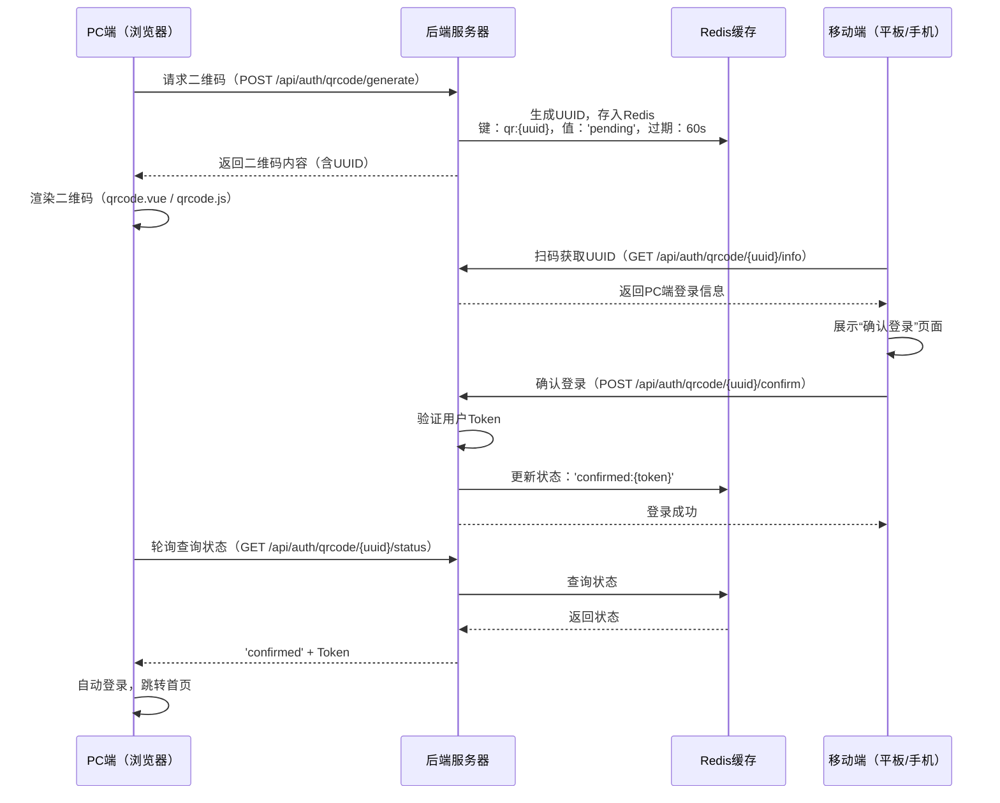

# 学生端多端适配设计方案（平板+手机优化版）


## 文档说明

- **文档版本**：v3.0
- **编写日期**：2026年9月
- **编写目的**：针对公安联考题库系统学生端，设计完整的平板端和手机端适配方案，聚焦移动端核心功能与最优体验。PC端设计已移除，专注于平板和手机两端的深度优化。
- **适用对象**：前端开发人员、UI/UX设计师


## 一、设计总览

### 1.1 设计目标

| 目标 | 说明 |
|------|------|
| **沉浸式学习** | 移动端设计聚焦学习核心场景，减少干扰，营造专注氛围 |
| **单手可操作** | 核心交互按钮位于屏幕下半部，适配单手操作习惯 |
| **信息层级清晰** | 小屏设备优先展示核心信息，次要信息通过二级页面呈现 |
| **触控友好** | 所有交互元素最小尺寸48px，适配手指点触（对齐移动端统一触控标准） |
| **视觉统一** | 平板端与手机端保持一致的品牌调性与视觉语言 |

### 1.2 设备断点

| 设备类型 | 屏幕宽度 | 栅格列数 | 设计重点 |
|---------|---------|---------|----------|
| **平板端** | 768px - 1024px | 8列 | 双列/混合布局，兼顾信息量与触控体验 |
| **手机端** | < 768px | 4列 | 单列布局，核心功能优先，单手操作 |

### 1.3 功能适配总表

| 功能模块 | 平板端 | 手机端 | 备注 |
|---------|--------|--------|------|
| 首页（签到/金句/新闻） | ✅ 完整 | ✅ 精简卡片 | 手机端折叠展示 |
| 快速练习 | ✅ | ✅ | 全端保留 |
| 历年试卷 | ✅ | ✅ | 全端保留 |
| 智能组卷 | ✅ | ✅ | 全端保留 |
| 联考小智 | ✅ | ✅ | 全端保留 |
| 模拟上机考试 | ❌ 删除 | ❌ 删除 | 移动端不支持 |
| 练习记录 | ✅ | ✅ | 全端保留 |
| 错题集 | ✅ | ✅ | 全端保留 |
| 收藏 | ✅ | ✅ | 全端保留 |
| 笔记 | ✅ | ✅ | 全端保留 |
| 成绩分析图 | ✅ 完整图表 | ✅ 简化图表 | 手机端适配小屏 |
| 备考资料 | ✅ | ✅ | 全端保留 |
| 论坛 | ✅ | ✅ | 全端保留 |
| 考试日历 | ✅ 保留 | ❌ 删除 | 手机端不展示 |
| 招考信息 | ✅ 保留 | ❌ 删除 | 手机端不展示 |
| 关于砺安题库 | ❌ 删除 | ❌ 删除 | 手机端移至“我的”设置中 |


## 二、多端登录与使用方案

### 2.1 整体方案概览

移动端（平板/手机）通过 **扫描PC端二维码** 或 **直接输入账号密码** 两种方式登录系统，无需额外注册。

```
┌─────────────────────────────────────────────────────────────────────────────┐
│  移动端登录方式总览                                                        │
├─────────────────────────────────────────────────────────────────────────────┤
│                                                                             │
│  ┌───────────────────────────────┐  ┌───────────────────────────────┐     │
│  │  📱 方式一：扫码登录（推荐）   │  │  📱 方式二：账号密码登录      │     │
│  │                               │  │                               │     │
│  │  1. PC端打开登录页            │  │  1. 打开移动端登录页          │     │
│  │  2. 显示动态二维码（60s有效） │  │  2. 输入用户名/密码           │     │
│  │  3. 移动端扫码确认            │  │  3. 点击“登录”                │     │
│  │  4. 自动登录并同步数据        │  │  4. 进入学习首页              │     │
│  └───────────────────────────────┘  └───────────────────────────────┘     │
│                                                                             │
│  登录后：                                                                   │
│  • 学习数据实时同步（题目进度、错题集、练习记录等）                         │
│  • 同一账号支持多设备同时在线（PC + 平板 + 手机）                           │
│  • 数据通过云端同步，换设备无缝衔接                                         │
└─────────────────────────────────────────────────────────────────────────────┘
```

### 2.2 二维码扫码登录详细设计

#### 2.2.1 技术实现方案

采用 **基于UUID + Redis的扫码登录机制**，整个流程不需要短信验证码或第三方SDK：

**PC端登录页展示二维码流程**：

```
┌─────────────────────────────────────────────────────────────────────────────┐
│  📱 扫码登录                                                               │
├─────────────────────────────────────────────────────────────────────────────┤
│                                                                             │
│  ┌─────────────────────────────────────────────────────────────────────┐    │
│  │                                                                     │    │
│  │                    ┌─────────────────┐                             │    │
│  │                    │                 │                             │    │
│  │                    │   二维码        │                             │    │
│  │                    │   (动态生成)    │                             │    │
│  │                    │                 │                             │    │
│  │                    └─────────────────┘                             │    │
│  │                                                                     │    │
│  │  请使用“砺安题库”APP或微信扫码登录                                  │    │
│  │  二维码有效期：60秒  [点击刷新]                                     │    │
│  │                                                                     │    │
│  │  已扫码用户：张三 (点击确认登录)  👆                                │    │
│  │                                                                     │    │
│  └─────────────────────────────────────────────────────────────────────┘    │
│                                                                             │
│  或使用账号密码登录 →                                                       │
└─────────────────────────────────────────────────────────────────────────────┘
```

**移动端扫码确认页面**：

```
┌─────────────────────────────────────────────────────────────────────────────┐
│  ← 返回                                       砺安题库                     │
├─────────────────────────────────────────────────────────────────────────────┤
│                                                                             │
│                    ┌─────────────────────────────────┐                      │
│                    │                                 │                      │
│                    │   🔍 扫码中...                  │                      │
│                    │                                 │                      │
│                    │   ┌──────────────────────┐     │                      │
│                    │   │  [扫描框 - 对准二维码]│     │                      │
│                    │   └──────────────────────┘     │                      │
│                    │                                 │                      │
│                    └─────────────────────────────────┘                      │
│                                                                             │
│  ┌─────────────────────────────────────────────────────────────────────┐    │
│  │  检测到PC端登录请求                                                 │    │
│  │  设备：Chrome · Windows 11                                         │    │
│  │  位置：北京 · 海淀                                                  │    │
│  │  时间：2026-09-05 14:32:15                                        │    │
│  │                                                                     │    │
│  │  [  ✅ 确认登录  ]  [  ❌ 取消  ]                                 │    │
│  └─────────────────────────────────────────────────────────────────────┘    │
└─────────────────────────────────────────────────────────────────────────────┘
```

#### 2.2.2 扫码登录技术流程



### 2.3 设备适配与数据同步

#### 2.3.1 多设备数据同步机制

| 数据类型 | 同步方式 | 实时性 | 说明 |
|---------|---------|--------|------|
| 用户信息 | Token认证 | 实时 | 登录后获取最新用户信息 |
| 题目/试卷数据 | API查询 | 实时 | 每次从数据库读取最新数据 |
| 答题进度 | API提交 | 实时 | 每道题提交后立即同步 |
| 错题集 | API查询 | 实时 | 从数据库实时读取 |
| 练习记录 | API查询 | 实时 | 从数据库实时读取 |
| 成绩分析 | API查询 | 近实时 | 缓存5分钟 |
| 收藏/笔记 | API提交/查询 | 实时 | 增删改即时生效 |

#### 2.3.2 多设备登录管理

| 功能 | 说明 |
|------|------|
| 同一账号多设备在线 | 支持PC + 平板 + 手机同时在线（最多3台设备） |
| 设备管理 | 可在“我的 → 设备管理”中查看和移除已登录设备 |
| 异地登录提醒 | 检测到新设备登录时，原设备收到推送通知 |
| 安全退出 | 支持“退出所有设备”功能 |


## 三、平板端完整页面设计

### 3.1 平板端整体布局模板

平板端采用 **“顶部导航 + 底部Tab栏”** 的混合导航模式，充分利用屏幕空间：

```
┌─────────────────────────────────────────────────────────────────────────────┐
│  🏛️ 砺安题库                       🔍 [搜索...]  🔔  👤 张三            │
├─────────────────────────────────────────────────────────────────────────────┤
│                                                                             │
│                         主内容区域                                          │
│                    （8列栅格布局，双列展示）                               │
│                                                                             │
│                                                                             │
├─────────────────────────────────────────────────────────────────────────────┤
│  🏠 首页  📚 题库  ✏️ 练习  💬 论坛  👤 我的                             │
└─────────────────────────────────────────────────────────────────────────────┘
```

### 3.2 平板端首页

```
┌─────────────────────────────────────────────────────────────────────────────┐
│  🏛️ 砺安题库                       🔍 [搜索...]  🔔  👤 张三            │
├─────────────────────────────────────────────────────────────────────────────┤
│  ┌──────────────────────────────────────────────────────────────────────┐  │
│  │  ☀️ 早上好，张三同学！                    连续学习 15 天 🔥         │  │
│  │  今日目标：完成 40 题   ████████████████░░░░  75% (30/40)         │  │
│  └──────────────────────────────────────────────────────────────────────┘  │
│                                                                             │
│  ┌────────────┐ ┌────────────┐ ┌────────────┐ ┌────────────┐              │
│  │ 📝 今日做题 │ │ 📊 本周做题 │ │ 📈 正确率  │ │ ⏱️ 学习时长 │              │
│  │ 18 题      │ │ 120 题     │ │ 70.2%     │ │ 1.8 小时   │              │
│  │ ↑12%       │ │ ↑8%        │ │ ↑3.2%     │ │ ↑15%      │              │
│  └────────────┘ └────────────┘ └────────────┘ └────────────┘              │
│                                                                             │
│  ┌────────────────────────────────┐ ┌────────────────────────────────┐      │
│  │  📈 本周学习趋势               │ │  📋 待办事项                 │      │
│  │  ┌──────────────────────┐     │ │  • 3份错题待复习 [去复习→] │      │
│  │  │  [柱状折线组合图]    │     │ │  • 1套智能组卷待完成       │      │
│  │  │  一 二 三 四 五 六 日│     │ │  • 2个论坛提问待回复       │      │
│  │  └──────────────────────┘     │ └────────────────────────────────┘      │
│  └────────────────────────────────┘                                        │
│                                                                             │
│  ┌────────────────────────────────┐ ┌────────────────────────────────┐      │
│  │  💬 每日金句                   │ │  📰 每日新闻                 │      │
│  │  “学而不思则罔...”            │ │  • 公安联考报名时间确定... │      │
│  │  —— 《论语·为政》             │ │  • 行测新增政治理论模块... │      │
│  └────────────────────────────────┘ └────────────────────────────────┘      │
│                                                                             │
│  ┌──────────────────────────────────────────────────────────────────────┐  │
│  │  📌 快捷入口                                                        │  │
│  │  [快速练习] [历年试卷] [智能组卷] [联考小智] [备考资料] [论坛]    │  │
│  └──────────────────────────────────────────────────────────────────────┘  │
│                                                                             │
├─────────────────────────────────────────────────────────────────────────────┤
│  🏠 首页  📚 题库  ✏️ 练习  💬 论坛  👤 我的                             │
└─────────────────────────────────────────────────────────────────────────────┘
```

### 3.3 平板端题库页面

```
┌─────────────────────────────────────────────────────────────────────────────┐
│  📚 题库                              🔍 [搜索题目...]  🔔  👤 张三      │
├─────────────────────────────────────────────────────────────────────────────┤
│  ┌──────────────────────────────────────────────────────────────────────┐  │
│  │  🔍 搜索题目、试卷...          [科目 ▼] [题型 ▼] [难度 ▼] [搜索] │  │
│  └──────────────────────────────────────────────────────────────────────┘  │
│                                                                             │
│  ┌────────────┐ ┌────────────┐ ┌────────────┐ ┌────────────┐              │
│  │ ⚡快速练习  │ │ 📄历年试卷  │ │ 🤖智能组卷  │ │ 🎯联考小智  │              │
│  │ 随机刷题    │ │ 真题演练    │ │ 个性组卷    │ │ AI答疑     │              │
│  └────────────┘ └────────────┘ └────────────┘ └────────────┘              │
│                                                                             │
│  ┌────────────────────────────────┐ ┌────────────────────────────────┐      │
│  │  📊 学习进度                   │ │  📋 快捷入口                 │      │
│  │  行测  ████████████░░  72%    │ │  [错题集] [收藏] [笔记]      │      │
│  │  公专  ████████░░░░░░  56%    │ │  [练习记录]                  │      │
│  │  申论  ██████░░░░░░░░  45%    │ │                              │      │
│  └────────────────────────────────┘ └────────────────────────────────┘      │
│                                                                             │
│  ┌──────────────────────────────────────────────────────────────────────┐  │
│  │  🔥 热门推荐                                                        │  │
│  │  [2026年公安联考行测真题]  [申论写作高分技巧]  [公专核心考点速记]   │  │
│  └──────────────────────────────────────────────────────────────────────┘  │
│                                                                             │
├─────────────────────────────────────────────────────────────────────────────┤
│  🏠 首页  📚 题库  ✏️ 练习  💬 论坛  👤 我的                             │
└─────────────────────────────────────────────────────────────────────────────┘
```

### 3.4 平板端答题页面

```
┌─────────────────────────────────────────────────────────────────────────────┐
│  ← 返回       2026年公安联考行测真题          ⏱️ 01:23:45  [交卷]       │
├─────────────────────────────────────────────────────────────────────────────┤
│  第 5/45 题 · 单选题 · 2分                    进度 ████████░░░░ 20%      │
├───────────────────────────────┬─────────────────────────────────────────────┤
│  ┌─────────────────────────┐  │  ┌─────────────────────────────────────┐   │
│  │  📖 题目内容             │  │  │  📋 答题卡                        │   │
│  │                          │  │  │  1  2  3  4  5  6  7  8  9  10   │   │
│  │  根据以下情境材料，      │  │  │  11 12 13 14 15 16 17 18 19 20  │   │
│  │  回答第5-8题...         │  │  │  ● 已答  ○ 未答  ◇ 标记       │   │
│  │  [图片]                  │  │  └─────────────────────────────────────┘   │
│  │  A. 立即出警             │  │                                         │
│  │  B. 报告上级             │  │  ┌─────────────────────────────────────┐   │
│  │  C. 疏散群众             │  │  │  📝 笔记                          │   │
│  │  D. 封锁现场             │  │  │  在此记录你的思考...              │   │
│  └─────────────────────────┘  │  └─────────────────────────────────────┘   │
├───────────────────────────────┴─────────────────────────────────────────────┤
│  [← 上一题]  [下一题 →]  [⭐ 收藏]  [🚩 标记]          [提交答案]       │
├─────────────────────────────────────────────────────────────────────────────┤
│  🏠 首页  📚 题库  ✏️ 练习  💬 论坛  👤 我的                             │
└─────────────────────────────────────────────────────────────────────────────┘
```

### 3.5 平板端成绩分析页面

```
┌─────────────────────────────────────────────────────────────────────────────┐
│  📈 成绩分析                          [近30天 ▼] [行测/公专/申论 ▼]      │
├─────────────────────────────────────────────────────────────────────────────┤
│  ┌──────────┐ ┌──────────┐ ┌──────────┐ ┌──────────┐                     │
│  │ 总练习量  │ │ 平均正确率│ │ 最高正确率│ │ 学习时长  │                     │
│  │ 3,562 题 │ │ 72.4%    │ │ 96.8%    │ │ 42.5 小时 │                     │
│  └──────────┘ └──────────┘ └──────────┘ └──────────┘                     │
│                                                                             │
│  ┌──────────────────────────────────────────────────────────────────────┐  │
│  │  各科目掌握度雷达图                                                  │  │
│  │         行测                                                         │  │
│  │   政治理论 ● 85%                                                    │  │
│  │    常识 ● 72%                                                       │  │
│  │  言语 ● 78%   ───────────  ● 资料 70%                              │  │
│  │      │ 判断 ● 65%                                                  │  │
│  │         公专                                                         │  │
│  └──────────────────────────────────────────────────────────────────────┘  │
│                                                                             │
│  ┌────────────────────────────────┐ ┌────────────────────────────────┐      │
│  │  各题型正确率                   │ │  薄弱知识点排行               │      │
│  │  单选  ██████████░ 82%        │ │  1. 图形推理    45%          │      │
│  │  多选  ████████░░░ 68%        │ │  2. 逻辑填空    52%          │      │
│  │  判断  █████████░░ 75%        │ │  3. 资料分析    58%          │      │
│  └────────────────────────────────┘ └────────────────────────────────┘      │
│                                                                             │
├─────────────────────────────────────────────────────────────────────────────┤
│  🏠 首页  📚 题库  ✏️ 练习  💬 论坛  👤 我的                             │
└─────────────────────────────────────────────────────────────────────────────┘
```

### 3.6 平板端备考资料页面

```
┌─────────────────────────────────────────────────────────────────────────────┐
│  📖 备考资料                                           [搜索资料...]      │
├─────────────────────────────────────────────────────────────────────────────┤
│  [📘 行测]  [📗 申论]  [📕 公专]                       进度 72% ████████ │
├─────────────────────────────────────────────────────────────────────────────┤
│  ┌─ 🎬 入门讲解视频 ──────────────────────────────────────────────────┐  │
│  │  ┌──────────────┐ ┌──────────────┐                               │  │
│  │  │  [封面]      │ │  [封面]      │                               │  │
│  │  │  行测导学     │ │  言语理解    │                               │  │
│  │  │  12:30 ✅    │ │  18:45 📌   │                               │  │
│  │  └──────────────┘ └──────────────┘                               │  │
│  │  ┌──────────────┐ ┌──────────────┐                               │  │
│  │  │  [封面]      │ │  [封面]      │                               │  │
│  │  │  判断推理    │ │  数量关系    │                               │  │
│  │  │  15:20 📌   │ │  22:10      │                               │  │
│  │  └──────────────┘ └──────────────┘                               │  │
│  └─────────────────────────────────────────────────────────────────────┘  │
│                                                                             │
│  ┌─ 🎯 深度拓展视频 ──────────────────────────────────────────────────┐  │
│  │  ┌──────────────┐ ┌──────────────┐                               │  │
│  │  │  [封面]      │ │  [封面]      │                               │  │
│  │  │  资料分析速算 │ │  图形推理    │                               │  │
│  │  │  25:30 ⭐⭐  │ │  32:15 ⭐⭐  │                               │  │
│  │  └──────────────┘ └──────────────┘                               │  │
│  └─────────────────────────────────────────────────────────────────────┘  │
│                                                                             │
│  ┌─ 🃏 知识卡片 ──────────────────────────────────────────────────────┐  │
│  │  ┌──────┐ ┌──────┐ ┌──────┐ ┌──────┐                           │  │
│  │  │逻辑填空│ │中心理解│ │图形推理│ │类比推理│                   │  │
│  │  │ 12/20 │ │ 8/15  │ │ 6/12  │ │ 10/18│                   │  │
│  │  └──────┘ └──────┘ └──────┘ └──────┘                           │  │
│  └─────────────────────────────────────────────────────────────────────┘  │
├─────────────────────────────────────────────────────────────────────────────┤
│  🏠 首页  📚 题库  ✏️ 练习  💬 论坛  👤 我的                             │
└─────────────────────────────────────────────────────────────────────────────┘
```

### 3.7 平板端论坛页面

```
┌─────────────────────────────────────────────────────────────────────────────┐
│  💬 论坛                                     [+ 发布帖子] [搜索帖子...]    │
├─────────────────────────────────────────────────────────────────────────────┤
│  [最新] [热门] [精华] [我的帖子]                                           │
├─────────────────────────────────────────────────────────────────────────────┤
│  ┌──────────────────────────────────────────────────────────────────────┐  │
│  │  📌 置顶 · 2026年公安联考备考经验交流帖                            │  │
│  │  2026-08-20  📢 管理员   💬 156  ❤️ 89                            │  │
│  └──────────────────────────────────────────────────────────────────────┘  │
│                                                                             │
│  ┌──────────────────────────────────────────────────────────────────────┐  │
│  │  🔥 热门 · 行测数量关系如何快速突破？                               │  │
│  │  2026-08-19  👤 张三   💬 23  ❤️ 45                               │  │
│  └──────────────────────────────────────────────────────────────────────┘  │
│                                                                             │
│  ┌──────────────────────────────────────────────────────────────────────┐  │
│  │  🔥 热门 · 公专职业素养核心考点总结                                 │  │
│  │  2026-08-18  👤 李四   💬 18  ❤️ 32                               │  │
│  └──────────────────────────────────────────────────────────────────────┘  │
│                                                                             │
│  ┌──────────────────────────────────────────────────────────────────────┐  │
│  │  📄 申论大作文万能框架分享                                          │  │
│  │  2026-08-17  👤 王五   💬 12  ❤️ 28                               │  │
│  └──────────────────────────────────────────────────────────────────────┘  │
├─────────────────────────────────────────────────────────────────────────────┤
│  🏠 首页  📚 题库  ✏️ 练习  💬 论坛  👤 我的                             │
└─────────────────────────────────────────────────────────────────────────────┘
```


## 四、手机端完整页面设计

### 4.1 手机端整体布局模板

手机端采用 **“底部Tab栏”** 主导航，5个核心Tab：

```
┌─────────────────────────────────────────────────────────────────────────────┐
│  ← 返回    砺安题库                  [🔍] [🔔]                             │
├─────────────────────────────────────────────────────────────────────────────┤
│                                                                             │
│                         主内容区域                                          │
│                    （单列布局，4列栅格）                                   │
│                                                                             │
│                                                                             │
│                                                                             │
│                                                                             │
├─────────────────────────────────────────────────────────────────────────────┤
│  🏠 首页  📚 题库  ✏️ 练习  💬 论坛  👤 我的                             │
└─────────────────────────────────────────────────────────────────────────────┘
```

### 4.2 手机端首页

```
┌─────────────────────────────────────────────────────────────────────────────┐
│  ← 返回    砺安题库                  [🔔]                                  │
├─────────────────────────────────────────────────────────────────────────────┤
│  ┌──────────────────────────────────────────────────────────────────────┐  │
│  │  ☀️ 早上好，张三！                连续学习 15 天 🔥                │  │
│  │  今日目标：40题    ████████████████░░░░  75% (30/40)              │  │
│  └──────────────────────────────────────────────────────────────────────┘  │
│                                                                             │
│  ┌────────────┐ ┌────────────┐                                             │
│  │ 📝 今日做题 │ │ 📊 本周做题 │                                             │
│  │ 18 题      │ │ 120 题     │                                             │
│  └────────────┘ └────────────┘                                             │
│  ┌────────────┐ ┌────────────┐                                             │
│  │ 📈 正确率   │ │ ⏱️ 学习时长 │                                             │
│  │ 70.2%     │ │ 1.8 小时   │                                             │
│  └────────────┘ └────────────┘                                             │
│                                                                             │
│  ┌──────────────────────────────────────────────────────────────────────┐  │
│  │  📈 本周学习趋势                 [7天 ▼] [30天 ▼]                  │  │
│  │  ┌──────────────────────┐                                         │  │
│  │  │  [简化折线图]        │                                         │  │
│  │  │  一 二 三 四 五 六 日 │                                         │  │
│  │  └──────────────────────┘                                         │  │
│  └──────────────────────────────────────────────────────────────────────┘  │
│                                                                             │
│  ┌──────────────────────────────────────────────────────────────────────┐  │
│  │  💬 每日金句                                                        │  │
│  │  “学而不思则罔，思而不学则殆。”                                     │  │
│  │  —— 《论语·为政》                                                  │  │
│  └──────────────────────────────────────────────────────────────────────┘  │
│                                                                             │
│  ┌──────────────────────────────────────────────────────────────────────┐  │
│  │  📰 每日新闻                                                        │  │
│  │  • 公安联考报名时间确定...                                         │  │
│  │  • 行测新增政治理论模块...                                         │  │
│  │  • 申论命题方向调整...                                             │  │
│  └──────────────────────────────────────────────────────────────────────┘  │
├─────────────────────────────────────────────────────────────────────────────┤
│  🏠 首页  📚 题库  ✏️ 练习  💬 论坛  👤 我的                             │
└─────────────────────────────────────────────────────────────────────────────┘
```

### 4.3 手机端题库页面

```
┌─────────────────────────────────────────────────────────────────────────────┐
│  ← 返回    📚 题库                                                         │
├─────────────────────────────────────────────────────────────────────────────┤
│  ┌──────────────────────────────────────────────────────────────────────┐  │
│  │  🔍 搜索题目...          [科目▼] [题型▼]                           │  │
│  └──────────────────────────────────────────────────────────────────────┘  │
│                                                                             │
│  ┌──────────┐ ┌──────────┐                                                │
│  │ ⚡快速练习 │ │ 📄历年试卷 │                                                │
│  │ 随机刷题   │ │ 真题演练   │                                                │
│  └──────────┘ └──────────┘                                                │
│  ┌──────────┐ ┌──────────┐                                                │
│  │ 🤖智能组卷 │ │ 🎯联考小智 │                                                │
│  │ 个性组卷   │ │ AI答疑    │                                                │
│  └──────────┘ └──────────┘                                                │
│                                                                             │
│  ┌──────────────────────────────────────────────────────────────────────┐  │
│  │  📊 我的进度                                                        │  │
│  │  行测  ████████████░░  72%                                         │  │
│  │  公专  ████████░░░░░░  56%                                         │  │
│  │  申论  ██████░░░░░░░░  45%                                         │  │
│  └──────────────────────────────────────────────────────────────────────┘  │
│                                                                             │
│  ┌──────────────────────────────────────────────────────────────────────┐  │
│  │  📋 快捷入口                                                        │  │
│  │  [错题集] [收藏] [笔记] [练习记录]                                  │  │
│  └──────────────────────────────────────────────────────────────────────┘  │
├─────────────────────────────────────────────────────────────────────────────┤
│  🏠 首页  📚 题库  ✏️ 练习  💬 论坛  👤 我的                             │
└─────────────────────────────────────────────────────────────────────────────┘
```

### 4.4 手机端答题页面

```
┌─────────────────────────────────────────────────────────────────────────────┐
│  ← 返回   2026年公安联考行测真题     ⏱️ 01:23:45                        │
├─────────────────────────────────────────────────────────────────────────────┤
│  第 5/45 题 · 单选题 · 2分            进度 ████████░░░░ 20%             │
├─────────────────────────────────────────────────────────────────────────────┤
│                                                                             │
│  ┌──────────────────────────────────────────────────────────────────────┐  │
│  │  📖 根据以下情境材料，回答第5-8题...                               │  │
│  │                                                                     │  │
│  │  [图片]                                                             │  │
│  │                                                                     │  │
│  │  ┌──────────────────────────────────────────────────────────────┐   │  │
│  │  │  ○ A. 立即出警                                              │   │  │
│  │  ├──────────────────────────────────────────────────────────────┤   │  │
│  │  │  ○ B. 报告上级                                              │   │  │
│  │  ├──────────────────────────────────────────────────────────────┤   │  │
│  │  │  ○ C. 疏散群众                                              │   │  │
│  │  ├──────────────────────────────────────────────────────────────┤   │  │
│  │  │  ○ D. 封锁现场                                              │   │  │
│  │  └──────────────────────────────────────────────────────────────┘   │  │
│  └──────────────────────────────────────────────────────────────────────┘  │
│                                                                             │
│  [上一题]  [下一题]  [⭐]  [🚩]                                            │
│                                                                             │
│  ┌──────────────────────────────────────────────────────────────────────┐  │
│  │              [📋 查看答题卡]  [📝 笔记]                            │  │
│  └──────────────────────────────────────────────────────────────────────┘  │
├─────────────────────────────────────────────────────────────────────────────┤
│  🏠 首页  📚 题库  ✏️ 练习  💬 论坛  👤 我的                             │
└─────────────────────────────────────────────────────────────────────────────┘
```

### 4.5 手机端练习页面（完整版）

```
┌─────────────────────────────────────────────────────────────────────────────┐
│  ✏️ 练习                                                                   │
├─────────────────────────────────────────────────────────────────────────────┤
│  ┌──────────────────────────────────────────────────────────────────────┐  │
│  │  🔍 搜索知识点...                [全部 ▼] [最近练习 ▼]           │  │
│  └──────────────────────────────────────────────────────────────────────┘  │
│                                                                             │
│  ┌─ 📚 科目快速切换 ───────────────────────────────────────────────────┐  │
│  │  ┌──────┐ ┌──────┐ ┌──────┐                                         │  │
│  │  │  📘   │ │  📗   │ │  📕   │                                         │  │
│  │  │ 行测  │ │ 申论  │ │ 公专  │                                         │  │
│  │  │ 72%  │ │ 45%  │ │ 56%  │                                         │  │
│  │  └──────┘ └──────┘ └──────┘                                         │  │
│  └──────────────────────────────────────────────────────────────────────┘  │
│                                                                             │
│  ┌─ 行测（当前选中）──────────────────────────────────────────────────┐  │
│  │  进度 ████████████░░░░░░ 72%  共156题  已练112题                  │  │
│  │                                                                     │  │
│  │  ┌──────────────────────────────────────────────────────────────┐   │  │
│  │  │  📖 政治理论                                    85%   15/18 │   │  │
│  │  │  ██████████░░░░░░░░░░░░░░░░░░░░░░░░░░░░░░░░░░             │   │  │
│  │  ├──────────────────────────────────────────────────────────────┤   │  │
│  │  │  📖 常识判断                                    72%   23/32 │   │  │
│  │  │  ████████░░░░░░░░░░░░░░░░░░░░░░░░░░░░░░░░░░░             │   │  │
│  │  ├──────────────────────────────────────────────────────────────┤   │  │
│  │  │  📖 言语理解与表达                              78%   31/40 │   │  │
│  │  │  █████████░░░░░░░░░░░░░░░░░░░░░░░░░░░░░░░░░░            │   │  │
│  │  ├──────────────────────────────────────────────────────────────┤   │  │
│  │  │  📖 判断推理                                    65%   18/28 │   │  │
│  │  │  ██████░░░░░░░░░░░░░░░░░░░░░░░░░░░░░░░░░░░░░             │   │  │
│  │  ├──────────────────────────────────────────────────────────────┤   │  │
│  │  │  📖 资料分析                                    70%   22/31 │   │  │
│  │  │  ███████░░░░░░░░░░░░░░░░░░░░░░░░░░░░░░░░░░░░            │   │  │
│  │  ├──────────────────────────────────────────────────────────────┤   │  │
│  │  │  📖 知觉速度与准确性                            45%    9/20 │   │  │
│  │  │  ████░░░░░░░░░░░░░░░░░░░░░░░░░░░░░░░░░░░░░░░            │   │  │
│  │  └──────────────────────────────────────────────────────────────┘   │  │
│  │  [查看全部 6 个模块 →]                                              │  │
│  └──────────────────────────────────────────────────────────────────────┘  │
│                                                                             │
│  ┌──────────────────────────────────────────────────────────────────────┐  │
│  │  📋 快捷入口                                                        │  │
│  │  ┌──────┐ ┌──────┐ ┌──────┐ ┌──────┐                              │  │
│  │  │ 📝    │ │ ❌    │ │ ⭐    │ │ 📓    │                              │  │
│  │  │练习记录│ │错题集 │ │收藏   │ │笔记   │                              │  │
│  │  │ 45条  │ │ 23道  │ │ 12题  │ │ 8条   │                              │  │
│  │  └──────┘ └──────┘ └──────┘ └──────┘                              │  │
│  └──────────────────────────────────────────────────────────────────────┘  │
├─────────────────────────────────────────────────────────────────────────────┤
│  🏠 首页  📚 题库  ✏️ 练习  💬 论坛  👤 我的                             │
└─────────────────────────────────────────────────────────────────────────────┘
```

#### 4.5.1 知识点点击后的下钻页面

当用户点击某个知识点（如“图形推理”）后，进入该知识点的练习模式选择页：

```
┌─────────────────────────────────────────────────────────────────────────────┐
│  ← 返回    图形推理                                                        │
├─────────────────────────────────────────────────────────────────────────────┤
│  ┌──────────────────────────────────────────────────────────────────────┐  │
│  │  📊 学习进度              6/12 题  进度 50%                       │  │
│  │  ████████░░░░░░░░░░░░░░░░░░░░░░░░░░░░░░░░░░░░░░░░░░               │  │
│  │  正确率：58%  薄弱点：空间重构                                     │  │
│  └──────────────────────────────────────────────────────────────────────┘  │
│                                                                             │
│  ┌──────────────────────────────────────────────────────────────────────┐  │
│  │  🎯 选择练习模式                                                   │  │
│  │                                                                     │  │
│  │  ┌──────────────────────────────────────────────────────────────┐   │  │
│  │  │  ⚡ 随机练习    系统随机出题，快速刷题                     │   │  │
│  │  └──────────────────────────────────────────────────────────────┘   │  │
│  │                                                                     │  │
│  │  ┌──────────────────────────────────────────────────────────────┐   │  │
│  │  │  📖 专项突破    按题型分类练习，逐个击破                   │   │  │
│  │  │  [图形规律] [空间重构] [类比推理] [定义判断]               │   │  │
│  │  └──────────────────────────────────────────────────────────────┘   │  │
│  │                                                                     │  │
│  │  ┌──────────────────────────────────────────────────────────────┐   │  │
│  │  │  ❌ 错题重练    仅练习错题，巩固薄弱                       │   │  │
│  │  │  当前 3 道错题等待重练                                      │   │  │
│  │  └──────────────────────────────────────────────────────────────┘   │  │
│  └──────────────────────────────────────────────────────────────────────┘  │
├─────────────────────────────────────────────────────────────────────────────┤
│  🏠 首页  📚 题库  ✏️ 练习  💬 论坛  👤 我的                             │
└─────────────────────────────────────────────────────────────────────────────┘
```

### 4.6 手机端论坛页面

```
┌─────────────────────────────────────────────────────────────────────────────┐
│  💬 论坛                               [+ 发布] [🔍]                      │
├─────────────────────────────────────────────────────────────────────────────┤
│  [最新] [热门] [精华] [我的]                                               │
├─────────────────────────────────────────────────────────────────────────────┤
│  ┌──────────────────────────────────────────────────────────────────────┐  │
│  │  📌 2026年公安联考备考经验交流帖                                    │  │
│  │  管理员 · 08-20    💬 156  ❤️ 89                                  │  │
│  └──────────────────────────────────────────────────────────────────────┘  │
│                                                                             │
│  ┌──────────────────────────────────────────────────────────────────────┐  │
│  │  🔥 行测数量关系如何快速突破？                                      │  │
│  │  张三 · 08-19     💬 23  ❤️ 45                                    │  │
│  └──────────────────────────────────────────────────────────────────────┘  │
│                                                                             │
│  ┌──────────────────────────────────────────────────────────────────────┐  │
│  │  🔥 公专职业素养核心考点总结                                        │  │
│  │  李四 · 08-18     💬 18  ❤️ 32                                    │  │
│  └──────────────────────────────────────────────────────────────────────┘  │
│                                                                             │
│  ┌──────────────────────────────────────────────────────────────────────┐  │
│  │  📄 申论大作文万能框架分享                                          │  │
│  │  王五 · 08-17     💬 12  ❤️ 28                                    │  │
│  └──────────────────────────────────────────────────────────────────────┘  │
├─────────────────────────────────────────────────────────────────────────────┤
│  🏠 首页  📚 题库  ✏️ 练习  💬 论坛  👤 我的                             │
└─────────────────────────────────────────────────────────────────────────────┘
```

### 4.7 手机端“我的”页面（个人中心）

```
┌─────────────────────────────────────────────────────────────────────────────┐
│  👤 我的                                                                   │
├─────────────────────────────────────────────────────────────────────────────┤
│  ┌──────────────────────────────────────────────────────────────────────┐  │
│  │  [头像]  张三                                                       │  │
│  │  刑侦2201班 · 学号：2024001                                        │  │
│  │  连续学习 15 天 🔥                                                  │  │
│  │  [编辑资料]                                                         │  │
│  └──────────────────────────────────────────────────────────────────────┘  │
│                                                                             │
│  ┌──────────────────────────────────────────────────────────────────────┐  │
│  │  📊 学习数据                                                        │  │
│  │  总做题 3,562题  正确率 72.4%  学习时长 42.5小时                  │  │
│  └──────────────────────────────────────────────────────────────────────┘  │
│                                                                             │
│  ┌──────────────────────────────────────────────────────────────────────┐  │
│  │  📈 成绩分析  →                                                    │  │
│  └──────────────────────────────────────────────────────────────────────┘  │
│                                                                             │
│  ┌──────────────────────────────────────────────────────────────────────┐  │
│  │  📖 备考资料  →                                                    │  │
│  └──────────────────────────────────────────────────────────────────────┘  │
│                                                                             │
│  ┌──────────────────────────────────────────────────────────────────────┐  │
│  │  ⚙️ 设置                                                            │  │
│  │  [个人设置] [通知设置] [设备管理] [关于砺安题库]  [退出登录]        │  │
│  └──────────────────────────────────────────────────────────────────────┘  │
├─────────────────────────────────────────────────────────────────────────────┤
│  🏠 首页  📚 题库  ✏️ 练习  💬 论坛  👤 我的                             │
└─────────────────────────────────────────────────────────────────────────────┘
```


## 五、平板/手机端登录与使用方案详细设计

### 5.1 二维码扫码登录详细设计

#### 5.1.1 技术方案概述

采用 **基于UUID + Redis的扫码登录机制**，不依赖第三方SDK或短信验证码：

| 组件 | 技术方案 | 说明 |
|------|---------|------|
| 二维码生成 | `qrcode` / `qrcode.vue` | PC端生成动态二维码 |
| 会话管理 | Redis + JWT | 存储扫码状态和用户Token |
| 状态轮询 | 长轮询（Long Polling） | PC端轮询扫码状态 |
| 实时通知 | Server-Sent Events / WebSocket | 扫码后实时通知PC端 |

#### 5.1.2 核心接口设计

**1. 生成二维码接口（PC端调用，公开接口·无需鉴权）**

```
POST /api/auth/qrcode/generate
Response:
{
  "uuid": "qr_20260905_143215_abc123",
  "qr_url": "{前端origin}/#/mobile/scan?uuid=abc123",
  "expires_in": 60,
  "qr_image_base64": "data:image/png;base64,..."
}
```

**2. 扫码获取信息接口（移动端调用）**

```
GET /api/auth/qrcode/{uuid}/info
Response:
{
  "device": "Chrome 120.0 / Windows 11",
  "location": "北京 · 海淀",
  "login_time": "2026-09-05 14:32:15"
}
```

**3. 确认登录接口（移动端调用）**

```
POST /api/auth/qrcode/{uuid}/confirm
Request:
{
  "token": "eyJhbGciOiJIUzI1NiIs..."
}
Response:
{
  "code": 200,
  "message": "登录确认成功"
}
```

**4. 轮询状态接口（PC端调用）**

```
GET /api/auth/qrcode/{uuid}/status
Response:
{
  "status": "confirmed",  // pending / confirmed / expired
  "token": "eyJhbGciOiJIUzI1NiIs..."  // 仅confirmed时返回
}
```

#### 5.1.3 登录安全保障

| 安全措施 | 说明 |
|---------|------|
| 二维码有效期 | 60秒自动过期，防止被他人误扫 |
| 设备二次确认 | 扫码后移动端需点击“确认登录” |
| 登录通知 | PC端收到登录成功通知，显示用户信息 |
| 异常检测 | 同一二维码被多次扫码时，触发安全告警 |
| HTTPS传输 | 所有接口使用HTTPS加密，防止中间人攻击 |

### 5.2 账号密码登录

```
┌─────────────────────────────────────────────────────────────────────────────┐
│  砺安题库                                                                  │
├─────────────────────────────────────────────────────────────────────────────┤
│                                                                             │
│                     ┌─────────────────────────┐                           │
│                     │      砺安题库            │                           │
│                     │   公安联考智能备考       │                           │
│                     └─────────────────────────┘                           │
│                                                                             │
│  ┌─────────────────────────────────────────────────────────────────────┐    │
│  │  账号：[________________________]                                  │    │
│  │  密码：[________________________]  [👁️]                          │    │
│  │  记住我 [ ]  忘记密码？                                           │    │
│  │                                                                     │    │
│  │  [  ✅ 登录  ]                                                     │    │
│  │                                                                     │    │
│  └─────────────────────────────────────────────────────────────────────┘    │
│                                                                             │
│  还没有账号？请联系管理员分配                                               │
│  扫码登录 >                                                               │
└─────────────────────────────────────────────────────────────────────────────┘
```

### 5.3 设备管理

用户在“我的 → 设备管理”中可查看和管理所有登录设备：

```
┌─────────────────────────────────────────────────────────────────────────────┐
│  ← 返回    设备管理                                                         │
├─────────────────────────────────────────────────────────────────────────────┤
│                                                                             │
│  ┌──────────────────────────────────────────────────────────────────────┐  │
│  │  当前设备（本机）                                                    │  │
│  │  📱 iPhone 15 Pro    iOS 17.4                                      │  │
│  │  首次登录：2026-09-01 14:23                                       │  │
│  │  当前在线 ●                                                       │  │
│  └──────────────────────────────────────────────────────────────────────┘  │
│                                                                             │
│  ┌──────────────────────────────────────────────────────────────────────┐  │
│  │  💻 其他设备                                                       │  │
│  │  Windows 11 · Chrome 120.0   北京 · 海淀                          │  │
│  │  最后活跃：2026-09-04 20:15                                       │  │
│  │  [移除设备]                                                         │  │
│  └──────────────────────────────────────────────────────────────────────┘  │
│                                                                             │
│  ┌──────────────────────────────────────────────────────────────────────┐  │
│  │  📱 其他设备                                                       │  │
│  │  iPad Pro 12.9    Safari 17.4   上海 · 浦东                       │  │
│  │  最后活跃：2026-09-03 10:30                                       │  │
│  │  [移除设备]                                                         │  │
│  └──────────────────────────────────────────────────────────────────────┘  │
│                                                                             │
│  [ 退出所有设备 ]                                                          │
└─────────────────────────────────────────────────────────────────────────────┘
```


## 六、交互规范与视觉设计

### 6.1 触控交互规范

| 交互类型 | 规范说明 |
|---------|----------|
| 点击反馈 | 所有可点击元素需有点击态（透明度/颜色变化/缩放） |
| 最小点击区域 | 48px × 48px（统一触控标准） |
| 滑动返回 | 支持从屏幕左边缘右滑返回 |
| 下拉刷新 | 列表页面支持下拉刷新 |
| 长按操作 | 支持长按弹出更多操作菜单 |
| 手势切换 | Tab栏支持左右滑动切换 |
| 过渡动画 | 页面切换使用平滑过渡动画（300ms） |

### 6.2 手势交互设计

| 手势 | 功能 | 适用页面 |
|------|------|---------|
| 左滑 | 返回上一页 | 所有页面 |
| 右滑 | 前进（如有） | 答题页面 |
| 上滑 | 加载更多 | 列表页面 |
| 下滑 | 刷新页面 | 首页、列表页 |
| 双击 | 回到顶部 | 长列表页面 |
| 长按 | 弹出操作菜单 | 列表项、卡片 |

### 6.3 横竖屏适配

| 屏幕方向 | 适配策略 |
|---------|---------|
| **竖屏（默认）** | 单列布局，内容垂直滚动，核心功能完整 |
| **横屏（可选）** | 双栏布局（如答题页面），左侧展示题目，右侧展示答题卡或解析 |

### 6.4 视觉设计规范

| 设计元素 | 平板端 | 手机端 |
|---------|--------|--------|
| 卡片圆角 | 12px | 10px |
| 卡片阴影 | 轻 | 超轻 |
| 字体大小 | 15px基准 | 14px基准 |
| 间距单位 | 20px | 16px |
| 主色（品牌深蓝） | #1A365D | #1A365D |
| 强调色（品牌红） | #C91F37 | #C91F37 |
| 背景色 | #F0F2F5 | #F5F7FA |

### 6.5 色彩与状态标识

| 状态 | 色值 | 用途 |
|------|------|------|
| 成功/已完成 | `#52C41A` | 已完成、正确、已读 |
| 警告/进行中 | `#FAAD14` | 进行中、待处理 |
| 危险/未完成 | `#FF4D4F` | 错误、未完成 |
| 信息/学习中 | `#1890FF` | 进行中、学习中 |
| 行测标识 | `#3B82F6` | 科目标识 |
| 申论标识 | `#10B981` | 科目标识 |
| 公专标识 | `#F59E0B` | 科目标识 |


## 七、性能优化与离线支持

### 7.1 性能优化策略

| 优化项 | 策略 | 说明 |
|--------|------|------|
| 首屏加载 | 路由懒加载 + 组件异步加载 | 减少首屏加载时间 |
| 图片加载 | 懒加载 + WebP格式 | 节省流量，提升加载速度 |
| 数据缓存 | 本地存储（localStorage） | 减少重复请求 |
| 网络请求 | 请求合并 + 防抖节流 | 减少请求次数 |
| 列表渲染 | 虚拟滚动 | 提升长列表性能 |
| 页面切换 | 预加载相邻页面 | 提升切换流畅度 |

### 7.2 离线支持

| 功能 | 支持情况 | 说明 |
|------|---------|------|
| 查看已加载题目 | ✅ 支持 | 已加载的题目可在离线时查看 |
| 答题提交 | ❌ 不支持 | 需联网提交 |
| 查看错题集 | ✅ 支持 | 错题数据已本地缓存 |
| 查看练习记录 | ✅ 支持 | 记录已本地缓存 |
| 查看金句/新闻 | ✅ 支持 | 当日的已缓存 |

### 7.3 加载状态设计

| 状态 | 展示方式 |
|------|---------|
| 初次加载 | 骨架屏（Skeleton Screen） |
| 刷新加载 | 顶部加载动画 |
| 更多加载 | 底部加载圈 + “加载中...” |
| 加载失败 | 错误提示 + “重试”按钮 |
| 空状态 | 插画 + 提示文字 + 操作引导 |


## 八、技术实现建议

### 8.1 核心技术方案

| 技术 | 用途 | 说明 |
|------|------|------|
| **CSS Grid + Flexbox** | 响应式布局 | 使用CSS Grid实现栅格系统 |
| **CSS 媒体查询** | 断点控制 | 根据屏幕宽度切换布局样式 |
| **Vue 3 响应式** | 组件级适配 | 使用`useMediaQuery`实现组件级响应式 |
| **CSS 容器查询** | 组件级自适应 | 根据容器宽度调整样式 |
| **qrcode.vue** | 二维码生成 | PC端生成登录二维码 |
| **qrcode-reader** | 二维码扫描 | 移动端扫码功能 |

### 8.2 断点实现示例

```css
/* 移动优先 - 默认手机端样式 */
.container { padding: 16px; }
.grid { display: grid; grid-template-columns: 1fr; gap: 12px; }

/* 平板端适配 (≥768px) */
@media (min-width: 768px) {
  .container { padding: 24px; max-width: 1024px; margin: 0 auto; }
  .grid { grid-template-columns: repeat(2, 1fr); gap: 16px; }
  .hide-on-tablet { display: none; }
  .show-on-tablet { display: block; }
}
```

### 8.3 Vue 3 设备检测 Composable

```javascript
// composables/useDevice.js
import { ref, onMounted, onUnmounted } from 'vue'

export function useDevice() {
  const isMobile = ref(false)
  const isTablet = ref(false)
  const width = ref(window.innerWidth)

  const checkDevice = () => {
    const w = window.innerWidth
    width.value = w
    isMobile.value = w < 768
    isTablet.value = w >= 768 && w < 1024
  }

  onMounted(() => {
    checkDevice()
    window.addEventListener('resize', checkDevice)
  })

  onUnmounted(() => {
    window.removeEventListener('resize', checkDevice)
  })

  return { isMobile, isTablet, width }
}
```


## 九、实施优先级

| 优先级 | 任务 | 说明 |
|--------|------|------|
| **P0** | 手机端布局（底部Tab栏 + 单列布局） | 移动优先策略，必须优先 |
| **P0** | 手机端功能模块调整（删除模拟上机、考试日历、招考信息） | 核心功能调整 |
| **P0** | 平板端布局（顶部栏+底部Tab + 双列布局） | 重要设备适配 |
| **P0** | 响应式栅格系统搭建 | 布局基础 |
| **P1** | 二维码扫码登录（完整流程） | 多端登录核心 |
| **P1** | 答题页双端适配 | 核心交互 |
| **P1** | 手机端练习页面（含科目-知识点下钻） | 核心页面 |
| **P2** | 图片响应式加载 | 性能优化 |
| **P2** | 触控交互优化（手势、反馈） | 移动端体验 |
| **P2** | 设备管理页面 | 增强功能 |
| **P3** | 离线缓存支持 | 增强体验 |
| **P3** | 横竖屏切换适配 | 增强体验 |


## 十、总结

本方案针对公安联考题库系统学生端，完成了平板端和手机端的完整页面设计：

| 维度 | 设计要点 |
|------|---------|
| **登录方式** | 二维码扫码登录 + 账号密码登录，支持多设备同时在线 |
| **功能适配** | 平板端完整功能（不含模拟上机）；手机端删除模拟上机、考试日历、招考信息 |
| **导航架构** | 平板：顶部栏+底部Tab；手机：底部Tab（5项） |
| **布局栅格** | 平板：8列双列；手机：4列单列 |
| **交互优化** | 触控最小区域48px，支持手势操作，页面切换平滑 |
| **数据同步** | 多设备实时同步，学习进度无缝衔接 |

通过以上设计，公安联考题库系统学生端将在平板端和手机端获得适配良好、体验一致、视觉美观的使用感受，满足用户在不同场景下的学习需求。