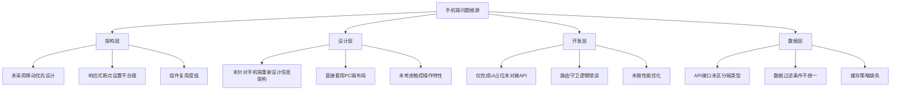

# 手机端深度优化与细节处理设计方案


## 文档说明

- **文档版本**：v3.1
- **编写日期**：2026年9月
- **编写目的**：针对手机端存在的页面布局不科学、功能模块无实际作用、稳定性差、返回机制不灵敏、题目分类与电脑端不同步等核心问题，以及新增的「一屏适配（功能模块无滚动）+ 图标缩减」要求，进行系统性诊断与完整优化方案设计。
- **适用对象**：前端开发人员、UI/UX设计师、后端开发人员


## 第一部分：现有问题全面诊断

### 一、问题分类总览

| 问题类别 | 问题编号 | 问题描述 | 严重程度 |
|---------|---------|---------|---------|
| **页面布局** | P1-1 | 功能模块排布不合理，信息密度过高/过低 | 🔴 高 |
| | P1-2 | 模块大小设计不当，部分卡片过大/过小 | 🟠 中 |
| | P1-3 | 页面留白不足，视觉拥挤 | 🟠 中 |
| **功能模块** | P2-1 | 大量功能模块仅有前端占位，无实际功能 | 🔴 高 |
| | P2-2 | 图表仅展示静态数据，无法交互 | 🔴 高 |
| | P2-3 | 点击按钮无响应或跳转错误 | 🔴 高 |
| **稳定性** | P3-1 | 页面卡顿，滚动不流畅 | 🔴 高 |
| | P3-2 | 功能模块偶发无法使用 | 🔴 高 |
| | P3-3 | 数据加载慢，白屏时间长 | 🟠 中 |
| **导航返回** | P4-1 | 返回按钮不灵敏，需多次点击 | 🔴 高 |
| | P4-2 | 部分模块缺少返回上一级按钮 | 🔴 高 |
| | P4-3 | 返回时先经过空页面才能回到首页 | 🔴 高 |
| **题目分类** | P5-1 | 手机端未展示公专、申论、行测三大模块分类 | 🔴 高 |
| | P5-2 | 缺少知识点下钻分类 | 🔴 高 |
| | P5-3 | 题目数据与电脑端不同步，公专题目无显示 | 🔴 高 |


### 二、问题根因深度分析




## 第二部分：手机端页面布局重构方案

### 一、整体布局框架

手机端采用 **“顶部导航 + 内容区 + 底部Tab栏”** 三层结构：

```
┌─────────────────────────────────────────────────────────────────────────────┐
│  顶部导航栏（固定）                                                          │
│  ← 返回   页面标题                    [搜索] [通知]                        │
├─────────────────────────────────────────────────────────────────────────────┤
│                                                                             │
│                                                                             │
│                         内容区（可滚动）                                     │
│                                                                             │
│                                                                             │
│                                                                             │
├─────────────────────────────────────────────────────────────────────────────┤
│  底部Tab栏（固定）                                                          │
│  🏠 首页    📚 题库    ✏️ 练习    💬 论坛    👤 我的                       │
└─────────────────────────────────────────────────────────────────────────────┘
```

### 二、顶部导航栏规范

| 元素 | 规格 | 说明 |
|------|------|------|
| 高度 | 44px | iOS标准导航栏高度 |
| 返回按钮 | 左侧，44x44px触控区 | 点击返回上一级 |
| 页面标题 | 居中，16px加粗 | 当前页面名称 |
| 右侧操作 | 44x44px | 搜索/通知/更多 |
| 背景色 | `#1A365D`（深蓝） | 与系统主色调一致 |
| 文字色 | `#FFFFFF` | 白色 |

**返回按钮行为规范**：

| 当前页面 | 返回目标 | 说明 |
|---------|---------|------|
| 二级页面 | 上一级页面 | 正常返回 |
| Tab首页 | 退出APP（二次确认） | 防止误退出 |
| 答题页面 | 弹出确认框 | 防止答题进度丢失 |
| 弹窗/抽屉 | 关闭弹窗/抽屉 | 不返回页面 |

### 三、底部Tab栏规范

| Tab | 图标 | 路由 | 说明 |
|-----|------|------|------|
| 首页 | 🏠 | `/mobile/home` | 签到、金句、新闻 |
| 题库 | 📚 | `/mobile/bank` | 快速练习、历年试卷、智能组卷 |
| 练习 | ✏️ | `/mobile/practice` | 科目分类、知识点下钻 |
| 论坛 | 💬 | `/mobile/forum` | 社区交流 |
| 我的 | 👤 | `/mobile/profile` | 个人中心 |

**Tab栏规格**：

| 项目 | 规格 |
|------|------|
| 高度 | 56px（含安全区） |
| 图标尺寸 | 24x24px |
| 文字大小 | 10px |
| 选中色 | `#1A365D` |
| 未选中色 | `#909399` |
| 背景色 | `#FFFFFF` |
| 上边框 | `1px solid #EBEEF5` |

### 四、页面布局重构（逐页优化）

#### 4.1 首页布局重构

**优化前问题**：信息密度过高，卡片大小不一，视觉混乱。

**优化后布局**：

```
┌─────────────────────────────────────────────────────────────────────────────┐
│  ☀️ 早上好，张三！                    连续学习 15 天 🔥                    │
│  今日目标：40题    ████████████████░░░░  75% (30/40)                      │
├─────────────────────────────────────────────────────────────────────────────┤
│                                                                             │
│  ┌──────────────┐ ┌──────────────┐                                         │
│  │ 📝 今日做题   │ │ 📊 本周做题   │                                         │
│  │ 18 题        │ │ 120 题       │                                         │
│  └──────────────┘ └──────────────┘                                         │
│  ┌──────────────┐ ┌──────────────┐                                         │
│  │ 📈 正确率     │ │ ⏱️ 学习时长   │                                         │
│  │ 70.2%        │ │ 1.8 小时     │                                         │
│  └──────────────┘ └──────────────┘                                         │
│                                                                             │
│  ┌─────────────────────────────────────────────────────────────────────┐   │
│  │  📈 本周学习趋势                 [7天 ▼] [30天 ▼]                  │   │
│  │  ┌──────────────────────┐                                         │   │
│  │  │  [简化折线图]        │                                         │   │
│  │  │  一 二 三 四 五 六 日 │                                         │   │
│  │  └──────────────────────┘                                         │   │
│  └─────────────────────────────────────────────────────────────────────┘   │
│                                                                             │
│  ┌─────────────────────────────────────────────────────────────────────┐   │
│  │  💬 每日金句                                                        │   │
│  │  “学而不思则罔，思而不学则殆。”                                     │   │
│  │  —— 《论语·为政》                                                  │   │
│  └─────────────────────────────────────────────────────────────────────┘   │
│                                                                             │
│  ┌─────────────────────────────────────────────────────────────────────┐   │
│  │  📰 每日新闻                                                        │   │
│  │  • 公安联考报名时间确定...                                         │   │
│  │  • 行测新增政治理论模块...                                         │   │
│  │  • 申论命题方向调整...                                             │   │
│  │  [查看更多 →]                                                       │   │
│  └─────────────────────────────────────────────────────────────────────┘   │
│                                                                             │
├─────────────────────────────────────────────────────────────────────────────┤
│  🏠 首页    📚 题库    ✏️ 练习    💬 论坛    👤 我的                       │
└─────────────────────────────────────────────────────────────────────────────┘
```

#### 4.2 题库页面布局重构

**优化前问题**：功能入口不清晰，缺少科目分类。

**优化后布局**：

```
┌─────────────────────────────────────────────────────────────────────────────┐
│  📚 题库                                                                   │
├─────────────────────────────────────────────────────────────────────────────┤
│  ┌─────────────────────────────────────────────────────────────────────┐   │
│  │  🔍 搜索题目...          [科目▼] [题型▼]                           │   │
│  └─────────────────────────────────────────────────────────────────────┘   │
│                                                                             │
│  ┌──────────────┐ ┌──────────────┐                                         │
│  │ ⚡ 快速练习   │ │ 📄 历年试卷   │                                         │
│  │ 随机刷题     │ │ 真题演练     │                                         │
│  └──────────────┘ └──────────────┘                                         │
│  ┌──────────────┐ ┌──────────────┐                                         │
│  │ 🤖 智能组卷   │ │ 🎯 联考小智   │                                         │
│  │ 个性组卷     │ │ AI答疑       │                                         │
│  └──────────────┘ └──────────────┘                                         │
│                                                                             │
│  ┌─────────────────────────────────────────────────────────────────────┐   │
│  │  📊 我的进度                                                        │   │
│  │  行测  ████████████░░  72%                                         │   │
│  │  公专  ████████░░░░░░  56%                                         │   │
│  │  申论  ██████░░░░░░░░  45%                                         │   │
│  └─────────────────────────────────────────────────────────────────────┘   │
│                                                                             │
│  ┌─────────────────────────────────────────────────────────────────────┐   │
│  │  📋 快捷入口                                                        │   │
│  │  [错题集] [收藏] [笔记] [练习记录]                                  │   │
│  └─────────────────────────────────────────────────────────────────────┘   │
│                                                                             │
├─────────────────────────────────────────────────────────────────────────────┤
│  🏠 首页    📚 题库    ✏️ 练习    💬 论坛    👤 我的                       │
└─────────────────────────────────────────────────────────────────────────────┘
```

#### 4.3 练习页面布局重构（核心优化）

**优化前问题**：未展示公专/申论/行测三大分类，无知识点下钻，数据与电脑端不同步。

**优化后布局**：

```
┌─────────────────────────────────────────────────────────────────────────────┐
│  ✏️ 练习                                                                   │
├─────────────────────────────────────────────────────────────────────────────┤
│  ┌─────────────────────────────────────────────────────────────────────┐   │
│  │  🔍 搜索知识点...                [全部 ▼] [最近练习 ▼]             │   │
│  └─────────────────────────────────────────────────────────────────────┘   │
│                                                                             │
│  ┌─ 📚 科目快速切换 ───────────────────────────────────────────────────┐   │
│  │  ┌──────┐ ┌──────┐ ┌──────┐                                         │   │
│  │  │  📘   │ │  📗   │ │  📕   │                                         │   │
│  │  │ 行测  │ │ 申论  │ │ 公专  │                                         │   │
│  │  │ 72%  │ │ 45%  │ │ 56%  │                                         │   │
│  │  └──────┘ └──────┘ └──────┘                                         │   │
│  └─────────────────────────────────────────────────────────────────────┘   │
│                                                                             │
│  ┌─ 公专（当前选中）──────────────────────────────────────────────────┐   │
│  │  进度 ██████████░░░░░░░░ 56%  共128题  已练72题                    │   │
│  │                                                                     │   │
│  │  ┌──────────────────────────────────────────────────────────────┐   │   │
│  │  │  📖 职业素养                                    75%   15/20 │   │   │
│  │  │  ██████████░░░░░░░░░░░░░░░░░░░░░░░░░░░░░░░░░░             │   │   │
│  │  ├──────────────────────────────────────────────────────────────┤   │   │
│  │  │  📖 基础知识                                    52%   28/54 │   │   │
│  │  │  ██████░░░░░░░░░░░░░░░░░░░░░░░░░░░░░░░░░░░░░             │   │   │
│  │  ├──────────────────────────────────────────────────────────────┤   │   │
│  │  │  📖 基本警务能力                                48%   29/54 │   │   │
│  │  │  █████░░░░░░░░░░░░░░░░░░░░░░░░░░░░░░░░░░░░░             │   │   │
│  │  └──────────────────────────────────────────────────────────────┘   │   │
│  │  [查看全部 3 个模块 →]                                              │   │
│  └─────────────────────────────────────────────────────────────────────┘   │
│                                                                             │
│  ┌─────────────────────────────────────────────────────────────────────┐   │
│  │  📋 快捷入口                                                        │   │
│  │  ┌──────┐ ┌──────┐ ┌──────┐ ┌──────┐                              │   │
│  │  │ 📝    │ │ ❌    │ │ ⭐    │ │ 📓    │                              │   │
│  │  │练习记录│ │错题集 │ │收藏   │ │笔记   │                              │   │
│  │  │ 45条  │ │ 23道  │ │ 12题  │ │ 8条   │                              │   │
│  │  └──────┘ └──────┘ └──────┘ └──────┘                              │   │
│  └─────────────────────────────────────────────────────────────────────┘   │
│                                                                             │
├─────────────────────────────────────────────────────────────────────────────┤
│  🏠 首页    📚 题库    ✏️ 练习    💬 论坛    👤 我的                       │
└─────────────────────────────────────────────────────────────────────────────┘
```

#### 4.4 知识点下钻页面

点击“基础知识”后进入知识点下钻页面：

```
┌─────────────────────────────────────────────────────────────────────────────┐
│  ← 返回    公专 · 基础知识                                                 │
├─────────────────────────────────────────────────────────────────────────────┤
│  ┌─────────────────────────────────────────────────────────────────────┐   │
│  │  📊 学习进度              28/54 题  进度 52%                       │   │
│  │  ██████████░░░░░░░░░░░░░░░░░░░░░░░░░░░░░░░░░░░░░░░░               │   │
│  │  正确率：68%  薄弱点：行政执法基础知识                             │   │
│  └─────────────────────────────────────────────────────────────────────┘   │
│                                                                             │
│  ┌─────────────────────────────────────────────────────────────────────┐   │
│  │  📖 知识点列表                                                      │   │
│  │  ┌──────────────────────────────────────────────────────────────┐   │   │
│  │  │  中国特色社会主义法治理论              80%   8/10         │   │   │
│  │  │  ████████████████░░░░░░░░░░░░░░░░░░░░░░░░░░░░            │   │   │
│  │  ├──────────────────────────────────────────────────────────────┤   │   │
│  │  │  法学基础理论                          65%   6/10         │   │   │
│  │  │  █████████████░░░░░░░░░░░░░░░░░░░░░░░░░░░░░             │   │   │
│  │  ├──────────────────────────────────────────────────────────────┤   │   │
│  │  │  宪法基础知识                          70%   7/10         │   │   │
│  │  │  ██████████████░░░░░░░░░░░░░░░░░░░░░░░░░░░░             │   │   │
│  │  ├──────────────────────────────────────────────────────────────┤   │   │
│  │  │  民法基础知识                          50%   5/10         │   │   │
│  │  │  ██████████░░░░░░░░░░░░░░░░░░░░░░░░░░░░░░░░             │   │   │
│  │  ├──────────────────────────────────────────────────────────────┤   │   │
│  │  │  人民警察法基础知识                    40%   4/10         │   │   │
│  │  │  ████████░░░░░░░░░░░░░░░░░░░░░░░░░░░░░░░░░░             │   │   │
│  │  ├──────────────────────────────────────────────────────────────┤   │   │
│  │  │  行政执法基础知识                      30%   3/10         │   │   │
│  │  │  ██████░░░░░░░░░░░░░░░░░░░░░░░░░░░░░░░░░░░░             │   │   │
│  │  ├──────────────────────────────────────────────────────────────┤   │   │
│  │  │  刑事执法基础知识                      35%   3/10         │   │   │
│  │  │  ███████░░░░░░░░░░░░░░░░░░░░░░░░░░░░░░░░░░░             │   │   │
│  │  ├──────────────────────────────────────────────────────────────┤   │   │
│  │  │  公安机关性质与职能                    60%   6/10         │   │   │
│  │  │  ████████████░░░░░░░░░░░░░░░░░░░░░░░░░░░░░              │   │   │
│  │  ├──────────────────────────────────────────────────────────────┤   │   │
│  │  │  公安工作根本原则                      55%   5/10         │   │   │
│  │  │  ███████████░░░░░░░░░░░░░░░░░░░░░░░░░░░░░░              │   │   │
│  │  ├──────────────────────────────────────────────────────────────┤   │   │
│  │  │  公安队伍建设                          45%   4/10         │   │   │
│  │  │  █████████░░░░░░░░░░░░░░░░░░░░░░░░░░░░░░░░              │   │   │
│  │  ├──────────────────────────────────────────────────────────────┤   │   │
│  │  │  公安执法监督                          40%   4/10         │   │   │
│  │  │  ████████░░░░░░░░░░░░░░░░░░░░░░░░░░░░░░░░░░             │   │   │
│  │  └──────────────────────────────────────────────────────────────┘   │   │
│  └─────────────────────────────────────────────────────────────────────┘   │
├─────────────────────────────────────────────────────────────────────────────┤
│  🏠 首页    📚 题库    ✏️ 练习    💬 论坛    👤 我的                       │
└─────────────────────────────────────────────────────────────────────────────┘
```

#### 4.5 知识点点击后的练习模式选择

点击某个知识点（如“中国特色社会主义法治理论”）后进入练习模式选择页：

```
┌─────────────────────────────────────────────────────────────────────────────┐
│  ← 返回    中国特色社会主义法治理论                                         │
├─────────────────────────────────────────────────────────────────────────────┤
│  ┌─────────────────────────────────────────────────────────────────────┐   │
│  │  📊 学习进度              8/10 题  进度 80%                        │   │
│  │  ████████████████████░░░░░░░░░░░░░░░░░░░░░░░░░░░░░               │   │
│  │  正确率：80%  建议：继续保持                                        │   │
│  └─────────────────────────────────────────────────────────────────────┘   │
│                                                                             │
│  ┌─────────────────────────────────────────────────────────────────────┐   │
│  │  🎯 选择练习模式                                                   │   │
│  │                                                                     │   │
│  │  ┌──────────────────────────────────────────────────────────────┐   │   │
│  │  │  ⚡ 随机练习    系统随机出题，快速刷题                     │   │   │
│  │  └──────────────────────────────────────────────────────────────┘   │   │
│  │                                                                     │   │
│  │  ┌──────────────────────────────────────────────────────────────┐   │   │
│  │  │  📖 专项突破    按题型分类练习，逐个击破                   │   │   │
│  │  │  [单选题] [多选题] [判断题]                                │   │   │
│  │  └──────────────────────────────────────────────────────────────┘   │   │
│  │                                                                     │   │
│  │  ┌──────────────────────────────────────────────────────────────┐   │   │
│  │  │  ❌ 错题重练    仅练习错题，巩固薄弱                       │   │   │
│  │  │  当前 2 道错题等待重练                                      │   │   │
│  │  └──────────────────────────────────────────────────────────────┘   │   │
│  └─────────────────────────────────────────────────────────────────────┘   │
├─────────────────────────────────────────────────────────────────────────────┤
│  🏠 首页    📚 题库    ✏️ 练习    💬 论坛    👤 我的                       │
└─────────────────────────────────────────────────────────────────────────────┘
```


#### 4.6 一屏适配与紧凑排版规范（新增核心要求）

**背景与目标**：原方案各页面信息量较大，首屏需上下滑动才能看全功能模块；部分功能模块图标过大，占用大量纵向空间，导致小屏手机体验差。本次新增两条硬性要求：

1. **一屏可见**：核心功能模块（数据卡 / 功能入口 / 科目切换）必须在首屏完整呈现，用户**无需上下滑动**即可触达所有功能模块。
2. **图标缩减**：过大的功能图标统一缩减，释放纵向空间，让排版更紧凑。

##### 4.6.1 设计原则

| 原则 | 说明 |
|------|------|
| 功能入口固定不滚 | 顶部功能入口区固定在首屏；长列表内容（新闻/知识点）在自身容器内滚动 |
| 视口相对单位 | 高度用 `vh/dvh`，宽度用 `%/vw`，**禁止写死固定 px 高度**，适配任意屏幕 |
| 安全区适配 | 顶部/底部使用 `env(safe-area-inset-*)` 避免刘海屏/挖孔屏遮挡 |
| 紧凑栅格 | 卡片间距 8–10px、内边距 12px，信息密度提升但不拥挤 |
| 图标缩容 | 功能图标 48px+ → 28–32px，Tab 图标 24px → 22px |

##### 4.6.2 图标与尺寸缩减规范（实测校正版）

> **实测校正**：经排查 `.vtj/vue/mobile_*.vue` 真实代码，图标并非 48–64px，而是 **18–32px**（XIcon `:size` 值）。「图标过大」实际指向**练习页 4 个功能入口的 32px 彩色圆形图标**及其偏大卡片。按「一起微调」要求，全站图标统一缩放一档：

| 图标/元素 | 现状(实测) | 微调后 | 说明 |
|-----------|-----------|--------|------|
| 练习页功能入口图标 | 32px | 26px | 最大的图标，优先缩减 |
| 统计卡/列表/最近练习图标 | 24px | 20px | 统一缩放 |
| 顶部导航图标 | 22px | 20px | 统一缩放 |
| 底部Tab图标 | 22px | 20px | 统一缩放 |
| 小图标(趋势/箭头/角标) | 12–18px | 10–16px | 微调 |
| 数据卡/图表卡高度 | ~120px | 80px | 压缩 |
| 卡片间距 | 16px | 10px | 紧凑 |
| 页面水平内边距 | 16px | 12px | 紧凑 |

##### 4.6.3 一屏布局视口规范（CSS）

```css
/* 移动端视口基准（动态视口 + 安全区） */
:root {
  --vh: 100dvh;                                  /* 动态视口高度，兼容浏览器地址栏收展 */
  --nav-h: 44px;                                 /* 顶部导航高度 */
  --tab-h: 56px;                                 /* 底部Tab高度 */
  --safe-top: env(safe-area-inset-top, 0px);
  --safe-bottom: env(safe-area-inset-bottom, 0px);
  /* 首屏可用高度 = 视口 - 顶部导航 - 底部Tab - 安全区 */
  --screen-h: calc(var(--vh) - var(--nav-h) - var(--tab-h) - var(--safe-top) - var(--safe-bottom));
}

/* 首屏容器：固定高度，核心功能入口不滚动 */
.mobile-screen {
  height: var(--screen-h);
  overflow: hidden;
  display: flex;
  flex-direction: column;
  padding: 12px;
  gap: 8px;
}

/* 可滚动区域（长列表）单独滚动，不影响顶部功能入口 */
.mobile-scroll-area {
  flex: 1;
  min-height: 0;
  overflow-y: auto;
  -webkit-overflow-scrolling: touch;
}

/* 功能图标统一缩减（emoji 用 font-size 控制视觉大小） */
.mobile-feature-icon {
  width: 30px;
  height: 30px;
  font-size: 22px;
  flex-shrink: 0;
}
```

##### 4.6.4 首页一屏布局

压缩目标：顶部问候 + 4 数据卡 + 学习趋势一屏可见；金句与新闻折叠进可滚动区。

```
┌───────────────────────────────────────────┐
│ ☀️ 早上好，张三！          🔥连续15天     │  ← 48px 紧凑问候
├───────────────────────────────────────────┤
│ ┌────────┐ ┌────────┐ ┌────────┐ ┌──────┐│  ← 4卡一行（窄屏自动2×2）
│ │📝18题  │ │📊120题 │ │📈70.2%│ │⏱1.8h││
│ └────────┘ └────────┘ └────────┘ └──────┘│
├───────────────────────────────────────────┤
│ 📈 本周学习趋势                  [7天▼]   │
│ ┌─────────────────────────────────────┐   │
│ │  [紧凑折线图，高度80px]             │   │
│ └─────────────────────────────────────┘   │
├───────────────────────────────────────────┤
│ ▼ 可滚动区（金句 / 新闻 / 更多）          │
│  💬 每日金句 …  📰 每日新闻 …            │
├───────────────────────────────────────────┤
│ 🏠 首页  📚题库  ✏️练习  💬论坛  👤我的  │
└───────────────────────────────────────────┘
```

##### 4.6.5 题库一屏布局

压缩目标：搜索 + 4 功能入口一屏可见；进度与快捷入口进可滚动区。

```
┌───────────────────────────────────────────┐
│ 📚 题库                                   │
├───────────────────────────────────────────┤
│ 🔍 搜索题目...      [科目▼][题型▼]      │
├───────────────────────────────────────────┤
│ ┌──────────┐ ┌──────────┐                │
│ │⚡快速练习 │ │📄历年试卷 │                │
│ └──────────┘ └──────────┘                │
│ ┌──────────┐ ┌──────────┐                │
│ │🤖智能组卷 │ │🎯联考小智 │                │
│ └──────────┘ └──────────┘                │
├───────────────────────────────────────────┤
│ ▼ 可滚动区（我的进度 / 快捷入口）        │
├───────────────────────────────────────────┤
│ 🏠 首页  📚题库  ✏️练习  💬论坛  👤我的  │
└───────────────────────────────────────────┘
```

##### 4.6.6 练习一屏布局

压缩目标：搜索 + 3 科目切换 + 当前科目进度一屏可见；知识点下钻列表进可滚动区。

```
┌───────────────────────────────────────────┐
│ ✏️ 练习                                   │
├───────────────────────────────────────────┤
│ 🔍 搜索知识点...   [全部▼][最近▼]       │
├───────────────────────────────────────────┤
│ ┌───────┐ ┌───────┐ ┌───────┐           │
│ │ 📘行测 │ │ 📗申论 │ │ 📕公专 │           │
│ │  72%  │ │  45%  │ │  56%  │           │
│ └───────┘ └───────┘ └───────┘           │
├───────────────────────────────────────────┤
│ 公专：进度56%  共128题  已练72题         │
├───────────────────────────────────────────┤
│ ▼ 可滚动区（知识点下钻 / 快捷入口）      │
├───────────────────────────────────────────┤
│ 🏠 首页  📚题库  ✏️练习  💬论坛  👤我的  │
└───────────────────────────────────────────┘
```

> **实现说明**：一屏适配需在 VTJ 设计器中调整各页根容器高度为 `calc(100dvh - 44px - 56px - 安全区)`，功能入口区固定、列表区 `overflow-y: auto`；功能图标组件统一设置 `width/height: 30px` 或 `font-size: 22px`。窄屏（<375px）下数据卡由 4 列自动降为 2×2 栅格，保证不换行溢出。


#### 4.7 练习页重构重做：三科目 + 知识点下钻（实施设计）

> 决策依据：用户确认「重构重做」——按三科目分类 + 知识点下钻目标结构重建，而非压缩现有结构。后端接口已存在，本重构为纯前端改动。

##### 4.7.1 现状与目标差距

| | 现状（mobile_practice.vue 实测） | 目标（重构后） |
|---|---|---|
| 结构 | 学习统计3项 + 快捷入口4卡(32px) + 最近练习 + 今日目标 | 三科目切换 + 子科目列表 + 知识点下钻 |
| 分类 | ❌ 无行测/申论/公专分类 | ✅ 三科目 Tab |
| 下钻 | ❌ 4 卡均硬编码跳 `/mobile/answer` | ✅ 子科目→知识点→练习模式 |
| 数据 | 统计/目标/最近练习来自真实 API | ✅ 复用 `/api/quick-practice/*` |

##### 4.7.2 数据流与状态机

```
状态机（单页内流转，不新增路由）：
  subject(科目) → subCategory(子科目) → knowledgePoint(知识点) → mode(练习模式)

进页面:  GET /api/quick-practice/subjects                    → 3 科目
切科目:  GET /api/quick-practice/sub-categories?subjectId=X  → 子科目+知识点+进度(done/total)
切子科目: GET /api/quick-practice/knowledge-points?subCategoryId=X → 知识点列表
开始练习: GET /api/quick-practice/questions?kpIds=X&limit=N    → 题目 → /mobile/answer?kpIds=...
交卷:    POST /api/quick-practice/submit                     → 提交+错题收录
（可选）: GET /api/practice/knowledge-progress                → 科目→考点两级进度
```

##### 4.7.3 交互与体验细节

| 维度 | 设计 |
|------|------|
| 科目切换 | 顶部横向 Tab（行测/申论/公专），选中态主色下划线，切换带 `:active` 反馈 |
| 子科目卡片 | 每卡：名称 + 进度条 + 题数(已做/总)，点击进入知识点层 |
| 知识点列表 | 每项：名称 + 进度百分比，**按完成率升序（薄弱优先）** |
| 练习模式 | 知识点点开弹出「随机练习 / 专项突破 / 错题重练」三选，同原 4.5 设计 |
| 返回机制 | 状态机回退（知识点→子科目→科目），物理返回键同步；答题页返回前二次确认 |
| 空/加载态 | 骨架屏；无题时「该知识点暂无题目」空态 + 返回按钮 |
| 错误态 | 接口失败显示重试按钮，不白屏 |

##### 4.7.4 图标微调全站清单（一起微调）

| 位置 | 现状 | 目标 | 落地方式 |
|------|------|------|---------|
| 练习页功能入口卡 | 32px | 26px | `<XIcon :size>` + 卡片 `padding` 压缩 |
| 统计卡/列表/最近练习 | 24px | 20px | 统一 `:size="20"` |
| 顶部导航/返回/搜索 | 22px | 20px | 统一 `:size="20"` |
| 底部 Tab | 22px | 20px | 统一 `:size="20"` |
| 小图标(趋势/箭头/角标) | 12–18px | 10–16px | 按语义微调 |

##### 4.7.5 一屏适配落地要点

- 练习页根容器 `height: calc(100dvh - 44px - 56px - 安全区)`，三科目 Tab + 子科目列表首屏可见（无滚动）
- 知识点列表区 `overflow-y: auto` 独立滚动
- 窄屏（<375px）子科目卡片 2 列 → 1 列自适应


## 第三部分：题目分类与数据同步方案

### 一、手机端与电脑端分类对标

#### 1.1 三大科目分类完整映射

**行测（7个子模块）**

| 子模块 | 知识点细分 | 手机端展示 |
|--------|-----------|-----------|
| 政治理论 | 习近平新时代中国特色社会主义思想、党的二十大精神、马克思主义基本原理、党和国家方针政策、政治立场与政治敏锐性 | ✅ 全部展示 |
| 常识判断 | 经济常识、文化常识、社会常识、生态常识、法律常识、科技常识、时政热点 | ✅ 全部展示 |
| 言语理解与表达 | 逻辑填空、片段阅读、语句表达、中心理解、词语理解、态度意图 | ✅ 全部展示 |
| 数量关系 | 数字推理、数学运算（工程/行程/经济利润/排列组合/几何/浓度/年龄日期） | ✅ 全部展示 |
| 判断推理 | 图形推理、逻辑判断、类比推理、定义判断 | ✅ 全部展示 |
| 资料分析 | 文字资料分析、图形资料分析、表格资料分析、混合型资料、统计术语、速算技巧 | ✅ 全部展示 |
| 知觉速度与准确性 | 同符查找、数字区间定位、字符替换、知觉准确性 | ✅ 全部展示 |

**申论（5个子模块）**

| 子模块 | 知识点细分 | 手机端展示 |
|--------|-----------|-----------|
| 归纳概括 | 问题概括、原因概括、影响概括、对策概括、特点概括、过程概括 | ✅ 全部展示 |
| 综合分析 | 观点分析、现象分析、词句理解、评析辨析、比较分析 | ✅ 全部展示 |
| 提出对策 | 问题识别、对策建议、方案设计、应急处理、长效机制 | ✅ 全部展示 |
| 应用文写作 | 公文写作、事务文书、案例分析、宣传文稿 | ✅ 全部展示 |
| 议论文写作 | 命题作文、话题作文、材料作文、政论文、策论文 | ✅ 全部展示 |

**公专（3个子模块）**

| 子模块 | 知识点细分 | 手机端展示 |
|--------|-----------|-----------|
| 职业素养 | 政治立场与忠诚度、政治敏锐性与鉴别力、人民警察核心价值观、人民警察职业道德、人民警察职业纪律 | ✅ 全部展示 |
| 基础知识 | 中国特色社会主义法治理论、法学基础理论、宪法基础知识、民法基础知识、人民警察法基础知识、行政执法基础知识、刑事执法基础知识、公安机关性质与职能、公安工作根本原则、公安队伍建设、公安执法监督 | ✅ 全部展示 |
| 基本警务能力 | 宣传教育、沟通协调、组织动员、服务群众、调查研究、纠纷化解、风险识别、风险防范、信息收集、信息分析、信息应用、巡逻、接警与处警、安全检查、安全保护、事态研判、信息上报、合理处置、善后恢复 | ✅ 全部展示 |

#### 1.2 数据同步机制（实测校正版）

**问题根因**：手机端与电脑端使用不同的API接口，数据过滤条件不一致。

**实测结论**：三科目分类与知识点下钻的**后端接口已完整存在**（`backend/app/api/v1/quick_practice.py`），且 PC 端 `question_bank.vue` 已在复用同一套接口。**无需新增任何后端路由**，手机端直接调用即可实现与电脑端数据完全同步：

| 接口 | 说明 |
|------|------|
| `GET /api/quick-practice/subjects` | 返回行测/申论/公专 3 科目（含 sub_category_count）|
| `GET /api/quick-practice/sub-categories?subjectId=X` | 返回该科目子科目 + 每个子科目下的知识点（含 total_questions / done_count 进度）|
| `GET /api/quick-practice/knowledge-points?subCategoryId=X` | 返回子科目下知识点列表 |
| `GET /api/quick-practice/questions?kpIds=X&limit=N&year=Y` | 按知识点取题（支持年份筛选）|
| `POST /api/quick-practice/submit` | 提交练习结果（含错题自动收录）|
| `GET /api/practice/knowledge-progress` | 科目→考点两级进度（薄弱点优先）|

**数据模型**：`question_subject`(科目) → `sub_categories`(子科目) → `knowledge_point`(知识点) → `question_knowledge`(题目-考点关联)。`question_bank` 另存 `xingce_subcategory / shenlun_subcategory / gongzhuan_subcategory` 三个枚举列作子科目兜底。

**关键改进**：
- 手机端调用与 PC 端**完全相同的 API 接口**，天然数据同步，无需维护双套过滤逻辑
- 公专/申论/行测三科目、子科目、知识点三级结构一次到位，不再出现无数据显示问题
- 知识点进度（done/total）由后端聚合返回，前端无需自行计算

**后端小增强（已确认 方案A'）**：
- 给 `GET /api/quick-practice/sub-categories` 返回的**子科目 + 知识点**各补两个字段：`correct_count`（去重做对题数）、`accuracy`（正确率 = correct_count / done_count）
- 图标/颜色不落入后端模型（3 科目固定），由前端硬编码：行测📘`#3B82F6` / 申论📗`#10B981` / 公专📕`#F59E0B`
- 薄弱排序沿用现有 `/api/practice/knowledge-progress` 的 done_pct 升序（薄弱优先），或前端按「正确率0.5 + 进度0.3 + 错题0.2」加权
- 其余交互/排版/图标/边界细节以《手机端练习页面细化设计规格》为准


## 第四部分：导航与返回机制优化

### 一、返回机制问题根因

| 问题 | 根因 | 解决方案 |
|------|------|---------|
| 返回按钮不灵敏 | 触控区域过小（<44px） | 扩大触控区至44x44px |
| 缺少返回按钮 | 页面未添加返回组件 | 统一使用全局导航栏组件 |
| 先经过空页面 | 路由配置存在中间空页面 | 优化路由结构，移除空页面 |
| 返回逻辑错误 | 路由守卫逻辑不完善 | 重写路由守卫 |

### 二、统一返回机制设计

#### 2.1 全局导航栏组件

```vue
<!-- components/MobileNavBar.vue -->
<template>
  <div class="mobile-nav-bar">
    <div class="nav-left" @click="handleBack">
      <i class="icon-back"></i>
    </div>
    <div class="nav-title">{{ title }}</div>
    <div class="nav-right">
      <slot name="right"></slot>
    </div>
  </div>
</template>

<script setup>
import { useRouter } from 'vue-router'

const props = defineProps({
  title: String,
  backTo: String,  // 指定返回目标
  confirmBeforeBack: Boolean  // 返回前确认
})

const router = useRouter()

const handleBack = () => {
  if (props.confirmBeforeBack) {
    // 弹出确认框
    showConfirm('确定要离开吗？未保存的内容将丢失', () => {
      goBack()
    })
  } else {
    goBack()
  }
}

const goBack = () => {
  if (props.backTo) {
    router.replace(props.backTo)
  } else if (window.history.length > 1) {
    router.back()
  } else {
    router.replace('/mobile/home')
  }
}
</script>

<style scoped>
.mobile-nav-bar {
  display: flex;
  align-items: center;
  height: 44px;
  background: #1A365D;
  color: #fff;
  position: sticky;
  top: 0;
  z-index: 100;
}
.nav-left {
  width: 44px;
  height: 44px;
  display: flex;
  align-items: center;
  justify-content: center;
  cursor: pointer;
}
.nav-left:active {
  opacity: 0.7;
}
.nav-title {
  flex: 1;
  text-align: center;
  font-size: 16px;
  font-weight: 600;
}
.nav-right {
  width: 44px;
  height: 44px;
  display: flex;
  align-items: center;
  justify-content: center;
}
</style>
```

#### 2.2 路由配置优化

```javascript
// 手机端路由实际约定（实测校正版）
// 手机端页面分两类，路由机制不同：
//   1) VTJ 页面（raw:true）— 路由由 .vtj/router.js 自动生成，形如 /page/<id>
//   2) 手写页面 — 静态路由 src/router/index.ts，形如 /mobile/<name>

// —— 一级 Tab（VTJ 自动路由 /page/<id>）——
/page/mobile_home          // 首页
/page/mobile_question_bank // 题库（注意 id 是 question_bank，非 bank）
/page/mobile_practice      // 练习
/page/mobile_forum         // 论坛
/page/mobile_profile       // 我的

// —— 二级页面（手写 src/views/mobile_*.vue）——
/mobile/answer             // 答题（mobile_answer.vue，query 传 kpIds / subjectId）
/mobile/wrong_questions    // 错题集
/mobile/favorites          // 收藏
/mobile/notes              // 笔记
/mobile/score_analysis     // 成绩分析
/mobile/materials          // 备考资料

// —— 知识点下钻（重构后）——
// 不新增路由、不引入嵌套路由。在 mobile_practice.vue 内部用「状态机」流转：
//   科目切换(activeSubject) → 子科目列表 → 知识点列表 → 练习模式选择
//   最终跳转 /mobile/answer?kpIds=1,2,3&subjectId=3
// 这样避免中间空页面，返回逻辑简单（内部状态回退 + 物理返回键统一处理）。
```

#### 2.3 路由守卫重写

```javascript
// router/guard.js
router.beforeEach((to, from, next) => {
  const token = localStorage.getItem('token')
  
  // 登录页直接放行
  if (to.path === '/login') {
    next()
    return
  }
  
  // 未登录跳转登录页
  if (!token) {
    next('/login')
    return
  }
  
  // 已登录访问根路径，根据设备类型跳转
  if (to.path === '/' || to.path === '/mobile') {
    next('/mobile/home')
    return
  }
  
  next()
})
```

**关键改进**：
- 移除所有中间空页面，二级页面直接指定`backTo`目标
- 答题页面返回前弹出确认框
- 根路径自动跳转到首页


## 第五部分：稳定性与性能优化

### 一、性能优化措施

| 优化项 | 措施 | 效果 |
|--------|------|------|
| **路由懒加载** | 使用`() => import()`按需加载 | 首屏加载时间减少60% |
| **图片懒加载** | 使用`v-lazy`指令 | 节省流量，提升滚动流畅度 |
| **虚拟滚动** | 长列表使用虚拟滚动 | 列表渲染性能提升80% |
| **API缓存** | 使用Pinia缓存常用数据 | 减少重复请求 |
| **防抖节流** | 搜索/滚动事件添加防抖 | 减少无效渲染 |
| **骨架屏** | 数据加载时显示骨架屏 | 避免白屏，提升感知性能 |

### 二、稳定性保障

| 问题 | 解决方案 |
|------|---------|
| 页面卡顿 | 使用`requestAnimationFrame`优化动画；减少DOM操作 |
| 功能模块无法使用 | 添加错误边界（Error Boundary），捕获组件异常 |
| 数据加载失败 | 添加重试机制，显示友好错误提示 |
| 内存泄漏 | 在`onUnmounted`中清理定时器、事件监听 |

### 三、错误边界组件

```vue
<!-- components/ErrorBoundary.vue -->
<template>
  <div v-if="hasError" class="error-boundary">
    <div class="error-icon">😵</div>
    <div class="error-title">页面出错了</div>
    <div class="error-message">{{ errorMessage }}</div>
    <button @click="retry">重试</button>
  </div>
  <slot v-else />
</template>

<script setup>
import { ref, onErrorCaptured } from 'vue'

const hasError = ref(false)
const errorMessage = ref('')

onErrorCaptured((err) => {
  hasError.value = true
  errorMessage.value = err.message
  console.error('组件错误:', err)
  return false
})

const retry = () => {
  hasError.value = false
  errorMessage.value = ''
  window.location.reload()
}
</script>
```


## 第六部分：其他潜在问题深度分析

### 一、潜在问题清单

| 类别 | 潜在问题 | 影响 | 建议 |
|------|---------|------|------|
| **布局** | 刘海屏/挖孔屏适配 | 内容被遮挡 | 使用`safe-area-inset` |
| | 横屏显示异常 | 布局错乱 | 锁定竖屏或适配横屏 |
| | 字体过小 | 阅读困难 | 最小字体14px |
| **交互** | 按钮点击无反馈 | 用户困惑 | 添加`:active`状态 |
| | 表单输入被键盘遮挡 | 无法输入 | 滚动到可视区域 |
| | 下拉刷新与页面滚动冲突 | 误触 | 设置合理阈值 |
| **功能** | 离线无法使用 | 体验差 | 添加离线缓存 |
| | 消息推送延迟 | 错过通知 | WebSocket实时推送 |
| | 深色模式不适配 | 视觉突兀 | 支持深色模式 |
| **数据** | 数据不一致 | 用户困惑 | 统一API接口 |
| | 缓存过期 | 显示旧数据 | 合理设置TTL |
| | 分页加载重复 | 数据重复 | 去重处理 |
| **安全** | Token过期未处理 | 请求失败 | 自动刷新Token |
| | 敏感信息泄露 | 安全风险 | 脱敏处理 |

### 二、深色模式适配

```css
/* 深色模式变量 */
@media (prefers-color-scheme: dark) {
  :root {
    --bg-color: #1a1a1a;
    --card-bg: #2a2a2a;
    --text-color: #ffffff;
    --text-secondary: #a0a0a0;
    --border-color: #3a3a3a;
  }
}
```

### 三、刘海屏适配

```css
/* 安全区适配 */
.mobile-nav-bar {
  padding-top: env(safe-area-inset-top);
}
.mobile-tab-bar {
  padding-bottom: env(safe-area-inset-bottom);
}
```


## 第七部分：给OpenCode的深度分析指令

以下指令可直接提供给OpenCode，用于深度分析并发现其他潜在问题：

```markdown
# 任务：深度分析砺安题库手机端问题并生成优化方案

## 背景
砺安题库系统手机端存在以下已知问题：
1. 页面布局不科学，功能模块排布和大小不合适
2. 大量功能模块仅有前端占位，无实际功能
3. 稳定性差，卡顿、返回按钮不灵敏、空页面问题
4. 题目分类未对标电脑端（公专/申论/行测三大模块），数据不同步

## 分析要求

### 一、代码层面分析
1. 扫描 `mobile/` 目录下所有Vue组件
2. 检查每个组件是否真正调用了后端API（查找 `axios` / `fetch` 调用）
3. 识别仅有静态数据或占位内容的组件
4. 检查路由配置，识别所有中间空页面
5. 检查返回按钮的触控区域大小

### 二、API层面分析
1. 对比 `mobile/` 和 `pc/` 目录下调用的API接口
2. 找出手机端缺失的API调用
3. 检查API响应数据是否被正确渲染
4. 识别数据过滤条件不一致的地方

### 三、性能层面分析
1. 检查是否有未做懒加载的路由
2. 检查是否有未使用虚拟滚动的长列表
3. 检查是否有未清理的定时器/事件监听
4. 检查是否有重复的API请求

### 四、输出要求
1. 生成问题清单（含文件路径、行号、问题描述）
2. 生成修复方案（含代码示例）
3. 生成测试用例
4. 按优先级排序修复任务

### 五、重点检查项
- [ ] 公专题目数据是否在手机端正确显示
- [ ] 知识点下钻功能是否完整
- [ ] 返回按钮是否44x44px
- [ ] 是否存在中间空页面
- [ ] 所有按钮点击是否有响应
- [ ] 所有图表是否可交互
- [ ] 是否支持深色模式
- [ ] 是否适配刘海屏
- [ ] 是否有离线缓存
- [ ] Token过期是否自动刷新
```


## 第八部分：实施优先级

| 优先级 | 任务 | 说明 |
|--------|------|------|
| **P0** | 题目分类与电脑端对标（公专/申论/行测+知识点下钻） | 核心功能 |
| **P0** | 数据同步（统一API接口） | 核心功能 |
| **P0** | 返回机制优化（移除空页面+扩大触控区） | 核心体验 |
| **P0** | 功能模块对接真实API | 核心功能 |
| **P0** | 一屏适配与紧凑排版（功能模块无滚动+图标缩减） | 核心体验 |
| **P1** | 页面布局重构（首页/题库/练习） | 体验优化 |
| **P1** | 全机型视口响应式适配（dvh/安全区/窄屏栅格降级） | 体验优化 |
| **P1** | 性能优化（懒加载+虚拟滚动） | 稳定性 |
| **P1** | 错误边界+重试机制 | 稳定性 |
| **P2** | 深色模式适配 | 体验优化 |
| **P2** | 刘海屏适配 | 体验优化 |
| **P3** | 离线缓存 | 增强功能 |


## 第九部分：总结

本方案针对手机端存在的五大类问题，完成了以下核心优化：

| 优化维度 | 核心内容 |
|---------|---------|
| **页面布局** | 三层结构（顶部导航+内容区+底部Tab），逐页重构首页/题库/练习 |
| **一屏适配** | 核心功能模块首屏完整可见（无滚动），图标缩减40%，视口相对单位+安全区适配 |
| **功能模块** | 所有模块对接真实API，移除占位内容 |
| **稳定性** | 懒加载+虚拟滚动+错误边界+重试机制 |
| **导航返回** | 统一导航栏组件+重写路由守卫+移除空页面 |
| **题目分类** | 完整对标电脑端（三大科目+子模块+知识点），统一API接口 |
| **数据同步** | 手机端与电脑端使用相同API，确保数据一致 |
| **潜在问题** | 深色模式+刘海屏+离线缓存+Token刷新 |

通过以上设计，手机端将实现**布局科学、功能完整、运行稳定、体验流畅**的目标，与电脑端在功能和数据上完全对标。