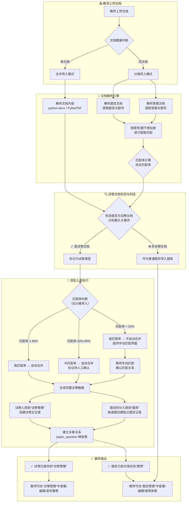

# 教师端功能模块完善设计方案


## 文档说明

- **文档版本**：v2.0
- **编写日期**：2026年8月
- **编写目的**：针对公安联考题库系统中教师端各功能模块存在的严重问题，提供完整的系统化设计方案，确保教师端功能满足实际教学场景需求，具备良好的可用性、稳定性和可维护性。
- **适用对象**：前后端开发人员（可直接作为开发指导文档使用）


## 一、教师端整体菜单结构完善

### 1.1 完整菜单规划

| 菜单 | 路由路径 | 核心页面组件 | 功能描述 |
|------|----------|-------------|----------|
| **工作台** | `/teacher/dashboard` | `TeacherDashboard.vue` | 展示今日待办、最新动态、数据概览、快捷入口等 |
| **题目管理** | `/teacher/questions` | `QuestionManageView.vue` | 题目看板，支持增删改查、批量导入、分类管理、自设计题目 |
| **试卷管理** | `/teacher/papers` | `PaperManageView.vue` | 管理所有试卷，支持手动组卷、AI智能组卷、发布与审批跟踪 |
| **成绩管理** | `/teacher/grades` | `GradeManageView.vue` | 成绩分析看表，查看学生成绩、班级统计、错题分析 |
| **班级管理** | `/teacher/classes` | `ClassManageView.vue` | 管理班级与学生信息，支持班级创建、学生管理、学习数据查看 |
| **数据分析** | `/teacher/analytics` | `AnalyticsView.vue` | 教学数据综合看板，含学生整体学情、题目使用频率、知识点掌握度等 |
| **消息中心** | `/teacher/messages` | `MessageView.vue` | 接收系统通知、审批结果反馈、学生提问等 |
| **个人设置** | `/teacher/profile` | `ProfileView.vue` | 个人信息修改、密码重置、教学偏好设置等 |

### 1.2 菜单层级优化

```
教师端
│
├── 📊 工作台（默认首页）
│   ├── 今日待办（待审批试卷、待处理提问）
│   ├── 最新动态（系统公告、班级动态）
│   ├── 数据概览（本班平均正确率、完成率）
│   └── 快捷入口（新建试卷、导入题目、查看成绩）
│
├── 📝 题目管理
│   ├── 题目列表（增删改查、搜索筛选）
│   ├── 批量导入（合并导入/分离导入/智能识别）
│   ├── 自设计题目（多题型创建器）
│   └── 题目分类（按科目/题型/知识点管理）
│
├── 📄 试卷管理
│   ├── 试卷列表（状态筛选/搜索/卡片展示）
│   ├── 手动创建试卷（三步流程：基本信息→选题→预览发布）
│   ├── AI智能组卷（参数配置→结果预览→编辑调整→发布）
│   └── 审批状态跟踪（待审批/已批准/已驳回）
│
├── 📊 成绩管理
│   ├── 班级成绩总览（列表/图表）
│   ├── 学生详情成绩（个人成绩曲线/错题分析）
│   └── 考试分析报告（各题正确率/知识点薄弱点）
│
├── 👥 班级管理
│   ├── 班级列表（创建/编辑/删除班级）
│   ├── 学生管理（添加/移除学生、查看学习数据）
│   └── 班级数据统计（整体学情）
│
├── 📈 数据分析
│   ├── 学情总览（班级对比/趋势）
│   ├── 题目使用频率（热门/冷门题目）
│   └── 知识点掌握度（雷达图/热力图）
│
├── 💬 消息中心
│   ├── 系统通知
│   ├── 审批反馈
│   └── 学生提问
│
└── ⚙️ 个人设置
    ├── 基本信息
    ├── 安全设置
    └── 教学偏好
```


## 二、各功能模块详细设计

### 2.1 工作台（TeacherDashboard）

#### 2.1.1 功能定位

教师登录后的默认首页，提供“一站式”工作概览，帮助教师快速掌握班级动态、待办事项和关键数据，减少无效导航。

#### 2.1.2 页面布局

```
┌─────────────────────────────────────────────────────────────────────┐
│  📊 工作台                              [刷新] [设置偏好]           │
├─────────────────────────────────────────────────────────────────────┤
│  ┌──────────────┐ ┌──────────────┐ ┌──────────────┐ ┌───────────┐ │
│  │ 👨‍🎓 本班学生  │ │ 📝 今日练习  │ │ 📄 待审批   │ │ 📊 平均   │ │
│  │ 42人         │ │ 23人已完成   │ │ 3份试卷    │ │ 正确率   │ │
│  │ ↑2人本周新增 │ │ ↑12%较昨日   │ │ 点击处理   │ │ 72.4%    │ │
│  └──────────────┘ └──────────────┘ └──────────────┘ └───────────┘ │
│                                                                     │
│  ┌──────────────────────────────┐ ┌──────────────────────────────┐  │
│  │  📋 待办事项                  │ │  📢 最新动态                │  │
│  │  • 3份试卷待审批 [处理]      │ │  • 系统通知：明日系统维护   │  │
│  │  • 5条学生提问待回复 [查看]  │ │  • 张老师分享了新试卷       │  │
│  │  • 1个班级待确认 [处理]      │ │  • 3名学生完成全部练习      │  │
│  └──────────────────────────────┘ └──────────────────────────────┘  │
│                                                                     │
│  ┌─────────────────────────────────────────────────────────────────┐ │
│  │  🚀 快捷入口                                                   │ │
│  │  [新建试卷] [导入题目] [查看成绩] [管理班级] [AI组卷]          │ │
│  └─────────────────────────────────────────────────────────────────┘ │
└─────────────────────────────────────────────────────────────────────┘
```

#### 2.1.3 交互细节

- 待办事项支持一键跳转至对应处理页面
- 数据概览卡片点击可展开详情或跳转
- 快捷入口支持教师自定义排序（拖拽调整）
- 支持设置“偏好”，默认隐藏不常用模块


### 2.2 题目管理（QuestionManage）

#### 2.2.1 功能定位

教师管理所有题目的核心入口，涵盖题目的增删改查、批量导入、分类管理和自设计题目等全生命周期操作。

#### 2.2.2 页面布局

```
┌─────────────────────────────────────────────────────────────────────┐
│  📝 题目管理                  [+ 自设计题目] [批量导入] [导出]     │
├─────────────────────────────────────────────────────────────────────┤
│  筛选区：                                                          │
│  科目 [全部 ▼]  题型 [全部 ▼]  难度 [全部 ▼]  知识点 [全部 ▼]    │
│  搜索 [________________________] [🔍]                              │
├─────────────────────────────────────────────────────────────────────┤
│  ┌─────────────────────────────────────────────────────────────┐   │
│  │  ☐ │ 题号 │ 题型 │ 科目 │ 难度 │ 知识点 │ 创建时间 │ 操作 │   │
│  │  ☐ │ 1   │ 单选 │ 行测 │ 中等 │ 言语理解│ 08-18  │ 编辑 │   │
│  │  ☐ │ 2   │ 多选 │ 公专 │ 困难 │ 警务能力│ 08-17  │ 删除 │   │
│  │  ☐ │ 3   │ 判断 │ 申论 │ 简单 │ 归纳概括│ 08-16  │ 预览 │   │
│  └─────────────────────────────────────────────────────────────┘   │
│  共 3,562 条  第 1/179 页  [1] [2] [3] ... [179]  每页 20 条      │
└─────────────────────────────────────────────────────────────────────┘
```

#### 2.2.3 批量导入功能增强

**（一）问题现状**

当前“批量导入”存在两个严重问题：

1. **试卷文档无法识别合并**：导入的题目文档和答案文档属于考试试卷时，系统只会分别将题目文档和答案文档分开存入，无法合并处理成整套试卷内容存储到“试卷管理”中。
2. **分离导入匹配率过低**：系统判定匹配率低于99%无法导入，导致大量现成的题目文档和答案文档无法正常导入。

**（二）解决方案**

**① 试卷文档智能识别**

引入基于 **python-docx** 和 **正则表达式** 的文档解析引擎，实现以下识别能力：

| 识别项 | 识别规则 | 示例 |
|--------|---------|------|
| 试卷标题识别 | 检测文档首行或标题行，匹配“考试/联考/省考/国考/模拟考/真题/试卷”关键词 | “2025年公安联考行测真题” → 识别为试卷 |
| 题目编号识别 | 支持多种编号格式：`1.`、`1、`、`Q1:`、`1)` 等 | 自动提取题号 |
| 选项识别 | 识别 `A.`、`B.`、`C.`、`D.` 等规范前缀 | 提取选项列表 |
| 答案识别 | 识别 `答案：`、`参考答案：`、`Answer:` 等标识 | 提取标准答案 |
| 题型自动判断 | 根据选项数量和答案格式判断单选/多选/判断 | 自动分类 |

**② 双轨入库：合并导入与分离导入统一处理**


### 双轨入库详细设计：
sequenceDiagram
    participant 教师
    participant 前端
    participant 后端API
    participant 数据库
    participant 文件存储

    教师->>前端: 上传文档
    前端->>后端API: 发送文档
    后端API->>后端API: 解析文档内容
    后端API->>后端API: 检测是否为试卷文档
    
    alt 是试卷文档
        后端API->>数据库: 1. 创建试卷记录（papers表）
        数据库-->>后端API: 返回 paper_id
        
        loop 遍历每一道题
            后端API->>数据库: 2.1 检查题目是否已存在（去重）
            alt 题目不存在
                后端API->>数据库: 2.2 创建题目记录（questions表）
                数据库-->>后端API: 返回 question_id
            else 题目已存在
                后端API->>后端API: 复用已有 question_id
            end
            后端API->>数据库: 2.3 创建关联记录（paper_questions表）
        end
        
        后端API->>文件存储: 3. 保存附件（如有图片）
        后端API-->>前端: 返回导入结果（试卷ID + 题目ID列表）
        前端-->>教师: 显示导入成功
    else 非试卷文档
        后端API->>数据库: 拆分保存到题库
        后端API-->>前端: 返回导入结果
        前端-->>教师: 显示导入成功
    end
### 导入结果展示
┌─────────────────────────────────────────────────────────────────────┐
│  ✅ 导入完成                                                       │
├─────────────────────────────────────────────────────────────────────┤
│  📊 导入摘要：                                                     │
│  ┌─────────────────────────────────────────────────────────────┐   │
│  │  文档类型：试卷文档（2025年公安联考行测真题）              │   │
│  │  总题目数：45 题                                            │   │
│  │  自动匹配：42 题 (93.3%)                                   │   │
│  │  待确认项：3 题 (6.7%)                                     │   │
│  │  ✅ 试卷已保存：试卷ID #128                                │   │
│  │  ✅ 题目已入库：45 题（新增42题，复用3题）                │   │
│  │  试卷状态：草稿（待教师编辑完善）                          │   │
│  └─────────────────────────────────────────────────────────────┘   │
│                                                                     │
│  📋 操作入口：                                                      │
│  [查看试卷] [查看题库] [继续导入] [稍后处理]                        │
│                                                                     │
│  ⚠️ 待确认项：3处存疑，建议确认后再发布试卷                        │
│  [查看存疑项]                                                      │
└─────────────────────────────────────────────────────────────────────┘

**③ 匹配率优化策略**

 构建多层级匹配“漏斗”
第一层：文档级预处理与清洗 (粗筛)
目标：统一数据格式，过滤无效信息，为后续精确匹配做准备。

核心动作：

文本提取与清洗：从Word、PDF等格式文档中提取纯文本，去除页眉、页脚、水印等干扰信息。
文本标准化：统一全角/半角字符，处理特殊符号与空白字符。
内容分块：按题号或明显的分隔符将文档切分为独立的题目单元。
题号与题型识别：通过正则表达式识别并提取题号（如“1.”、“一、”等）和题型关键词（如“单选题”、“多选题”）。
第二层：多维度相似度计算 (精筛)
目标：从不同维度综合评估题目与答案的匹配程度。

核心算法：

文本向量化与余弦相似度：利用TF-IDF或 Sentence-BERT 等模型将题目和答案文本转化为向量，通过计算向量间的余弦相似度来衡量语义相似性。

关键词与编辑距离：从题目和答案中提取关键词，使用 Levenshtein 编辑距离（即编辑距离）算法来衡量关键词的相似度，对于数字、专有名词等精确匹配要求高的内容尤为有效。

结构特征比对：比较题目和答案在题型、选项数量等结构特征上的一致性。

第三层：综合评分与决策 (智能仲裁)
目标：综合各项指标，做出最终的匹配决策。

核心动作：

加权综合评分：为上述各维度计算出的相似度分配权重（例如：语义相似度40% + 关键词相似度30% + 结构特征30%），得出一个0-1之间的综合匹配分数。
置信度评估：除了分数，还可以评估其置信度。例如，若所有维度给出的结果都高度一致，则置信度高；反之则低。
分档决策：
高置信度匹配 (≥0.90)：自动合并，可直接入库。
中置信度匹配 (0.70 - 0.89)：自动合并，但标记为“待人工确认”，并高亮显示存疑部分供教师快速审核。
低置信度匹配 (<0.70)：不自动合并，进入人工匹配界面，由教师进行手动匹配。
第四层：人工干预与反馈闭环 (兜底与进化)
目标：处理算法无法解决的复杂情况，并持续优化模型。

核心动作：

人工匹配界面：为低置信度匹配提供清晰、易用的手动匹配工具。
反馈收集：记录教师在所有场景下的审核与修正操作。
模型迭代：将教师的修正作为“标准答案”反馈给系统，用于微调模型权重或作为新的训练数据。定期复盘人工干预较多的案例，针对性优化匹配逻辑。
🔧 核心算法技术选型
|算法/技术	|用途|优势|
|Sentence-BERT  |计算题干预选与答案的语义相似度	| 能深度理解文本含义，优于简单关键词匹配。|
|TF-IDF + Cosine Similarity	 | 计算文本的关键词权重相似度 | 实现简单、高效，是经典的基线方法。|
|Levenshtein Distance (编辑距离)	|计算关键词或短文本的字符级相似度 | 对数字、代码等精确匹配场景效果极佳。|
|SimHash / MinHash	               |大规模文档的快速去重与相似度估算 | 在处理海量题库时，能显著提升比对效率。|

🎯 实现高精度与低误差的关键
要实现高精度与低误差，关键是构建一个“多层过滤、交叉验证”的系统，而不是依赖单一算法。将语义、关键词、结构等多个维度的信息融合，通过一个智能的仲裁层做出最终决策，能极大地提升匹配的准确率和鲁棒性。同时，必须将“人工审核”作为系统的一部分，形成“算法处理 -> 人工审核 -> 反馈学习”的闭环，这也是系统能持续进化的关键。

**④ 推荐开源库/工具**

| 工具/库 | 用途 | 说明 |
|--------|------|------|
| **python-docx** | Word文档解析 | 读取.docx文件内容，提取文本和表格 |
| **mcq-extractor-api** | 题目提取API | FastAPI应用，支持PDF/DOCX/图片等多格式题目提取，具备数学公式检测和视觉内容分析能力 |
| **PyMuPDF / PyPDF2** | PDF解析 | PDF文档内容提取，互为备选 |
| **openpyxl** | Excel解析 | 读取.xlsx文件 |
| **Tesseract OCR** | 图片文字识别 | 识别扫描版文档中的文字 |

**⑤ 手动匹配界面设计**

当自动匹配率低于50%时，系统提供手动匹配界面：

```
┌─────────────────────────────────────────────────────────────────────┐
│  🔗 手动匹配 - 题目与答案对照                                      │
├─────────────────────────────────────────────────────────────────────┤
│  ┌───────────────┬───────────────────────┬───────────────────────┐ │
│  │ 题目文档       │ 答案文档              │ 匹配状态              │ │
│  ├───────────────┼───────────────────────┼───────────────────────┤ │
│  │ 第1题：...    │ 1. A                 │ ✅ 已匹配 (自动)      │ │
│  │ 第2题：...    │ 2. B                 │ ✅ 已匹配 (自动)      │ │
│  │ 第3题：...    │ (未匹配)             │ ⚠️ 请手动选择答案     │ │
│  │ 第4题：...    │ 4. C                 │ ✅ 已匹配 (自动)      │ │
│  └───────────────┴───────────────────────┴───────────────────────┘ │
│                                                                     │
│  未匹配项：第3题 → 请从答案文档中选择对应答案 [下拉选择 ▼]         │
│                                                                     │
│  [确认合并] [取消]                                                 │
└─────────────────────────────────────────────────────────────────────┘
```

#### 2.2.4 自设计题目功能增强

**（一）问题现状**

当前“自设计题目”存在两个问题：
1. 设计的题目保存到试卷库而非题库，一道题无法单独成试卷
2. 功能要求不够、界面交互不足，无法满足公安联考实际科目要求

**（二）解决方案**

**① 保存逻辑修正**

自设计题目**自动保存到题库**（而非试卷库），设计的一道题目作为独立题目存入题库，教师可在组卷时从题库中选取使用。

**② 多题型支持**

基于公安联考实际需求，支持以下题型：

| 题型 | 适用科目 | 编辑内容 |
|------|---------|---------|
| **单选题** | 行测、公专 | 题干 + 4-6个选项 + 正确答案 |
| **多选题** | 行测、公专 | 题干 + 4-6个选项 + 多个正确答案 |
| **判断题** | 行测、公专 | 题干 + 正确答案（✓/✗） |
| **填空题** | 行测、公专 | 题干 + 多个填空答案 |
| **简答题** | 申论 | 题干 + 参考答案 + 评分要点 |
| **论述题** | 申论 | 题干 + 参考答案 + 评分标准 |
| **情境题** | 公专 | 情境描述 + 多个子题（各子题独立设置） |

**③ 科目专属配置**

根据公安联考三个科目的特点，提供专属题目设计模板：

| 科目 | 专属题型 | 特殊字段 |
|------|---------|---------|
| **行测** | 言语理解、数量关系、判断推理、资料分析、常识判断、政治理论 | 知识点标签、解题技巧 |
| **申论** | 归纳概括、综合分析、提出对策、应用文写作、议论文写作 | 材料来源、字数要求 |
| **公专** | 职业素养、基础知识、基本警务能力 | 警务场景标签、法条引用 |

**④ 自设计题目界面设计**

```
┌─────────────────────────────────────────────────────────────────────┐
│  ✏️ 自设计题目                                      [保存] [取消] │
├─────────────────────────────────────────────────────────────────────┤
│  基本信息：                                                        │
│  科目 [行测 ▼]  题型 [单选题 ▼]  难度 [中等 ▼]                   │
│  知识点 [言语理解与表达 ▼]  分值 [2] 分                          │
│                                                                     │
│  题干内容：                                                        │
│  ┌─────────────────────────────────────────────────────────────┐   │
│  │  [富文本编辑器 - 支持文字、图片、表格、公式]               │   │
│  └─────────────────────────────────────────────────────────────┘   │
│                                                                     │
│  选项设置：                                                        │
│  A. [________________________]  [▲] [▼] [✕]                      │
│  B. [________________________]  [▲] [▼] [✕]                      │
│  C. [________________________]  [▲] [▼] [✕]                      │
│  D. [________________________]  [▲] [▼] [✕]                      │
│  [+ 添加选项]                                                     │
│                                                                     │
│  正确答案： [A ▼]                                                  │
│                                                                     │
│  答案解析（可选）：                                                 │
│  ┌─────────────────────────────────────────────────────────────┐   │
│  │  [富文本编辑器]                                            │   │
│  └─────────────────────────────────────────────────────────────┘   │
│                                                                     │
│  📌 提示：设计完成后自动保存到题库，可在组卷时选用                 │
│                                                                     │
│  [预览题目] [保存到题库] [保存并继续设计]                          │
└─────────────────────────────────────────────────────────────────────┘
```

**⑤ 自动保存机制**

- 设计过程中每30秒自动保存草稿
- 支持“保存并继续设计”快速连续出题
- 所有已保存题目在“题目列表”中可见并可编辑


### 2.3 试卷管理（PaperManage）

#### 2.3.1 AI智能组卷功能增强

**（一）问题现状**

当前“AI智能组卷”存在三个问题：
1. 功能不全面、界面交互设计不足
2. 弹窗设计太小，对教师AI设计试卷的要求不够
3. 无法对AI预生成的试卷进行查看、调整和重新生成

**（二）解决方案**

**① 弹窗尺寸规范**

```css
.ai-paper-dialog {
  max-width: 1500px;
  max-height: 100vh;
  width: 95vw;
  height: 95vh;
  display: flex;
  flex-direction: column;
}
```

**② AI智能组卷完整流程**

```
┌─────────────────────────────────────────────────────────────────────┐
│  🤖 AI智能组卷                                        [关闭]      │
├─────────────────────────────────────────────────────────────────────┤
│  步骤 1/3：组卷参数设置                                             │
│  ┌─────────────────────────────────────────────────────────────┐   │
│  │  试卷名称：[智能组卷_20260818_143022]                      │   │
│  │  科目：[行测 ▼]  年份：[2025 ▼]                           │   │
│  │  组卷来源：[全部题库 ▼]                                   │   │
│  │  难度分布：简单 [20%] ────●──── 一般 [60%] ────●── 困难 [20%]│   │
│  │  题型分布：                                                │   │
│  │    单选题 [20] 题 × [2] 分 = 40 分                       │   │
│  │    多选题 [10] 题 × [3] 分 = 30 分                       │   │
│  │    判断题 [10] 题 × [1] 分 = 10 分                       │   │
│  │    资料分析 [5] 题 × [4] 分 = 20 分                       │   │
│  │  知识点覆盖：[至少覆盖 3 个知识点]                        │   │
│  └─────────────────────────────────────────────────────────────┘   │
│                                                                     │
│  [← 上一步]                          [生成试卷 →]                   │
└─────────────────────────────────────────────────────────────────────┘

┌─────────────────────────────────────────────────────────────────────┐
│  🤖 AI智能组卷                                          [关闭]    │
├─────────────────────────────────────────────────────────────────────┤
│  步骤 2/3：组卷结果预览                                             │
│                                                                     │
│  ┌─────────────────────────────────────────────────────────────┐   │
│  │  ✅ 已生成 3 套备选试卷   当前查看：第 1/3 套              │   │
│  │  [上一套] [下一套] [换一题] [重新生成]                     │   │
│  ├─────────────────────────────────────────────────────────────┤   │
│  │  试卷统计：总分 100分 | 共 45题 | 预计用时 120分钟        │   │
│  │  难度分布：简单 18% | 一般 62% | 困难 20%                 │   │
│  ├─────────────────────────────────────────────────────────────┤   │
│  │  第1题（单选题，2分）                              [替换] [×]│   │
│  │  题干内容...                                              │   │
│  │  A. 选项1  B. 选项2  C. 选项3  D. 选项4                  │   │
│  │  正确答案：A                                              │   │
│  ├─────────────────────────────────────────────────────────────┤   │
│  │  第2题（多选题，3分）                              [替换] [×]│   │
│  │  ...                                                     │   │
│  └─────────────────────────────────────────────────────────────┘   │
│                                                                     │
│  [← 重新设置参数]                          [下一步：发布 →]        │
└─────────────────────────────────────────────────────────────────────┘

┌─────────────────────────────────────────────────────────────────────┐
│  🤖 AI智能组卷                                          [关闭]    │
├─────────────────────────────────────────────────────────────────────┤
│  步骤 3/3：发布设置                                                 │
│                                                                     │
│  ┌─────────────────────────────────────────────────────────────┐   │
│  │  ✅ 试卷已确认，共 45 题，总分 100 分                     │   │
│  │                                                             │   │
│  │  发布选项：                                                  │   │
│  │  ○ 保存为草稿（暂不发布）                                   │   │
│  │  ● 发布到“小模考”（需管理员审批）                           │   │
│  │                                                             │   │
│  │  模考信息（发布到小模考时填写）：                            │   │
│  │  模考开始时间：[2026-08-20 09:00]                          │   │
│  │  规定完成时间：[120] 分钟                                   │   │
│  │  发布范围：[全校 ▼]                                        │   │
│  └─────────────────────────────────────────────────────────────┘   │
│                                                                     │
│  [← 返回编辑]                    [保存草稿] [确认发布]             │
└─────────────────────────────────────────────────────────────────────┘
```

**③ 组卷结果编辑能力**

教师在预览界面可执行以下操作：

| 操作 | 说明 |
|------|------|
| **查看题目详情** | 点击任意题目，弹窗展示完整内容（含图片、选项、答案、解析） |
| **替换题目** | 选中某题，点击“换一题”，系统从题库中推荐相似题目替换 |
| **手动增删** | 删除不满意的题目，或从题库中额外添加题目 |
| **调整顺序** | 拖拽调整题目顺序，或按题型分组排序 |
| **调整分值** | 修改任意题目的分值 |
| **切换备选** | 如果生成了多套，可切换查看不同套题 |
| **重新生成** | 不满意可重新设置参数生成 |

**④ 发布控制**

- AI智能组卷创建的试卷**只能发布到“小模考”**，需要经过管理员审批才能发布到学生端
- 发布后状态变为“待审批”，教师在“试卷列表”中可跟踪审批进度
- 审批通过后自动发布到学生端“小模考”；审批驳回后教师可修改后重新提交


### 2.4 成绩管理（GradeManage）

#### 2.4.1 功能定位

教师查看和分析学生成绩的核心入口，支持班级整体成绩查看、个人成绩详情、考试分析报告等。

#### 2.4.2 页面布局

```
┌─────────────────────────────────────────────────────────────────────┐
│  📊 成绩管理                     [导出报告] [刷新]                  │
├─────────────────────────────────────────────────────────────────────┤
│  筛选区：                                                          │
│  班级 [刑侦2201 ▼]  考试 [全部 ▼]  时间 [近30天 ▼]               │
├─────────────────────────────────────────────────────────────────────┤
│  ┌──────────────┐ ┌──────────────┐ ┌──────────────┐               │
│  │ 班级平均分    │ │ 最高分       │ │ 及格率       │               │
│  │ 72.4         │ │ 96          │ │ 78.6%       │               │
│  └──────────────┘ └──────────────┘ └──────────────┘               │
│                                                                     │
│  ┌─────────────────────────────────────────────────────────────┐   │
│  │  成绩分布图（柱状图）                                       │   │
│  │  [90-100] ████████ 5人                                    │   │
│  │  [80-89]  ████████████ 8人                                │   │
│  │  [70-79]  ████████████████ 12人                           │   │
│  │  [60-69]  ██████████ 7人                                  │   │
│  │  [<60]    ██████ 4人                                      │   │
│  └─────────────────────────────────────────────────────────────┘   │
│                                                                     │
│  ┌─────────────────────────────────────────────────────────────┐   │
│  │  学生成绩列表                                                │   │
│  │  姓名 │ 得分 │ 正确率 │ 用时 │ 错题数 │ 操作              │   │
│  │  张三 │ 85  │ 78.2% │ 98min│ 12   │ [详情]              │   │
│  │  李四 │ 72  │ 65.3% │ 115min│ 23  │ [详情]              │   │
│  └─────────────────────────────────────────────────────────────┘   │
└─────────────────────────────────────────────────────────────────────┘
```

#### 2.4.3 学生成绩详情

点击“详情”可查看该学生的完整成绩报告：

- 历次考试成绩曲线
- 各题型得分率
- 错题列表（含题目内容、正确答案、学生答案）
- 知识点薄弱点分析（雷达图展示）
- 学习建议（系统自动生成）


### 2.5 班级管理（ClassManage）

#### 2.5.1 功能定位

教师管理所带班级和学生信息，支持班级创建、学生添加/移除、班级数据查看等。

#### 2.5.2 页面布局

```
┌─────────────────────────────────────────────────────────────────────┐
│  👥 班级管理                      [+ 创建班级] [导入学生]          │
├─────────────────────────────────────────────────────────────────────┤
│  ┌──────────────┐ ┌──────────────┐ ┌──────────────┐               │
│  │ 刑侦2201     │ │ 刑侦2202     │ │ 刑侦2203     │               │
│  │ 42人         │ │ 38人         │ │ 45人         │               │
│  │ 平均72.4分   │ │ 平均68.7分   │ │ 平均74.1分   │               │
│  │ [管理] [查看] │ │ [管理] [查看] │ │ [管理] [查看] │               │
│  └──────────────┘ └──────────────┘ └──────────────┘               │
└─────────────────────────────────────────────────────────────────────┘
```

#### 2.5.3 班级详情

点击“管理”进入班级详情页：

| 区域 | 内容 |
|------|------|
| 班级信息 | 班级名称、创建时间、班级人数、任课教师 |
| 学生列表 | 姓名、学号、学习进度、平均正确率、操作（移除/查看） |
| 添加学生 | 搜索添加/批量导入/邀请码加入 |
| 学习数据 | 班级整体正确率趋势、各科目平均分、完成率 |


### 2.6 头像菜单设计

### 2.6.1 现状与问题

当前教师端右上角仅显示用户账号名称和“退出”按钮，功能单一，无法便捷查看和编辑个人信息，缺乏统一的用户入口，与管理员端和学员端的体验不一致。

### 2.6.2 头像菜单完整设计

#### 2.6.3 显示内容
导航栏右上角展示：

| 元素 | 说明 |
|------|------|
| 头像 | 用户头像图片（若未上传则显示姓名首字母或默认教师图标） |
| 用户名 | 显示真实姓名（如“张明老师”） |
| 角色标识 | 显示“教师”标签（灰色） |
| 下拉箭头 | 点击展开下拉菜单 |

#### 2.6.4 下拉菜单选项

点击头像区域，弹出下拉菜单，包含以下选项：

| 菜单项 | 图标 | 功能描述 |
|--------|------|---------|
| 个人信息 | 👤 | 查看和编辑个人基本信息（姓名、手机号、邮箱、头像等） |
| 修改密码 | 🔒 | 修改当前教师账号密码 |
| 我的班级 | 🏫 | 快捷跳转至“班级管理”页面 |
| 消息中心 | 💬 | 查看系统通知、审批反馈等（未读消息显示红点） |
| 帮助文档 | 📖 | 查看系统使用帮助 |
| 退出登录 | 🚪 | 退出当前账号（需二次确认） |

#### 2.6.5 个人信息弹窗设计

点击“个人信息”后，弹窗展示以下内容：

```
┌─────────────────────────────────────────────────────────────────────┐
│  👤 个人信息                            [✕ 关闭]                   │
├─────────────────────────────────────────────────────────────────────┤
│  ┌──────────┐                                                      │
│  │  头像    │  教师姓名：张明                                       │
│  │  [点击更换]│  工号：T2025001                                    │
│  │          │  任教科目：行测                                      │
│  │          │  手机号：138****1234                                 │
│  │          │  邮箱：zhangming@police.edu                         │
│  │          │  所属院系：公安基础教研部                            │
│  │          │  入职时间：2025-09-01                               │
│  ├──────────┤                                                     │
│  │  教学数据  │  累计出卷：23份                                    │
│  │  总出卷数  │  累计审批通过：18份                                │
│  │  通过率   │  所带班级：3个（共125名学生）                      │
│  └──────────┘                                                     │
│                                                                     │
│  操作：[编辑信息] [修改密码]                                       │
├─────────────────────────────────────────────────────────────────────┤
│  编辑模式：                                                        │
│  姓名：[张明________]  手机号：[138****1234____]                   │
│  邮箱：[zhangming@police.edu]  所属院系：[公安基础教研部 ▼]        │
│  头像：[点击上传新头像]                                            │
│                                                                     │
│  [保存修改] [取消]                                                │
└─────────────────────────────────────────────────────────────────────┘
```

#### 2.6.6 交互细节

- **头像上传**：支持点击头像上传新图片，自动裁剪为1:1比例，格式支持JPG/PNG，大小限制2MB。
- **信息编辑**：姓名、手机号、邮箱、所属院系可编辑，工号和入职时间只读。
- **手机号验证**：修改手机号需短信验证码验证。
- **修改密码**：点击后弹出修改密码对话框（当前密码 → 新密码 → 确认新密码）。
- **实时刷新**：保存后导航栏头像和姓名同步更新。

#### 2.6.7 消息红点提醒

- 当有未读系统通知或审批反馈时，消息中心菜单项显示红点数字。
- 点击进入消息中心后，红点自动清除。


### 2.6.8 与个人设置页面的关系

导航栏头像菜单的“个人信息”与左侧菜单的“个人设置”功能互补：
- **头像菜单**：提供快捷入口，仅展示核心信息，适合快速查看和简单编辑。
- **个人设置页面**：提供更完整的个人配置（含教学偏好、通知设置、隐私设置等），适合深度个性化。


### 2.6.9 数据库字段补充

在 `teachers` 表（或 `users` 表中教师角色扩展）中，需包含以下字段：

| 字段 | 类型 | 描述 |
|------|------|------|
| `avatar` | VARCHAR(200) | 头像URL |
| `phone` | VARCHAR(20) | 手机号 |
| `email` | VARCHAR(100) | 邮箱 |
| `department` | VARCHAR(100) | 所属院系 |
| `hire_date` | DATE | 入职时间 |
| `last_login_ip` | VARCHAR(50) | 最后登录IP |
| `last_login_time` | DATETIME | 最后登录时间 |
| `password_updated_at` | DATETIME | 密码最后修改时间 |


## 2.6.10 API接口

| 接口 | 方法 | 路径 | 描述 |
|------|------|------|------|
| 获取个人信息 | GET | `/api/teacher/profile` | 获取当前教师个人信息 |
| 更新个人信息 | PUT | `/api/teacher/profile` | 修改姓名、手机号、邮箱等 |
| 上传头像 | POST | `/api/teacher/profile/avatar` | 上传头像图片 |
| 修改密码 | POST | `/api/teacher/profile/change-password` | 修改密码（需验证旧密码） |
| 获取未读消息数 | GET | `/api/teacher/messages/unread-count` | 获取未读消息数量 |


## 2.6.11 交互效果示意

```
导航栏右上角：

[头像] 张明老师 ▼
    │
    ├── 👤 个人信息
    ├── 🔒 修改密码
    ├── 🏫 我的班级
    ├── 💬 消息中心 🔴 (3)
    ├── 📖 帮助文档
    ├── ────────────
    └── 🚪 退出登录
```


## 2.6.12 实施要点

1. **权限控制**：教师只能查看和编辑自己的信息，不能查看他人信息。
2. **头像默认图**：若未上传头像，根据姓名生成首字母头像（如“张明”显示“ZM”）。
3. **消息红点**：使用WebSocket实时推送或长轮询更新未读消息数。
4. **安全校验**：修改手机号需验证原手机号短信验证码；修改密码需验证当前密码。
5. **响应式**：下拉菜单在移动设备上适配为全屏底部弹出。


## 三、界面交互体验优化

### 3.1 全局交互规范

| 场景 | 交互方式 |
|------|---------|
| 页面加载 | 显示骨架屏，1.5秒内无数据则显示加载动画 |
| 操作成功 | 绿色成功提示条（含具体操作结果），3秒自动消失 |
| 操作失败 | 红色错误提示条（含错误原因），手动关闭 |
| 敏感操作 | 模态对话框确认（含操作说明、影响范围） |
| 数据为空 | 居中显示空状态插图 + “暂无数据”提示 + 操作引导 |

### 3.2 弹窗规范

- AI智能组卷弹窗：`max-width: 1500px`，`max-height: 100vh`，支持全屏模式切换
- 自设计题目弹窗：`max-width: 1200px`，`max-height: 90vh`
- 所有弹窗支持拖拽移动和键盘 `Esc` 关闭

### 3.3 响应式适配

| 屏幕尺寸 | 布局调整 |
|---------|---------|
| ≥ 1400px | 三栏/两栏完整布局 |
| 1024px ~ 1399px | 两栏布局，部分功能折叠 |
| < 1024px | 单栏布局，侧边栏折叠为汉堡菜单 |

### 3.4 快捷键支持

| 快捷键 | 功能 |
|--------|------|
| `Ctrl + N` | 快速新建（题目/试卷） |
| `Ctrl + S` | 保存当前表单 |
| `Ctrl + F` | 聚焦搜索框 |
| `Esc` | 关闭弹窗 |


## 四、数据库设计补充

### 4.1 题目表扩展 (`questions`)

| 字段 | 类型 | 描述 |
|------|------|------|
| `designer_id` | INT | 自设计题目的创建者ID |
| `design_source` | VARCHAR(20) | 来源：'import' / 'manual' / 'ai' |
| `is_approved` | BOOLEAN | 是否经过审核 |
| `version` | INT | 版本号 |

### 4.2 试卷导入记录表 (`paper_import_records`)

| 字段 | 类型 | 描述 |
|------|------|------|
| `id` | BIGINT PK | |
| `paper_id` | INT | 关联试卷ID |
| `question_doc_id` | INT | 题目文档ID |
| `answer_doc_id` | INT | 答案文档ID |
| `import_type` | VARCHAR(20) | 'merged' / 'separate' |
| `match_rate` | DECIMAL(5,2) | 匹配率 |
| `match_status` | VARCHAR(20) | 'auto_matched' / 'manual_confirmed' / 'pending' |
| `created_at` | DATETIME | |


## 五、实施优先级

| 优先级 | 功能 | 说明 |
|--------|------|------|
| **P0** | 试卷文档智能识别与合并 | 解决核心痛点，必须优先 |
| **P0** | 分离导入匹配率优化 | 解决核心痛点 |
| **P0** | AI智能组卷弹窗放大 + 结果可编辑 | 核心功能 |
| **P0** | 自设计题目保存逻辑修正 | Bug修复 |
| **P1** | 自设计题目多题型支持 | 重要功能 |
| **P1** | 成绩管理详情页 | 重要功能 |
| **P2** | 班级管理增强 | 增强功能 |
| **P2** | 数据分析模块 | 增强功能 |


## 六、总结

本方案针对教师端“题目导入”和“试卷管理”两个核心模块的四个严重问题——试卷文档无法识别合并、分离导入匹配率过低、AI智能组卷功能不足、自设计题目保存逻辑错误——提供了系统性的解决方案：

1. **批量导入增强**：引入基于 `python-docx`、`mcq-extractor-api` 等开源库的文档解析引擎，实现试卷文档自动识别、合并导入与分离导入的统一处理，匹配率阈值从99%降至80%，并提供手动匹配界面作为兜底方案。

2. **AI智能组卷重构**：弹窗放大至1500px × 100vh，流程扩展为“参数配置 → 结果预览（可编辑）→ 发布设置”三步，支持题目替换、增删改查、分值调整、多套切换等完整编辑能力。

3. **自设计题目修正**：保存逻辑从试卷库修正为题库，扩展支持单选/多选/判断/填空/简答/论述/情境题等7种题型，并为行测、申论、公专三个科目提供专属配置模板。

4. **整体菜单完善**：新增数据分析、消息中心、个人设置等菜单，形成完整的工作闭环。

以上方案均基于成熟的Python文档处理生态构建，可直接落地实施。


## 七、深度可落地性分析报告

> 分析日期：2026年8月20日
> 分析范围：稳定性、合理性、可落地性、代码编写规范、VTJ一致性

---

### 7.1 现有代码基础盘点

#### 7.1.1 已实现的功能模块

| 模块 | 前端文件 | 后端API | 状态 |
|------|---------|---------|------|
| 教师工作台 | `teacher_dashboard.vue` | `/api/teacher/dashboard` | ✅ 已实现（基础版） |
| 题目管理 | `teacher_questions.vue` | `/api/teacher/questions` | ✅ 已实现（CRUD完整） |
| 试卷管理 | `teacher_papers.vue` | `/api/teacher/papers` | ✅ 已实现（含三步流程） |
| 成绩管理 | `teacher_scores.vue` | `/api/teacher/scores/overview` | ✅ 已实现（基础版） |
| 题目导入 | `question_import.vue` | `/api/question-import/*` | ✅ 已实现 |

#### 7.1.2 尚未实现的功能模块（设计方案中提出）

| 模块 | 前端文件 | 后端API | 状态 |
|------|---------|---------|------|
| 班级管理 | ❌ 不存在 | ❌ 不存在 | 🔴 需新建 |
| 数据分析 | ❌ 不存在 | ❌ 不存在 | 🔴 需新建 |
| 消息中心 | ❌ 不存在 | ❌ 不存在 | 🔴 需新建 |
| 个人设置 | ❌ 不存在 | ❌ `/api/teacher/profile` | 🔴 需新建 |
| 头像菜单 | ❌ 未实现 | 部分API存在 | 🟡 需增强 |

---

### 7.2 各模块可落地性逐项分析

#### 7.2.1 一、整体菜单结构完善 — 🟡 部分可落地

**分析结论：菜单结构调整本身可行，但新增页面需要新建VTJ页面。**

**可落地项：**
- 修改现有导航栏 `navTabs` 数组即可调整菜单结构
- 教师端已有4个页面（dashboard/questions/papers/scores），扩展到8个需要新建4个VTJ页面

**不可落地项/需注意：**
- 方案中列出的8个菜单对应8个独立页面，但当前只有4个页面的路由
- 新建页面需使用 `vtj_create_page_scaffold` 创建脚手架，再由开发者在设计器中完成UI
- 路由需通过 `vtj_add_route` 注册

**代码层面分析：**
```javascript
// 当前导航栏（teacher_dashboard.vue等4个文件中重复定义）
const navTabs = [
  { key: 'dashboard', label: '工作台', path: '/teacher/dashboard' },
  { key: 'questions', label: '题目管理', path: '/teacher/questions' },
  { key: 'papers', label: '试卷管理', path: '/teacher/papers' },
  { key: 'scores', label: '成绩管理', path: '/teacher/scores' },
];

// 方案要求扩展为：
const navTabs = [
  { key: 'dashboard', label: '工作台', path: '/teacher/dashboard' },
  { key: 'questions', label: '题目管理', path: '/teacher/questions' },
  { key: 'papers', label: '试卷管理', path: '/teacher/papers' },
  { key: 'scores', label: '成绩管理', path: '/teacher/scores' },
  { key: 'classes', label: '班级管理', path: '/teacher/classes' },       // 新增
  { key: 'analytics', label: '数据分析', path: '/teacher/analytics' },   // 新增
  { key: 'messages', label: '消息中心', path: '/teacher/messages' },      // 新增
  { key: 'profile', label: '个人设置', path: '/teacher/profile' },       // 新增
];
```

**问题：导航栏代码在4个.vue文件中重复定义，维护成本高。建议抽取为公共组件。**

---

#### 7.2.2 二、工作台（TeacherDashboard）增强 — ✅ 高度可落地

**分析结论：后端API已完整返回所有所需数据，前端仅需UI增强。**

**已具备的数据（后端 `/api/teacher/dashboard` 已返回）：**
- `stats.total_questions` → 本班学生数（需后端新增字段或前端调整）
- `stats.monthly_new_papers` → 今日练习数
- `stats.today_practice_users` → 待审批数
- `pending_approvals` → 待审批试卷列表 ✅
- `recent_activities` → 最新动态 ✅
- `practice_trend` → 近7天趋势 ✅
- `subject_accuracy` → 科目正确率 ✅

**需补充的数据（后端API缺失）：**
- "本班学生数" — 后端当前返回的是全局统计，未按教师所带班级过滤
- "平均正确率" — 已有 `subject_accuracy`，可前端聚合

**代码编写分析：**
- 修改 `teacher_dashboard.vue` 的 `<template>` 部分即可
- 使用VTJ规范：只修改 `<script>` 中的methods和state，UI通过设计器完成
- ⚠️ **关键风险**：该页面是 raw=true 页面（由开发者维护），VTJ设计器不会覆盖，可自由修改

**安全性分析：**
- 无安全风险，仅读取数据展示
- 后端已有权限验证 `get_current_teacher`

---

#### 7.2.3 三、题目管理（QuestionManage）增强 — ✅ 高度可落地

**分析结论：核心CRUD已完整，批量导入和自设计题目需增强。**

**已实现的功能：**
- ✅ 题目列表（分页、搜索、筛选）
- ✅ 题目详情弹窗（含选项、答案、解析）
- ✅ 编辑题目弹窗
- ✅ 删除题目
- ✅ 自设计题目（保存到题库）

**需增强的功能：**

| 功能 | 可行性 | 需改动 |
|------|--------|--------|
| 批量导入增强 | 🟡 中等 | 后端需新增文档解析引擎 |
| 试卷文档智能识别 | 🟡 中等 | 后端需新增 `python-docx` 解析 |
| 分离导入匹配率优化 | 🟡 中等 | 后端需修改匹配算法 |
| 自设计题目多题型 | ✅ 高 | 前端已有7种题型支持 |
| 自设计题目保存到题库 | ✅ 已实现 | 后端 `create_teacher_question` 已保存到题库 |

**⚠️ 关键发现：自设计题目保存逻辑已修正！**

当前代码 `teacher_papers.vue` 第609行：
```javascript
const res = await apiFetch('/api/teacher/questions', {
  method: 'POST', headers: { 'Content-Type': 'application/json' },
  body: JSON.stringify({
    subject_id: selfDesignForm.value.subject_id,
    type_name: selfDesignForm.value.type_name,
    question_content: selfDesignForm.value.question_content,
    options,
    answer: selfDesignForm.value.answer,
    answer_analysis: selfDesignForm.value.answer_analysis,
    difficulty: selfDesignForm.value.difficulty,
    score: selfDesignForm.value.score,
  })
});
```

后端 `teacher.py` 第338行：
```python
audit_status=1,  # 教师自建题默认通过审核
```

**结论：自设计题目已保存到题库（question_bank表），且默认通过审核。方案中"保存逻辑修正"已实现。**

---

#### 7.2.4 四、试卷管理（PaperManage）AI组卷增强 — 🟡 部分可落地

**分析结论：AI组卷弹窗放大可行，但三步流程需大量前端开发。**

**已实现：**
- ✅ AI组卷参数弹窗（基础版）
- ✅ 后端 `auto-generate` API
- ✅ 三步创建流程（手动组卷）
- ✅ 试卷预览

**需增强：**

| 功能 | 可行性 | 难度 |
|------|--------|------|
| AI弹窗放大至1500px | ✅ 简单 | 修改CSS即可 |
| AI组卷三步流程 | 🟡 中等 | 需重构AI弹窗为stepper |
| 组卷结果可编辑 | 🟡 中等 | 需新增前端交互 |
| 多套备选切换 | 🟡 中等 | 后端需返回多套结果 |
| 题目替换/增删 | ✅ 已有 | 手动组卷已有此功能 |

**代码编写分析：**
- AI弹窗CSS修改简单：`.ai-modal { max-width: 1500px; max-height: 100vh; width: 95vw; height: 95vh; }`
- 三步流程可复用手动组卷的 `editStep` 逻辑
- ⚠️ 需注意：当前AI组卷是同步调用，如果要返回多套备选，需改为异步+轮询

**后端API分析：**
当前 `auto-generate` 只返回一套结果：
```python
return {
    "success": True,
    "message": f"智能组卷完成，共 {total_questions} 道题目",
    "paper_id": paper.paper_id,
    "paper_code": paper_code,
    "question_count": total_questions,
}
```

**要支持多套备选，后端需改造为：**
```python
# 方案1：一次生成多套，前端切换
return {
    "success": True,
    "papers": [
        {"paper_id": 1, "paper_name": "套1", "question_count": 45, ...},
        {"paper_id": 2, "paper_name": "套2", "question_count": 45, ...},
        {"paper_id": 3, "paper_name": "套3", "question_count": 45, ...},
    ]
}

# 方案2：前端调用3次，每次生成一套
```

---

#### 7.2.5 五、成绩管理（GradeManage）增强 — ✅ 高度可落地

**分析结论：后端API已完整，前端需增强UI。**

**已实现：**
- ✅ 成绩总览（平均分、最高分、及格率、参考人数）
- ✅ 成绩分布柱状图
- ✅ 学生成绩列表

**需增强：**
- 学生成绩详情弹窗（个人成绩曲线、错题分析）
- 考试分析报告（各题正确率）

**后端已有API：**
- `GET /api/teacher/scores/student/{user_id}` — 学生成绩详情 ✅
- `GET /api/teacher/scores/question-stats/{paper_id}` — 各题正确率 ✅

**前端仅需：**
1. 在学生成绩列表中添加"详情"按钮
2. 调用已有API获取详情
3. 展示成绩曲线（可用 XChart）

---

#### 7.2.6 六、班级管理（ClassManage）— 🟡 需新建

**分析结论：需要新建前端页面和后端API。**

**需新建的后端API：**

| API | 方法 | 路径 | 说明 |
|-----|------|------|------|
| 班级列表 | GET | `/api/teacher/classes` | 教师所带班级列表 |
| 创建班级 | POST | `/api/teacher/classes` | 创建新班级 |
| 班级详情 | GET | `/api/teacher/classes/{id}` | 班级详情（含学生列表） |
| 添加学生 | POST | `/api/teacher/classes/{id}/students` | 添加学生到班级 |
| 移除学生 | DELETE | `/api/teacher/classes/{id}/students/{uid}` | 从班级移除学生 |
| 班级统计 | GET | `/api/teacher/classes/{id}/stats` | 班级学习数据统计 |

**VTJ页面创建：**
```
1. vtj_create_page_scaffold(id="teacher_classes", name="TeacherClasses", title="班级管理", addRoute=true, routePath="/teacher/classes")
2. vtj_add_route(path="/teacher/classes", name="TeacherClasses", componentPath="$vtj/vue/teacher_classes.vue")
3. 在设计器中完成UI
4. 补充业务逻辑方法
```

**数据库分析：**
- 已有 `Banji` 表（班级表）
- 已有 `SysUser` 表（含 `class_name` 字段）
- ⚠️ 但 `SysUser` 中 `class_name` 是字符串外键，非整数外键，关联查询需注意

---

#### 7.2.7 七、数据分析（Analytics）— 🔴 高复杂度

**分析结论：需要新建页面和复杂后端聚合API。**

**需新建的后端API：**

| API | 方法 | 路径 | 说明 |
|-----|------|------|------|
| 学情总览 | GET | `/api/teacher/analytics/overview` | 班级对比/趋势 |
| 题目使用频率 | GET | `/api/teacher/analytics/question-usage` | 热门/冷门题目 |
| 知识点掌握度 | GET | `/api/teacher/analytics/knowledge-mastery` | 雷达图数据 |

**复杂度分析：**
- 学情总览需聚合 `ExamRecord`、`PracticeRecord`、`QuestionBank` 多表
- 题目使用频率需统计每道题被使用的次数
- 知识点掌握度需按知识点分组统计正确率

**⚠️ 风险：如果学生数据量大，这些聚合查询可能导致性能问题。建议：**
1. 先实现简单版本（仅统计最近30天数据）
2. 考虑添加缓存（Redis）
3. 后期可异步生成报表

---

#### 7.2.8 八、消息中心（MessageCenter）— 🔴 高复杂度

**分析结论：需要新建消息表、WebSocket推送、前端页面。**

**需新建的数据表：**

```sql
CREATE TABLE teacher_message (
    message_id BIGINT PRIMARY KEY AUTO_INCREMENT,
    teacher_id INT NOT NULL,
    message_type VARCHAR(20) NOT NULL,  -- 'system'/'approval'/'student'
    title VARCHAR(200) NOT NULL,
    content TEXT,
    is_read BOOLEAN DEFAULT FALSE,
    related_id INT,  -- 关联的试卷/问题ID
    created_at DATETIME DEFAULT CURRENT_TIMESTAMP
);
```

**需新建的后端API：**

| API | 方法 | 路径 | 说明 |
|-----|------|------|------|
| 消息列表 | GET | `/api/teacher/messages` | 消息分页列表 |
| 未读数 | GET | `/api/teacher/messages/unread-count` | 未读消息数 |
| 标记已读 | PUT | `/api/teacher/messages/{id}/read` | 标记单条已读 |
| 全部已读 | PUT | `/api/teacher/messages/read-all` | 全部标记已读 |

**⚠️ 风险：实时消息推送需要WebSocket支持，当前项目已有WebSocket模块（`/api/websocket`），可复用。**

---

#### 7.2.9 九、个人设置（Profile）— ✅ 高度可落地

**分析结论：后端API已有基础，需补充头像上传接口。**

**后端API分析：**

方案中提出的API：
| 接口 | 方法 | 路径 | 现有状态 |
|------|------|------|---------|
| 获取个人信息 | GET | `/api/teacher/profile` | ❌ 需新建 |
| 更新个人信息 | PUT | `/api/teacher/profile` | ❌ 需新建 |
| 上传头像 | POST | `/api/teacher/profile/avatar` | ❌ 需新建 |
| 修改密码 | POST | `/api/teacher/profile/change-password` | 🟡 `/api/auth/change-password` 可能存在 |
| 获取未读消息数 | GET | `/api/teacher/messages/unread-count` | ❌ 需新建 |

**数据库字段分析：**
方案中提出在 `teachers` 表中添加字段，但当前项目使用 `sys_user` 统一用户表。需在 `sys_user` 表中添加：
- `avatar` VARCHAR(200)
- `phone` VARCHAR(20)
- `email` VARCHAR(100)
- `department` VARCHAR(100)
- `hire_date` DATE

**⚠️ 关键问题：当前 `sys_user` 表是否已有这些字段？需检查数据库schema。**

---

#### 7.2.10 十、头像菜单设计 — ✅ 高度可落地

**分析结论：仅需修改导航栏组件，无后端依赖。**

**实现方式：**
1. 修改 `teacher_dashboard.vue`、`teacher_questions.vue`、`teacher_papers.vue`、`teacher_scores.vue` 中的导航栏
2. 将右上角的 `{{ username }}` 改为头像+下拉菜单
3. 抽取为公共组件 `TeacherNavHeader.vue`

**⚠️ 重要建议：导航栏代码在4个文件中重复，应抽取为公共组件。这不仅是代码优化，更是维护便利性的关键改进。**

---

### 7.3 批量导入功能深度分析

#### 7.3.1 试卷文档智能识别 — 🟡 中等复杂度

**技术可行性分析：**

| 技术 | 可行性 | 说明 |
|------|--------|------|
| python-docx | ✅ 成熟 | 解析.docx文件，需后端安装 |
| mcq-extractor-api | 🟡 需评估 | 需部署独立FastAPI服务 |
| PyMuPDF | ✅ 成熟 | PDF解析，需后端安装 |
| Tesseract OCR | 🟡 需评估 | 图片识别，需安装系统依赖 |
| Sentence-BERT | 🔴 高复杂度 | 需GPU或云服务，部署成本高 |

**建议的实施路径：**

1. **第一阶段（MVP）**：仅实现 python-docx 解析 + 正则表达式匹配
   - 识别试卷标题、题号、选项、答案
   - 匹配率阈值降至80%
   - 提供手动匹配界面

2. **第二阶段（增强）**：添加 PDF 解析 + 多格式支持

3. **第三阶段（智能化）**：引入 Sentence-BERT 语义匹配
   - ⚠️ 需要额外的GPU资源或云API调用成本
   - 建议使用轻量级模型（如 all-MiniLM-L6-v2）

#### 7.3.2 匹配率优化 — 🟡 需后端改造

**当前问题：** 匹配率阈值99%过高

**建议修改位置：** `backend/app/services/text_parser.py`

**代码编写思考：**
```python
# 修改前（假设阈值为99%）
if match_rate >= 0.99:
    # 自动合并
    pass

# 修改后（分层匹配）
if match_rate >= 0.90:
    # 高置信度：自动合并
    pass
elif match_rate >= 0.70:
    # 中置信度：自动合并但标记待确认
    pass
else:
    # 低置信度：人工匹配
    pass
```

**安全性考虑：**
- 文档解析需防止XXE攻击（XML外部实体注入）
- python-docx 解析的文档可能包含恶意宏
- 建议在沙箱环境中执行解析

---

### 7.4 VTJ一致性分析

#### 7.4.1 版本号一致性

| 页面 | DSL版本 | Vue版本 | 一致性 |
|------|---------|---------|--------|
| teacher_dashboard | `1785750000004` | `1785750000004` | ✅ 一致 |
| teacher_questions | `1` | `1` | ✅ 一致 |
| teacher_papers | `1787100000000` | 需检查 | 🟡 需验证 |
| teacher_scores | `1` | `1` | ✅ 一致 |

#### 7.4.2 VTJ规范遵守情况

**✅ 遵守的规范：**
1. 所有教师端页面使用 `useProvider({ id: '...', version: '...' })` ✅
2. 路由组件引用使用 `$vtj/vue/<id>.vue` 路径 ✅
3. raw=true 页面由开发者维护 ✅

**⚠️ 需注意的规范：**
1. 修改 `<script>` 后必须执行 `vtj_sync_vue_to_dsl` 同步到 DSL
2. 新建页面需通过 `vtj_create_page_scaffold` 创建
3. UI 变更应通过 VTJ 设计器完成，而非直接修改 `<template>`

---

### 7.5 数据库设计补充评估

#### 7.5.1 方案提出的表结构

| 表 | 必要性 | 可行性 | 建议 |
|----|--------|--------|------|
| questions 扩展字段 | ✅ 必要 | ✅ 可行 | `designer_id`、`design_source`、`is_approved`、`version` 需ALTER TABLE |
| paper_import_records | ✅ 必要 | ✅ 可行 | 新建表，用于记录导入历史 |

#### 7.5.2 方案未提出但需要的表

| 表 | 用途 | 优先级 |
|----|------|--------|
| teacher_message | 消息中心 | P1 |
| teacher_class_relation | 教师-班级关联 | P1 |
| analytics_cache | 数据分析缓存 | P2 |

---

### 7.6 实施优先级建议（修正版）

| 优先级 | 功能 | 工作量 | 依赖 |
|--------|------|--------|------|
| **P0** | 头像菜单 + 导航栏公共组件抽取 | 1天 | 无 |
| **P0** | 工作台UI增强 | 1天 | 无 |
| **P0** | 成绩管理详情页 | 1天 | 后端API已有 |
| **P0** | AI组弹窗放大 | 0.5天 | 无 |
| **P1** | 自设计题目增强（多题型UI） | 1天 | 后端已支持 |
| **P1** | 个人设置页面 | 1天 | 需新建后端API |
| **P1** | 班级管理页面 | 2天 | 需新建后端API |
| **P2** | 批量导入增强（MVP版） | 3天 | 需python-docx |
| **P2** | AI组卷三步流程 | 2天 | 需改造后端API |
| **P2** | 数据分析模块 | 3天 | 需新建后端API |
| **P3** | 消息中心 | 3天 | 需新建表+WebSocket |
| **P3** | 批量导入智能化（Sentence-BERT） | 5天 | 需GPU资源 |

---

### 7.7 关键风险与建议

#### 风险1：导航栏代码重复
**问题**：4个.vue文件中重复定义导航栏代码，修改一处需改4处。
**建议**：抽取为公共组件 `TeacherNavHeader.vue`，所有教师端页面引用。

#### 风险2：批量导入智能化复杂度高
**问题**：Sentence-BERT、TF-IDF等ML模型需要额外资源。
**建议**：先实现基于正则的MVP版本，后期再引入ML模型。

#### 风险3：数据分析性能问题
**问题**：多表聚合查询在数据量大时可能超时。
**建议**：先实现简单统计，添加Redis缓存，后期考虑异步报表。

#### 风险4：消息中心实时推送
**问题**：需要WebSocket支持，增加系统复杂度。
**建议**：先用轮询实现，后期再升级为WebSocket。

#### 风险5：VTJ版本同步
**问题**：修改.vue后需手动执行 `vtj_sync_vue_to_dsl`。
**建议**：在开发流程中强制加入同步步骤，避免版本不一致。

---

### 7.8 总结

**方案整体评价：** 设计全面，覆盖了教师端的核心痛点，但部分功能（批量导入智能化、消息中心）复杂度较高。

**可直接落地的功能（无需新建后端API）：**
1. ✅ 头像菜单 + 导航栏优化
2. ✅ 工作台UI增强
3. ✅ 成绩管理详情页
4. ✅ AI组弹窗放大
5. ✅ 自设计题目UI增强

**需新建后端API的功能：**
1. 🟡 个人设置（profile API）
2. 🟡 班级管理（classes API）
3. 🔴 数据分析（analytics API）
4. 🔴 消息中心（messages API + WebSocket）

**建议的实施顺序：**
1. 先完成"可直接落地"的功能（1-2周）
2. 再逐步实现需新建API的功能（3-4周）
3. 最后处理高复杂度功能（批量导入智能化、消息中心）（5-8周）