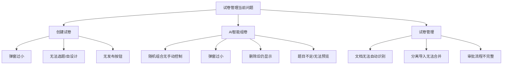
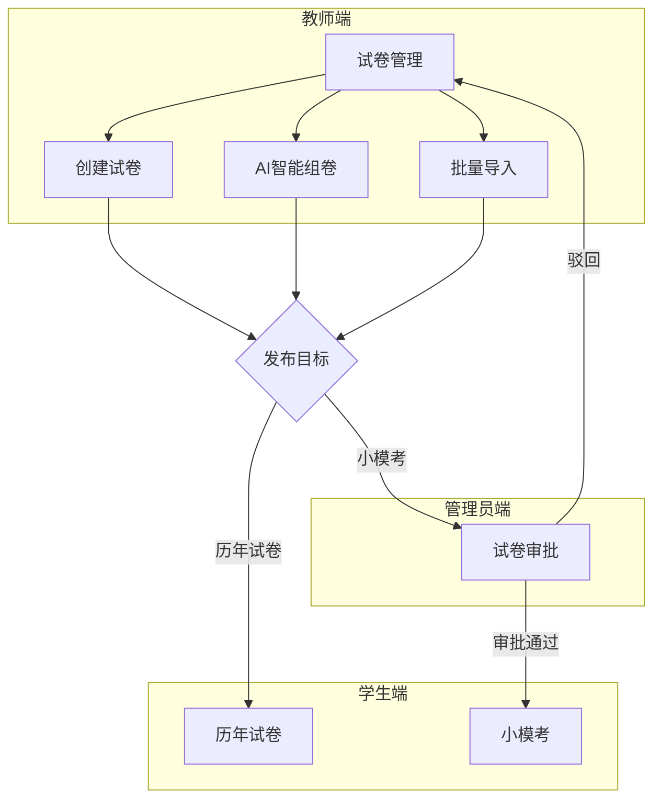
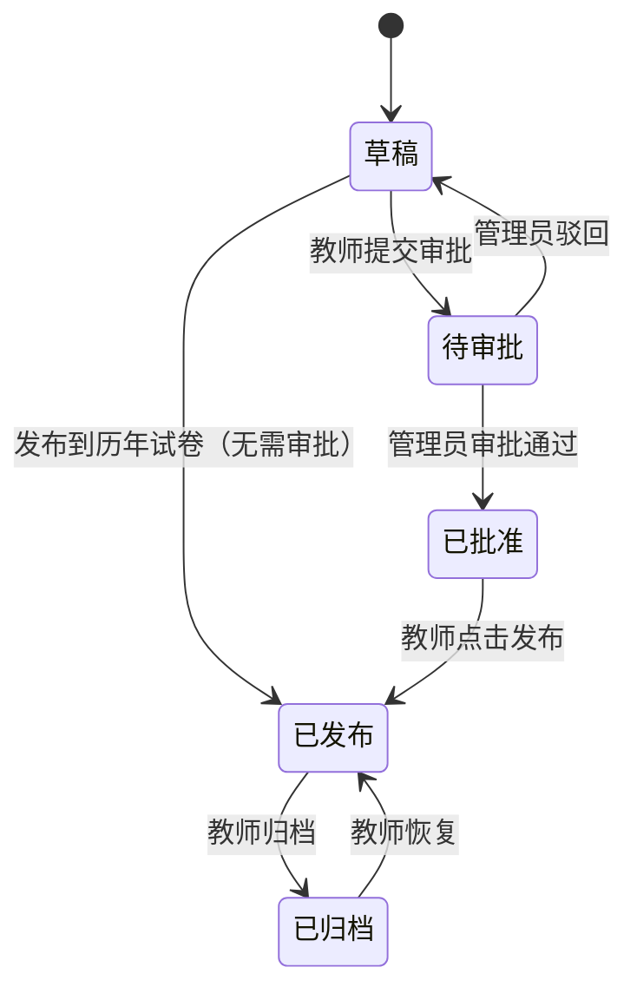
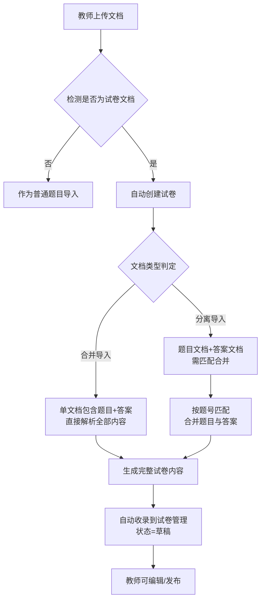
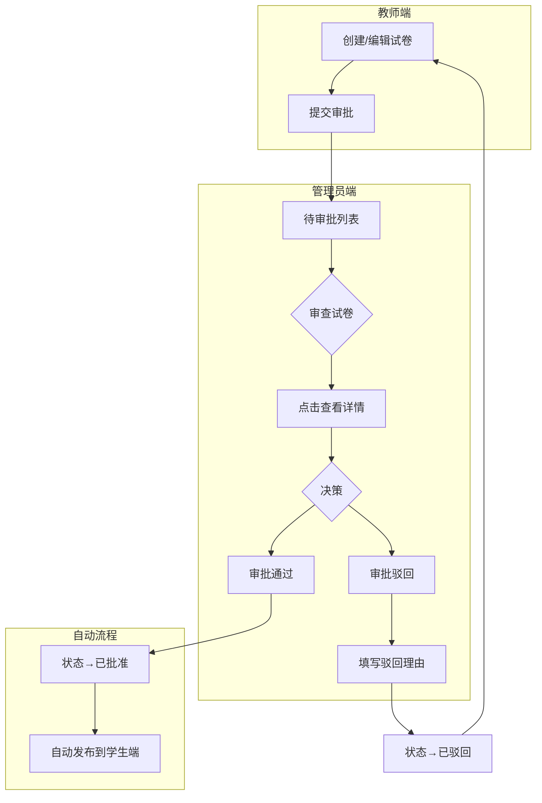

# 教师端“试卷管理”功能模块完善设计方案


## 文档说明

- **文档版本**：v1.0
- **编写日期**：2026年8月
- **编写目的**：针对公安联考题库系统中教师端“试卷管理”模块存在的功能缺陷，提供完整的系统化设计方案，确保该功能模块满足教师实际教学场景需求，具备良好的可用性、稳定性和可维护性。
- **适用对象**：前后端开发人员（可直接作为开发指导文档使用）


## 一、现状问题总结

### 1.1 问题清单

| 问题编号 | 问题描述 | 所属模块 | 优先级 |
|---------|---------|---------|--------|
| P1-1 | 创建试卷弹窗过小（max-width不足，max-height未设置），不方便查看和设计试卷 | 创建试卷 | P0 |
| P1-2 | 不支持从现有题库选择题目，不支持教师自设计题目 | 创建试卷 | P0 |
| P1-3 | 缺少“发布试卷”按钮，只能查看，无法完成组卷后发布操作 | 创建试卷 | P0 |
| P1-4 | 组卷是系统随机组合，教师无法进行手动增删改查题目 | AI智能组卷 | P0 |
| P1-5 | AI组卷弹窗同样过小 | AI智能组卷 | P0 |
| P1-6 | 删除的试卷仍显示在前端，占据空间 | AI智能组卷 | P0 |
| P1-7 | AI组卷题目数量不足，无法点击查看题目详情 | AI智能组卷 | P0 |
| P1-8 | 批量导入的试卷文档无法自动识别为试卷 | 试卷管理 | P1 |
| P1-9 | 分离导入（题目文档+答案文档）无法自动合并 | 试卷管理 | P1 |
| P1-10 | AI组卷和手动创建的试卷需审批后才能发布 | 试卷管理 | P0 |

### 1.2 核心痛点图示




## 二、整体功能架构设计

### 2.1 试卷管理模块总览

```
教师端“试卷管理”
│
├── 📋 试卷列表（默认展示所有已创建的试卷）
│   ├── 试卷卡片/列表展示
│   ├── 状态筛选（草稿/待审批/已批准/已发布/已归档）
│   ├── 搜索（按试卷名称/科目/创建时间）
│   └── 操作（编辑/删除/复制/预览/发布）
│
├── 📝 创建试卷
│   ├── 从现有题库选题（题目选择器）
│   │   ├── 按科目/题型/难度/知识点筛选
│   │   ├── 单选/多选（批量选择题目）
│   │   └── 预览题目详情
│   ├── 自设计题目（题目编辑器）
│   │   ├── 选择题（单选/多选）
│   │   ├── 判断题
│   │   ├── 填空题
│   │   ├── 简答题/论述题
│   │   └── 情境题
│   └── 试卷属性设置
│       ├── 试卷名称
│       ├── 考试年份
│       ├── 科目（行测/申论/公专）
│       ├── 试卷类型（国考/联考/省考/模拟考）
│       ├── 推荐用时
│       ├── 总分
│       └── 难度评级
│
├── 🤖 AI智能组卷
│   ├── 组卷参数设置
│   │   ├── 科目选择
│   │   ├── 题型分布（各题型题量/分值）
│   │   ├── 难度分布（简单/一般/困难占比）
│   │   ├── 知识点分布
│   │   └── 试卷年份范围
│   ├── 组卷结果（可编辑）
│   │   ├── 查看所有题目详情
│   │   ├── 手动增删题目
│   │   ├── 替换题目（换一题）
│   │   ├── 调整题目顺序（拖拽）
│   │   └── 调整题目分值
│   └── 保存/发布
│
├── 📤 试卷发布
│   ├── 发布到“历年试卷”（无需审批）
│   ├── 发布到“小模考”（需管理员审批）
│   └── 发布范围（全校/指定年级/指定班级）
│
└── 📊 补充功能
    ├── 试卷版本管理
    ├── 试卷模板
    ├── 试卷使用统计
    ├── 批量操作
    └── 操作日志
```

### 2.2 模块关联关系




## 三、详细功能设计

### 3.1 试卷列表页设计

#### 3.1.1 页面布局

采用 **顶部筛选区 + 卡片列表区** 的布局：

| 区域 | 内容 | 说明 |
|------|------|------|
| **顶部操作栏** | 搜索框 + 创建试卷按钮 + AI组卷按钮 + 批量操作 | 快捷入口 |
| **筛选区** | 状态筛选、科目筛选、年份筛选、试卷类型筛选 | 快速定位试卷 |
| **列表区** | 试卷卡片展示 | 支持分页，每页12/20/50项 |

#### 3.1.2 试卷卡片设计

每个试卷卡片展示以下信息：

| 信息项 | 说明 |
|--------|------|
| 试卷名称 | 大号字体显示，点击进入详情 |
| 基本信息 | 科目、年份、类型、总题数、总分、推荐用时 |
| 状态标签 | 草稿（灰色）/ 待审批（橙色）/ 已批准（绿色）/ 已发布（蓝色）/ 已归档（灰色） |
| 操作按钮 | 编辑 / 预览 / 复制 / 删除 / 发布（根据状态动态显示） |

#### 3.1.3 状态管理

| 状态 | 可见性 | 可执行操作 |
|------|--------|-----------|
| **草稿** | 仅教师自己可见 | 编辑、预览、删除、提交审批 |
| **待审批** | 教师端和管理员端可见 | 查看详情、撤回审批（教师）/ 审批（管理员） |
| **已批准** | 教师端和管理员端可见 | 预览、发布到学生端 |
| **已发布** | 所有人可见（学生端可见） | 查看、归档 |
| **已归档** | 仅教师端可见（可筛选） | 查看、恢复 |

**状态流转图**：



### 3.2 创建试卷功能设计

#### 3.2.1 弹窗尺寸规范

```css
/* 创建试卷弹窗样式 */
.create-paper-dialog {
  max-width: 1500px;
  max-height: 100vh;
  width: 95vw;
  height: 95vh;
  display: flex;
  flex-direction: column;
  margin: 0 auto;
  border-radius: 12px;
}

/* 弹窗内部布局 */
.create-paper-dialog .dialog-body {
  flex: 1;
  overflow-y: auto;
  padding: 20px 24px;
}

.create-paper-dialog .dialog-footer {
  padding: 16px 24px;
  border-top: 1px solid #ebeef5;
  background: #fafafa;
  border-radius: 0 0 12px 12px;
}
```

#### 3.2.2 创建试卷三步流程

```
┌─────────────────────────────────────────────────────────────────┐
│                    创建试卷（步骤 1/3）                          │
│  ① 设置试卷基本信息                                             │
│     - 试卷名称 [输入框]                                         │
│     - 考试年份 [下拉选择]                                       │
│     - 科目 [下拉选择：行测/申论/公专]                          │
│     - 试卷类型 [下拉选择：国考/联考/省考/模拟考]               │
│     - 推荐用时 [数字输入]                                       │
│     - 难度评级 [自动计算/手动选择]                              │
├─────────────────────────────────────────────────────────────────┤
│                           [下一步 →]                            │
└─────────────────────────────────────────────────────────────────┘

┌─────────────────────────────────────────────────────────────────┐
│                    创建试卷（步骤 2/3）                          │
│  ② 添加题目                                                     │
│                                                                  │
│  ┌───────────────┐  ┌───────────────────────────────────────┐  │
│  │  题库选择区    │  │  已选题目列表                        │  │
│  │  [科目筛选]    │  │  1. [行测·单选] 题干内容...  [×]    │  │
│  │  [题型筛选]    │  │  2. [公专·多选] 题干内容...  [×]    │  │
│  │  [难度筛选]    │  │  3. [申论·简答] 题干内容...  [×]    │  │
│  │  [知识点筛选]  │  │  ...                                 │  │
│  │  [搜索]        │  │  共选择 15 题，总分 30 分            │  │
│  │  ├── 题目列表  │  │                                      │  │
│  │  │  ☐ 题1      │  │  [添加题目] [从题库选择]             │  │
│  │  │  ☐ 题2      │  │                                      │  │
│  │  │  ☐ 题3      │  │                                      │  │
│  │  └── 分页      │  │                                      │  │
│  └───────────────┘  └───────────────────────────────────────┘  │
├─────────────────────────────────────────────────────────────────┤
│              [← 上一步]            [下一步 →]                   │
└─────────────────────────────────────────────────────────────────┘

┌─────────────────────────────────────────────────────────────────┐
│                    创建试卷（步骤 3/3）                          │
│  ③ 预览与发布                                                   │
│                                                                  │
│  试卷预览（只读模式，展示完整试卷内容）                          │
│  ┌───────────────────────────────────────────────────────────┐  │
│  │  第1题（单选题，2分）                                     │  │
│  │  题干内容...                                              │  │
│  │  A. 选项1  B. 选项2  C. 选项3  D. 选项4                  │  │
│  │  正确答案：A                                              │  │
│  ├───────────────────────────────────────────────────────────┤  │
│  │  第2题（多选题，3分）                                     │  │
│  │  ...                                                     │  │
│  └───────────────────────────────────────────────────────────┘  │
│                                                                  │
│  发布选项：                                                      │
│  ○ 保存为草稿（暂不发布）                                       │
│  ○ 发布到“历年试卷”（无需审批）                                 │
│  ○ 发布到“小模考”（需管理员审批）                               │
│                                                                  │
│  [返回上一步] [保存草稿] [确认发布]                              │
└─────────────────────────────────────────────────────────────────┘
```

#### 3.2.3 题目选择器（从现有题库选题）

| 功能 | 实现方式 |
|------|---------|
| 题目筛选 | 支持按科目、题型、难度、知识点、关键词进行多维度筛选 |
| 批量选择 | 支持单选（点击）和多选（勾选），支持全选当前页 |
| 题目预览 | 点击题目可弹窗查看完整内容（含图片、选项、答案、解析） |
| 已选统计 | 实时显示已选题目数量、题型分布、总分统计 |
| 题目换源 | 支持“换一题”功能，从题库随机替换当前题目 |

#### 3.2.4 自设计题目编辑器

| 题型 | 编辑内容 | 特殊要求 |
|------|---------|---------|
| **单选题** | 题干、4-6个选项、正确答案 | 至少2个选项 |
| **多选题** | 题干、4-6个选项、正确答案（多选） | 至少2个正确答案 |
| **判断题** | 题干、正确答案（✓/✗） | - |
| **填空题** | 题干、答案（可多个空） | 支持多个填空 |
| **简答题/论述题** | 题干、参考答案、评分要点 | 主观题标识 |
| **情境题** | 情境描述、多个子题 | 每个子题独立设置 |

#### 3.2.5 试卷属性自动计算

| 属性 | 计算方式 |
|------|---------|
| 总题数 | 自动累加所有题型数量 |
| 总分 | 自动累加各题分值 |
| 难度评级 | 根据各题难度加权平均计算 |
| 推荐用时 | 根据题型和题量智能估算（可手动调整） |

### 3.3 AI智能组卷功能设计

#### 3.3.1 组卷参数设置

| 参数 | 说明 | 默认值 |
|------|------|--------|
| 试卷名称 | 自动生成或手动输入 | “智能组卷_YYYYMMDD_HHMMSS” |
| 科目 | 行测/申论/公专 | 行测 |
| 考试年份 | 如2025 | 当前年份 |
| 组卷来源 | 全部题库 / 历年真题 / 自定义 | 全部题库 |
| 难度分布 | 简单/一般/困难 各占比例 | 20%/60%/20% |
| 题型分布 | 各题型题量/分值 | 按科目默认 |
| 知识点覆盖 | 至少覆盖x个知识点 | 3个 |
| 是否包含图片题 | 是/否 | 是 |
| 生成数量 | 生成n套备选 | 3套 |

#### 3.3.2 组卷结果编辑

生成后，教师可在结果页面进行以下操作：

| 操作 | 说明 |
|------|------|
| **查看题目详情** | 点击任意题目，弹窗展示完整内容（含图片、选项、答案、解析） |
| **替换题目** | 选中某题，点击“换一题”，系统从题库中推荐相似题目替换 |
| **手动增删** | 删除不满意的题目，或从题库中额外添加题目 |
| **调整顺序** | 拖拽调整题目顺序，或按题型分组排序 |
| **调整分值** | 修改任意题目的分值 |
| **切换备选** | 如果生成了多套，可切换查看不同套题 |
| **重新生成** | 不满意可重新设置参数生成 |

#### 3.3.3 删除功能修复

- **软删除机制**：删除的试卷进入“回收站”，不立即物理删除
- **回收站管理**：可恢复或彻底删除
- **前端刷新**：删除后立即从列表中移除，不显示删除的试卷

### 3.4 试卷文档自动识别与收录

#### 3.4.1 识别规则

| 识别项 | 规则 | 示例 |
|--------|------|------|
| 试卷标题 | 包含“考试/联考/省考/国考/模拟考/真题/试卷”关键词 | “2025年公安联考行测真题” → 自动识别为试卷 |
| 试卷年份 | 提取文档中的年份信息 | “2025” → 自动填充年份 |
| 试卷科目 | 根据“行测/申论/公专”关键词识别 | 文档中含“行测” → 自动关联科目 |
| 试卷类型 | 根据“联考/省考/国考/模拟考”关键词识别 | “联考” → 试卷类型=联考 |

#### 3.4.2 导入流程



#### 3.4.3 答案文档合并规则

| 场景 | 处理方式 |
|------|---------|
| 题目文档有题号，答案文档有对应题号 | 按题号匹配，自动合并 |
| 题目文档无题号 | 按顺序匹配（位置一一对应） |
| 题号不匹配或部分缺失 | 标记为“待人工匹配”，提示教师手动补充 |
| 答案格式识别 | 支持“A/B/C/D”、“√/×”等多种格式 |

### 3.5 审批与发布控制

#### 3.5.1 发布权限控制

| 试卷来源 | 是否需要审批 | 发布方式 |
|---------|-------------|---------|
| 批量导入（自动识别） | ❌ 不需要 | 可直接“发布到学生端” |
| 手动创建试卷 | ✅ 需要 | 需管理员审批后发布 |
| AI智能组卷 | ✅ 需要 | 需管理员审批后发布 |

#### 3.5.2 发布目标

| 发布目标 | 审批要求 | 适用场景 |
|---------|---------|---------|
| 历年试卷 | 无需审批 | 学生自主练习 |
| 小模考 | 需管理员审批 | 全校统一模拟考试 |

#### 3.5.3 发布流程

```
教师点击“发布”
    │
    ├── 发布到“历年试卷”
    │   └── 直接发布 → 学生端“历年试卷”可见
    │
    └── 发布到“小模考”
        ├── 提交审批 → 状态变为“待审批”
        ├── 管理员审批通过 → 状态变为“已批准”
        │   └── 自动发布到学生端“小模考”
        └── 管理员审批驳回 → 状态变为“已驳回”
            └── 教师可修改后重新提交
```

### 3.6 试卷审批流程




## 四、补充功能设计

### 4.1 试卷版本管理

| 功能 | 说明 |
|------|------|
| 版本记录 | 每次修改保存时自动创建版本快照 |
| 版本回滚 | 支持回退到历史任意版本 |
| 版本对比 | 对比两个版本的差异（新增/删除/修改的题目） |

### 4.2 试卷模板功能

| 功能 | 说明 |
|------|------|
| 保存为模板 | 将当前试卷保存为模板（不含具体题目，仅含结构） |
| 从模板创建 | 基于模板快速创建新试卷 |
| 模板管理 | 管理所有保存的模板 |

### 4.3 试卷使用统计

| 统计项 | 说明 |
|--------|------|
| 试卷被使用次数 | 被多少学生做过 |
| 平均正确率 | 所有完成该试卷学生的平均正确率 |
| 各题正确率 | 每道题的正确率统计 |
| 难度反馈 | 学生做完后反馈的难度评级 |

### 4.4 试卷预览与打印

| 功能 | 说明 |
|------|------|
| 预览模式 | 模拟学生端看到的试卷样式 |
| 打印试卷 | 生成可打印的PDF版本 |
| 导出Word | 导出为Word文档，方便线下使用 |

### 4.5 批量操作

| 操作 | 说明 |
|------|------|
| 批量删除 | 选中多份试卷一键删除 |
| 批量发布 | 选中多份试卷一键发布 |
| 批量归档 | 选中多份试卷一键归档 |

### 4.6 操作日志

| 记录项 | 说明 |
|--------|------|
| 操作时间 | 精确到秒 |
| 操作人 | 教师姓名 |
| 操作类型 | 创建/编辑/删除/发布/审批/归档 |
| 操作详情 | 具体操作内容描述 |


## 五、UI/UX设计规范

### 5.1 弹窗设计规范

```
┌─────────────────────────────────────────────────────────────────┐
│  ✕ 创建试卷                                    [帮助] [收起]  │
├─────────────────────────────────────────────────────────────────┤
│                                                                  │
│  ┌─ 步骤1：基本信息 ────────────────────────────────────────┐  │
│  │ 试卷名称 [________________________________]             │  │
│  │ 年份 [2025 ▼]  科目 [行测 ▼]  类型 [联考 ▼]            │  │
│  │ 用时 [120] 分钟  难度 [●一般]                          │  │
│  └──────────────────────────────────────────────────────────┘  │
│                                                                  │
│  ┌─ 步骤2：添加题目 ────────────────────────────────────────┐  │
│  │ ┌──────────────┐ ┌──────────────────────────────────┐  │  │
│  │ │ 题库筛选      │ │ 已选题目 (15题)                  │  │  │
│  │ │ [科目]       │ │ 1. [单选·行测] 题干...  [×]   │  │  │
│  │ │ [题型]       │ │ 2. [多选·公专] 题干...  [×]   │  │  │
│  │ │ [难度]       │ │ 3. [判断·申论] 题干...  [×]   │  │  │
│  │ │ [知识点]     │ │ ...                             │  │  │
│  │ │              │ │ 统计：单选3题 多选5题 ...       │  │  │
│  │ │ □ 题1        │ │ 总分：30分                       │  │  │
│  │ │ □ 题2        │ │                                  │  │  │
│  │ │ □ 题3        │ │ [从题库选择] [自设计题目]       │  │  │
│  │ └──────────────┘ └──────────────────────────────────┘  │  │
│  └──────────────────────────────────────────────────────────┘  │
│                                                                  │
│  ┌─ 步骤3：预览与发布 ──────────────────────────────────────┐  │
│  │  试卷预览（完整展示）                                    │  │
│  │  ...                                                    │  │
│  │                                                          │  │
│  │  发布选项：○ 保存草稿  ○ 历年试卷  ○ 小模考            │  │
│  └──────────────────────────────────────────────────────────┘  │
├─────────────────────────────────────────────────────────────────┤
│  [上一步]  [下一步]  [保存草稿]  [确认发布]                    │
└─────────────────────────────────────────────────────────────────┘
```

### 5.2 响应式设计

| 屏幕尺寸 | 布局调整 |
|---------|---------|
| ≥ 1400px | 三栏布局（筛选区 + 列表区 + 详情区） |
| 1024px ~ 1399px | 两栏布局（筛选区 + 列表区） |
| < 1024px | 单栏布局（列表区，筛选区折叠为下拉） |


## 六、数据库设计

### 6.1 试卷主表扩展 (`papers`)

在现有 `papers` 表基础上新增字段：

| 字段 | 类型 | 描述 |
|------|------|------|
| `source_type` | VARCHAR(20) | 来源类型：'manual' / 'ai' / 'import' / 'template' |
| `import_doc_id` | INT | 关联导入的原始文档ID |
| `is_separate_import` | BOOLEAN | 是否为分离导入（题目+答案分离） |
| `answer_doc_id` | INT | 分离导入时的答案文档ID |
| `template_id` | INT | 关联的模板ID（如从模板创建） |
| `version` | INT | 当前版本号，默认1 |
| `parent_version_id` | INT | 父版本ID，用于版本追溯 |

### 6.2 审批状态枚举

> ⚠️ 本节 v1.0 的小写枚举与数据库真实枚举不符，已勘误。**唯一事实源为 `exam_paper.paper_type`**（Enum：`DRAFT/PENDING/APPROVED/PUBLISHED/ENDED`），详见第十二章 12.3。

| 业务状态 | `paper_type`（DB 事实源） | 派生 `approval_status` | 说明 |
|--------|------|------|------|
| 草稿 | `DRAFT` | `draft` | 教师创建中，未提交 |
| 待审批 | `PENDING` | `pending` | 已提交审批，等待管理员审核 |
| 已批准 | `APPROVED` | `approved` | 管理员审批通过，可发布 |
| 已发布 | `PUBLISHED` | `approved` | 已发布到学生端 |
| 已归档/已删除 | `ENDED` | — | 软删除统一落 ENDED |

### 6.3 新增表

#### 6.3.1 试卷版本历史表 (`paper_versions`)

| 字段 | 类型 | 描述 |
|------|------|------|
| `id` | BIGINT PK | |
| `paper_id` | INT | 试卷ID |
| `version` | INT | 版本号 |
| `content_snapshot` | JSON | 该版本的完整试卷内容快照（含所有题目） |
| `change_description` | TEXT | 版本变更说明 |
| `created_by` | INT | 创建者ID |
| `created_at` | DATETIME | |

#### 6.3.2 试卷模板表 (`paper_templates`)

| 字段 | 类型 | 描述 |
|------|------|------|
| `id` | BIGINT PK | |
| `name` | VARCHAR(200) | 模板名称 |
| `description` | TEXT | 模板描述 |
| `template_structure` | JSON | 模板结构（含题型分布、题量等） |
| `created_by` | INT | 创建者ID |
| `created_at` | DATETIME | |

#### 6.3.3 试卷使用统计表 (`paper_statistics`)

| 字段 | 类型 | 描述 |
|------|------|------|
| `id` | BIGINT PK | |
| `paper_id` | INT | 试卷ID |
| `total_attempts` | INT | 总尝试次数 |
| `total_completions` | INT | 完成次数 |
| `avg_score` | DECIMAL(5,2) | 平均得分 |
| `avg_accuracy` | DECIMAL(3,2) | 平均正确率 |
| `question_stats` | JSON | 各题正确率统计 |
| `updated_at` | DATETIME | |

#### 6.3.4 操作日志表 (`operation_logs`)

| 字段 | 类型 | 描述 |
|------|------|------|
| `id` | BIGINT PK | |
| `user_id` | INT | 操作人ID |
| `module` | VARCHAR(50) | 操作模块（如“试卷管理”） |
| `action` | VARCHAR(50) | 操作类型（如“创建试卷”） |
| `target_id` | INT | 操作目标ID（如试卷ID） |
| `details` | JSON | 操作详情 |
| `ip_address` | VARCHAR(50) | 操作IP |
| `created_at` | DATETIME | |


## 七、API接口设计

### 7.1 教师端接口

> ⚠️ 以下路径以第十二章 12.9 的实测端点为最终依据。勘误：AI 组卷实际为 `POST /api/teacher/papers/auto-generate`（非 `ai-generate`）；`GET /api/teacher/papers/{id}` 详情、`DELETE /api/teacher/papers/{id}/questions/{qid}` 移除题目、复制/版本/模板端点当前**缺失**，属待补项。

| 接口 | 方法 | 路径 | 描述 |
|------|------|------|------|
| 获取试卷列表 | GET | `/api/teacher/papers` | 支持分页、筛选、搜索 |
| 获取试卷详情 | GET | `/api/teacher/papers/{id}` | 获取完整试卷内容 |
| 创建试卷 | POST | `/api/teacher/papers` | 创建新试卷 |
| 编辑试卷 | PUT | `/api/teacher/papers/{id}` | 修改试卷内容 |
| 删除试卷 | DELETE | `/api/teacher/papers/{id}` | 软删除试卷 |
| 复制试卷 | POST | `/api/teacher/papers/{id}/copy` | 复制现有试卷 |
| 提交审批 | POST | `/api/teacher/papers/{id}/submit-approval` | 提交到管理员审批 |
| 发布试卷 | POST | `/api/teacher/papers/{id}/publish` | 发布到学生端 |
| 获取题目列表 | GET | `/api/teacher/questions` | 从题库选题 |
| AI智能组卷 | POST | `/api/teacher/papers/ai-generate` | 根据参数生成试卷 |
| 获取版本历史 | GET | `/api/teacher/papers/{id}/versions` | 获取版本历史 |
| 版本回滚 | POST | `/api/teacher/papers/{id}/rollback` | 回滚到指定版本 |
| 获取模板列表 | GET | `/api/teacher/templates` | 获取试卷模板 |
| 从模板创建 | POST | `/api/teacher/papers/from-template` | 基于模板创建 |

### 7.2 管理员端接口

| 接口 | 方法 | 路径 | 描述 |
|------|------|------|------|
| 获取审批列表 | GET | `/api/admin/approval/papers` | 获取所有待审批试卷 |
| 获取试卷详情 | GET | `/api/admin/approval/papers/{id}` | 获取完整试卷内容 |
| 审批通过 | POST | `/api/admin/approval/papers/{id}/approve` | 通过审批 |
| 审批驳回 | POST | `/api/admin/approval/papers/{id}/reject` | 驳回审批 |


## 八、给 Claude Code / OpenCode 的实施提示词

```markdown
# 任务：完善教师端“试卷管理”功能模块

## 一、当前问题
1. 创建试卷弹窗过小（max-width/height不足）
2. 不支持从现有题库选题，不支持教师自设计题目
3. 缺少“发布试卷”按钮
4. AI组卷无法手动增删改查题目
5. AI组卷生成的题目不足，无法查看题目详情
6. 删除的试卷仍显示在前端
7. 批量导入的试卷文档无法自动识别为试卷
8. 分离导入（题目文档+答案文档）无法自动合并
9. AI组卷和手动创建的试卷需要审批后才能发布

## 二、技术栈
- 前端：Vue 3 + Element Plus
- 后端：FastAPI
- 数据库：PostgreSQL

## 三、实现要求

### 1. 创建试卷弹窗
- max-width: 1500px，max-height: 100vh
- 分三步流程：基本信息 → 添加题目 → 预览与发布
- 支持从现有题库选题（多维度筛选、批量选择、预览详情）
- 支持自设计题目（单选/多选/判断/填空/简答/情境题）

### 2. AI智能组卷
- 支持设置组卷参数（科目、题型分布、难度分布、知识点覆盖）
- 生成结果可编辑（查看详情、替换题目、增删题目、调整顺序、调整分值）
- 删除后立即从列表移除（软删除 + 回收站）

### 3. 试卷文档自动识别
- 识别规则：文档标题包含“考试/联考/省考/国考/模拟考/真题/试卷”
- 自动创建试卷并收录到试卷管理
- 支持“分离导入”自动合并（按题号匹配）

### 4. 审批与发布控制
- 批量导入的试卷：无需审批，可直接发布
- 手动创建/AI组卷：需要管理员审批后才能发布
- 发布目标：历年试卷（无需审批）/ 小模考（需审批）

### 5. 补充功能
- 试卷版本管理（保存历史版本、版本回滚）
- 试卷模板（保存为模板、从模板创建）
- 试卷使用统计（使用次数、正确率、各题正确率）
- 操作日志（记录所有操作）
- 批量操作（批量删除/发布/归档）

## 四、输出要求
1. 完整的后端 API 代码（含所有接口）
2. 完整的前端 Vue 组件代码
3. 数据库迁移脚本
4. 测试用例
```


## 九、实施优先级

| 优先级 | 功能 | 说明 |
|--------|------|------|
| **P0** | 创建试卷弹窗放大 + 三步流程 | 核心功能，必须优先 |
| **P0** | 从现有题库选题 + 自设计题目 | 核心功能 |
| **P0** | 发布按钮 + 审批流程 | 核心功能 |
| **P0** | AI组卷结果可编辑 | 核心功能 |
| **P0** | 删除后立即移除 | Bug修复 |
| **P1** | 试卷文档自动识别 | 重要功能 |
| **P1** | 分离导入自动合并 | 重要功能 |
| **P2** | 试卷版本管理 | 增强功能 |
| **P2** | 试卷模板 | 增强功能 |
| **P3** | 试卷使用统计 | 增强功能 |
| **P3** | 操作日志 | 增强功能 |


## 十、风险与应对

| 风险项 | 影响 | 应对措施 |
|--------|------|---------|
| 弹窗过大导致低分辨率屏幕显示不全 | 部分教师使用笔记本，屏幕较小 | 设置max-height: 100vh，内部滚动；支持全屏模式切换 |
| AI组卷生成速度慢 | 影响教师使用体验 | 采用异步生成模式，显示加载进度；限制单次生成题目数量上限（如200题） |
| 分离导入匹配错误 | 答案与题目错位 | 增加人工确认步骤；提供手动匹配界面 |
| 版本回滚导致数据丢失 | 误操作回滚后丢失后续修改 | 回滚前创建当前版本快照；支持再回滚 |
| 审批流程卡顿 | 教师等待审批，影响发布效率 | 设置审批超时提醒；支持催办功能 |


## 十一、总结

本方案从 **弹窗尺寸优化**、**题目来源扩展**、**AI组卷可控化**、**文档自动识别**、**审批发布流程** 五个维度全面完善了教师端“试卷管理”功能模块。同时补充了版本管理、模板管理、统计分析、操作日志等增强功能，确保该模块满足教师实际教学场景需求，具备良好的可用性和可维护性。设计过程中充分考虑了与管理员端“试卷审批”模块和学生端“历年试卷”、“小模考”模块的联动关系，形成完整的试卷生命周期管理体系。

---

## 十二、补充完善——公安联考教师视角的落地设计

> **章节版本**：v1.1 | **补充日期**：2026-08-17
> **说明**：本章基于对当前前后端源码的实测核对，纠正原方案与真实代码脱节之处，并从公安联考教师的**权限操作、主要用途、使用体验舒适、实用**四个维度补齐落地细节。本章为后续实施的唯一依据，与第六、七章冲突处以本章为准。

### 12.1 关键词工程深度思考

| 用户关键词 | 深度解读 | 落点 |
|-----------|---------|------|
| 权限操作 | 教师 `role_level=1` 只能管理**自己创建**的试卷（`creator_id` 过滤）；只能软删草稿（`paper_type→ENDED`）；发布到「小模考」需管理员审批；管理员 `role_level=2` 负责审批 | 12.3 状态模型、12.4 发布双轨制 |
| 主要用途 | 出卷（题库选题 + 自设计题目）、AI 智能组卷、发布（历年试卷供自主练习 / 小模考供统一模考）、审校 | 12.5 场景优化 |
| 使用体验舒适 | 弹窗放大 + 三步流程、实时题数/总分统计、题目预览、换一题、拖拽排序、分页 | 12.6 bug 修复、12.7 DSL 节点设计 |
| 实用 | 公安联考三科（行测/申论/公专），**公专情境题/案例分析**为重点题型；批量为王、低学习成本 | 12.5.1 自设计题目 |

### 12.2 现状勘误（纠正 §1.1）

原 §1.1 的 P1-1~P1-10 已部分过时。经源码实测，当前后端 `teacher.py` 与前端 `teacher_papers.vue`（`raw:true`）**已实现**：

| 已实现功能 | 对应原问题 |
|-----------|-----------|
| 创建试卷（`POST /api/teacher/papers`，`DRAFT`） | P1-1 部分（弹窗仍偏小） |
| 从题库选题（`POST .../questions` + 前端左右双栏选题弹窗） | P1-2 的「从题库选题」部分 |
| 提交审批（`submit-approval → PENDING`） | P1-10 的审批链路 |
| 发布（行内按钮，`APPROVED→PUBLISHED`） | P1-3 部分 |
| 删除（软删 = `paper_type→ENDED`） | P1-6 部分 |
| AI 组卷（`auto-generate`，一键硬编码） | P1-4/5/7 部分 |

**真正的剩余缺口（P0，仅 5 项）：**

| 编号 | 缺口 | 说明 |
|------|------|------|
| G1 | 自设计题目 | 无 `POST /api/teacher/questions`，前端无编辑器 |
| G2 | AI 组卷参数化 | 前端 `aiGenerate` 硬编码 `30/10/5/5`，无参数弹窗 |
| G3 | 试卷详情/预览 | 缺 `GET /api/teacher/papers/{id}`，前端无预览弹窗 |
| G4 | 题目移除 | 缺教师端 `DELETE .../questions/{qid}` |
| G5 | PENDING 筛选 + 分页 | 状态筛选缺 `PENDING` 选项，无分页 |

### 12.3 状态模型统一（单一事实源 = `exam_paper.paper_type`）

原 §6.2 使用小写 `draft/pending/approved/rejected/published/archived`，与数据库真实枚举不符。现统一以 `exam_paper.paper_type`（Enum：`DRAFT/PENDING/APPROVED/PUBLISHED/ENDED`）为**唯一事实源**：

| 业务状态 | `paper_type`（DB 事实源） | 派生 `approval_status`（列表展示用） | 前端标签色 |
|---------|------|------|------|
| 草稿 | `DRAFT` | `draft` | 灰 |
| 待审批 | `PENDING` | `pending` | 橙 |
| 已批准 | `APPROVED` | `approved` | 绿 |
| 已发布 | `PUBLISHED` | `approved` | 蓝 |
| 已归档/已删除 | `ENDED` | — | 灰 |

> **关键**：`paper_approval_workflow.status`（`pending/approved/rejected`）仅作审批流转的派生信息，**不单独建列**；「已归档」与「已删除」统一落 `ENDED`（现有软删除约定，`teacher.py` / `paper_generation.py` 一致）。
> 后端 `teacher.py` 列表接口同时返回 `paper_type`（大写）与派生 `approval_status`（小写），前端筛选按 `paper_type` 过滤，逻辑自洽。

### 12.4 发布双轨制落地（新增 `publish_target` 字段，已确认）

#### 12.4.1 字段与迁移

- `exam_paper` 新增 `publish_target VARCHAR(20) NULL`，取值 `past_paper`（历年试卷）/ `mock_exam`（小模考）。
- **迁移纪律（R1）**：`main.py` 启动自动加列机制**当前不覆盖 `exam_paper`**，需新增一条 `ALTER TABLE exam_paper ADD COLUMN publish_target VARCHAR(20)`。

#### 12.4.2 发布分流

```
教师点击「发布」
  ├── 选择「历年试卷」→ publish_target = 'past_paper'
  │     POST /api/teacher/papers/{id}/publish   （允许 DRAFT/APPROVED → PUBLISHED，免审批直发）
  └── 选择「小模考」→ publish_target = 'mock_exam'
        POST /api/teacher/papers/{id}/submit-approval  （DRAFT → PENDING）
        └─ 管理员 approve（admin_approval.py）→ PUBLISHED（自动发布）
```

> **注意（R2）**：现有 `paper_generation.py` 的 `POST /api/papers/{id}/publish` 守卫是「仅 `APPROVED→PUBLISHED`」，与「历年试卷免审批直发」冲突。落地时**新增**教师端 `/api/teacher/papers/{id}/publish` 按 `publish_target` 分流，**不复用旧端点**。

#### 12.4.3 学生端分流

| 通道 | 列表端点 | 过滤条件 |
|------|---------|---------|
| 历年试卷 | `GET /api/exams/list` | `paper_type=PUBLISHED AND publish_target='past_paper'` |
| 小模考 | `GET /api/student/mock-exams` | `publish_target='mock_exam' AND paper_type=PUBLISHED` |

### 12.5 公安联考场景优化（对应 5 项真缺口）

#### 12.5.1 自设计题目（G1）

- **后端**：新增 `POST /api/teacher/questions`，复用 `question_import.py` 的建题逻辑；入库默认 `status=1`、`audit_status='approved'`（教师可信）、`creator_id=当前教师`（R3）。
- **题型**：覆盖公安联考——单选题、多选题、判断题、填空题、简答题、论述题、**情境题/案例分析（公专重点）**；情境题含情境描述 + 多个子题，每个子题独立设置。
- **前端**：新增「自设计题目」编辑器弹窗。

#### 12.5.2 AI 组卷参数化（G2）

- 弹窗参数：科目、难度分布（简单/一般/困难占比）、题型配比（各题型题量+分值）、知识点覆盖、题量上限。
- 替换前端 `aiGenerate` 硬编码的 `question_config:{'单选题':30,'多选题':10,'论述题':5,'写作题':5}`。

#### 12.5.3 试卷预览（G3）

- **后端**：新增 `GET /api/teacher/papers/{id}`，返回完整试卷（含题目、选项、答案、解析、分值）。
- **前端**：新增只读预览弹窗，模拟学生视角（默认不含答案，可按需切换显示答案）。

#### 12.5.4 题目移除（G4）

- **后端**：新增 `DELETE /api/teacher/papers/{id}/questions/{qid}`（仅 `DRAFT`）。

#### 12.5.5 PENDING 筛选 + 分页（G5）

- 前端状态筛选补 `PENDING` 选项；列表加分页（每页 12/20/50）。

### 12.6 前端 bug 修复（写入实施清单）

| 编号 | 问题 | 现状 | 修复 |
|------|------|------|------|
| B1 | `publishPaper` 前缀不一致 | 调 `POST /api/papers/{id}/publish` | 改用 `POST /api/teacher/papers/{id}/publish`（带 `publish_target`） |
| B2 | 添加题目弹窗总分不显示 | 模板绑定 `{{ totalSelectedScore }}`，但该 `ref` 未更新且未导出（return 里导出的是 `getTotalScore`） | 在 `selectQuestion/removeSelectedQuestion` 中更新并 `return` 导出（或模板改用 `getTotalScore()`） |
| B3 | DSL 严重脱节 | `teacher_papers.json` 的 `nodes:[]` 为空、`state` 缺 `filterStatus/exam_type/添加题目系列`、CSS 与 .vue 不一致 | 执行 `vtj_sync_vue_to_dsl` 同步 `state/methods/__VERSION__` |

### 12.7 DSL 节点设计规范（新增 UI）

因 `teacher_papers.vue` 为 `raw:true` 且 DSL `nodes` 为空（template 全手写），新增 UI 手写在 .vue 并保持 VTJ 出码特征；若后续迁回设计器，按以下 DSL 节点规范表达：

- **弹窗**：`{ "name": "ElDialog", "from": "element-plus", "props": { "modelValue": ..., "title": ..., "width": ... } }`
- **表单**：`ElForm` / `ElFormItem` / `ElInput` / `ElSelect`（`options` 用 `JSExpression` 绑定 state）
- **表格**：`ElTable` + `ElTableColumn`（`data` 用 `JSExpression`）
- **state**：`{ "type": "JSExpression", "value": "..." }`
- **methods**：`{ "type": "method" | "asyncMethod", "params": [...] }`
- **lifeCycles**：`{ "mounted": { "type": "method" } }`
- **events**：`events.click.handler = { "type": "JSExpression", "value": "this.xxx(...)" }`

**职责边界**：Claude 只补 `<script>`（methods/state/lifeCycles），template 结构按本节规范手写；同步后 `__VERSION__` 一致（R5）。

### 12.8 落地纪律（R1~R5 风险应对）

| 编号 | 风险 | 落地纪律 |
|------|------|---------|
| R1 | `publish_target` 迁移方式 | `main.py` 启动迁移**新增** `ALTER TABLE exam_paper ADD COLUMN publish_target` |
| R2 | 免审批直发 vs 现有 publish 守卫 | 新增 `/api/teacher/papers/{id}/publish` 分流，不复用旧端点 |
| R3 | 自设计题入库状态 | `status=1` + `audit_status='approved'` + `creator_id`，复用 import 建题逻辑 |
| R4 | raw + 空 nodes 页面规则适用 | 保持 `useProvider` + `defineComponent` + `apiFetch`，同步 DSL |
| R5 | 前端不生效 | 同步提升 `__VERSION__`（.vue/.json 一致）+ 清 `node_modules/.vite` + 浏览器强刷 |

### 12.9 文件定位清单

| 层 | 文件 | 改动 |
|----|------|------|
| 前端（唯一） | `.vtj/vue/teacher_papers.vue` | 自设计编辑器、AI 组卷弹窗、发布目标弹窗、预览、PENDING 筛选+分页、B1/B2 bug 修复 |
| 前端 DSL | `.vtj/files/teacher_papers.json` | `vtj_sync_vue_to_dsl` 同步 state/methods/`__VERSION__` |
| 后端 | `backend/app/api/v1/teacher.py` | +`POST /questions`（自设计）、+`GET /papers/{id}`（详情）、+`DELETE /papers/{id}/questions/{qid}`（移除）、+`POST /papers/{id}/publish`（分流） |
| 后端 | `backend/app/api/v1/paper_generation.py` | 如复用旧 publish 则需按 `publish_target` 放宽守卫（可选） |
| 后端 | `backend/app/models/models.py` | `ExamPaper` 新增 `publish_target` 列 |
| 后端 | `backend/app/main.py` | 启动迁移新增 `ALTER TABLE exam_paper` |
| 学生端（后续实施） | 历年试卷 / 小模考列表 | 各加 `publish_target` 过滤 |

---