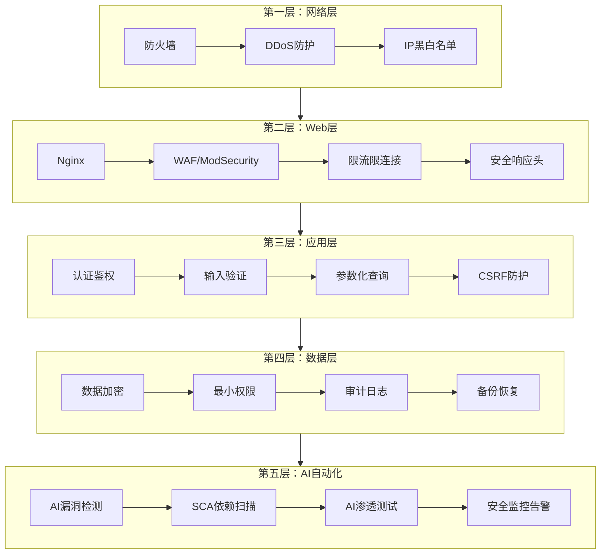
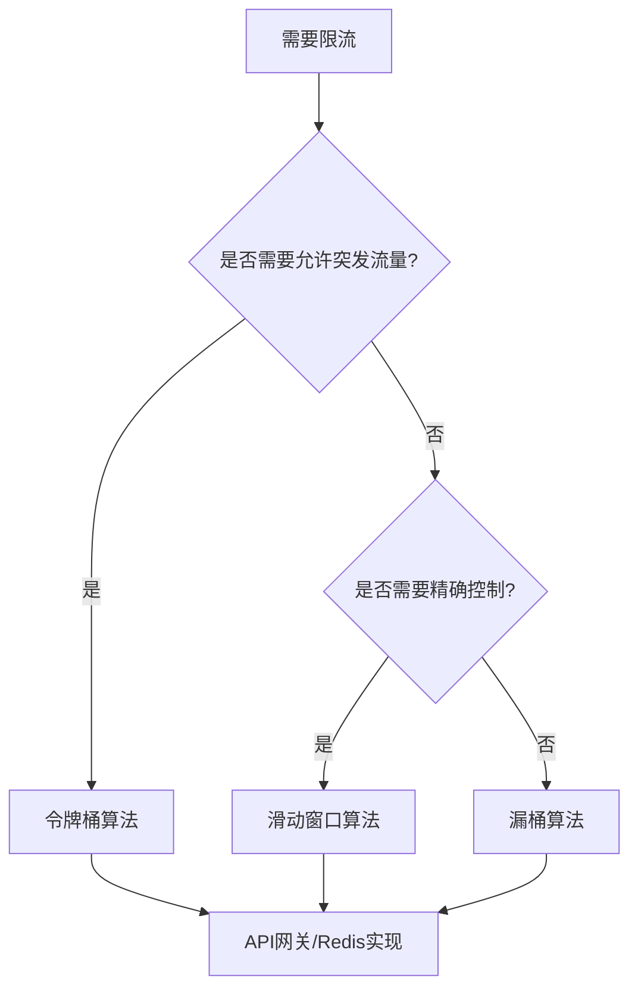
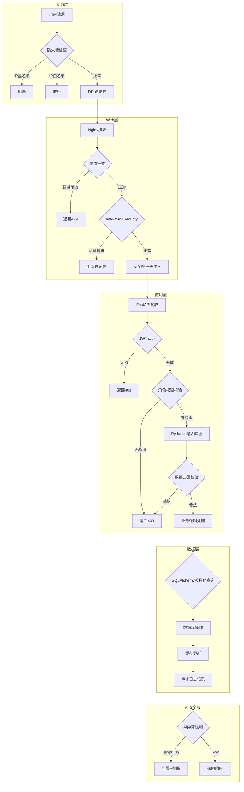
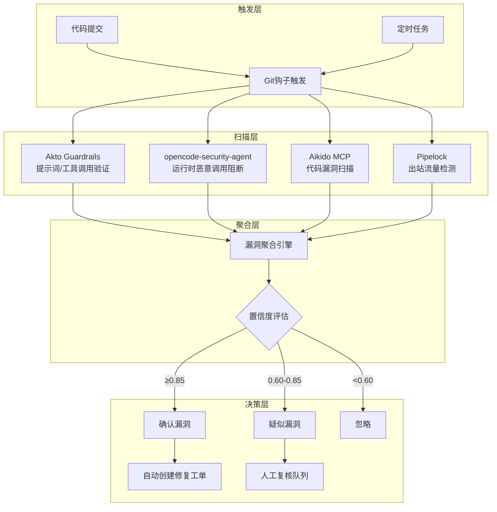
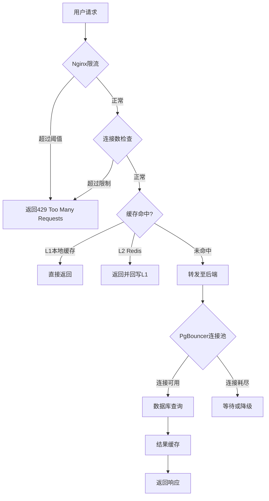

# 公安联考题库系统 网络安全保护屏障设计方案（完整整合版）


## 文档说明

- **文档版本**：v3.0
- **编写日期**：2026年9月
- **编写目的**：整合网络安全保护基本原则、浏览器安全机制、AI自动化安全工具、高并发稳定性保障，形成完整的网络安全保护屏障设计方案
- **适用对象**：系统架构师、后端开发人员、运维工程师、安全工程师


## 第一部分：网络安全保护基本原则

### 一、最小权限原则

#### 1.1 核心定义

任何主体（用户、程序、进程）仅被授予完成其任务所必需的最小权限，不多授予任何多余权限。

#### 1.2 实施层次

| 层次 | 实施措施 | 具体实现 |
|------|---------|---------|
| **数据库层** | 数据库用户权限最小化 | 应用连接使用专用账号，仅授予`SELECT`、`INSERT`、`UPDATE`、`DELETE`权限，禁止`DROP`、`ALTER` |
| **API层** | 接口权限最小化 | 每个API接口明确标注所需角色，通过FastAPI依赖注入强制校验 |
| **前端层** | 菜单和按钮权限最小化 | 根据用户角色动态渲染菜单，无权限的按钮置灰或隐藏 |
| **文件系统层** | 文件访问权限最小化 | 上传目录禁止执行权限，配置文件仅root可读 |
| **容器层** | 容器权限最小化 | 容器以非root用户运行，使用只读文件系统 |

#### 1.3 数据库权限配置示例

```sql
-- 创建专用应用账号（最小权限）
CREATE USER liankao_app WITH PASSWORD 'strong_password';

-- 仅授予必要的DML权限
GRANT SELECT, INSERT, UPDATE, DELETE ON ALL TABLES IN SCHEMA public TO liankao_app;
GRANT USAGE, SELECT ON ALL SEQUENCES IN SCHEMA public TO liankao_app;

-- 禁止DDL权限（应用不应修改表结构）
REVOKE CREATE ON SCHEMA public FROM liankao_app;

-- 只读用户（用于报表/查询）
CREATE USER liankao_readonly WITH PASSWORD 'readonly_password';
GRANT SELECT ON ALL TABLES IN SCHEMA public TO liankao_readonly;
```


### 二、纵深防御原则

#### 2.1 多层防御架构



#### 2.2 各层相互配合机制

| 配合场景 | 第一层 | 第二层 | 第三层 | 第四层 | 第五层 |
|---------|--------|--------|--------|--------|--------|
| **SQL注入攻击** | IP限流 | WAF规则拦截 | 参数化查询 | 数据库权限限制 | AI代码审计发现漏洞 |
| **XSS攻击** | — | CSP响应头 | 输出编码 | — | AI静态分析检测 |
| **越权访问** | IP白名单 | — | JWT角色校验 | 行级安全RLS | AI权限测试 |
| **DDoS攻击** | 防火墙 | Nginx限流 | — | — | 异常流量检测告警 |

#### 2.3 AI辅助威胁理解

利用AI自动化分析威胁本质，作出正确应对：

| 威胁类型 | AI分析方法 | 应对措施 |
|---------|-----------|---------|
| **零日漏洞** | AI代码审计（DeepAudit/KAVACH） | 自动生成修复补丁 |
| **新型攻击模式** | 异常行为AI检测 | 动态调整WAF规则 |
| **供应链攻击** | SCA依赖分析 + AI推理 | 自动锁定安全版本 |
| **提示词注入** | Pipelock AI防火墙 | 实时阻断恶意请求 |


### 三、数据与代码分离原则

#### 3.1 分离边界定义

| 分离类型 | 说明 | 实现方式 |
|---------|------|---------|
| **SQL与代码分离** | SQL语句不与用户输入拼接 | SQLAlchemy ORM参数化查询 |
| **HTML与数据分离** | 用户数据不直接渲染为HTML | Vue模板自动转义 + DOMPurify净化 |
| **命令与参数分离** | 系统命令不以字符串拼接执行 | `subprocess.run()`参数列表 |
| **路径与数据分离** | 文件路径不由用户输入决定 | UUID重命名 + 白名单路径校验 |

#### 3.2 注入防护实现

```python
# SQL注入防护：SQLAlchemy ORM参数化查询
stmt = select(User).where(User.username == username)  # ✅ 安全

# XSS防护：DOMPurify净化后渲染
import DOMPurify
sanitized = DOMPurify.sanitize(user_content)  # ✅ 安全

# 命令注入防护：参数列表而非字符串拼接
subprocess.run(["ffmpeg", "-i", user_input, "output.mp4"])  # ✅ 安全
```


### 四、不可预测性原则

#### 4.1 加密算法应用

| 应用场景 | 算法 | 说明 |
|---------|------|------|
| **传输加密** | TLS 1.3 + AES-256-GCM | 所有HTTP通信强制HTTPS |
| **密码存储** | bcrypt（cost=12） | 加盐哈希，不可逆 |
| **数据加密** | AES-256-CBC | 敏感字段（手机号、身份证号）加密存储 |
| **JWT签名** | HS256 / RS256 | 防篡改令牌 |

#### 4.2 哈希算法应用

| 应用场景 | 算法 | 说明 |
|---------|------|------|
| **文件完整性** | SHA-256 | 上传文件MD5/SHA256校验 |
| **内容去重** | MD5 + SimHash | 题目去重 |
| **密码哈希** | bcrypt | 不可逆密码存储 |

#### 4.3 随机数算法应用

| 应用场景 | 算法 | 说明 |
|---------|------|------|
| **会话ID** | `secrets.token_urlsafe(32)` | 密码学安全随机 |
| **CSRF Token** | `secrets.token_hex(32)` | 防跨站请求伪造 |
| **资源ID** | UUID v4 | 不可预测的资源标识 |
| **二维码登录** | UUID v4 | 扫码登录唯一标识 |

```python
import secrets
import uuid

# 密码学安全随机数
session_id = secrets.token_urlsafe(32)      # 会话ID
csrf_token = secrets.token_hex(32)          # CSRF Token
resource_id = str(uuid.uuid4())             # 资源ID

# 验证码生成（6位数字）
captcha_code = ''.join(secrets.choice('0123456789') for _ in range(6))
```


### 五、黑名单与白名单策略

#### 5.1 端口管理

| 端口 | 用途 | 开放范围 | 说明 |
|------|------|---------|------|
| **22** | SSH管理 | 仅管理员IP | 密钥登录，禁止密码 |
| **80** | HTTP | 全部 | 强制跳转443 |
| **443** | HTTPS | 全部 | 主要访问入口 |
| **8000** | FastAPI | 仅内网127.0.0.1 | Nginx代理 |
| **5432** | PostgreSQL | 仅内网127.0.0.1 | 禁止外网访问 |
| **6379** | Redis | 仅内网127.0.0.1 | 禁止外网访问 |
| **6432** | PgBouncer | 仅内网127.0.0.1 | 连接池 |

```bash
# UFW防火墙配置
sudo ufw default deny incoming
sudo ufw default allow outgoing
sudo ufw allow 22/tcp
sudo ufw allow 80/tcp
sudo ufw allow 443/tcp
sudo ufw enable
```

#### 5.2 IP黑白名单

| 策略 | 应用场景 | 实现方式 |
|------|---------|---------|
| **IP白名单** | 管理后台访问 | 仅允许学校内网IP访问/admin路径 |
| **IP黑名单** | 恶意IP拦截 | 基于fail2ban自动封禁异常IP |
| **PhishTank黑名单** | 钓鱼网站拦截 | 集成PhishTank API检测恶意URL |


## 第二部分：浏览器安全机制利用

### 一、同源策略（Same-Origin Policy）

#### 1.1 同源策略定义

浏览器限制来自不同源的脚本只能读取同源资源，防止恶意网站窃取数据。

#### 1.2 实施措施

| 措施 | 说明 |
|------|------|
| **CORS配置** | FastAPI配置`CORSMiddleware`，仅允许指定域名 |
| **SameSite Cookie** | 设置`SameSite=Lax`防止跨站携带Cookie |
| **postMessage安全** | 跨窗口通信时验证origin |

```python
from fastapi.middleware.cors import CORSMiddleware

app.add_middleware(
    CORSMiddleware,
    allow_origins=["https://liankao.com"],  # 仅允许自己的域名
    allow_credentials=True,
    allow_methods=["GET", "POST", "PUT", "DELETE"],
    allow_headers=["Authorization", "Content-Type"],
)
```


### 二、浏览器沙箱（Browser Sandbox）

#### 2.1 沙箱机制

浏览器将每个标签页隔离在独立进程中，限制其对系统资源的访问。

#### 2.2 利用方式

| 措施 | 说明 |
|------|------|
| **iframe sandbox属性** | 对嵌入的第三方内容添加`sandbox`属性 |
| **CSP frame-ancestors** | 限制页面被嵌入的方式 |
| **X-Frame-Options** | 防止点击劫持攻击 |

```nginx
# 防止页面被嵌入其他网站
add_header X-Frame-Options "SAMEORIGIN" always;
add_header Content-Security-Policy "frame-ancestors 'self';" always;
```


### 三、恶意网站拦截（PhishTank集成）

#### 3.1 多层过滤架构

基于PhishTank API的多层安全过滤架构：

| 层级 | 机制 | 数据源 | 说明 |
|------|------|--------|------|
| **第一层** | 黑名单过滤 | PhishTank API | 已知钓鱼网站拦截 |
| **第二层** | 白名单验证 | Tranco List API | 可信域名放行 |
| **第三层** | AI模型检测 | XGBoost（22个URL特征） | 零日威胁检测，准确率97.73% |

#### 3.2 后端实现

```python
# backend/app/services/phishing_detector.py
import requests
import hashlib

class PhishingDetector:
    """多层钓鱼网站检测器"""
    
    PHISHTANK_API = "https://checkurl.phishtank.com/checkurl/"
    
    async def check_url(self, url: str) -> dict:
        """多层检测URL安全性"""
        # 第一层：PhishTank黑名单
        is_blacklisted = await self._check_phishtank(url)
        if is_blacklisted:
            return {"safe": False, "reason": "PhishTank黑名单命中"}
        
        # 第二层：白名单验证
        is_whitelisted = await self._check_tranco(url)
        if is_whitelisted:
            return {"safe": True, "reason": "白名单域名"}
        
        # 第三层：AI模型检测（XGBoost）
        risk_score = await self._ai_detect(url)
        if risk_score > 0.7:
            return {"safe": False, "reason": f"AI检测风险分数: {risk_score}"}
        
        return {"safe": True, "risk_score": risk_score}
    
    async def _check_phishtank(self, url: str) -> bool:
        """PhishTank API查询"""
        response = requests.post(
            self.PHISHTANK_API,
            data={"url": url, "format": "json"},
            headers={"User-Agent": "phishtank/liankao"}
        )
        return response.json().get("results", {}).get("in_database", False)
```


### 四、逆向工程编译可操作文件——防URL中的XSS攻击

#### 4.1 浏览器编译机制分析

浏览器在解析URL时会进行多层编译和规范化，攻击者可利用这些机制进行XSS攻击：

| 攻击向量 | 原理 | 防护措施 |
|---------|------|---------|
| **URL编码绕过** | `%3Cscript%3E` → `<script>` | 强制URL解码后再校验 |
| **DOM型XSS** | 通过`location.hash`注入 | 禁用`innerHTML`，使用`textContent` |
| **React/Vue模板注入** | 利用框架漏洞 | 使用DOMPurify净化 |

#### 4.2 CSP强制策略

通过Nginx配置CSP响应头，限制脚本执行来源：

```nginx
# 分阶段部署CSP：先Report-Only观察，再强制执行
add_header Content-Security-Policy "default-src 'self'; script-src 'self' https://cdn.jsdelivr.net; style-src 'self' 'unsafe-inline'; img-src 'self' data: https:; connect-src 'self' https://api.liankao.com; frame-ancestors 'self'; object-src 'none'; base-uri 'self'; form-action 'self'; upgrade-insecure-requests;" always;

# 报告模式（部署初期）
# add_header Content-Security-Policy-Report-Only "default-src 'self'; report-uri /api/csp-report;" always;
```

#### 4.3 URL输入净化

```python
import re
from urllib.parse import unquote

def sanitize_url_input(url: str) -> str:
    """URL输入净化，防止XSS注入"""
    # 1. 多次URL解码，防止编码绕过
    decoded = unquote(url)
    while '%' in decoded:
        decoded = unquote(decoded)
    
    # 2. 移除危险协议
    decoded = re.sub(r'^(javascript|data|vbscript):', '', decoded, flags=re.IGNORECASE)
    
    # 3. 移除HTML标签
    decoded = re.sub(r'<[^>]*>', '', decoded)
    
    # 4. 移除事件处理器
    decoded = re.sub(r'on\w+\s*=', '', decoded, flags=re.IGNORECASE)
    
    return decoded
```


## 第三部分：OpenCode生态AI安全工具集成

### 一、AI安全工具全景

| 工具名称 | 类型 | 核心能力 | 集成方式 |
|---------|------|---------|---------|
| **Akto Guardrails** | OpenCode插件 | 拦截提示词和工具调用，实时安全验证 | OpenCode Hooks插件 |
| **Pipelock** | AI代理防火墙 | 出站流量控制、防密钥泄露、防提示词注入 | MCP代理 |
| **Aikido MCP** | OpenCode MCP | 自动扫描AI生成代码的漏洞和硬编码密钥 | MCP Server |
| **opencode-security-agent** | OpenCode插件 | 实时阻断恶意工具调用 | 插件（v2运行时阻断） |
| **cyberaudit-skill** | MCP Skill | 通用安全审计 | stdio MCP Server |

### 二、Akto Guardrails配置

Akto Guardrails在OpenCode的三个关键点进行安全验证：

| Hook点 | 作用 |
|--------|------|
| `experimental.chat.messages.transform` | 在发送给AI之前验证用户提示词 |
| `tool.execute.before` | 在执行之前验证工具调用（MCP和内置） |
| `tool.execute.after` | 记录工具响应用于审计追踪 |

**配置**（`~/.config/opencode/opencode.json`）：
```json
{
  "plugin": ["akto-guardrails"],
  "mcp": {
    "akto": {
      "type": "local",
      "command": ["python3", "~/.opencode/plugins/akto-mcp-request.py"],
      "enabled": true
    }
  }
}
```

### 三、Pipelock AI代理防火墙配置

Pipelock作为AI代理与网络之间的边界，检查HTTP、WebSocket、MCP流量：

| 检测能力 | 说明 |
|---------|------|
| **密钥泄露防护** | 阻止API Key、Token通过出站请求泄露 |
| **提示词注入检测** | 识别并阻断恶意提示词 |
| **SSRF防护** | 阻止服务端请求伪造 |
| **工具投毒检测** | 检测恶意的MCP工具调用 |

### 四、Aikido MCP配置

Aikido MCP自动扫描AI生成的代码：

```json
{
  "mcp": {
    "aikido": {
      "type": "local",
      "command": ["npx", "-y", "@aikidosec/mcp@latest"],
      "enabled": true
    }
  }
}
```

### 五、opencode-security-agent配置

v2版本通过`tool.execute.before`事件实时阻断恶意工具调用：

| 阻断类型 | 说明 |
|---------|------|
| **敏感路径读取** | `~/.ssh/`、`~/.aws/`、`/etc/shadow` |
| **已知恶意域名** | `giftshop.club`（Postmark MCP后门） |
| **数据外泄服务** | pastebin.com、transfer.sh、webhook.site |
| **危险命令** | `curl ... \| bash`、`base64 -d \| bash` |


## 第四部分：系统高并发与稳定性保障

### 一、数据库连接池与读写分离

#### 1.1 PgBouncer连接池配置

```ini
[databases]
liankao_db = host=127.0.0.1 port=5432 dbname=liankao_db

[pgbouncer]
pool_mode = transaction
default_pool_size = 20
max_client_conn = 10000
max_db_connections = 50
listen_port = 6432
```

#### 1.2 SQLAlchemy异步连接池

```python
engine = create_async_engine(
    DATABASE_URL,
    pool_size=20,
    max_overflow=10,
    pool_timeout=60,
    pool_recycle=3600,
    pool_pre_ping=True,
)
```

### 二、多级缓存策略

| 缓存层级 | 技术方案 | 缓存内容 | 过期策略 |
|---------|---------|---------|---------|
| **L1 本地缓存** | TTLCache | 题目选项、知识点映射 | 5分钟 |
| **L2 Redis** | Redis Cluster | 试卷列表、用户会话 | 1-24小时 |
| **L3 数据库** | PostgreSQL | 所有持久化数据 | 永久 |

### 三、限流算法与实现

#### 3.1 限流算法对比

| 算法 | 原理 | 特点 | 适用场景 |
|------|------|------|---------|
| **计数器** | 固定窗口计数 | 简单，有临界问题 | 简单限流 |
| **滑动窗口** | 时间窗分割统计 | 精度高，无临界问题 | API调用频次控制 |
| **漏桶** | 固定速率处理 | 平滑流出，不允许突发 | 接口稳定性要求高 |
| **令牌桶** | 令牌生成 + 请求取令牌 | 允许合理突发 | 秒杀、抢购场景 |

令牌桶算法允许突发流量，更符合实际需求；漏桶算法以固定速率处理请求，限流更严格。

#### 3.2 Nginx限流配置

Nginx提供两个核心限流模块：

```nginx
http {
    # 请求速率限制（按IP）
    limit_req_zone $binary_remote_addr zone=api_limit:10m rate=30r/s;
    limit_req_zone $binary_remote_addr zone=login_limit:10m rate=5r/m;
    
    # 并发连接限制（按IP）
    limit_conn_zone $binary_remote_addr zone=conn_limit:10m;
    
    server {
        # API通用限流
        location /api/ {
            limit_req zone=api_limit burst=50 nodelay;
            limit_conn conn_limit 10;
            proxy_pass http://backend;
        }
        
        # 登录接口严格限流
        location /api/auth/login {
            limit_req zone=login_limit burst=3 nodelay;
            error_page 503 @custom_limit;
            proxy_pass http://backend;
        }
        
        location @custom_limit {
            return 429 "请求太频繁，请稍后再试。";
        }
    }
}
```

#### 3.3 限流算法选择决策树



### 四、异步任务与爬虫隔离

使用Celery将爬虫任务与Web服务隔离：

```python
celery_app = Celery(
    "liankao",
    broker="redis://redis-cluster:6379/0",
    backend="redis://redis-cluster:6379/1"
)

celery_app.conf.behavior = {
    'worker_concurrency': 2,
    'task_time_limit': 1800,
    'task_soft_time_limit': 1500,
    'task_acks_late': True,
    'worker_prefetch_multiplier': 1,
}
```

### 五、水平扩展与负载均衡

```nginx
upstream backend {
    server 192.168.1.10:8000 weight=3;
    server 192.168.1.11:8000 weight=2;
    server 192.168.1.12:8000 weight=1;
    keepalive 32;
}
```


## 第五部分：完整防护流程图

### 一、请求处理全流程安全防护



### 二、AI自动化安全检测流程



### 三、高并发请求处理流程




## 第六部分：已知漏洞与应急响应

### 一、技术栈已知漏洞

| 组件 | 漏洞 | 影响版本 | 修复措施 |
|------|------|---------|---------|
| **Vue I18n** | CVE-2025-53892（DOM XSS） | <9.14.5, <10.0.8 | 升级至9.14.5/10.0.8 |
| **FastAPI** | 依赖注入安全 | — | 定期更新至最新稳定版 |
| **PostgreSQL** | 权限提升 | — | 及时安装安全补丁 |
| **Redis** | 未授权访问 | — | 配置密码+仅内网访问 |

### 二、SCA依赖扫描自动化

```yaml
# .github/workflows/sca-scan.yml
name: SCA Security Scan
on:
  push:
    branches: [main, develop]
  schedule:
    - cron: '0 2 * * *'
jobs:
  sca-scan:
    runs-on: ubuntu-latest
    steps:
      - uses: actions/checkout@v3
      - name: Python依赖扫描
        run: |
          pip install pip-audit
          pip-audit -r backend/requirements.txt --format json > reports/python-sca.json
      - name: Node.js依赖扫描
        run: npm audit --json > reports/node-sca.json
      - name: OpenSCA深度扫描
        run: |
          pip install opensca-cli
          opensca-cli -path ./ -format json -output reports/opensca.json
      - name: 漏洞告警
        if: contains(vulnerabilities, 'critical')
        run: python scripts/alert.py --severity critical
```


## 第七部分：实施优先级

| 优先级 | 任务 | 说明 |
|--------|------|------|
| **P0** | 最小权限原则落地（数据库/API/文件系统） | 基础安全 |
| **P0** | 数据与代码分离（ORM/DOMPurify/参数化） | 防注入核心 |
| **P0** | Nginx限流配置（API/登录接口） | 防暴力破解 |
| **P0** | 安全响应头（CSP/X-Frame-Options/HSTS） | 浏览器安全 |
| **P1** | Akto Guardrails + opencode-security-agent | AI运行时安全 |
| **P1** | PgBouncer连接池 + 多级缓存 | 高并发基础 |
| **P1** | PhishTank黑名单集成 | 恶意网站拦截 |
| **P2** | Pipelock AI代理防火墙 | 出站流量控制 |
| **P2** | ModSecurity + OWASP CRS | WAF防护 |
| **P2** | Celery异步任务隔离 | 爬虫隔离 |
| **P3** | SCA依赖扫描自动化 | 供应链安全 |
| **P3** | XGBoost钓鱼检测模型 | AI威胁检测 |


## 第八部分：总结

本方案整合了以下核心安全能力：

| 维度 | 核心措施 | 技术实现 |
|------|---------|---------|
| **最小权限** | 数据库/API/文件/容器权限最小化 | 专用账号+依赖注入+目录权限 |
| **纵深防御** | 五层防御架构，层间相互配合 | 防火墙→WAF→应用→数据→AI |
| **数据代码分离** | 参数化查询、输出编码、命令参数化 | ORM+DOMPurify+subprocess |
| **不可预测性** | 加密/哈希/随机数算法 | TLS 1.3+bcrypt+secrets |
| **黑白名单** | 端口/API/域名/IP多级管控 | UFW+PhishTank+白名单 |
| **浏览器安全** | 同源策略/沙箱/恶意拦截/CSP | CORS+sandbox+PhishTank+CSP |
| **AI自动化安全** | Guardrails+Agent+Firewall+MCP | Akto+opencode-agent+Pipelock+Aikido |
| **高并发稳定性** | 连接池+缓存+限流+异步+扩展 | PgBouncer+Redis+Nginx+Celery+K8s |

通过以上设计，砺安题库系统构建了一套 **“AI驱动、多层纵深、自动检测、弹性扩展”** 的完整网络安全保护屏障，能够有效防范SQL注入、XSS、CSRF、越权攻击、文件上传漏洞、DDoS、暴力破解、供应链攻击等各类网络威胁，同时在高峰期（10,000人同时在线）保障系统稳定运行。