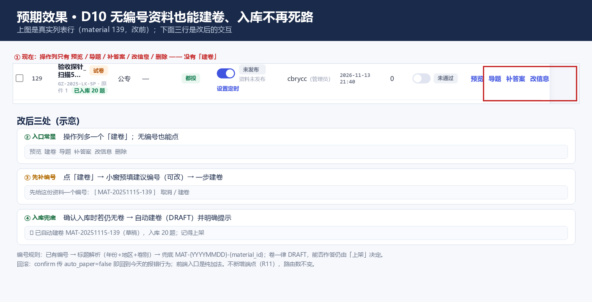
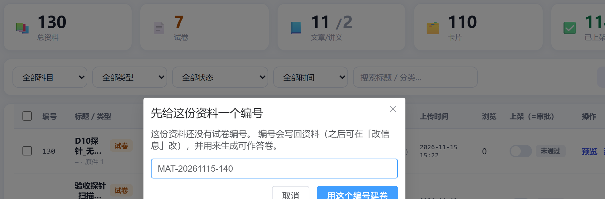

# D10 · 「没有编号的试卷资料建不了卷、也入不了库」修复方案 v1

> **状态**：⏳ 待批准（2026-11-15）· **来源**：今天验收 5 页探针时真实撞上
> **分支**：`feat/material-multi-format-import`（`main` 未动）
> **相关**：`扫描件题号行漏检_方案_v1.md`（T6）、A2「建卷」、P1「上传即建卷」、P3「导题」

---

## 1. 现象（今天真实发生）

material 139（`验收探针_扫描5页_请勿上架`，试卷类、`paper_code = NULL`）：

| 你想做的事 | 实际发生 |
|---|---|
| 建卷 | 列表行里**根本没有「建卷」按钮**（只有 预览/待确认/改信息/删除） |
| 点「确认入库」 | 弹红条：**「这条资料还没有可作答卷：先「建卷」（或重新上传试卷）再入库」** |
| 按提示找「建卷」 | 找不到 → **死路**；最后是我手工 `PATCH 编号` + `ensure-paper` 才走通 |

## 2. 根因（三条，互相叠加）

| # | 位置 | 问题 |
|---|---|---|
| 1 | `backend/.../materials.py:118`（`_item_brief`） | 列表回包**只带 `badge`、不带 `paper_code`**；而 C2a/C2b 之后编号主要写在 `paper_code` 上 |
| 2 | `src/views/admin/materials.vue:284` + `:573` | 「建卷」的显示条件是 `paperCodeOf(row) && !row.exam?.known`，而 `paperCodeOf` 只读 `row.badge` → **改信息补过编号、或上传时没解析出编号的资料，按钮永远不显示**；`ensurePaper()` 里 `if (!code) return;` 还是**静默返回** |
| 3 | `paper_ingest/service.py:332-334` → `materials.py:2348-2350` | 入库时无卷直接 400，**只给一句文字**，没有任何"去建卷/补编号"的动作或引导 |

> 这三条合起来就是：**编号看不见（1）→ 入口不显示（2）→ 走到最后一步被打回且无路可走（3）**。
> 历史上 #128（「2016江西招警…」文件名解析不出科目）撞的是同一条链。

## 3. 方案（D10-1/2/3 + 测试，≈0.7d）

### D10-1 列表契约：把编号带出来（后端 1 行）

`_item_brief()` 增加 `"paper_code": m.paper_code`（列为现成字段，不动表结构）；
前端 `paperCodeOf(row)` 改 `row.paper_code || row.badge`（兼容老数据把编号写在 `badge` 的情况）。

### D10-2 「建卷」入口：无编号也能点（前端）

- 显示条件改为 `row.type === 'paper' && !row.exam?.known`（**去掉编号前置条件**）；
- 有编号：`ensurePaper(row)` 行为不变（确认框 → POST）；
- **无编号**：弹一个「先给这份资料一个编号」小窗，预填**建议编号**（见 D10-3 的生成规则，允许改），
  确认后：`PATCH /admin/{id}/meta {paper_code}` → `POST /admin/{id}/ensure-paper` → 刷新列表；
- 失败不再静默：`ElMessage.error(具体原因)`。

### D10-3 入库兜底：无卷时自动建卷，一次走通（后端 + 前端提示）

`paper_ingest.confirm_draft()` 的「无卷」分支改为**自动建卷**：

```
paper_id = draft.paper_id or _paper_id_of(db, material)
if paper_id is None:
    code = suggest_paper_code(material)          # 见下方规则
    material.paper_code = material.paper_code or code   # 写回，下次不再生成第二个
    result = material_paper_link.ensure_paper_for_material(db, material, actor_id=...)
    paper_id = result["paper"]["paper_id"]
    paper_auto_created = True
```

**编号生成规则（优先级从高到低，保证可读且唯一）**：

| 顺序 | 规则 | 例 |
|---|---|---|
| 1 | 资料已有 `paper_code` / `badge` | `GZ-2025-LK-5P` |
| 2 | 标题能解析出「年份+地区+卷别」→ `build_paper_code()` | `GZ-2025-LK-T` |
| 3 | 兜底：`MAT-{YYYYMMDD}-{material_id}` | `MAT-20251115-139` |

- 卷名 = 资料标题；科目 = 资料科目；时长/总分取 `paper_meta` 缺省（120 分钟 / 100 分）；
- 卷状态 **DRAFT**（与 A2/P1 同一口径：能不能考由「资料上架」经 P5 决定）；
- 审计：复用 `ensure_paper` 那条审计，另加 `paper_import` 里的 `auto_paper=true` 字样；
- 回包里带 `paper_auto_created` / `paper_code`，**前端 toast 明确说**：
  「已自动建卷 GZ-2025-LK-T（草稿），入库后记得上架，学生才能考」；
- 需要保留旧行为时：`confirm` 的 body 传 `auto_paper=false` → 仍按今天的方式报 400（文案改成带引导：
  「先点该行的『建卷』，或重新上传时补编号」）。

### D10-4 测试

| 层 | 用例 |
|---|---|
| 后端 | `_item_brief` 含 `paper_code`；`suggest_paper_code` 三条规则（3）；无卷入库自动建卷 + 写回编号 + DRAFT（1）；再入库幂等不建第二张（1）；`auto_paper=false` 仍 400（1）；审计留痕（1） |
| 前端 | `paperCodeOf` 回退 `paper_code`（2）；`canBuildPaper(row)` 显示条件（3）；建议编号纯函数（2） |
| 端到端 | 造一份**无编号**的试卷资料 → 列表看到「建卷」→ 导题 → 确认入库一次成功（真机截图） |

## 4. 预期效果



| 场景 | 现在 | 改后 |
|---|---|---|
| 无编号试卷资料的操作列 | 没有「建卷」 | **有「建卷」**（点开先补编号，预填建议值） |
| 点「确认入库」 | 红条报错、死路 | **一次成功**：自动建卷（`MAT-20251115-139` 这类）+ toast 说明 |
| 改信息补过编号的资料 | 编号在列表"看不见"、建卷入口消失 | `paper_code` 直接带出来 |
| 想让系统别自动建卷 | — | `auto_paper=false`（报错文案带引导） |

## 5. 影响面与风险

| 项 | 判断 |
|---|---|
| 纯资料库（`placement=library`）的资料 | 导题入库时**也会建一张 DRAFT 卷**——这是必须的（题目要挂卷才能作答），不是副作用 |
| 已有卷的资料 | 走原路，`paper_auto_created=false`，行为不变 |
| 编号唯一性 | `MAT-` 规则含 `material_id`，天然唯一；手工编号走幂等复用 |
| API | **不新增路径**（R11），只给 `_item_brief` 加字段、给 `confirm` 加 `auto_paper` 开关 |
| 路由数 | 不变（L6 不受影响） |
| 回滚 | `auto_paper=false` 或 revert；前端入口是纯加法 |
| 风险 | 自动建卷会让"题库卷列表"多出 DRAFT 卷（与 P1 上传即建卷一致）；编号可读性靠三条规则兜底 |

## 6. 验收口径

- 后端新增 ≥7 例、前端新增 ≥7 例；
- `cd backend && pytest tests -k "material or paper or ingest or answer or ocr"` 全绿；
- 前端 `vitest` 全绿、`vue-tsc` 0；
- `gate_all` 9/10（唯一红仍是既有 L1-G）；
- 真机：一份无编号资料 → 看到「建卷」→ 导题 → 入库成功（截图留档）。

## 7. 交付记录（2026-11-15，按「按建议全做 D10-1/2/3」）

### 7.1 落地内容

| 层 | 文件 | 改动 |
|---|---|---|
| 后端 | `api/v1/library/materials.py` | `_item_brief` 增加 `paper_code`；列表对「无编号试卷」多给 `paper_code_suggest`；`ensure-paper` 收 body `paper_code`，没有就按 `suggest_paper_code()` 推一个并写回；`confirm` 透传 `auto_paper`（默认 true）+ 审计写明「自动建卷 X」 |
| 后端 | `services/paper_ingest/service.py` | `confirm_draft(auto_paper=True)`：无卷时自动建 DRAFT 卷、写回编号、`draft.paper_id` 留痕；回包加 `paper_auto_created` / `paper_code`；`auto_paper=false` 时保留旧报错（文案带引导） |
| 后端 | `services/paper_meta_parser.py` | 新增 `suggest_paper_code()`：已有编号 → 标题解析（`build_paper_code`）→ `MAT-{YYYYMMDD}-{id}` 兜底 |
| 前端 | `src/utils/paperCode.ts`（新） | `paperCodeOf` / `canBuildPaper` / `suggestPaperCode` / `isValidPaperCode` 纯函数（可单测） |
| 前端 | `views/admin/materials.vue` | `paperCodeOf` 改 `paper_code \|\| badge`；「建卷」入口改 `canBuildPaper(row)`（**不再要求编号**）；无编号时弹「先给这份资料一个编号」（预填建议值）→ 建卷后刷新 |
| 前端 | `components/admin/ParseDraftDrawer.vue` | 无卷时确认文案改「入库时自动建一张草稿卷」；入库成功 toast 带 `已自动建卷 X（草稿），记得上架` |
| 前端 | `utils/overlay.ts` | 新增 `promptOverlay`（与 `confirmOverlay` 同一套层级口径） |

### 7.2 真机验证（临时资料 140，验完即删）

| 步 | 结果 |
|---|---|
| 上传 `D10探针_无编号.pdf`（library 投放） | material **140**，`paper_code = 空` |
| 列表回包 | `paper_code = ""`、**`paper_code_suggest = MAT-20261115-140`**、`exam.known = false` |
| 操作列（真机 DOM） | `预览 / **建卷** / 导题 / 改信息 / 删除` —— 以前这一格没有「建卷」 |
| 点「建卷」 | 弹窗「先给这份资料一个编号」，预填 `MAT-20261115-140` → 「用这个编号建卷」 |
| 建卷结果 | `study_material.140.paper_code = MAT-20261115-140`；`exam_paper` **#8 DRAFT**（名称=资料标题）|
| 顺带验证 | material **139** 的 `paper_code=GZ-2025-LK-5P` 现在在列表里**看得见**了（D10-1）|
| 清理 | 删卷 #8、软删资料 140（进回收站）；库回到 **129 份在架资料 / 7 张卷 / 417 题**，无 `MAT-%` 残留 |



### 7.3 测试与门禁

| 项 | 结果 |
|---|---|
| 后端新增 | `tests/test_d10_paper_entry.py` **10 passed**（建议编号 3 / 列表契约 1 / 自动建卷 3 / 建卷接口 2 / 路由透传 1）|
| 前端新增 | `src/utils/__tests__/paperCode.spec.ts` **10 passed** |
| 前端全量 | **70 文件 / 751 用例全绿**；`vue-tsc` **0** |
| 后端回归 | 见提交信息（`-k "material or paper or ingest or answer or ocr or splitter"`）|
| 门禁 | 见提交信息（`gate_all`，唯一红仍是既有 L1-G）|

### 7.4 边界（如实）

- **自动建卷会多出一张 DRAFT 卷**：这是必须的（题目要挂卷才能作答），与 P1「上传即建卷」同一口径；卷能不能考仍由「资料上架」经 P5 决定。
- **编号规则只会"猜"到「科目+年份+地区」这一级**：猜不出就用 `MAT-YYYYMMDD-id`，之后可在「改信息」改成正式编号（改编号不会动已有卷的关联，因为关联键是编号——改之前请确认没有卷在用）。
- **`auto_paper=false`** 保留旧行为（报错带引导），给需要"必须先建卷再入库"的场景。
- 本轮**没有**动「上传即建卷」的触发条件，也没有新增端点（R11），路由数不变。
