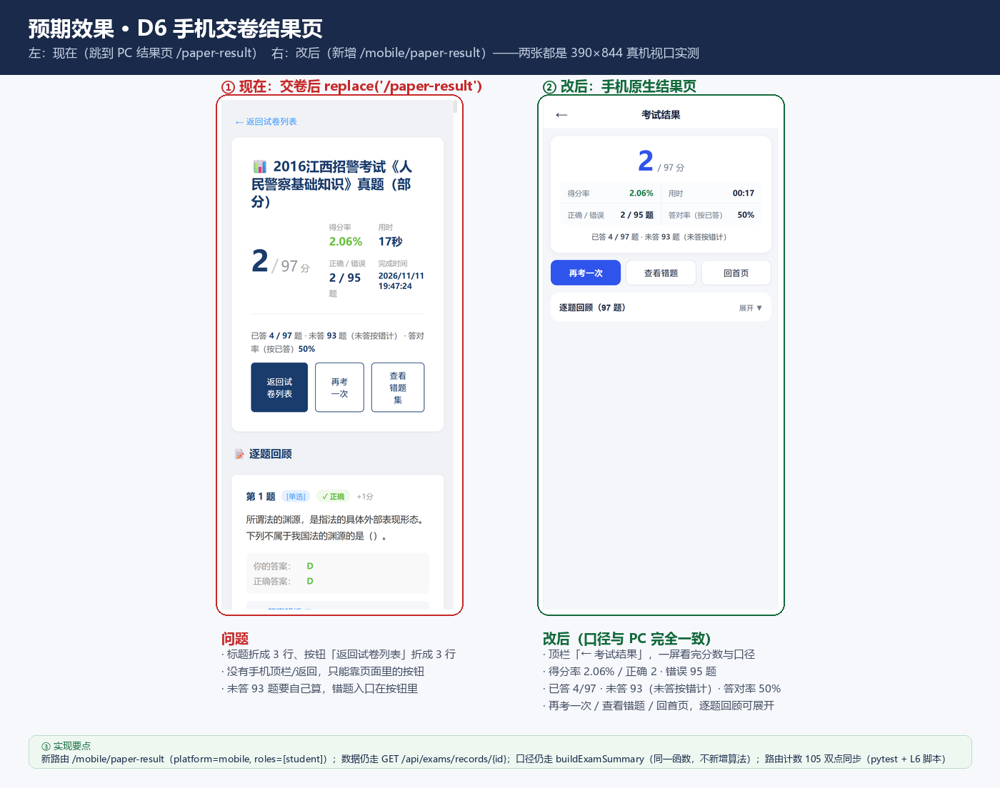
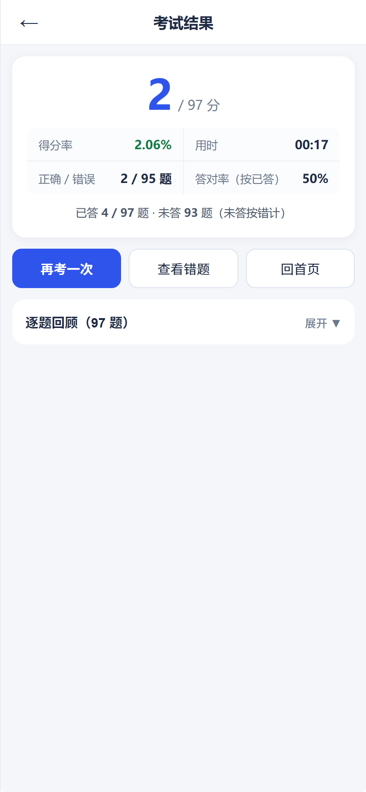
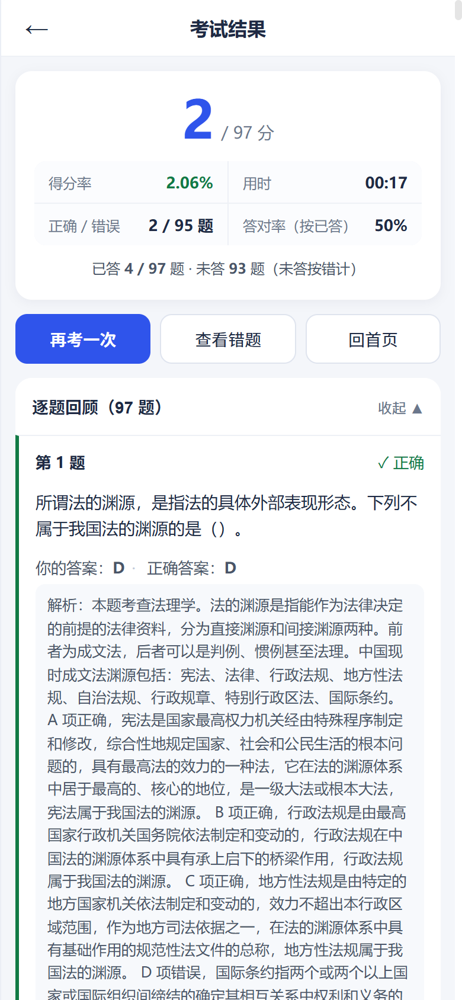

# D6 · 手机交卷结果页 · 方案 v1

> **状态**：📝 已归档（2026-11-15；你在「剩下三个缺陷按顺序全做」中批准 D6，本文件是该项的方案 + 交付记录）
> **分支**：`feat/material-multi-format-import`（`main` 未动）
> **R11**：**不新增端点**——复用 `GET /api/exams/records/{record_id}`，OpenAPI 仍 **461**
> **路由数**：**104 → 105**，两处断言点必须同改（`test_route_roles.py` + `verify-modularization-constraints.mjs`）

---

## 1. 现象（实测）

手机答题页 `src/views/student/mobile/mobile_answer.vue:807` 交卷成功后：

```ts
// 改前
router.replace(`/paper-result?record_id=${recordId.value}&paper_id=${paperId.value}`);
```

`/paper-result` 是 **PC 结果页**（`.vtj/vue/paper_result.vue`，桌面三段式版式）。手机端已有 7 个
`mobile_*` 页 + `meta.platform: 'mobile'`，**唯独结果页缺位**，于是手机用户拿到的是一张桌面页。

用 390×844 真机视口实测旧路径（见 §4 左图）：

| 观察 | 证据 |
|---|---|
| 卷名折成 **3 行**（"2016江西招警考试《人民警察基础知识》真题（部分）"）| 截图左 |
| 三个主按钮里「返回试卷列表」被折成 **3 行**，「查看错题集」折 2 行 | 截图左 |
| 4 个 meta（得分率/用时/正确错误/完成时间）挤成 2 行，`正确 / 错误 2 / 95` 换行 | 截图左 |
| 没有手机顶栏/返回键，只能靠页内按钮走 | 截图左 |

## 2. 方案（D6-1 ~ D6-4，≈0.4d）

### D6-1 新页 `src/views/student/mobile/mobile_paper_result.vue`

**手写页**（放 `src/views/student/mobile/`），**不新建 `.vtj` 页**——不碰 R1/R3，也不用设计器。

| 区块 | 内容 |
|---|---|
| 顶栏 | `←` 返回 + 标题「考试结果」 |
| 成绩卡 | 大号得分 / 满分；2×2 meta：得分率、用时、正确 ÷ 错误、答对率（按已答）；下面一行「已答 X / Y 题 · 未答 Z 题（未答按错计）」 |
| 动作区 | 再考一次（`POST /api/exams/{paper_id}/start` → `/mobile/answer`）、查看错题（`/mobile/wrong-questions`）、回首页（`/mobile/home`） |
| 逐题回顾 | 默认**收起**；展开后逐题给「✓/✗ + 题干（选项带样式）+ 你的答案 / 正确答案 + 解析」 |

**口径与 PC 完全一致（这是本项的核心约束）**：

| 项 | 来源 | 说明 |
|---|---|---|
| 数据 | `GET /api/exams/records/{record_id}` | 与 PC 结果页同一个接口 |
| 得分率 / 正确错误 / 已答未答 / 答对率 | `buildExamSummary()`（`src/utils/examSummary.ts`）| 与 PC 结果页、交卷弹窗、成绩分析**同一个函数**，不新增算法 |
| 满分 | 记录里的 `max_score`（权威值，97 分卷就是 97）| **不用 `\|\| 100` 兜底** |
| 题干渲染 | `renderQuestionContent()` | 与 PC 同款，选项样式一致 |

### D6-2 路由

```ts
// src/router/index.ts（紧跟 MobileAnswer 之后）
{
  path: '/mobile/paper-result',
  name: 'MobilePaperResult',
  component: () => import('@/views/student/mobile/mobile_paper_result.vue'),
  meta: { platform: 'mobile', roles: ['student'] }
}
```

### D6-3 交卷跳转改到新路由

`mobile_answer.vue:807` → `router.replace('/mobile/paper-result?record_id=…&paper_id=…')`。

### D6-4 路由计数双点同步（否则 L5/L6 直接红）

| 位置 | 改前 | 改后 |
|---|---|---|
| `backend/tests/test_route_roles.py::test_page_route_count` | 104 | **105** |
| `scripts/verify-modularization-constraints.mjs` `EXPECTED_DYNAMIC_IMPORTS` | 104 | **105** |

## 3. 影响面与风险

| 项 | 判断 |
|---|---|
| PC 结果页 `/paper-result` | **不动**，桌面端仍走它（两端各自版式、同一口径）|
| 新端点 | 无 → L4 / OpenAPI 461 不变 |
| 路由数 +1 | 两个断言点必须同改；L6 会真的去 `import()` 每一处（新页必须存在且可解析）|
| R12（不为平板复制手机页）| 未新增平板副本；本页是手机专用新页，不是 PC 页的复制 |
| R1/R2/R3（`.vtj/`）| 完全没碰 `.vtj/` |
| 回滚 | 单提交 revert（页面 + 路由 + 跳转 + 两个计数 + 测试，一处不落）|

## 4. 预期效果



| 场景 | 现在 | 改后 |
|---|---|---|
| 手机上答完卷 | 落到 PC 版式页，标题折 3 行、按钮折 3 行 | 原生手机页：顶栏 + 成绩卡 + 3 个动作，**一屏看完** |
| 看「为什么 97 题只对 2 题」| 4 个 meta 挤成两行，未答数要自己算 | 2×2 meta + 「已答 4 / 97 · 未答 93（未答按错计）」一行说清 |
| 逐题看错题 | 长列表一次全展开 | 默认收起，点开 97 条，题干/选项/答案/解析齐全 |

## 5. 验收口径

- 前端新增 `src/views/student/mobile/__tests__/mobilePaperResult.spec.ts` **4 例**（口径逐项 / 回顾展开条数 / 接口失败提示 / 三个动作路由）；
- `npm run typecheck` **0**；`npx vitest run` 全量全绿（71→72 文件）；
- `pytest backend/tests/test_route_roles.py` **5 passed**（含 105）；
- `node scripts/verify-modularization-constraints.mjs` 通过（105 处动态 import 均存在）；
- `gate_all` **9/10**（仅 L1-G 因题库量未达标红，与本次无关）；
- 真机：390×844 视口打开 `/mobile/paper-result?record_id=4`，分数/口径/回顾与库内数据一致。

## 6. 交付记录（2026-11-15，三个缺陷的第 3 项）

### 6.1 落地内容

| 层 | 文件 | 改动 |
|---|---|---|
| 前端 | `src/views/student/mobile/mobile_paper_result.vue` | **新增**手机结果页（顶栏 / 成绩卡 / 3 动作 / 可折叠逐题回顾）|
| 前端 | `src/router/index.ts` | 新增 `/mobile/paper-result`（`platform: mobile, roles: [student]`）|
| 前端 | `src/views/student/mobile/mobile_answer.vue:807` | 交卷成功跳转 `→ /mobile/paper-result`（原 `/paper-result`）|
| 测试 | `src/views/student/mobile/__tests__/mobilePaperResult.spec.ts` | **新增 4 例**（jsdom 挂载）|
| 测试 | `backend/tests/test_route_roles.py`、`scripts/verify-modularization-constraints.mjs` | 页面路由数 104 → **105** |

### 6.2 真机验证（学生 `202516001`，record 4：97 题卷，作答 4 题）

URL：`http://localhost:9527/#/mobile/paper-result?record_id=4`，视口 390×844 @2x。

| 项 | 页面显示 | 库/接口真值 | 结论 |
|---|---|---|---|
| 得分 / 满分 | `2 / 97 分` | `total_score=2`、`paper.total_score=97` | ✅ |
| 得分率 | `2.06%` | 2 ÷ 97 = 2.06% | ✅（两位小数，非取整成 2%）|
| 用时 | `00:17` | `duration_used=17` | ✅ |
| 正确 / 错误 | `2 / 95 题` | `is_correct=1` 共 2 条；97−2=95（含未答，与 PC 同口径）| ✅ |
| 已答 / 未答 | `已答 4 / 97 题 · 未答 93 题` | `answered_count=4`、`question_total=97` | ✅ |
| 答对率（按已答）| `50%` | 2 ÷ 4 | ✅ |
| 逐题回顾 | `逐题回顾（97 题）`，展开后 97 条，2 条 ✓ / 95 条 ✗，第 97 条显示「你的答案：未答 · 正确答案：C」+ 解析 | `details.length=97` | ✅ |





### 6.3 测试与门禁

| 项 | 结果 |
|---|---|
| 前端新增 | `mobilePaperResult.spec.ts` **4 passed** |
| 前端全量 | `npx vitest run` **72 文件 / 762 用例** 全绿 |
| 类型 | `npm run typecheck` **0 错** |
| 后端路由 | `pytest tests/test_route_roles.py` **5 passed**（页面路由 **105**）|
| L6 | `verify-modularization-constraints.mjs`：105 处动态 import 全部存在、无跨域 import、VTJ 版本 8/8 |
| 门禁 | `gate_all` **9/10**（仅 L1-G：题库 397 < 3085/3632，历史遗留）|
| OpenAPI | 461 → **461**（本项无新端点）|

### 6.4 如实说明

1. **第一版 chip 口径是错的，真机截图当场发现并修掉**：我最初把成绩卡做成三个 chip
   「答对 2 / 答错 95 / 未答 93」，三项相加 190 ≠ 97——因为「错误」口径**含未答**（2026-11-11 你拍板的口径），
   与「未答」并排就重复计数了。现已改成与 PC 结果页同款：2×2 meta（得分率/用时/正确÷错误/答对率）+
   单独一行「已答 4/97 · 未答 93（未答按错计）」。**这是本次唯一一次返工，发生在代码阶段、截图验收时**。
2. **「再考一次」没有在真机点**：点一次会在 `exam_record` 里新建一条进行中的记录（写库、会污染现有 4 条干净记录）。
   该按钮走的是 `POST /api/exams/{paper_id}/start` + 跳 `/mobile/answer`，与 PC 结果页 `retakeExam()` 同一接口同一写法；
   如果你要我现场点一次并随后清理那条记录，说一声我就做。
3. **右侧偶现的悬浮图标不是本页的**：那是模板外壳 `App.vue` 里的 `XMask`（VTJ 应用框架，actions 含 badge=1 的消息/锁定/退出），
   开发模式下页面加载约 10s 后淡入，会压在窄屏右侧。属模板既有行为，不在 D6 范围；本文两张真机图取的都是它未出现的时刻。
4. **手机端只改了「交卷」这一个入口**：全仓 `grep paper-result` 后，手机侧指向 PC 结果页的只有 `mobile_answer.vue` 这一处。
