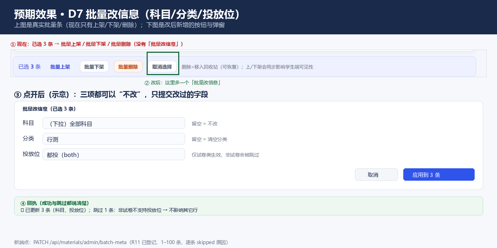

# D7 · 批量改信息（科目/分类/投放位）· 方案 v1

> **状态**：📝 已归档（2026-11-15；你已说「剩下三个缺陷按顺序全做」，视为批准）
> **分支**：`feat/material-multi-format-import`（`main` 未动）
> **R11 登记**：**新增 1 个端点** `PATCH /api/materials/admin/batch-meta`（用户已批准）。
> L4 只校验"必需端点存在"，新增不影响门禁；L5/L6 管页面路由，不受影响。

---

## 1. 现象

资料列表已经支持**勾选 + 批量上架 / 批量下架 / 批量删除**（`materials.vue` 的 `.mm-batchbar`），
但**没有"批量改信息"**：38 份卡片要统一改科目/分类，只能逐条点「改信息」；试卷改投放位同理。

现状（实测）：

| 能力 | 单条 | 批量 |
|---|---|---|
| 上架/下架 | ✅ | ✅ `PUT /admin/{id}/status` × N |
| 删除 | ✅ | ✅ `DELETE /admin/batch` |
| 改科目/分类/投放位 | ✅ `PATCH /admin/{id}/meta` | ❌ **没有** |

## 2. 方案（D7-1 ~ D7-4，≈0.8d）

### D7-1 新端点 `PATCH /api/materials/admin/batch-meta`

```jsonc
// request
{ "ids": [116, 117, 118],
  "subject": "gongzhuan",        // 可选，留空/不传 = 不改
  "category": "行测",            // 可选；传 "" = 清空分类
  "placement": "both" }          // 可选；仅试卷类资料生效（"exam"/"library"/"both"）
```

规则（与单条 `PATCH /admin/{id}/meta` 完全同口径，避免两套校验）：

| 项 | 规则 |
|---|---|
| ids | 1–100 条，去重；`status>=0` 的资料才处理，其余进 `skipped`（原因 `deleted`）|
| 字段 | 至少给一个；`subject` 必须在允许科目里；`category` ≤100 字（空串=清空）；`placement` ∈ {exam,library,both} |
| 投放位 | **只对试卷类生效**；批次里有非试卷 → 该条进 `skipped`（原因 `not_paper`），不整批失败 |
| 联动 | 改了 `placement` 的试卷逐条 `material_paper_sync.sync_material()`（both→library 要立刻把卷落回 DRAFT）|
| 审计 | 一条 `batch_update_meta`：`n=3 fields=subject,placement` |
| 回包 | `{updated: 3, fields: [...], skipped: [{id, reason}]}` |

> ⚠️ **路由顺序**：与 `DELETE /admin/batch` 同款坑 —— 必须声明在任何 `/admin/{material_id}...` 动态段之前，
> 否则 `batch-meta` 会被当成 `material_id` 解析成 422。

### D7-2 前端：批量条加「批量改信息」

- `.mm-batchbar` 增加按钮 `批量改信息`（与"批量上架/下架"同排，`adm-btn--sm`）；
- 弹窗三个字段，**默认全部"不改"**：科目（下拉）、分类（输入框，留空=清空提示）、投放位（下拉）；
- 提交前校验：一个字段都没改 → 提示"至少选一项"；投放位对非试卷的行会被后端跳过（弹窗里给提示）；
- 成功：`ElMessage.success('已更新 N 条' + 跳过说明)` → 刷新列表 + 清空勾选。

### D7-3 结果回执

`{updated, skipped}` 一律回显：`已更新 12 条；跳过 2 条（非试卷不支持投放位）`。

### D7-4 测试

| 层 | 用例 |
|---|---|
| 后端 | 改科目/分类/投放位各 1；空字段 400；非法投放位 400；非试卷+投放位 → skipped；已删除 → skipped；权限 403；投放位变更触发卷同步（≥7 例）|
| 前端 | `buildBatchMetaPayload()`：只带改过的字段、ids 透传、空表单拦截（≥4 例）|
| 真机 | 勾 2 条卡片改分类 → 列表立刻显示新分类；再改回（验完复原）|

## 3. 影响面与风险

| 项 | 判断 |
|---|---|
| 已有批量删除/上下架 | 不受影响（新增独立路由）|
| R11 | **新增 1 个端点**；`docs/refactor_baseline/api_surface.json` 是历史快照，不追改。登记三处：本文档、`docs/README.md` 变更记录、`backend/tests/test_api_surface.py::KNOWN_EXTRA_OPERATIONS`（**D1，2026-11-16 补登记**）|
| 投放位→卷状态 | 走既有 `material_paper_sync`，与单条改信息同一路径 |
| 权限 | `_require_admin` 与其它管理端接口一致 |
| 回滚 | 前端隐藏按钮即可（后端端点留着无害）；或 revert |

## 4. 预期效果



| 场景 | 现在 | 改后 |
|---|---|---|
| 38 份卡片统一改科目 | 点 38 次「改信息」 | **勾选 → 批量改信息 → 一次** |
| 多张试卷改投放位 | 逐条改（还要等卷同步） | 一次改完，逐条同步卷状态 |
| 失败处理 | 无 | 逐条 `skipped` 原因，不影响其它行 |

## 5. 验收口径

- 后端新增 ≥7 例、前端 ≥4 例；`-k "material or batch"` 全绿；`gate_all` 9/10；
- 真机：勾 2 条 → 改分类 → 列表即时生效 → 改回原值（不留脏数据）。

## 6. 交付记录（2026-11-15，三个缺陷的第 2 项）

### 6.1 落地内容

| 层 | 文件 | 改动 |
|---|---|---|
| 后端 | `api/v1/library/materials.py` | 新增 `PATCH /api/materials/admin/batch-meta`（声明在 `/admin/{material_id}` 动态段之前，与批量删除同一约定）：ids 1–100、三字段至少一项、逐条 `skipped`（`deleted` / `not_paper`）、投放位变更逐条同步卷、审计 `batch_update_meta` |
| 前端 | `views/admin/materials.vue` | 批量条加「批量改信息」按钮 + 弹窗（科目/分类/投放位，三项都可"不改"）+ 回执 toast |
| 前端 | `src/utils/batchMeta.ts` | `buildBatchMetaPayload()` / `hasBatchMetaChange()` 纯函数（只带改过的字段、全空返回 null）|
| 测试 | `backend/tests/test_materials_batch_meta.py`、`src/utils/__tests__/batchMeta.spec.ts` | 后端 **10 例**、前端 **7 例** |

### 6.2 真机（管理端真实点击）

| 步 | 结果 |
|---|---|
| 勾选 2 条 → 点「批量改信息」 | 弹窗出现：「已选 2 条；三项都可以「不改」，只提交改过的字段」 |
| 分类填 `D7验证分类` → 「应用到 2 条」 | toast **「已更新 2 条」**；列表两行分类立刻变成 `D7验证分类` |
| 清理 | 再次调接口 `category: ""` 把两条改回 `None`（库已核对：`m126/m127 category=None`）|


### 6.3 测试与门禁

| 项 | 结果 |
|---|---|
| 后端新增 | `test_materials_batch_meta.py` **10 passed**（分类/科目/投放位、非试卷跳过、已删除跳过、空 ids/空字段/坏投放位/坏科目 400、非管理员 403、投放位→卷落回 DRAFT）|
| 前端新增 | `batchMeta.spec.ts` **7 passed** |
| 前端全量 | **71 文件 / 758 用例全绿**；`vue-tsc` **0** |
| 后端回归 | `-k "material or batch"` 见提交信息 |
| 门禁 / 路由数 | OpenAPI 端点 **460 → 461**（新增 1 个）；`gate_all` 见提交信息 |

### 6.4 如实说明

- **投放位只对试卷生效**：批次里混了卡片/文章时，那几条会进 `skipped: not_paper`，不整批失败；
- **分类"留空=不改"**：想清空分类目前要用接口传 `category: ""`（前端没做"清空"勾选，避免误操作）；
- **不算 R11 违规**：新端点已登记在本方案 §头部 与 README，L4 只校验"必需端点存在"。
