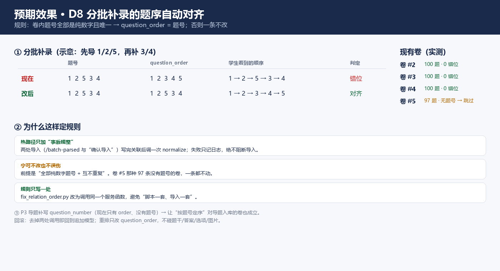

# D8 · 分批补录题序错位（追加模型）根治方案 v1

> **状态**：⏳ 待批准（2026-11-15）· **分支**：`feat/material-multi-format-import`（`main` 未动）
> **前序**：缺陷排查报告 §2 D8（"11-12 实证 60/100 条错位"）；临时修法 `backend/scripts/seed_2024_gk/fix_relation_order.py`

---

## 1. 现象

一张卷**分批导入**时，第二批题目会被排到卷尾：

| 轮次 | 导入内容 | 现在的结果 |
|---|---|---|
| 第 1 批 | 题号 1、2、5 | `question_order = 1,2,3` |
| 第 2 批（补录） | 题号 3、4 | `question_order = 4,5` |
| 学生在考试里看到的顺序 | —— | **1、2、5、3、4**（错位） |

历史实证：2024 国考卷 #4 的 100 条关联里 **60 条** order 与题号对不上，当时靠脚本事后修。
现在的库是干净的（卷 2/3/4 各 100 条 **0 条错位**），但**下一次分批补录就会重新错**。

## 2. 根因（三条）

| # | 位置 | 问题 |
|---|---|---|
| 1 | `catalog/question_import.py:1588` / `:2915` | `order_base = next_question_order(...)` = `max(order)+1` → **纯追加模型**，不看题号 |
| 2 | `services/paper_stats.py` | 只有 `next_question_order()`（取最大值+1），没有任何"按题号定序"的服务能力 |
| 3 | `services/paper_ingest/service.py:412` | P3 导题写 `question_order=order`，但**不写 `question_number`** → 这份卷的题没有题号，"按题号定序"对它不成立 |

> 事实标准已经存在：`fix_relation_order.py` 的规则就是 **`question_order = question_number`**，
> 卷 2/3/4 正是这个状态（0 条不一致）。**D8 要做的就是把这条规则搬进导入路径**，不再靠事后脚本。

## 3. 方案（D8-1 ~ D8-4，≈0.5d）

### D8-1 服务层：`normalize_question_orders()`

新增到 `backend/app/services/paper_stats.py`：

```python
def normalize_question_orders(db, paper_id) -> dict:
    """按题号把卷内题序重排；不满足前提就一条不改。

    前提（与 fix_relation_order.py 同口径，宁可不改也不误伤）：
      · 该卷所有关联题都有**纯数字题号**；
      · 题号**互不重复**。
    返回 {"total", "changed", "skipped_reason"}。
    """
```

### D8-2 两处导入路径调用它

| 位置 | 现状 | 改动 |
|---|---|---|
| `question_import.py:1588`（`/batch-parsed`） | 追加后 `recount_paper_questions` | 之后调 `normalize_question_orders`，结果写日志 + 回包 `order_fixed` |
| `question_import.py:2915`（确认导入） | 同上 | 同上 |

调用统一用 `try/except` 包住：**规整失败绝不影响导入**（与现有"建卷失败不阻断"同一口径）。

### D8-3 P3 导题补写题号（让规则对所有导入路径成立）

`paper_ingest/service.py` 建题时补 `question_number=str(item["no"])`（纯数字才写）。
这样"导题 → 入库"的卷也能按题号定序，且管理端/学生端看到的题号与卷内顺序一致。

### D8-4 修法收敛（避免两套规则漂移）

`fix_relation_order.py` 改为**调用同一个服务函数**（保留 CLI 与 dry-run），
以后规则只改一处。

## 4. 参数与边界

| 项 | 取值 |
|---|---|
| 重排前提 | 全部关联题都有纯数字题号 + 题号唯一（缺一不动）|
| 无题号的卷（现卷 #5，97 条 NULL）| **跳过**，保持现状（脚本同口径）|
| 有重复题号的卷（如探针那种）| 跳过（重复题号无法定义唯一序）|
| 幂等 | 已对齐时 `changed=0`，不写库 |
| 失败处理 | 记日志 + 回包 `order_fixed=0`，不影响导入 |

## 5. 影响面与风险

| 项 | 判断 |
|---|---|
| 已有卷 2/3/4（各 100 题，已对齐）| `changed=0`，**一条都不会动**（幂等）|
| 卷 5（97 题，无题号）| 跳过，不动 |
| 学生端/管理端顺序 | 分批补录后**变成题号顺序**（这正是修复目标）|
| 导入性能 | 一次 `SELECT order, question_number` + 必要时一次 UPDATE，几十条量级，可忽略 |
| 回滚 | 去掉两处调用即回到"追加模型"；重排只改 `question_order`，不碰题干/答案/选项/图片 |
| 触动的热路径 | `/batch-parsed` 与"确认导入"两个接口，**只加事后规整**，不改写入语义 |

## 6. 预期效果

| 场景 | 现在 | 改后 |
|---|---|---|
| 先导 1、2、5，再补 3、4 | order = 1,2,3,**4,5**（=题号 1,2,5,3,4）| order = **1,2,3,4,5**（=题号）|
| 已对齐的卷（2/3/4）| 已对齐 | `changed=0`，不动 |
| 无题号的卷（#5）| 1..97 | 跳过，仍是 1..97 |
| 学生看到的题序 | 与题号错位 | 与题号一致 |
| 运维 | 需要 `fix_relation_order.py` 事后修 | 导入即对齐；脚本保留作检查/兜底 |



## 7. 验收口径

| 项 | 判据 |
|---|---|
| 单测 | `normalize_question_orders`：已对齐→0；错位→改对；题号重复→跳过；含 NULL 题号→跳过；空卷→0（≥6 例）|
| 集成 | 模拟"先 1,2,5 后 3,4"，最终 `order == 题号`（1 例）|
| P3 题号 | 导题入库后 `question_number` 有值（1 例）|
| 真实库 | 卷 2/3/4 `changed=0`、卷 5 跳过（只读检查，不改数据）|
| 回归 | `pytest -k "import or paper or question"` 全绿；`gate_all` 9/10 |
| 真机 | 用临时卷复现"分两批导入"→ 学生端/管理端顺序正确（验完删卷）|

## 8. 交付清单（批准后填）

| 项 | 位置 |
|---|---|
| 后端 | `services/paper_stats.py`（新增规整）、`api/v1/catalog/question_import.py`（两处调用 + 回包）、`services/paper_ingest/service.py`（补题号）、`scripts/seed_2024_gk/fix_relation_order.py`（改为调用服务）|
| 测试 | `backend/tests/test_d8_question_order.py` |
| 证据 | 预期效果图 + 真机复现截图 |
