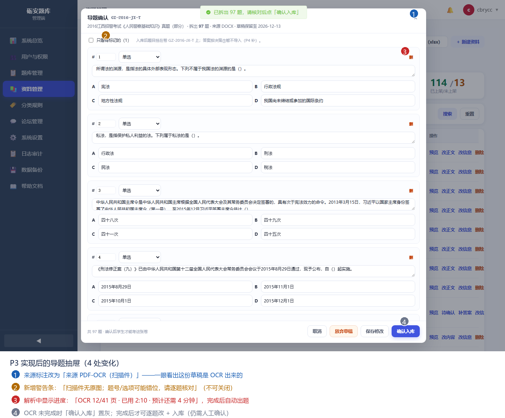
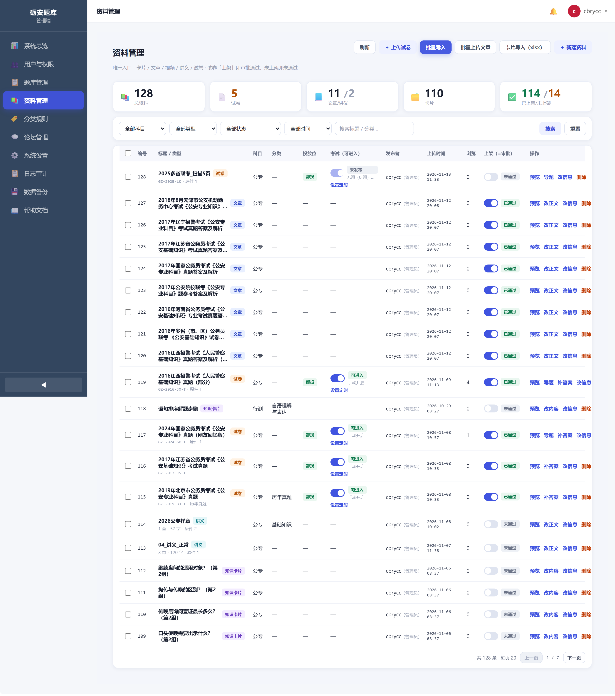
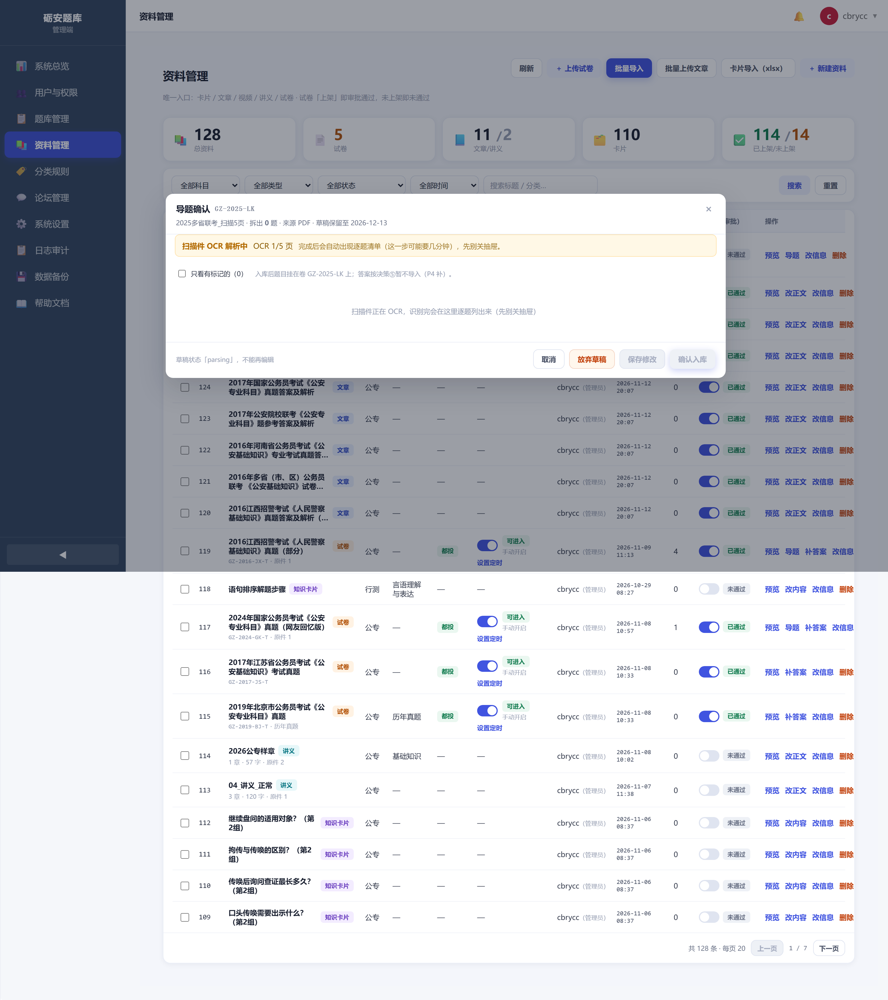
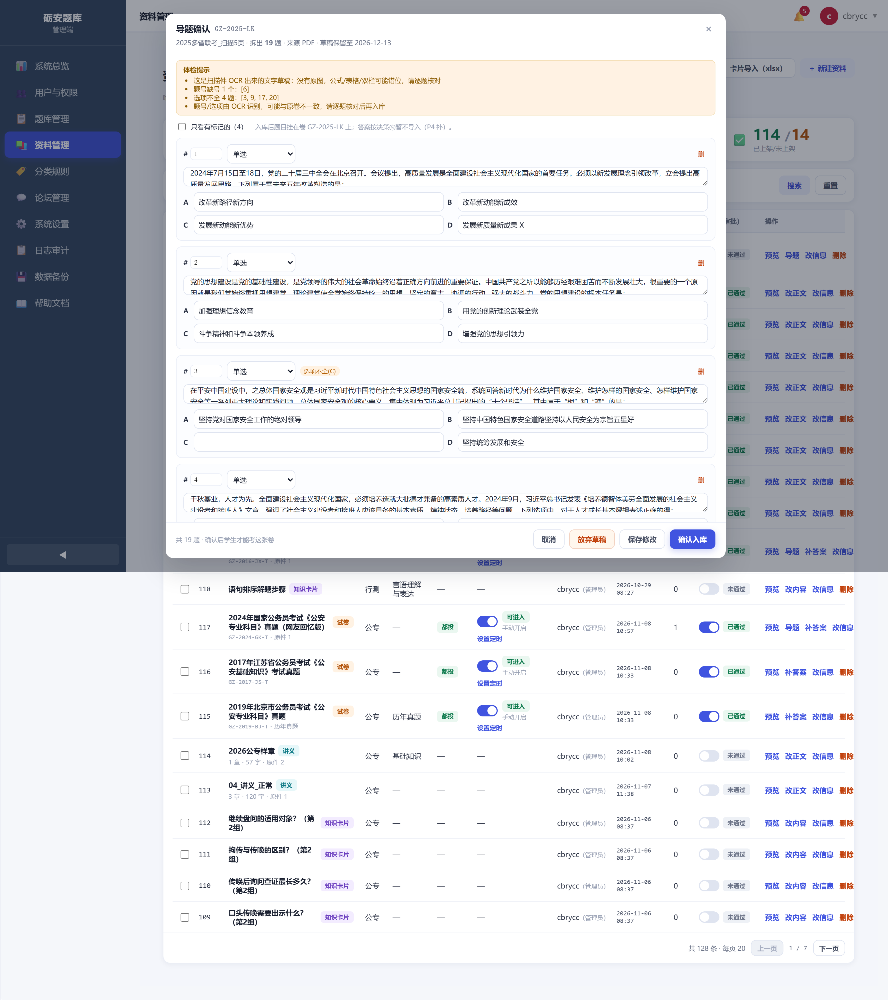

# 扫描件 OCR P3（试卷导题）方案 v2 · 实施级（待确认后开工）

> 日期：2026-11-13　｜　分支：`feat/material-multi-format-import`（**不动 main**）
> 前置：你已批准 D1–D5（O5 先做、P3 无图无版式、异步、范围、去重口径）；**O5 已交付**（`87af89c`）。
> 本文是 P3 的**实施级方案**（含真机预期效果图）；按全局规则：**确认后我才动代码**。

---

## 0. 一句话结论

扫描试卷现在**根本拆不出题**（PDF 无文字层 → `read_pdf` 拿到 0 行 → 0 题）。
本方案让「导题」对扫描件走 **OCR → 复用现有 splitter → 出待确认草稿**，并且**改为异步**（41 页 ≈6.5 分钟）。
**只承诺文字草稿**：无原图、无版式还原，必须人工逐题核对后入库。

---

## 1. 现状审计（代码实测）

| 环节 | 位置 | 现状 | 扫描件的下场 |
|---|---|---|---|
| 读 PDF | `paper_ingest/readers.py:156` `read_pdf()` | `page.get_text("dict")` 取题号 y 坐标（归图）+ `get_text()` 取行 | 两者都空 → `lines=[]` → **0 题** |
| 图片 | 同文件 192–227 | `get_images()` + rect 归属到题 | 扫描件只有整页大图，若放行会**全堆到某一题** |
| 拆题 | `paper_ingest/splitter.py:177` `split_questions()` | 纯按行文本 + 题号/选项规则（**不需要坐标**） | 只要给对文本就能用 |
| 草稿 | `paper_ingest/service.py:79` `parse_material()` | **同步**解析完再写 `status=pending` | 41 页 OCR 6.5 分钟会卡住请求 |
| 入口 | `materials.py:2068` `POST /admin/{id}/parse` | 同步返回草稿 brief | 同上 |
| 草稿表 | `paper_parse_draft` | 14 列：`status / item_count / items_json / warnings_json / message …` | 无进度列 |
| 前端 | `materials.vue:829 openDraft()` + `ParseDraftDrawer.vue` | `pending` 直接开抽屉；否则 POST 解析后开 | 打开后不再轮询状态 |

**已具备的零件**（本轮之前都已交付）：`parse_pdf_once()`（判定扫描）、`ocr_sidecar`（S-C 常驻 OCR）、`ocr_html.drop_noise()`（去页眉页脚）、`splitter.split_questions()`（拆题）。

### 1.1 可行性 PoC（真实 41 页扫描试卷前 2 页）

| 指标 | 实测 |
|---|---|
| OCR | 2 页 **19.1s（9.5s/页）**；41 页 ≈ **6.5 分钟** |
| 文本 | 66 行；认到题号 6 个 |
| 拆题 | **6 题，其中 4 题四选项齐全** |
| 缺陷 | 第 3 题丢 C 项；页脚 `X`、店主微信/公众号噪声；选项跨行截断 |

---

## 2. 范围

| 做（In） | 不做（Out） |
|---|---|
| 扫描 PDF → OCR → 文字草稿（题号/题型/题干/选项） | 图片裁剪与归属（原图一律不带） |
| 异步解析：草稿 `parsing` + 进度 + 惰性超时 | 双栏阅读顺序修正、公式/表格还原 |
| 噪声过滤 + 三条警告（扫描件/无原图/题号可能错位） | 自动确认入库（仍必须人工核对） |
| 前端：导题后轮询、进度显示、完成前禁止确认 | 纯图片卷（拍照成 jpg 的试卷）——不支持 |

---

## 3. 设计

### 3.1 读 PDF：扫描分支（`readers.py`）

```
read_pdf(path):
  info = parse_pdf_once(path)            # S-A 已有：一次 pymupdf，采样前 3 页判定
  if info["scanned"]:
      return read_pdf_ocr(path, pages=info["pages"])
  ...原有文字版逻辑不动...
```

`read_pdf_ocr(path, pages)`：
1. `ocr_sidecar.read_pdf_text(path, max_pages=60)` → 逐行文本 + `meta`（页数/失败页/截断）；
2. **去噪**：`ocr_html.drop_noise()` + 试卷专属正则（`店主微信|公众号|其他机构|本PDF|扫码|加微信|参考答案在最后`）；
3. 返回 `{lines, images: [], meta: {"reader": "pdf-ocr", "pages": N, "scanned": True, "failed_pages": [...]}}`。

### 3.2 草稿异步状态机（`service.py` + 路由）

```
POST /admin/{id}/parse
  ├─ 立刻建草稿 status="parsing"，message="OCR 排队中"
  ├─ 返回 draft_brief（status=parsing, draft_id）
  └─ 后台线程 _paper_parse_job(draft_id, path, ext)：
       解析 → 写 items_json / warnings_json / item_count
             → status="pending"，message="拆出 97 题"
       失败 → status="failed"，message=具体原因（带页号）
```

- 复用 O5 的 `session_factory` 注入方式（测试内存库/生产 `SessionLocal`）；
- 惰性超时：`GET /parse-drafts/{id}` 时若 `parsing` 且 `create_time` 超 **40 分钟** → 置 `failed`「OCR 超时中断（>40 分钟）」；
- **进度文本写 `message`（零迁移）**：后台每 10 页更新为 `"OCR 12/41 页"`；完成后改回摘要。前端直接显示 `status=parsing` + `message`。

### 3.3 拆题与警告

- `split_questions(lines, default_type="单选")`（**不改拆题规则**）；
- 追加警告（`warnings_json`）：
  1. `"这是扫描件 OCR 出来的文字草稿：没有原图，公式/表格/双栏可能错位，请逐题核对"`；
  2. `"题号/选项由 OCR 识别，可能与原卷不一致（实测样本 6 题里 2 题选项不全）"`；
  3. 若有失败页/截断：`"第 7 页识别失败"` / `"仅解析前 60 页"`；
- `draft_brief` 增加 `source="ocr"` 字样（前端标题显示「来源 PDF-OCR」）。

### 3.4 前端（`materials.vue` + `ParseDraftDrawer.vue`）

| 场景 | 行为 |
|---|---|
| 点「导题」 | POST 返回 `parsing` → **直接打开抽屉**，显示「OCR 排队中 / OCR 12/41 页 · 已用 2:10」 |
| 轮询 | 抽屉打开时若 `status=parsing`，每 2.5s 拉 `GET /parse-drafts/{id}`，直到 `pending`（渲染表格）或 `failed`（显示原因 + 重试按钮） |
| 完成 | 表格照旧可编辑；顶部黄条显示三条警告 |
| 确认入库 | `parsing/failed` 时置灰 |
| 失败重试 | 「重新解析」按钮（复用现有 POST parse） |

> 零新端点、零迁移；只给草稿状态枚举加一个 `parsing`，`message` 语义扩展为"进度或摘要"。

---

## 4. 预期效果



| 场景 | 现在 | P3 之后 |
|---|---|---|
| 扫描试卷点「导题」 | 拆出 **0 题**（或长时间无响应） | 抽屉立刻打开：`OCR 12/41 页 · 已用 2:10` |
| 等 6 分钟 | 请求可能超时/白屏 | 后端异步跑，进度可见；失败有页号 |
| 完成后 | — | 草稿表格（实测样本：6 题 / 4 题选项齐全），逐题可改 |
| 来源标注 | `来源 DOCX` | `来源 PDF-OCR（扫描件）` |
| 风险提示 | 无 | 黄条：「无原图 / 题号可能错位 / 请逐题核对」 |
| 入库 | — | 仍需人工点「确认入库」，与文字版同一套流程 |

> 上图是**真机「导题确认」抽屉截图 + 标注**（当前 97 题那份文字版草稿），非实现后效果图；实现后我会用扫描试卷的真机图替换。

---

## 5. 任务拆分（≈2.3d）

| 步 | 内容 | 估时 |
|---|---|---|
| T1 | `read_pdf_ocr()` + 试卷噪声表 + `images=[]` + 单测（扫描判定/噪声/空文本/截断） | 0.6d |
| T2 | 草稿 `parsing` + `_paper_parse_job` + 进度写 `message` + 40 分钟惰性超时 + 单测（状态流转/失败/超时） | 0.6d |
| T3 | 前端：抽屉轮询、进度文案、警告条、确认按钮置灰（+2 例单测） | 0.4d |
| T4 | 测试补全：≥6 例（判定/噪声/拆题条数/warning/状态/截断） | 0.3d |
| T5 | 真机：41 页扫描试卷（或前 5 页）走通，出真机图 + 题数对照 | 0.4d |

**DoD**：同一份扫描试卷点「导题」→ 3 分钟内出现 `pending` 草稿（41 页约 6.5 分钟，进度可见）→ 题号连续可编辑、警告可见 → 人工确认后题库新增题目；`pytest` 新增 ≥6 例；`gate_all` 仍 9/10；`vue-tsc` 0。

---

## 6. 风险与回滚

| 风险 | 评估 | 处置 |
|---|---|---|
| OCR 拆题错位（丢选项/串题） | **高** | 只出草稿 + 三条警告 + 必须人工确认；入库前可逐题删改 |
| 双栏/表格阅读顺序错 | 高 | 同上；v1 不修版式 |
| 41 页 6.5 分钟 | 中 | 异步 + 进度 + 失败带页号；>60 页截断 |
| 后台任务随重启丢失 | 中 | 40 分钟惰性超时置 failed，可重试 |
| `message` 复用为进度位与"摘要"混用 | 低 | `status=parsing` 时 `message` 一律是进度文本；完成/失败时改写为摘要/原因 |
| 回滚 | — | 扫描分支前加开关 `PAPER_OCR=0` 直接走旧逻辑；异步可回退为同步（保留旧函数） |

---

## 7. 需要你确认（2 条）

| # | 事项 | 选项 | 建议 |
|---|---|---|---|
| C1 | 进度文本放哪 | **A 复用 `message`（零迁移）** / B 加一列 `progress_json`（要迁移） | **A** |
| C2 | 本方案是否按上面口径开工 | A 是 / B 先改某处 | **A** |

---

## 8. 归档

| 物 | 位置 |
|---|---|
| 本方案 | `docs/plans/OCR_P3_试卷导题扫描件_方案_v2.md` |
| 真机现状 + 预期效果标注图 | `docs/plans/assets/OCR_P3/01_现状_导题抽屉_真机.png`、`02_预期效果_扫描件导题.png` |
| PoC 脚本（不入库） | `_run/p3_poc.py`、`_run/find_scanned_papers.py`、`_run/p3_annotate.py` |
| 交付记录 | 实现后写入本文 §9 |

---

## 9. 交付记录（2026-11-13 实施完成）

> 口径：全部数字来自真机跑（后端 8001 + 前端 9527）+ 日志时间戳 + pytest 输出，不估算。

### 9.1 代码落点

| 文件 | 改动 |
|---|---|
| `backend/app/services/paper_ingest/readers.py` | 新增 `read_pdf_ocr()`（走 sidecar OCR、去噪、`images=[]`）、`PAPER_NOISE`、`strip_inline_noise()`（广告粘行处理）、`MAX_OCR_PAGES=60`；`read_pdf()` 先 `parse_pdf_once` 判扫描再分流 |
| `backend/app/services/paper_ingest/service.py` | 拆出 `create_draft()` / `fill_draft()`；`parse_material()` = 两者串起来（文字版行为不变）；`fill_draft` 对扫描件补三条警告（无原图 / 逐题核对 / 失败页或截断） |
| `backend/app/api/v1/library/materials.py` | `POST /admin/{id}/parse` 对扫描件走「建 parsing 草稿 → 立刻返回 → 后台 `_paper_parse_job`」；**幂等**：已有新鲜 parsing 草稿就返回同一份（不再起第二个 OCR）；`GET /parse-drafts/{id}` 对 >40 分钟的 parsing 惰性判 failed；`admin_upload_file` 对扫描件跳过同步解析并给出提示 |
| `src/components/admin/ParseDraftDrawer.vue` | `parsing` 状态横幅 + 2.5s 轮询 + 组件卸载停止 + 空清单文案（解析中不再说「都被过滤了」） |
| `src/views/admin/materials.vue` | 「导题」对 `pending`/`parsing` 都开抽屉，`parsing` 给 info 提示 |
| `backend/tests/test_paper_ingest_ocr_p3.py` | 9 例：OCR 分流 / 噪声（含 3 例粘行广告 + 反例）/ 警告 / 路由 parsing / 幂等 / 40 分钟超时 |

### 9.2 真机结果（真实 41 页扫描试卷取前 5 页）

| 项 | 实测 |
|---|---|
| 源文件 | `题库/公安题目（打印）/2025多省联考公安《公安专业》.pdf`（41 页 56MB，唯一一份纯扫描**试卷**；其余 6 份扫描件都是答案解析） |
| 探针 | 前 5 页重建为 `_run/p3_scan_5p.pdf`（5 页 / 5.3MB / 文本层 0 字符，脚本 `_run/make_p3_subset.py` 强校验） |
| 「导题」响应 | **0.14s**（日志：11:45:16.858 收到请求 → 11:45:16.999 返回，草稿 `parsing`） |
| OCR 进度 | `OCR 1/5 页`→`2/5`→`3/5`→`4/5` 每页约 21s，最后 `pending` |
| 总耗时 | **114.0s / 5 页 = 22.8s/页**（另一轮 107.6s = 21.5s/页）；按 41 页线性外推 ≈ 15 分钟 |
| 拆题 | **19 题**，四选项齐全 **15 题**；警告如实报「题号缺号 1 个：[6]」「选项不全 4 题：[3, 9, 17, 20]」 |
| 内容正确性 | 首题「2024年7月15日至18日，党的二十届三中全会在北京召开…」与原卷一致（此前一轮读错成 2017 年**答案** PDF，原因是探针 material id 被复用后挂上了孤儿 `material_file`；产品删除是软删、不会产生孤儿，已按 `_run/cleanup_p3_probe.py` 清干净并核对 `orphan_count=0`） |

**真机图**（`docs/plans/assets/OCR_P3/`）：





### 9.3 实施中发现并修掉的 4 个缺陷（都是真机才暴露的）

| # | 现象 | 修法 |
|---|---|---|
| 1 | OCR 把页脚广告**粘进选项行尾**：「B、用党的创新理论武装全党 常加微信 txw1663 赠送最新」 | `strip_inline_noise()`：按「联系人/推广词/扫码动作」三种锚点切掉广告尾巴，保留正文；第二轮又出现裸号 `xwl663赠送最`（“加微信”被 OCR 吃掉）→ 补「字母+数字号 + 纯推广字」规则 |
| 2 | `PAPER_NOISE` 里的 `扫码` 会把正常题干整行误杀（如「A、扫码支付」） | 收紧为 `扫码(关注|领取|进群|加群|获取|下载|免费)`，并加反例测试 |
| 3 | 解析中抽屉正文写「没有可显示的题目（可能都被过滤了）」 | 改为「扫描件正在 OCR，识别完会在这里逐题列出来（先别关抽屉）」 |
| 4 | 双击「导题」会起第二个 OCR，前一份被置 discarded 白等 | 路由幂等：已有新鲜 `parsing` 草稿直接返回（`reused=true`），并加单测断言只起 1 个后台任务 |

### 9.4 验收

| 项 | 结果 |
|---|---|
| `pytest backend/tests/test_paper_ingest_ocr_p3.py` | **9 passed** |
| `pytest tests -k "paper or upload or import or material"`（cwd=`backend`） | **550 passed / 4 skipped / 0 failed**（13 分 38 秒）。⚠️ 同一命令若从仓库根目录跑会 47 failed——`conftest`/`rootdir` 按 `backend` 解析，**必须 `cd backend` 再跑** |
| `vue-tsc --noEmit` | **0 error**（exit 0） |
| `vitest run ParseDraftDrawer.spec.ts` | **5 passed** |
| `gate_all` | 9/10（唯一红仍是既有 L1-G 行测 397 < 3085/3632，与本次无关） |
| 数据清理 | 探针资料 138 + 草稿 3/4/5/6 已清；`study_material` 回到 132；`pragma integrity_check=ok`；`orphan_count=0` |

### 9.5 与方案 v2 的差异（都已在上表说明，无范围外改动）

- 方案只说「噪声去行」，实测必须**去行尾片段**才可用（9.3-1）；
- 方案没提双击并发，实测会白烧一份 OCR（9.3-4）；
- 未做：版面/双栏还原、图片切图、>60 页续跑——仍按 v1 口径留给后续。

