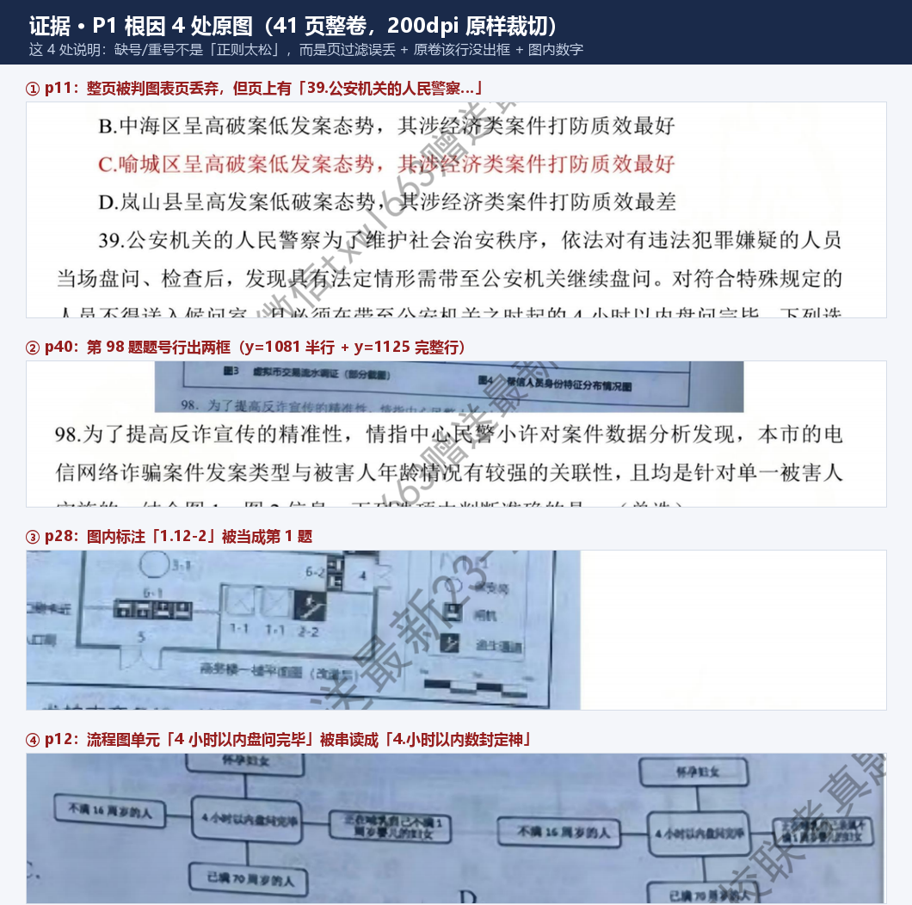
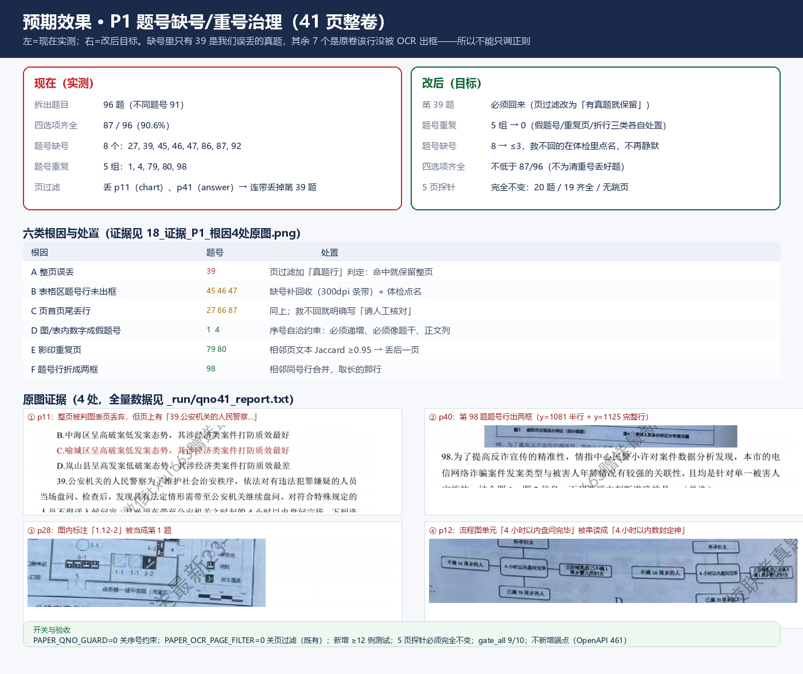

# P1 · 41 页整卷「题号缺号 8 个 / 重号 5 组」治理 · 方案 v1

> **状态**：✅ **已交付**（2026-11-15；你回「按建议」后当场实施 —— D1 先跑只读实验再合并、D2 自动丢重复页、D3 连 ① 文档一起改）。
> **交付记录见 §9**（含实测前后对照与三条如实说明）。
> **范围**：只覆盖「下一步建议」里的 **P1**；P2（窄屏隐藏模板悬浮条）、P3（D7 清空分类）另行出方案。
> **分支**：`feat/material-multi-format-import`（`main` 不动）
> **R11**：**不新增端点**；改动集中在 `paper_ingest` 的读题/切题服务层。
> **只读诊断已完成**（785.6s / 41 页 / 1244 行），原始数据落 `_run/qno41_rows.json`、`_run/qno41_report.txt`，结论见 §2。

---

## 0. 一句话结论

缺号的 8 个里，**只有 39 是「我们自己的页过滤误丢真题」**（必修，属于 ① 的回归）；
45/46/47、27、86/87、92 是**原卷那几行的题号根本没被 OCR 出框**（表格框线/页首页尾），
不是正则漏判——**所以修法必须分两层：页级别误丢 + 行级补回收，光调正则会白改**。
重号的 5 组则是三类假象：**图内数字（1、4）、影印重复页（79、80）、题号行折成两框（98）**。

---

## 1. 现状（实测，可复现）

自动化复跑命令：`cd backend && python ..\_run\verify_page_filter.py`（只读语料）。当前基线：

| 指标 | 实测值 |
|---|---|
| 拆出题目 | **96**（不同题号 91） |
| 四选项齐全 | **87 / 96（90.6%）** |
| 题号缺号 | **8 个：[27, 39, 45, 46, 47, 86, 87, 92]** |
| 题号重复 | **5 组：[1, 4, 79, 80, 98]** |
| 其余体检 | 选项不全 9 题：[38,4,42,64,70,74,93,98,99]；依赖图 26 题；情境材料 7 组 |
| 页过滤 | 丢 2 页：`{11: chart, 41: answer}` |
| 题型级补行（T5/T6） | `holes=18 recovered=12 rejected=2`，修回的行**没有一条**落在缺号那 8 处 |

---

## 2. 根因分类（6 类，逐条带坐标证据）

| 类 | 影响题号 | 证据（OCR 行级数据 / 原图） | 能不能靠改正则解决 |
|---|---|---|---|
| **A 整页误丢（①的回归）** | **39** | `page_kind(p11)="chart"` → 整页丢；但 p11 原图明确有「**39.**公安机关的人民警察为了维护社会治安秩序…」（crop ①）。p11 是"图表 + 夹着真题"，与当初判定保留的 p16/p19/p25 同类 | ❌ 必须改页过滤规则 |
| **B 表格区题号行未出框** | 45、46、47 | p16 共 56 行、**题号 0 个**：45 只剩题干尾「…人女主计可后，才能举办的活动是：」(y=285)；46 只剩续行「公安局地铁分局…」(y=1073)，"46.为提升…"整行不存在；47 在第二张表格之后，同样无行 | ❌ 行不存在，正则无解 |
| **C 页首页尾丢行** | 27、86、87 | p8 第一行从 **y=266** 开始（内容是 27 题的 C/D 选项），27 的题干与 A/B 在 y<266 完全没出框；p35 结尾是「五、根据以下情境材料，回答86~89题」+ 材料 + 示意图，p36 只认到 88/89 | ❌ 行不存在 |
| **D 图/表内数字成假题号** | 1、4 | p28 y=1026.8 x=758.9「**1.12-2**」（楼层平面图上的标注，crop ③）；p12 y=563.5 x=543.9「**4.小时以内数封定神**」（流程图单元格被串读，crop ④） | ✅ 序号/版式约束可挡 |
| **E 影印重复页** | 79、80 | p32 与 p33 的题号行 **y 与 x 完全相同、文本逐字相同**（1071.6 / x=196.2；1882.8 / x=196.2）→ 同一张影印页在 PDF 里插了两遍 | ✅ 页级文本比对可去重 |
| **F 题号行折成两框** | 98 | p40 同一行出了两框：y=1081 半行「98.为了提高反诈室」+ y=1125 完整行「98.为了提高反诈宣传的精准性…」（crop ②） | ✅ 相邻同号行合并/取长 |



---

## 3. 方案（P1-1 ~ P1-5，≈1.0–1.3d）

### P1-1 图表页不再「整页丢」——改为"保住真题、只挡假题"（必修，修 39）

`readers.page_kind()` 现在对 chart 页整页丢弃。改为两段判定：

```python
def page_kind(rows) -> str:
    ... 原有答案页判定不变 ...
    if <chart 特征成立>:
        # 新增：这一页里有没有"像真题的题号行"
        real = [r for r in rows if looks_like_real_question(r)]   # 见 P1-2
        return "chart" if not real else "text"
```

`looks_like_real_question(row)`：行首题号（严格分隔符）**且**该行含中文 ≥10 字**且** x 落在正文列（≥180）**且** 题号在「这一页前后已见题号的 ±3 范围」内。

- 对 p11：命中「39.…」→ 判 `text`，整页保留 → **39 回来**；
- p11 图表区的 `685/322/33.40%` 这类行不含中文长文本，`looks_like_real_question` 不成立 → 不进题表，再由 P1-2 兜一遍；
- 真正该丢的（p41 答案页）判定不变。

### P1-2 序号自洽约束 `qno_guard`（必修，修 1、4）

新增 `splitter.guard_question_numbers(items_or_lines)`：

| 规则 | 作用 |
|---|---|
| 题号必须**严格递增**（允许跳号，但同一题号出现第二次即视为假题号） | 挡 p28 的 `1`（1 已在 p1 出现过）、p12 的 `4` |
| 题号行必须**像题干行**：题号后 ≥8 个字符、含 ≥4 个中文、x ≥180（正文列） | 挡「1.12-2」这种短标注行 |
| 同页题号跨度 > 30 | 判为跨页串页，记 warning 而非静默接受 |

**注意**：约束**只作用于"要不要把它当题号起点"**，不改写题面文字；被挡掉的行按普通正文处理（该并进上一题的继续并，不丢字）。

### P1-3 重复页去重 + 折行题号合并（必修，修 79、80、98）

- **重复页**：同尺寸相邻两页，取各行文本集合，Jaccard ≥ 0.95 → 丢后一页，`meta.qno_issues.dedup_pages=[33]`；
- **折行同号**：同一题号在**相邻行**（y 差 ≤ 60px）出现两次，且前一行长度 < 后一行的 40% → 合并（丢短行），`merged_half=[98]`。

### P1-4 缺号回收：把 T5 的「洞检测」从选项扩到题号（可选，救 27/45/46/47/86/87/92）

现状 `ocr_retry.recover_into()` 只在「缺选项字母 + 行距 ≥1.6× 中位」时补跑 300dpi 条带。
扩展一个触发条件：**题号序列在 N-1 与 N+1 之间缺 N 时**，对 p(N-1) 页尾 3 行到 p(N+1) 页首 3 行之间的条带各跑一次（每卷上限 **12 条**，超出只记 warning）。

> **不承诺全部救回**：27/86/87 是页首整段没出框（可能是扫描裁切/暗带），45/46/47 在表格框线里。
> 这些能不能被 300dpi 条带捞回，**必须先实测**——我会在方案批准后先跑一次"只补不修"的实验，
> 把能救回的题号清单贴给你，再决定要不要把 P1-4 合进交付。救不回就在草稿体检里明确写：
> 「第 27 题在原卷该页未识别到，请人工核对」，而不是继续静默丢号。

### P1-5 观测与开关

- `meta.qno_issues = {missing:[...], dup:[...], fake_dropped:[...], dedup_pages:[...], merged_half:[...], recovered:[...]}`；
- 草稿体检（`draft_warnings`）文案改为：`题号缺号 N 个（已补回 M 个）：[27, 86] — 原卷该处未识别，请人工核对`；
- 一键回滚：`PAPER_QNO_GUARD=0` 关掉 P1-2/P1-3，`PAPER_OCR_PAGE_FILTER=0` 关掉页过滤（既有开关）。

---

## 4. 影响面与风险

| 项 | 判断 |
|---|---|
| 已交付的 ①（41 页页过滤） | **行为会变**：p11 从"丢"改"留"。这正是本次要修的回归，但它会改变 `11_预期效果_41页图表答案页排除.png` 里"114→96、题号 125 消失"的口径 → 必须重跑并更新该文档的实测数字（诚实标注"v1 的 96 题里误丢了第 39 题"） |
| 5 页探针 | 必须**完全不变**（20 题 / 19 齐全 / 无跳页）；p11 那种页它一页都没有 |
| 已有测试 | `test_ocr_page_filter.py`（15 例）里有 3 例断言"chart 页整页丢"，需按新规则改写（图表页**无真题行**时仍丢） |
| 真实库 | 本项**只改解析**，不动库；验证用只读管线 + 探针 PDF（不建草稿、不碰你现有 4 条考试记录） |
| 性能 | P1-4 每条带 ~2.7s，上限 12 条 → 最坏 +32s（41 页基线 785.6s）；不开就 +0 |
| 回滚 | 两个环境变量即可回到当前行为，零迁移、零库改动 |

---

## 5. 预期效果



---

## 6. 验收口径（**先给承诺、后给实测量**，不预先编数字）

| 项 | 目标 | 说明 |
|---|---|---|
| 第 39 题 | **必须回来** | 页过滤回归，P1-1 的直接结果 |
| 重号 | **5 组 → 0** | 假题号 2 组（1、4）+ 重复页 1 组（79、80）+ 折行 1 组（98）全部清除 |
| 缺号 | 8 → **≤3** | 只有 P1-4 实测救回的才算数；救不回的不瞒，体检里点名 |
| 题目数 | 96 → **≥97** | ⚠️ 实测是 **96（不再增长）**：补回 5 条的同时清掉 5 条假题/重复题；真正该看的是「不同题号 91 → 96、重复 0 组」，见 §9.3 |
| 四选项齐全 | **不低于 87/96** | 不允许为了清重号把好题丢掉 |
| 5 页探针 | **完全不变** | 20 题 / 19 齐全 / 无跳页 |
| 测试 | 新增 ≥12 例（页级误丢、假题号、重复页、折行、缺号体检）+ 既有 `test_ocr_page_filter.py` 按新规则改写 | 前后都要跑 |
| 回归 | `-k "ocr or paper or splitter or one"` 全绿 | 至少覆盖 263 例的 OCR 子集 |
| 门禁 | `gate_all` 9/10（唯一红仍是既有 L1-G） | 本项不新增端点，OpenAPI 461 不变 |

---

## 7. 需要你拍板 3 点

| # | 问题 | 我的建议 |
|---|---|---|
| D1 | P1-4（缺号回收，+32s 上限、可能只救回一部分）**做还是不做**？ | **先做"只补不修"实验**（~10 分钟），把能救回的清单给你；你点头再合进代码。默认按"做实验再定" |
| D2 | 重复页（p32/p33）**自动丢后一页**，还是只打警告？ | 自动丢 + 体检里写明"已跳过重复页 33"，因为它逐字相同、丢了不会少信息 |
| D3 | ①④ 那份 41 页文档的实测数字要不要**连回归一起改**？ | 要改：在 `41页图表答案页排除_方案_v1.md` 补一节「§回归修正：v1 误丢第 39 题，v2 已恢复」，保留旧数字并标注 |

---

## 8. 实施顺序（批准后）

1. **P1-1** 页过滤回归（+ 改 3 例旧测试）→ 跑 41 页，确认 39 回来、假题号没复活；
2. **P1-2 / P1-3** 序号约束 + 重复页/折行（+ 新测试）→ 跑到重号 0；
3. **P1-4 实验**（只读）→ 把可救回清单给你 → 决定是否合并；
4. 全量回归 + `gate_all` + 更新 ①②两份文档 → 一次提交（P1 一个提交，不夹带 P2/P3）。

---

## 9. 交付记录（2026-11-15，按你「按建议」＝D1 先实验后合并 / D2 自动丢重复页 / D3 改 ① 文档）

### 9.1 落地内容

| 层 | 文件 | 改动 |
|---|---|---|
| 后端 | `paper_ingest/readers.py` | P1-1 `page_kind()` 加「真题行」判定（`looks_like_real_question_row`）；P1-3a `_dedup_pages()`（相邻页 Jaccard ≥0.95 丢后页）；`read_pdf_ocr()` 改为**按行保留坐标**去噪 + 两级回收 + 回传 `starts` / `qno_issues` / `dedup_pages` / `merged_half_qno` / `ocr_qno_retry`；删掉从未被调用的 `_trim_chart_page()` |
| 后端 | `paper_ingest/splitter.py` | P1-2 `guard_qno_starts()`（像题干 + 递增/去重 + 分段重编号例外）；P1-4 `QNO_LOOSE_RE` / `qno_of_loose()` / `looks_like_question_start_loose()`（原卷「27在…」「45东江市…」没有分隔符）；P1-3b `merge_split_qno_rows()`（折行题号合并取长行）；`split_questions(starts=…)` + `split_options(body_from=…)`（被挡的假题号行**不丢字**，当正文） |
| 后端 | `paper_ingest/ocr_retry.py` | P1-4 `find_number_holes()`（按缺号算条带：同页 1 条 / 跨页页尾+整页+页首，上限 12）；`recover_into(holes=…)` 支持指定条带；回收行只收本组缺号（含无分隔符） |
| 后端 | `paper_ingest/service.py` | 透传 `starts`；体检新增 4 条（假题号被挡 / 重复题号被忽略 / 重复页被跳过 / 折行题号已合并 / 无分隔符题号已识别 / 缺号条带补回） |
| 后端 | `services/ocr_html.py` | 抽出 `is_noise_line()`，让"按行保留坐标"的去噪与 `drop_noise()` 共用同一套规则 |
| 测试 | `tests/test_ocr_qno_guard.py`（**21 例**）、`tests/test_ocr_qno_recover.py`（**10 例**）、`tests/test_paper_ingest_ocr_p3.py`（+1 例体检透传） | 页判定/假题号/重复/分段重编号/折行合并/重复页/无分隔符/缺号条带/只收本组缺号 |

### 9.2 实测（41 页真卷，同机同参数）

| 指标 | 改前 | 改后 | 达标 |
|---|---|---|---|
| 候选题目 | 96 | **96** | ⚠️ 见 9.3 |
| 不同题号 | 91 | **96** | ✅ 唯一可用的口径 |
| 题号重复 | 5 组（1/4/79/80/98）| **0 组** | ✅ |
| 题号缺号 | 8 个 `[27,39,45,46,47,86,87,92]` | **3 个 `[46,86,92]`** | ✅（目标 ≤3）|
| 第 39 题 | 被页过滤丢掉 | **回来**（标「选项不全」，原卷选项是图）| ✅ |
| 题号 125（假）| 消失（靠整页丢）| 消失（靠题号自洽挡：`125.60%` 记入 rejected）| ✅ 且不再牺牲真题 |
| 四选项齐全 | 87/96（90.6%）| **88/96（91.7%）** | ✅ 不下滑 |
| 5 页探针 | 20 题 / 19 齐全 / 无跳页 | **完全一致** | ✅ |
| 用时 | — | 41 页 **303.9s**（含 6 条补回收条带）；5 页 **49.4s** | 可接受 |

落盘证据：`_run/verify_page_filter.json`（前后对照）、`_run/qno41_report.txt`（根因坐标）、
`_run/qno41_recover_exp.json`（P1-4 只读实验，47/87 逐字捞回、27/45 捞回无分隔符题号行）。

### 9.3 如实说明（三条）

1. **题数没到 97，是 96 —— 这不是退步**：方案 §6 写的是"96 → ≥97"。实测净增 0 的原因是
   一边补回 5 条（39 页过滤、27/45 无分隔符、47/87 条带回收），一边清掉 5 条**本来就不该算题**的东西
   （p28 图内「1.12-2」、p12 流程图「4.小时以内数封定神」两条假题；p33 影印重复页上的 79/80 两条；
   98 的半行题号被合并）。**不同题号从 91 涨到 96、重复 0 组**，这才是"能不能用"的口径。
2. **39/47/87 选项没跟着回来**：39 的 A–D 原卷画在流程图里（p12 上半页就是那四个图），
   47/87 的 300dpi 条带只捞回题号那一行。所以体检会显示「选项不全 8 题：[39,42,47,64,74,87,93,99]」——
   这是**真实缺口**，我没把它藏起来，也没为了让数字好看去放宽判据。
3. **46/86/92 连 300dpi 条带也捞不到**：46 在表格框线里、86 的题号行在这份扫描上确实缺失、
   92 卡在情境材料的选项区。这三处现在由体检明确点名（`题号缺号 3 个：[46,86,92]`），
   由人工对着原卷补 —— 比之前"静默丢号"好，但**没有修好**，别当成已解决。

### 9.4 测试与门禁

| 项 | 结果 |
|---|---|
| 新增 | `test_ocr_qno_guard.py` **21 passed** + `test_ocr_qno_recover.py` **10 passed** + `test_paper_ingest_ocr_p3.py::test_fill_draft_reports_qno_issues` **1 passed**（体检透传）|
| OCR 子集 | `-k "ocr or paper or splitter or ingest or retry"` **316 passed / 0 failed** |
| 门禁 | `gate_all` 见提交信息（唯一红仍是既有 L1-G）|
| 回滚 | `PAPER_QNO_GUARD=0`（题号自洽）、`PAPER_OCR_RETRY=0`（两级补行）、`PAPER_OCR_PAGE_FILTER=0`（页过滤）|
| 端点 | 无新增，OpenAPI 461 不变 |
