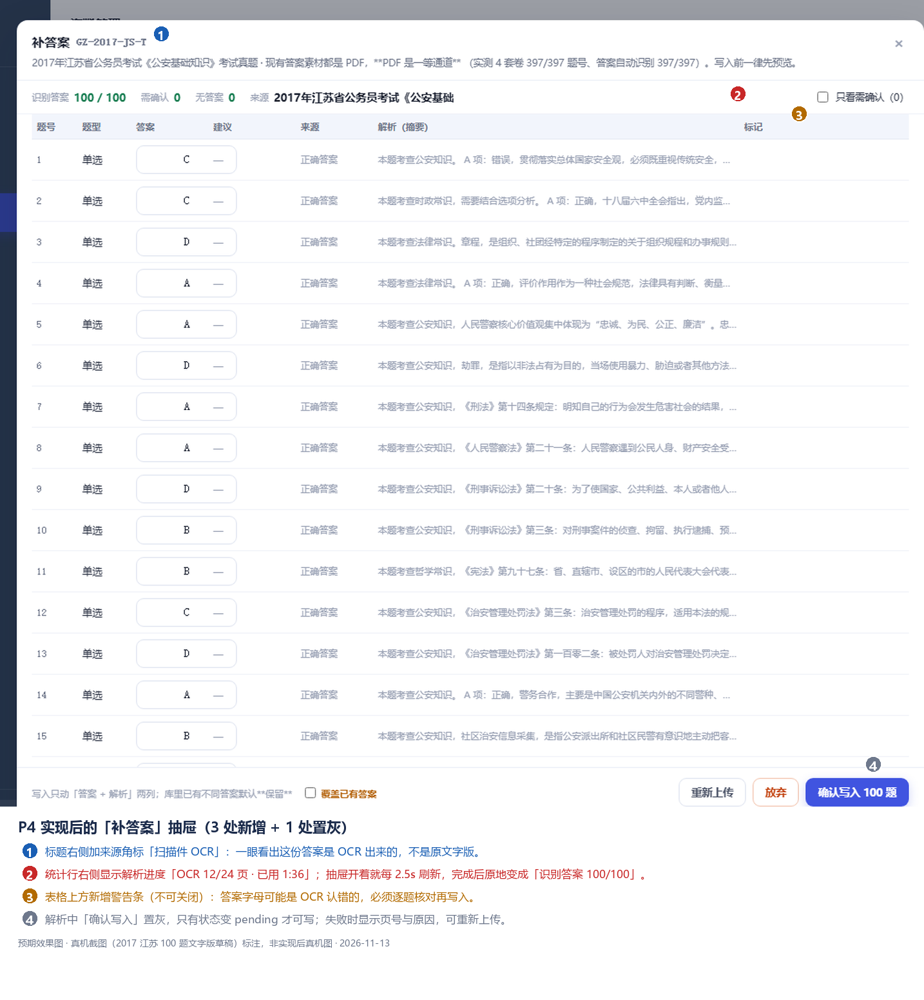
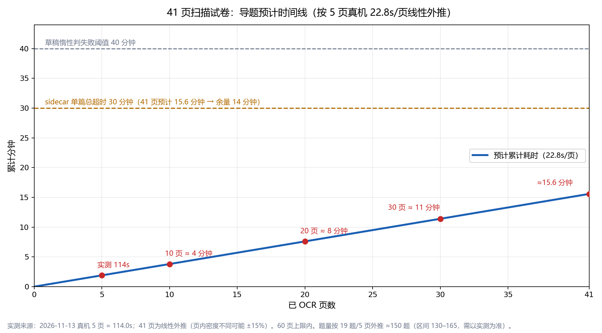
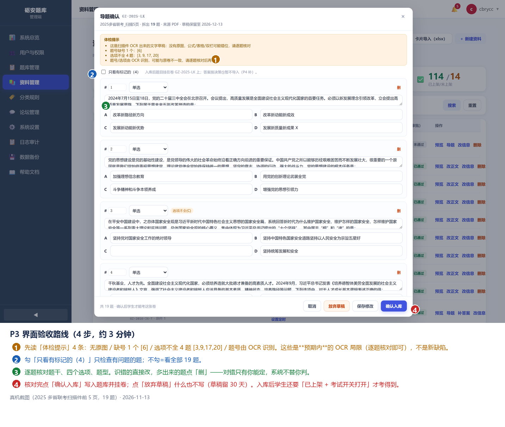

# 下一步三件事（P4 补答案扫描件 / 41 页整卷验收 / P3 界面验收）方案 v1

> 状态：**待你批准后开工**（2026-11-13 出方案 + 3 张预期效果图，尚未写业务代码）
> 分支：`feat/material-multi-format-import`（`main` 不动）
> 关联：`扫描件OCR能力_方案_v1.md`（P1）、`扫描件OCR_P2_文章讲义_方案_v1.md`（P2）、`OCR_P3_试卷导题扫描件_方案_v2.md`（P3，已交付）

---

## 0. 一句话结论

三件事分别是：**①P4 把「补答案」也做成异步 OCR**（现在 24–43 页答案扫描件会让请求卡 3–7 分钟）、
**②对真实 41 页扫描试卷跑一次全量验收**（会先卡在一个**真问题**上：上传上限 20MB < 文件 57MB，见 §1.3）、
**③给 P3 出一份 4 步界面验收清单**（含预期内缺陷清单，避免把 OCR 局限误判成新 bug）。
预计 **1.2 天**（P4 0.7 + 验收 0.4 + 清单 0.1）。

---

## 1. 现状实测（本轮重新量的，不是回忆）

### 1.1 「补答案」现在是同步 OCR

| 项 | 实测 |
|---|---|
| 入口 | `POST /api/materials/admin/papers/{paper_id}/answers/parse` |
| 读取方式 | `raw = file.file.read()` 一次读进内存，上限 **30MB**，落临时文件后**同步**调 `answer_ingest.parse_answers()` |
| 扫描分支 | `read_text_of()` 发现 PDF 文字层为空 → `_read_scanned_pdf()` → `ocr_sidecar.read_pdf_text()`（P1 已通） |
| 已有耗时证据 | P1 真机：24 页答案件裁 3 页 → **29.9s**（≈10s/页）、13 题全中 |
| 外推 | 24 页 ≈ 4.0 分钟；43 页 ≈ 7.2 分钟 —— **全程阻塞一个 HTTP 请求**，前端只有一个「上传中」 |
| 临时文件 | 现在 `finally` 里立刻删除；改异步后必须活到后台任务跑完 |

### 1.2 语料里的扫描答案件（全量扫了 `题库/答案解析（不用打印）/`）

答案是 **132 份 PDF**，其中 **5 份是真扫描件**（前 3 页 0 文字层）：

| 文件 | 页数 | 大小 | OCR 预估 |
|---|---|---|---|
| 2017年多省联考《公安专业科目》考试参考答案及解析 | 24 | 1.2MB | ≈4.0 分钟 |
| 2021年3月28日多省联考《公安专业科目》试卷参考答案及解析 | 27 | 5.15MB | ≈4.5 分钟 |
| 2025年国家公务员考试《公安专业科目》题答案 | 43 | 26.79MB | ≈7.2 分钟 |
| 2025年天津市公务员考试《公安专业科目》答案 | 41 | 25.47MB | ≈6.8 分钟 |
| 2025年广东省考试录用公务员《公安专业科目》答案 | 20 | 13.63MB | ≈3.3 分钟 |

→ 5 份都在 30MB 上限内，**都能传但都要等 3–7 分钟**；这正是 P4 要解决的体验问题。

### 1.3 41 页整卷：先撞上传上限（真问题）

| 项 | 实测 |
|---|---|
| 真实扫描试卷 | `题库/公安题目（打印）/2025多省联考公安《公安专业》.pdf`：**41 页 / 56.97MB / 0 文字层** |
| 材料上传上限 | `services/material_files.py: MAX_FILE_BYTES = 20 * 1024 * 1024`（端点 `admin/files/upload`、`admin_upload_file` 都守它） |
| 结论 | **这份真卷今天根本传不进 UI**（56.97MB ≫ 20MB），P3 的异步能力再强也没有入口 |
| 旁证 | 现状能传进来的扫描件最大 5.2MB（前 5 页探针），所以 P3 真机只验了 5 页 |

→ 这既是验收的拦路石，也是**真实用户会遇到的缺陷**（扫描卷动辄 40–80MB）。必须先决策 D2。

### 1.4 P3 已测的性能与阈值（41 页外推的依据）

| 项 | 数值 |
|---|---|
| 5 页真机 | **114.0s（22.8s/页）**，其中 OCR 约 20s/页、拆题约 10s |
| 41 页外推 | **≈15.6 分钟**（见效果图 02） |
| sidecar 单篇总超时 | 30 分钟（余量约 14 分钟） |
| 草稿惰性判失败 | 40 分钟 |
| `MAX_OCR_PAGES` | 60 页（41 页在限内） |

---

## 2. 三件事的范围与 DoD

| # | 事项 | DoD（可验） |
|---|---|---|
| **A** | **P4 补答案扫描件异步化** | 上传一份**真扫描答案件**（≥20 页）→ 请求 **<1s** 返回 `parsing` → 抽屉显示 `OCR x/y 页` → 完成后 `pending`，答案逐题可改 → 确认写入才有改动；失败有页号原因；重复点不重复 OCR |
| **B** | **41 页整卷全量验收** | 真实 57MB 扫描卷走完「上传 → 导题 → 41/41 页 → 拆题」，出**真机图 + 数字**（题数、四选项齐全率、耗时/页、警告），库清理干净（探针删除、`integrity ok`） |
| **C** | **P3 界面验收清单** | 一份 4 步清单（含预期内缺陷 4 条 + 回执模板），你按清单 3 分钟走完即可判定 P3 验收通过/不通过 |

---

## 3. 设计

### 3.1 A：P4 异步 OCR（照 P3 的同一套口径，零迁移）

**服务层拆分**（`services/answer_ingest/service.py`）

```python
create_answer_draft(db, *, paper_id, ext, source_name, actor_id, status="pending", message="")
fill_answer_draft(db, draft, *, ext, abs_path, progress_cb=None)   # 读文本→抽答案→校验→回写
parse_answers(...)   # 保留为 create+fill 的同步壳，行为一行不变（xlsx/docx/txt 走这条）
```

**扫描件判定**（新增 10 行纯函数，避免为判扫描跑整个解析）

```python
def pdf_text_layer_empty(path, *, sample=3) -> bool   # 前 3 页 0 非空白字符即判定扫描件
```

**路由**（`api/v1/library/materials.py`）

| 分支 | 行为 |
|---|---|
| 非扫描 / 非 PDF | 原同步路径（不变） |
| 扫描 PDF | ①落临时文件（**不删**，记进 job）②建 `status="parsing"` 草稿，`message="OCR 排队中"` ③`background_tasks.add_task(run_in_threadpool, _answer_parse_job, ...)` ④立刻回包 |
| 幂等 | 该卷已有**新鲜** `parsing` 草稿（≤40 分钟）→ 直接返回它（`reused=true`），不起第二个 OCR |
| 惰性超时 | `GET /answers/drafts/{id}`、`/latest` 读到 >40 分钟的 `parsing` → 改 `failed`「OCR 超时中断（>40 分钟），可重新上传」 |
| 临时文件清理 | job 结束（成功/失败）在 `finally` 删；启动时扫一遍 >2h 的遗留 `uploads/tmp/answers/*` |

**进度**：`progress_cb` 把 `OCR 3/24 页` 写进 `draft.message`（`message` 列已存在，**零迁移**）；
完成后改写为摘要：`扫描件已 OCR 24/24 页（214s）；识别 100 题 / 卷共 100 题；3 题需确认`。
`draft_payload` 已带 `status` / `message` / `can_edit`，前端无需新契约。

**警告（新增 1 条）**：答案字母是 OCR 认出来的，可能与原卷不一致 → 抽屉黄条。
`_ocr_note()` 已有「扫描件已 OCR x/y 页」，只需补「答案字母请逐题核对」与失败页数。

**前端**（`AnswerDraftDrawer.vue`）

| 场景 | 现在 | P4 之后（效果图 01） |
|---|---|---|
| 上传大扫描件 | 转圈 3–7 分钟，无进度 | 立刻返回，抽屉显示 `OCR 12/24 页 · 已用 1:36`（2.5s 轮询） |
| 来源 | 「来源 2017年…」 | 标题旁角标「扫描件 OCR」 |
| 警告 | 无 | 黄条「答案字母可能识别错，请逐题核对」 |
| 按钮 | 一直可点 | `parsing` 时「确认写入」置灰 |
| 失败 | 只有一句错误 | 显示页号原因 + 「重新上传」 |

### 3.2 B：41 页全量验收（含 D2 决策）

**必须先解决 20MB 上限**，三个选项：

| 选项 | 做法 | 代价 | 影响面 |
|---|---|---|---|
| **A（推荐）** | `material_files` 增加**按类型上限**：`MAX_BYTES_BY_EXT = {"pdf": 60MB, 其余 20MB}`；上传端点与 `admin_upload_file` 都改用它；错误文案写清「PDF 支持 60MB」 | 0.2d | 2 个服务函数 + 1 端点 + 前端提示 + 3 例测试；`api_surface` 不变 |
| B | 不改上限，验收走**服务层**直接跑 57MB 文件（不经 UI），另出一张「上限不足」的缺陷单 | 0.1d | 用户仍然传不上去；验收不算真机全链路 |
| C | 前端先压图/分卷 | 1d+ | 复杂、画质受损、OCR 反而更差 |

**验收步骤（选 A 后）**

1. 备份库（`sqlite3.backup()`）→ 建 1 条探针资料（`type=paper`，标题带 `探针`）；
2. 上传 57MB 真卷 → 断言响应时间、`material_file` 落盘、`parse` 返回 `parsing`；
3. 每 30s 记一次 `draft.message`（`OCR x/41 页`），记录 1/5/10/20/30/41 页的时间点；
4. 完成 → 记：总耗时、题数、四选项齐全率、失败页、缺号、`message` 摘要；
5. 抽屉真机截图（41/41 页与拆题结果各一张）；
6. 清理：删探针资料 + 草稿 + `material_file`（**物理删行会留孤儿**——按 `_run/cleanup_p3_probe.py` 的做法连文件行一起删，并核对 `orphan_count=0`）；`integrity ok`。

**验收要回答的 4 个问题**：①15.6 分钟外推准不准 ②41 页题量落不落在外推区间（≈150，130–165）
③三位数题号（100+）拆得对不对 ④长任务期间后台是否稳定（另一路接口还能用）。

### 3.3 C：P3 界面验收清单（效果图 03）

| 步 | 做什么 | 期望 |
|---|---|---|
| 1 | 打开管理端资料列表，找标题 `2025多省联考_扫描5页` 的行 | 状态标签「待确认 19 题」或可直接点「导题」 |
| 2 | 点「导题」（或行内「待确认」） | 抽屉打开；`parsing` 时显示 `OCR x/5 页`；`pending` 时直接出表 |
| 3 | 读「体检提示」4 条 | 无原图 / 缺号 [6] / 选项不全 [3,9,17,20] / 题号由 OCR 识别 —— **均属预期** |
| 4 | 抽查 3 题（第 1、3、17 题）× 逐题改 → 点「放弃草稿」 | 草稿状态变 `discarded`，题库**零变化**（这是安全验法，不写脏数据） |

**预期内的瑕疵（不是缺陷）**：第 1 题 D 选项尾多一个 `X`（页脚符号被并进选项行）、第 3/9/17/20 题选项不全、
第 6 题题号缺失 —— 这些只能靠人工核对改掉，P3 v1 明确「不做版面还原」。

---

## 4. 预期效果图（3 张，真实渲染 + 标注）







> 01/03 是**真机截图 + 编号标注**（不 P 假界面）；02 是数据图，明确标注"按 5 页实测外推"。

---

## 5. 任务拆分与估时（合计 ≈1.2d）

| 步 | 内容 | 估时 | 验收方式 |
|---|---|---|---|
| T1 | `answer_ingest` 拆 `create/fill` + `pdf_text_layer_empty` + 进度回调（**不改**同步壳行为） | 0.25d | 既有答案测试 0 回归 |
| T2 | 路由异步 + `_answer_parse_job` + 幂等 + 惰性超时 + tmp 生命周期 | 0.25d | 新 5–6 例：扫描件回 parsing / 幂等 / 超时 / 进度文案 / job 失败回写 / tmp 清理 |
| T3 | 前端 `AnswerDraftDrawer`：轮询 + 角标 + 黄条 + 置灰 | 0.2d | +2 例单测；`vue-tsc` 0 |
| T4 | 上传上限按类型（若 D2=A）+ 文案 + 3 例测试 | 0.2d | 57MB 上传 200；20MB 以上非 PDF 仍 400 |
| T5 | 41 页全量验收（真机跑 ≈16 分钟）+ 2 张真机图 + 数字 | 0.25d | 探针清理、`integrity ok` |
| T6 | P3 界面验收清单（含回执模板）+ 图 03 | 0.1d | 文档 |

---

## 6. 风险与回滚

| 风险 | 评估 | 处置 |
|---|---|---|
| 41 页 OCR 跑 15.6 分钟占满 CPU，期间其他请求变慢 | 中 | 验收挑空闲时段；sidecar 单进程本身限并发；失败有惰性超时 |
| 上传上限放开到 60MB → 内存峰值 | 中 | 端点改**流式落盘**（`shutil.copyfileobj`，不整读内存）；加 disk 水位检查 |
| 临时文件泄漏（异步后不能立刻删） | 中 | job `finally` 删 + 启动扫 >2h 遗留 + 测试断言 |
| P4 异步化打破现有答案测试 | 中 | T1 保留同步壳；`IMPORT_INLINE` 同款开关 `ANSWER_INLINE=1` 供测试 |
| 41 页拆题质量差（三位数题号/跨页） | 中 | 验收就是去暴露它；差就差，如实写进交付记录，不硬吹 |
| 回滚 | — | P4：`ANSWER_INLINE=1` 回到同步；上限：改回常量 20MB（一行） |

---

## 7. 需要你确认（4 条，默认全按建议）

| # | 事项 | 选项 | 建议 |
|---|---|---|---|
| **D1** | P4 是否照 P3 口径做异步（进度写 `message`、幂等、40 分钟惰性超时） | A 是 / B 只加前端提示不异步 | **A** |
| **D2** | 上传上限 20MB 卡住 57MB 真卷怎么办 | **A 按类型上限（PDF 60MB，其余 20MB）** / B 不改（验收走服务层，另记缺陷） / C 前端压缩 | **A**（不做 C） |
| **D3** | 41 页验收允许真机跑吗（≈16 分钟、占 CPU，会建 1 条探针资料，跑完清） | A 允许 / B 只跑 10 页（4 分钟）折中 | **A**（41 页才是真实场景） |
| **D4** | P4 的 5 份扫描答案件要不要顺手全部验一遍 | A 只验最大的 43 页那份（最能暴露问题） / B 5 份全跑（≈26 分钟） | **A**（其余留给你按需） |

---

## 8. 写码前自问（8 条，答不上来就不动手）

1. **同步壳有没有被改坏？** —— T1 明确"同步壳保留"，xlsx/docx/txt 三条通道必须 0 行为变化（现有测试兜底）。
2. **临时文件活到什么时候？** —— job `finally` 删；启动扫 2h 遗留；失败路径也删。
3. **后台任务的 session 从哪来？** —— 与 P3 一致：`sessionmaker(bind=db.get_bind())`，不用 `SessionLocal`（否则写生产库/测试库串号）。
4. **进度写库会不会拖死 OCR？** —— 回调里 try/except + rollback，失败不抛。
5. **幂等的判据够不够窄？** —— 只认「同卷 + status=parsing + 40 分钟内」，旧草稿照旧被新解析覆盖。
6. **60MB 上传会不会把内存打爆？** —— 必须流式写盘；断言 57MB 上传期间 RSS 峰值（可用 `psutil` 粗测）。
7. **41 页跑完会不会留下脏数据？** —— 探针资料/草稿/文件行一起删，`orphan_count=0` + `integrity ok` 才算收尾。
8. **验收数字会不会被"想当然"？** —— 题量、四选项齐全率、耗时全部取真机与日志，不用外推值充实测值。

---

## 9. 归档

| 物 | 位置 |
|---|---|
| 本方案 | `docs/plans/P4补答案扫描件与整卷验收_方案_v1.md` |
| 预期效果图（3 张） | `docs/plans/assets/P4与整卷验收/01…03` |
| 生成脚本（不入库） | `_run/p4_annotate.py` |
| 交付记录 | 实施后写入本文 §10 |
