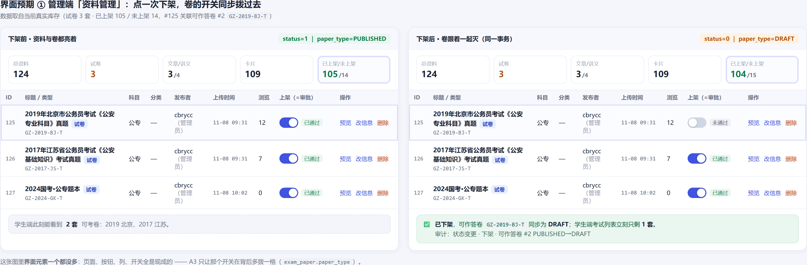
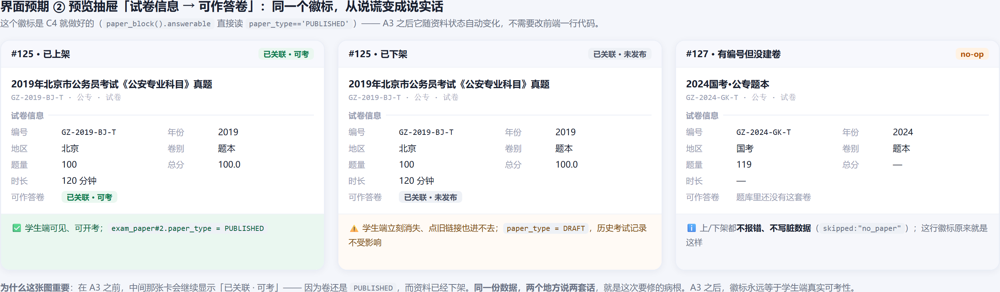
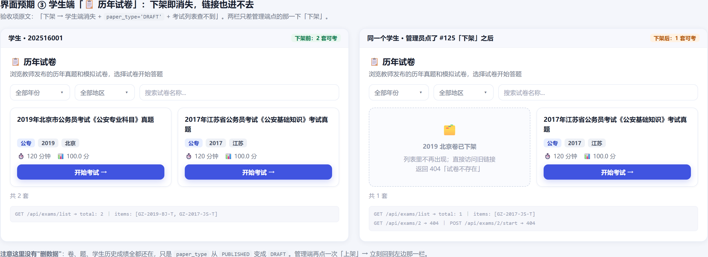
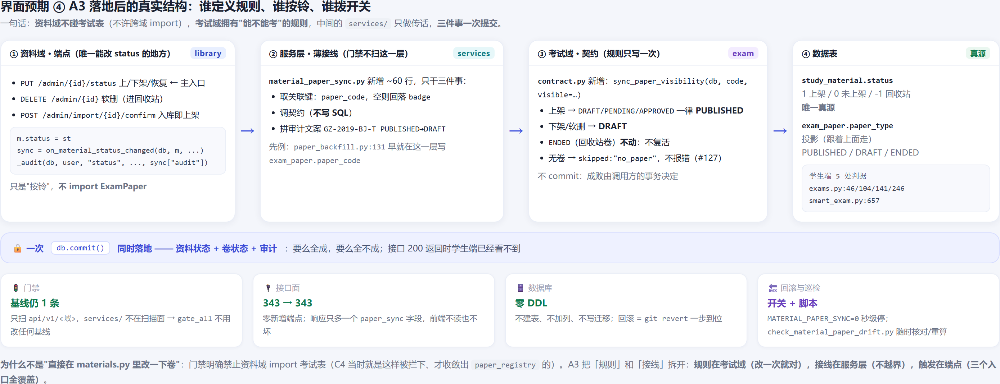

# P5 上下架联动 `exam_paper.paper_type` —— 实现方案对比（含影响面 / 回滚 / 测试点）

> **状态**：📋 **待你拍板（本文档未改任何代码）**
> **分支**：`feat/material-multi-format-import`，基线提交 `a415574`（C3 试卷筛选）之后
> **依据**：《试卷管理收敛_单一入口与上架即审批_方案_v1.md》§2.3「可作答卷降为投影」/ §3 P5
> **撰写**：2026-11-08 ｜ 实测环境：后端 **8001**（8000 被 Docker `om-ai-service` 占用）、SQLite WAL
> **命名歧义提醒**：本文的「P5」是**试卷管理收敛方案**里的 P5（上架联动）；与 `AGENTS.md` §6 目录重构阶段表里的「**P5 事件总线**」同名不同物，勿混读（见附录 C）。

---

## 0. 一句话结论

推荐 **方案 A3**：在**考试域**新增 `exam/contract.py`（拥有「可作答性」这一状态机），资料域只经过 `services/material_paper_sync.py` 这一层薄接线调用它，**上/下架与 `paper_type` 在同一个事务里翻转**。

- 门禁基线**保持 1 条不变**、API 面**保持 343 不变**、**零 DDL**
- 工期 **≈1.1 人日**（含备份、dry-run 脚本、测试与文档）
- 若你更希望「跨域 import 出现在边界扫描报告里、可被人审计」→ 选 **A2**（代价：基线 1→2 条，**需要你批准**）
- 若你只想要最小补丁 → 选 **A1**（0.5 人日，一个服务文件同时承担读与写）
- **B（事件驱动）不建议**放在 P5：它能解耦，但把「立即可见」降级成「最终一致」，且 `FOUNDATION_ENABLED=false` 时还必须维护第二套同步路径；等目录重构的「事件总线」阶段一起做更合算
- **C（不改 exam_paper，改学生侧判据）**：与 §2.3 冲突，**否决**（理由见 4.5）
- **D（只做巡检修复）**：达不到验收项「下架后学生立刻考不到」，只能作为 A 系列的**回滚与兜底资产**（见 §8）

---

## 0.5 通俗版：A3 到底做了什么（一分钟看懂）

### 打个比方

| 名词 | 人话 |
|---|---|
| `study_material.status` | 资料库书架上的**「在架 / 下架」标签** |
| `exam_paper.paper_type` | 考试系统里那张卷的**「开考开关」** |
| 现在的毛病 | 摘标签的人和拨开关的人**不是一个人、也没打招呼** → 标签摘了，开关还开着，学生照样点「开始考试」 |
| A3 做的事 | **摘标签的时候，顺手把开关一起拨下去**；而且规定了"开关怎么拨"这件事**只能由懂考试的人说了算** |

三个角色各管一段，谁也不越界：

```
资料页（只看得到 status）──按铃──▶ 服务层（跑腿的）──问规矩──▶ 考试域（懂 PUBLISHED/DRAFT/ENDED）──拨开关
```

### 六条优势（说人话 + 证据）

| # | 优势 | 人话 | 证据（可复核） |
|---|---|---|---|
| 1 | **一处按铃，四条路全覆盖** | 上架、下架、删进回收站、导入时直接上架 —— 全走同一个开关函数，不会"漏了某条路" | 3 个调用点（`materials.py:2048/2114/2719`） |
| 2 | **立刻生效，不用等** | 接口返回 200 的那一刻，学生刷新就已经看不到；不像"定时同步"有几分钟空窗期 | 同一事务提交；对照 B 方案的 Dispatcher 周期 |
| 3 | **不会"一半成功一半失败"** | 资料状态改成功、卷没改成功 → 这种最难查的中间态不存在；要么都成、要么都不成 | 同一个 `db.commit()`；T9 用 monkeypatch 验证 |
| 4 | **不欠新债** | 门禁基线还是 1 条、端点还是 343 个、不建表不加列 → 不用为了一个开关去改门禁、改契约快照 | `gate_all` 9/10、`check_module_boundary --check-only` 新增 0 条 |
| 5 | **规矩只写一次** | `DRAFT/PENDING/APPROVED/ENDED` 的判别集中在一个文件；以后做学生端小程序、第三方接入，复用同一个函数 | `exam/contract.py` 单点 |
| 6 | **出事能退** | 一个环境变量秒停、`git revert` 一步回滚、快照+审计+脚本三重还原 | §8 三层回滚 |

### 分角色预期效果

| 谁 | **会变** | **不会变**（重要） |
|---|---|---|
| 管理员 | 点「下架」→ 该卷同步变 `DRAFT`；审计里多一句「可作答卷 GZ-2019-BJ-T PUBLISHED→DRAFT」；统计卡「已上架/未上架」随资料数变化（105/14 → 104/15） | 界面元素一件不加、按钮位置不变、操作步骤不变 |
| 学生 | 下架的卷**从考试列表消失**、旧链接 404、开考被拒；再上架立刻恢复 | **历史考试记录、成绩、错题全都在**（`exam_records` 不按 `paper_type` 过滤） |
| 教师 | 试卷管理里该卷显示「草稿」（因为它真的不可考了） | 自己创建的卷、题目、排序都不受影响 |
| 运维 | 审计可追溯、漂移可巡检、开关可秒停 | 不新增服务、不新增定时任务、不加表 |
| 前端代码 | **0 行改动**（响应多一个 `paper_sync` 字段，没人读也不坏） | `.vtj` 模板一行不动（R3） |

### 界面预期图（4 张，按真实库存数据绘制）

> 说明：这 4 张是按**现有真实页面结构 + 真实数据**（试卷 3 套、#125/#126 有关联卷、#127 无卷、status 分布 105/14）绘制的**预期效果图**，不是线上截图；实现后真实界面应与之一致（元素不增不减）。

**① 管理端「资料管理」：点一次下架，卷的开关同步拨过去**



**② 预览抽屉「试卷信息 → 可作答卷」：同一个徽标，从说谎变成说实话**



**③ 学生端「历年试卷」：下架即消失，链接也进不去**



**④ A3 的结构：谁定义规则、谁按铃、谁拨开关**



---

## 1. 要解决的问题：现在点「下架」，学生照样能考

《试卷管理收敛》§2.3 原文（`docs/plans/试卷管理收敛_单一入口与上架即审批_方案_v1.md:79-84`）：

```
### 2.3 可作答卷降为投影（关键机制）
- 上架：study_material.status → 1 时，若存在关联 exam_paper，同步 paper_type → PUBLISHED；
- 下架：status → 0 时同步 paper_type → DRAFT；
- 反向不再驱动：paper_type 变了不改资料状态（唯一真源 = study_material.status）；
- 学生考试链路依赖 paper_type='PUBLISHED'（exams.py:46/104/141 三处过滤）
  → 联动必须做对，否则"资料下架了但学生还能考"。
```

**当前实测**：`PUT /api/materials/admin/{id}/status`（`backend/app/api/v1/library/materials.py:2035`）只改 `study_material.status`，**完全不碰 `exam_paper`**。资料库现有的 3 套试卷资料（#125/#126/#127）全是 `status=1`，其中关联的 #2/#3 恰好也是 `PUBLISHED`，所以现状看起来"对"——**这只是巧合，一旦下架任一条，漂移立刻出现**。

学生侧到底看哪几处（实测 5 处）：

| # | 位置 | 场景 | 漏联动的后果 |
|---|---|---|---|
| 1 | `app/api/v1/exam/exams.py:46` | `GET /api/exams/list` 考试列表 | 下架卷仍在列表里 |
| 2 | `exams.py:104` | `GET /api/exams/{id}` 试卷详情 | 点进去还能看到卷 |
| 3 | `exams.py:141` | `GET /api/exams/{id}/questions` 取题（考试模式） | 还能拿到题目 |
| 4 | `exams.py:246` | `POST /api/exams/{id}/start` 开始考试 | **还能开考并扣次数** |
| 5 | `app/api/v1/exam/smart_exam.py:657` | 小智组卷授权判断 | 借题链路仍认为它公开 |

---

## 2. 事实基线（全部实测，可复核）

### 2.1 谁能把 `paper_type` 写成 `PUBLISHED`（真正让学生看到）

| 位置 | 入口 | 触发人 |
|---|---|---|
| `catalog/papers.py:442` | `POST /api/papers/{id}/publish` | 管理员（要求 `APPROVED`） |
| `catalog/paper_generation.py:748` | `POST /api/paper-generation/{id}/publish` | 管理员（要求已审批） |
| `platform/admin_approval.py:245` | `POST /api/admin/papers/{id}/approve` | 管理员（`PENDING→PUBLISHED`） |
| `platform/teacher.py:1383` | 教师端发布（`publish_target=past_paper`） | 教师（`DRAFT/APPROVED→PUBLISHED`） |

> 这 4 处就是「反向驱动」的 4 扇门。P5 只做「资料→卷」单向同步，**不关这 4 扇门**，所以漂移在 P0–P4（收敛到资料管理单入口）落地前仍然存在（见 §9 风险 R1）。

### 2.2 谁能改 `study_material.status`（需要挂联动的真实入口）

| 位置 | 动作 | 是否要挂 P5 |
|---|---|---|
| `materials.py:2048` | `PUT /admin/{id}/status`：0↔1、-1→0/1（恢复） | ✅ **主入口** |
| `materials.py:2114` | `DELETE /admin/{id}`、`DELETE /admin/batch`：`status=-1` 软删 | ⚠️ 建议挂（见 D-P5-3） |
| `materials.py:2719` | `POST /admin/import/{id}/confirm` 带 `publish=true` 直接入库为已上架 | ⚠️ 建议挂（见 D-P5-4） |
| `materials.py:1959` | `POST /admin/files/upload` 建资料 `status=0` | 否 |
| `materials.py:481/544/668/693` | 学生个人卡 / 分享开关（`type=card`，无卷） | 否 |

### 2.3 数据现状（`backend/data/question_bank.db`，本文撰写时）

`exam_paper` 3 行：

| paper_id | paper_code | paper_type | 题目/总分/时长 |
|---|---|---|---|
| 1 | `P-20261026-D65ED5` | **ENDED** | 0 / 100 / 120 |
| 2 | `GZ-2019-BJ-T` | **PUBLISHED** | 100 / 100 / 120 |
| 3 | `GZ-2017-JS-T` | **PUBLISHED** | 100 / 100 / 120 |

试卷类资料 3 行（全部 `status=1`）：

| material_id | 标题 | status | paper_code | 是否有关联卷 |
|---|---|---|---|---|
| 125 | 2019年北京市公务员考试《公安专业科目》真题 | 1 | `GZ-2019-BJ-T` | ✅ exam_paper#2 |
| 126 | 2017年江苏省公务员考试《公安基础知识》考试真题 | 1 | `GZ-2017-JS-T` | ✅ exam_paper#3 |
| 127 | 2024国考·公专题本 | 1 | `GZ-2024-GK-T` | ❌ **库里没有这张卷** |

资料状态分布：`-1` 5 条、`0` 14 条、`1` 105 条（合计 124）；`material_file` 6 行；事件表 `foundation_outbox` 120 条全部 `dispatched`。

> **结论**：P5 上线当天，**#125/#126 是唯一的真实用例**；#127 上/下架必须是"安静的 no-op"（不报错、不写脏数据），这条要进测试。

### 2.4 门禁事实（决定了方案能不能过 L4）

`backend/scripts/gates/gate_l4_api_contract.py`：

- 只校验 OpenAPI 里 7 个必需端点存在 + 跑 `check_module_boundary.py --check-only`
- **`--check-only` 不会自动写基线** → 想登记新违规必须**手工改** `backend/data/refactor_baseline/boundary_baseline.json`
- 当前基线只有 **1 条**：`cross_import|library|materials|api.v1.catalog`
- 检查器**只扫 `app/api/v1/<域>/*.py`**（`_iter_domain_modules()`），**不扫 `app/services/`、`app/foundation/`**
- 两类违规：`cross_import`（跨域模块互 import）/ `cross_write`（import 了"他域独占"的 ORM 模型，依据 `table_usage.json`）

**先例**：`materials.py:21` 就是 `from ....api.v1.catalog import contract as taxonomy`——**"域契约模块 + 基线登记一条"是本项目已经在用的范式**，不是新发明。

**既有事实（重要，影响 A1/A3 的诚实性）**：`app/services/paper_backfill.py:131` 早就在 services 层直接写 `paper.paper_code`（C2a 补录），即"services 写 exam_paper"**已经是既成事实**，A1/A3 不是破例，而是沿用。

### 2.5 事件基础设施现状（决定 B 的成本）

| 组件 | 状态 |
|---|---|
| `foundation/outbox.py` `emit(session, event_name=…, aggregate_type=…)` | ✅ 可用，与业务写同事务 |
| `foundation/dispatcher.py` + `dispatcher_lock.py` | ✅ 常驻投递，单写者文件锁 |
| `services/event_handlers.py` `build_handlers()` | ✅ 6 个事件已注册（user.action / paper.published / 3 个 document snapshot / forum） |
| 幂等 | ✅ `foundation/inbox.claim(session, consumer, event)` |
| 门禁约束 | L7-17：**`app/api/v1` 里禁止 `events.publish`**（必须走 outbox）；且要求 `event_handlers.py` 含 `claim(`、`EV_USER_ACTION`、`EV_PAPER_PUBLISHED` |
| 实测数据 | 120 条事件全部 `dispatched`，链路是活的 |

---

## 3. 先定语义：状态映射矩阵（D-P5-1 … D-P5-6）

**四个方案的技术差异，一半来自这里的选择**。先把语义定死，方案对比才有意义。

| # | 场景 | 我的建议 | 备选 | 若选备选会怎样 |
|---|---|---|---|---|
| **D-P5-1** | 上架 + 卷是 `DRAFT` | → `PUBLISHED` | — | — |
| **D-P5-2** | 上架 + 卷在 `PENDING`/`APPROVED`（审批流程中途） | **→ `PUBLISHED`**（"上架即终审"，符合 P0 目标语义） | 保持不动 | 管理员看到"已上架"但学生考不到，是最难排查的一类"沉默失败" |
| **D-P5-3** | 上架 + 卷是 `ENDED`（回收站） | **不动，返回 `skipped:"ended"`** | 复活成 PUBLISHED | 一份被彻底删除的卷被一次上架复活，题目关系可能已残缺 |
| **D-P5-4** | 下架 / **软删除**（`status=0` 或 `-1`） | → `DRAFT`（软删除也联动） | 只对 `0` 联动 | 删除一份试卷资料后学生仍能考，删了等于没删 |
| **D-P5-5** | **入库即上架**（`import_confirm` 带 `publish=true`） | **也联动**（else 新导入的试卷学生考不到） | 只在 status 端点联动 | 新导入路径静默失效，只能靠"再点一次下架再上架"救 |
| **D-P5-6** | 资料**无 `paper_code`** 或**库里无此卷**（#127） | **no-op + `skipped:"no_paper"`**，不报错 | 400 报错 | 127 这种"有编号没建卷"的合法中间态会被卡死 |

**关联键**：`study_material.paper_code`（回落 `badge`）→ `exam_paper.paper_code`，一对一（`services/paper_registry.find_exam_by_code()` 现成）。
**一码多资料**的防御：若同一 `paper_code` 被 ≥2 条资料引用，则**任一条 `status=1` 即保持可考，全部不为 1 才下架**（当前数据无此情况，属于防御性实现）。

**正向/反向**：只做「资料 → 卷」，**卷的状态变化不回头改资料**（§2.3 明文）。副作用是教师端直接发布一张卷时资料仍显示"未上架"——这是已知残留，记在 R1。

---

## 4. 四个方案

> 所有方案的**公共部分**：都不新增端点（API 面 343 不变）、都不改表结构（零 DDL/零迁移）、都不改 `.vtj` 模板、都不动路由（L6/L7 仍 105 页）、都不需要前端改动（可选提示见 P5-4）。

### 4.1 方案 A1 — 服务层同步写（最小补丁，0.5 人日）

**思路**：`services/paper_registry.py` 现在只读，把它升级为"读 + 写"的投影桥，直接在服务里改 `ExamPaper.paper_type`。

**改动文件**

| 文件 | 改动 |
|---|---|
| `backend/app/services/paper_registry.py` | +`sync_paper_type(db, material, *, reason) -> dict`（内部 `find_exam_by_code` + 翻转 + 返回 `{paper_id, before, after, changed, skipped}`，**不 commit**） |
| `backend/app/api/v1/library/materials.py` | 3 处调用：`admin_set_status`(L2048 前)、`admin_batch_delete`/`admin_delete`(L2114 前)、`import_confirm`(L2719 前) |
| `backend/tests/test_materials_publish_link_p5.py` | 新增（12 例） |
| `backend/scripts/check_material_paper_drift.py` | 新增（dry-run 巡检，见 §8） |
| `docs/plans/P5_上下架联动_交付记录_v1.md` | 交付后写 |

**数据流**：`PUT status` → `m.status=st` → `sync_paper_type()` 改 `paper.paper_type` → 一次 `db.commit()`（审计 `_audit` 也在同事务内，顺带把当前"commit 后再写审计"的弱一致修掉）。

**一致性**：**强**。接口 200 返回时学生列表立刻看不到。
**权限与安全**：不新增权限面；`_require_admin` 不变；`sync` 只接受服务端解析出的 material，不接受外部传入的 `paper_code`/`paper_type`（防越权改卷）。
**影响面**：`exam_paper` 0–1 行 UPDATE / 次；`sys_operation_log` +1 行；学生端 5 个判据点行为按预期变化；教师端试卷列表里 #2/#3 会随资料下架变成 `DRAFT`（教师会以为卷"退回草稿"，需要文档说明，可选提示见 P5-4）。
**回滚**：代码 revert 即可（无 DDL、无端点、无表），历史数据靠审计/快照回退（§8）。
**测试点**：见 §7 的 T1–T12（全部适用）。
**门禁**：L4 不变（`services/` 不被扫描），基线仍 1 条；API 面不变 → R11 无感。
**工期**：0.5 人日。
**风险**：`paper_registry.py` 从"只读桥"变成"读写桥"，文件职责变混；将来若上事件总线要再拆一次（成本小，因为只有 3 个调用点）。
**为什么放这里（代码位置论证）**：`paper_registry.py` 的文件头注释原本就写了「上架联动（paper_type 同步）属于 C3/P5，届时同样走这个文件」——A1 就是照注释做的。好处是**改动面最小**；坏处是"考试域的状态机语义写在了资料域的服务里"，`PENDING/APPROVED/ENDED` 的规则散在非考试域。

---

### 4.2 方案 A2 — 考试域契约 + 基线登记（1.0 人日，需你批准）

**思路**：仿 `catalog/contract.py` 新建 `exam/contract.py`，由考试域拥有"可作答性"的状态机；资料域**直接 import 考试域契约**，并把这 1 条 `cross_import` **登记进边界基线**（1 → 2 条）。

**改动文件**

| 文件 | 改动 |
|---|---|
| `backend/app/api/v1/exam/contract.py` | **新增**。`sync_paper_visibility(db, paper_code, *, visible) -> dict`，内部持有 `EXAM_PAPER_DRAFT/PUBLISHED/PENDING/APPROVED/ENDED` 常量和映射规则；不 commit |
| `backend/app/api/v1/library/materials.py` | 顶部 `from ....api.v1.exam import contract as exam_paper`；3 处调用 |
| `backend/data/refactor_baseline/boundary_baseline.json` | **1 → 2 条**，新增 `"cross_import|library|materials|api.v1.exam"` ← **这一步必须你批准** |
| `backend/tests/test_materials_publish_link_p5.py` | 新增 |
| `backend/scripts/check_material_paper_drift.py` | 新增 |
| `docs/…` | 交付记录 + 基线变更说明 |

**数据流 / 一致性 / 权限 / 测试点 / 回滚**：同 A1（同步、同事务）。
**门禁**：**基线 +1 条**。`--check-only` 不会自动吸收，必须手工编辑 JSON；改完要跑 `gate_all` 证明"新增 0 条"是**声明式**的而不是**漂移**。好处：这条跨域关系**在扫描报告里可见**，比藏在 `services/` 里更诚实、可审计。
**工期**：1.0 人日（多出来的是契约文件 + 基线变更 + 评审说明）。
**风险**：基线是"技术债台账"，从 1 涨到 2 需要理由；理由足够（这是领域语义，不是图省事的越界），但要接受"以后每次跨域都要走同一流程"的规矩。
**为什么放这里**：`catalog/contract.py` 的 docstring 明确写了这套约定（"跨域不得直接 import 他域 ORM 模型，必须经由该域的契约模块"）。A2 是**字面意义上最合规**的做法——代价是把违规写进基线。

---

### 4.3 方案 A3 — 考试域契约 + 服务层接线（**推荐**，0.75 人日）

**思路**：A2 的契约（语义归考试域）+ A1 的接线（资料域不 import 考试域，`services/` 做薄桥）。

```
library/materials.py ──(import)──▶ services/material_paper_sync.py ──(import)──▶ api/v1/exam/contract.py ──▶ ExamPaper
        ↑ 资料域只依赖服务     ↑ 门禁不扫 services/       ↑ 状态机在考试域，域内 import 合规
```

**改动文件**

| 文件 | 改动 | 说明 |
|---|---|---|
| `backend/app/api/v1/exam/contract.py` | **新增**（同 A2） | 考试域拥有 `paper_type` 语义；域内 import 自己的模型，零违规 |
| `backend/app/services/material_paper_sync.py` | **新增**，~60 行 | 只做三件事：取 `paper_code`（含 `badge` 回落）→ 调契约 → 生成审计 detail；**不写 SQL、不做业务判断** |
| `backend/app/api/v1/library/materials.py` | 3 处调用（L2048 / L2114 / L2719 前），`_audit` detail 带上卷的变化 | +~15 行 |
| `backend/data/refactor_baseline/boundary_baseline.json` | **不动**（仍 1 条） | 因为 `services/` 不在扫描范围 |
| `backend/tests/test_materials_publish_link_p5.py` | 新增 12 例 | |
| `backend/scripts/check_material_paper_drift.py` | 新增（dry-run/`--apply`，回滚与兜底共用） | |
| `docs/plans/P5_上下架联动_交付记录_v1.md` | 交付记录 | |

**接口形态（写进文档，便于你先审）**

```python
# exam/contract.py —— 考试域拥有状态机，不 commit，由调用方的事务决定成败
def sync_paper_visibility(db, paper_code: str, *, visible: bool) -> dict:
    """资料可见性 → 可作答性。
    visible=True  : DRAFT/PENDING/APPROVED → PUBLISHED（ENDED 跳过）
    visible=False : PUBLISHED → DRAFT（ENDED 跳过；PENDING/APPROVED 也回 DRAFT，
                    表示"资料下架即不可考"）
    返回 {"paper_id":int|None, "paper_code":str, "before":str|None,
          "after":str|None, "changed":bool, "skipped":None|"empty_code"|"no_paper"|"ended"}
    """
```

```python
# services/material_paper_sync.py
def on_material_status_changed(db, material, *, prev_status: int, reason: str) -> dict:
    """资料 status 变化后同步可作答卷。返回契约结果 + 审计 detail 片段。"""
```

`PUT /admin/{id}/status` 的响应从 `{"ok": true}` 变成 `{"ok": true, "paper_sync": {...}}`——**纯增量字段**，前端不读也不受影响（`fetchAdminMaterialList`/A4 页面无字段依赖），API 面上限不变。

**数据流 / 一致性 / 权限 / 安全**：与 A1 相同（同事务、强一致、`_require_admin` 不变、不接受外部状态参数）。
**影响面**：

| 维度 | 影响 |
|---|---|
| 后端文件 | 3 改 2 增（+1 脚本、+1 测试），约 150 行净增 |
| 数据库 | `exam_paper.paper_type` 最多 1 行 / 次；`sys_operation_log` +1 行 / 次；**无迁移** |
| 端点 | 0 新增；`PUT /admin/{id}/status`、`DELETE /admin/{id}`、`POST /admin/import/{id}/confirm` 的**行为**变化 |
| 学生端 | 5 个判据点按 §3 矩阵变化；**已生成的考试记录不受影响**（`exam_records` 不按 `paper_type` 过滤） |
| 教师端 | 试卷列表 #2/#3 会随资料下架变 `DRAFT`（可能困惑，见 P5-4 可选提示） |
| 门禁 | L4/L6/L7 **全部不变**（基线 1 条、页面 105、导入 105）；L1-G 既有红 |
| 文档 | 交付记录 + README 索引 + 方案回填（§3 语义定稿） |

**回滚**：代码 revert（无 DDL/无端点/无表）→ 数据靠审计 detail 或备份快照（§8 三层）。
**工期**：0.75 人日（备份+脚本 0.2、契约 0.2、接线 0.2、测试与文档 0.15）。
**风险**：`services/` 不被边界扫描 → 跨域写"扫描看不到"，只能靠**契约文件注释 + 交付记录 + 本项目既有先例（`paper_backfill`）**保证可审计。**这条我会在交付记录里显式声明，不藏着。**
**为什么放这里（"为什么不是写在 materials.py 里"）**：① 门禁明确禁止 library 模块 import `ExamPaper`（C4 就是这么被拦下并收敛到 `paper_registry` 的）；② `paper_type` 的合法值集合与迁移规则属于考试域知识，写在资料域会让资料域依赖考试域的状态细节；③ `services/` 里已有 `paper_backfill` 写 `exam_paper.paper_code` 的先例，A3 只是把"写"这件事做得更干净：**契约在域内、接线在服务、调用在端点**。

---

### 4.4 方案 B — 事件驱动（Outbox 异步，2.0 人日）

**思路**：资料状态变化时 `outbox_emit` 一条 `study_material.status_changed.v1`，Dispatcher 投递给 `services/event_handlers.py` 的新 handler，由 handler 翻转 `paper_type`（幂等靠 `foundation_inbox.claim`）。

**改动文件**：`app/core/events.py`（+1 常量）、`materials.py`（3 处 `outbox_emit`，范式见 `catalog/papers.py:452-455`）、`services/event_handlers.py`（+handler + `build_handlers()` 注册 + `claim(`）、`tests`（需要 drain outbox 的异步用例）、`scripts/check_material_paper_drift.py`。

**优点**：资料域彻底不感知考试域；事件可重放；为目录重构的「事件总线」阶段铺路；`paper_type` 的写入发生在**考试侧消费逻辑**里，语义归属最干净。
**缺点 / 代价**：

1. **最终一致**：`PUT status` 返回 200 时，学生列表可能还要等一个 Dispatcher 周期（`FOUNDATION_DISPATCH_MS`）才更新 → 验收项「下架后考试列表查不到」是**时间窗口内不成立**的
2. **双路径**：`EVENT_OUTBOX_ENABLED=false`（回滚开关）时必须回退成同步调用，否则功能**静默失效** → 两套路径、双倍测试
3. **测试成本**：pytest 必须显式驱动 Dispatcher（或直接调 handler），否则断言时序不稳
4. **运维面**：要看 `foundation_outbox` 积压；handler 抛异常会重试（要设计"重试 N 次仍失败"的可见性）
5. **门禁**：L7-17 要求 handler 注册与 `claim(`，新增事件名要过 L7；`api/v1` 里禁止 `events.publish`（用 outbox 是对的）

**一致性**：最终一致（秒级）。
**回滚**：代码 revert + 清理已入队事件（`foundation_outbox` 里未投递的行）。
**工期**：2.0 人日（含异步测试与双路径兜底）。
**结论**：**技术上完全可行**（基础设施是现成的、120 条事件已验证链路），但**在 P5 这个"一个布尔值"的需求上不划算**；建议作为「事件总线阶段」的候选，不是现在。

---

### 4.5 方案 C — 不改 `exam_paper`，改学生侧判据（**否决**）

**思路**：`exams.py` 的 4 处过滤再加一个条件——「该卷对应的资料 `status=1`」，即考试链路直接读资料状态。

**为什么否决**（与 §2.3 直接冲突）：

1. **需要 exam 域读 library 的 ORM**（`StudyMaterial`）→ 反方向再一次跨域，又要往基线里再加一条 `cross_write|exam|exams|StudyMaterial`
2. **判据要在 5 处重复**（`exams.py` 4 处 + `smart_exam.py:657`），以后每加一个消费方都要记得加——漏一处就是"下架还能考"，正是本次要消除的缺陷
3. `exam_paper.paper_type` 与真实可见性**分裂**：管理端显示"已发布"、学生看不到、教师端统计把它算进已发布 → 运维无法解释（`teacher.py:699-702` 的 `draft/published` 统计直接失真）
4. 需要 JOIN/子查询改 SQL，属于**热路径**改动（考试列表 + 开始考试），性能与回归风险都高于"改一个字段"

**工期**：1.5 人日（还治不好）。**结论**：不做。

---

### 4.6 方案 D — 只做一致性巡检/修复（0.5 人日，不单独作为 P5）

**思路**：新增 `backend/scripts/check_material_paper_drift.py`，扫描全部试卷资料 vs `exam_paper`，输出漂移清单，`--apply` 才修；可手动跑、可定时。

**优点**：零风险、零门禁、零端点、可随时回滚。
**缺点**：**达不到验收项**——「下架后学生立刻考不到」在巡检间隔内不成立（人工跑 = 可能永远不跑）。
**定位**：**不单独作为 P5**，而是 A1/A2/A3 的**必备配套**：既是上线的 dry-run 证据（"上线前漂移 = 0"），也是回滚工具（§8 第三层），还是 R1（反向漂移）的唯一可见性来源。

---

## 5. 对比矩阵

| 维度 | A1 服务层 | A2 契约+基线 | **A3 契约+服务（荐）** | B 事件驱动 | C 改学生侧 | D 只巡检 |
|---|---|---|---|---|---|---|
| 一致性 | 强 | 强 | **强** | 最终（秒级窗口） | 强 | 无（靠人跑） |
| 满足验收「下架立刻考不到」 | ✅ | ✅ | **✅** | ⚠️ 窗口内不满足 | ✅ | ❌ |
| 门禁变化 | 0 | **基线 1→2（需批）** | **0** | 0（L7 需过） | **基线 +1（反向）** | 0 |
| API 面（343） | 不变 | 不变 | **不变** | 不变 | 不变 | 不变 |
| 改动文件数 | 3 | 4 | **4** | 5 | 2 | 1 |
| 语义归属 | 资料域服务（混） | 考试域 | **考试域** | 考试域消费者 | 考试域（但读 library） | — |
| 可测性 | 高 | 高 | **高** | 低（需 drain/异步） | 中（5 处重复） | 高 |
| 回滚难度 | 低 | 低（含基线回退） | **低** | 中（未投递事件） | 中 | 无 |
| 与 §2.3 一致 | 一致 | 一致 | **一致** | 一致（异步） | **冲突** | 辅助 |
| 工期（人日） | 0.5 | 1.0 | **0.75** | 2.0 | 1.5 | 0.5 |
| 风险 | 职责混 | 技术债台账 +1 | **扫描不可见（须文档声明）** | 双路径 + 时序 | 重复判据 + 统计失真 | 不达验收 |

---

## 6. 推荐方案 A3 的落地拆分

| 步骤 | 内容 | 产出 / DoD | 估时 |
|---|---|---|---|
| **P5-0** | ① `sqlite3.backup()` 全库快照（R10）② 写 `scripts/check_material_paper_drift.py`（dry-run 默认）③ 跑一遍证明**当前漂移 = 0** | 快照文件 + 干跑日志（0 漂移）；这同时是回滚资产 | 0.2d |
| **P5-1** | `exam/contract.py`：状态机 + 返回契约 + 域内单测（D-P5-1/2/3 三态） | 纯函数级可测；ENDED 不复活 | 0.2d |
| **P5-2** | `services/material_paper_sync.py` + `materials.py` 3 处调用（同事务、先 sync 后 commit） | 上/下架/软删/入库即上架四条路径都联动 | 0.2d |
| **P5-3** | 审计 detail 带卷变化（`上架；可作答卷 GZ-2019-BJ-T PUBLISHED→DRAFT`）+ 响应体加 `paper_sync` | 运维能解释"为什么卷变了" | 0.1d |
| **P5-4**（可选） | 前端「下架」二次确认文案加一句「同时会让该场考试对学生不可见」 | 需 DOM 注入或 `<script>` 改（**不动 `<template>`**，R3）；不做也不影响功能 | 0.1d |
| **P5-5** | 12 条 pytest + 回归 + `gate_all` + 交付记录 + README 索引 + 方案 §3 回填 | 全绿交付记录 | 0.25d |
| **合计** | | | **≈1.05–1.15d** |

**动手前必须先答的 8 问（A3 版）**

1. **为什么这段代码放这里**：契约在 `exam/`（状态语义属考试域，域内 import 合规）；接线在 `services/`（门禁扫描区外，沿用 `paper_backfill` 先例）；调用在 `library/materials.py` 三处（唯一能改 status 的地方）
2. **好处**：一处状态机 + 三条路径全覆盖 + 同事务强一致 + 零 DDL/零端点
3. **安全**：不新增权限面；`sync` 只接受服务端查出的 material；不接受客户端传 `paper_code`/`paper_type`；`_require_admin` 前置（未授权到不了 sync）
4. **运维**：审计 detail 可追溯；漂移脚本可随时核对；`paper_type` 语义与 §2.3 一致
5. **可维护**：`PENDING/APPROVED/ENDED` 规则集中在一个文件；`exam/contract.py` 可被将来的 P4 复用
6. **前端渲染**：0 改动（响应新增 `paper_sync` 字段，前端忽略；抽屉"可作答卷"三态已由 `paper_block()` 提供，自动变正确）
7. **后端字段**：不新增列/表；只写已有 `exam_paper.paper_type`
8. **路由注册**：不新增路由 → 343 不变、`test_api_surface.py` 无需改白名单

---

## 7. 测试点清单

### 7.1 pytest（新文件 `backend/tests/test_materials_publish_link_p5.py`，12 例）

| # | 用例 | 断言 |
|---|---|---|
| T1 | 下架 #125（关联 #2 PUBLISHED） | 200；`exam_paper#2.paper_type == 'DRAFT'`；学生 `GET /api/exams/list` **不含** `GZ-2019-BJ-T` |
| T2 | 再上架 #125 | `paper_type == 'PUBLISHED'`；学生列表恢复含该卷 |
| T3 | 上架 #127（`GZ-2024-GK-T` 无卷） | 200；`paper_sync.skipped == "no_paper"`；**无异常、无脏数据**、`exam_paper` 仍 3 行 |
| T4 | 上架但卷是 `ENDED`（造一条 #1 同码资料） | `paper_type` 仍 `ENDED`；`skipped == "ended"`；不复活 |
| T5 | 卷在 `PENDING`/`APPROVED` 时上架（D-P5-2） | → `PUBLISHED`（按建议语义） |
| T6 | 软删 #125（D-P5-4） | `status=-1` 且 `paper_type == 'DRAFT'`；学生考不到 |
| T7 | `import_confirm(publish=true)` 新建带 `paper_code` 的试卷资料（D-P5-5） | 若存在同码卷且为 `DRAFT` → `PUBLISHED` |
| T8 | 幂等：连续两次上架 | 第二次 `changed == False`；审计各 1 行；无重复写入 |
| T9 | 事务性：monkeypatch 让契约抛异常 | 接口 500；**`study_material.status` 未被提交**（保持原值） |
| T10 | 审计 detail | 含 `GZ-2019-BJ-T` 与 `PUBLISHED→DRAFT`；`operation_type == '状态变更'` |
| T11 | 边界：卡片资料（`paper_code` 为空）改 status | 契约**不查库**（`skipped=="empty_code"`），`exam_paper` 无变化 |
| T12 | 权限：学生 token 调 `PUT /admin/{id}/status` | 403；`paper_type` 不变 |

### 7.2 回归（必跑）

```powershell
cd backend
$env:PYTHONIOENCODING="utf-8"
python -m pytest tests/test_materials_publish_link_p5.py tests/test_materials_soft_delete.py `
  tests/test_materials_admin.py tests/test_materials_filters_c3.py `
  tests/test_materials_papers_c2c4.py tests/test_materials_meta_c2b.py -q
```

预期：新增 12 例 + 既有 C 批 74 例全绿（不含 L1-G 相关的既有红）。

### 7.3 门禁（带 8001 端口）

```powershell
$env:OPENAPI_URL="http://127.0.0.1:8001/openapi.json"
python backend/scripts/gates/gate_all.py      # 期望 9/10（L1-G 既有红）
python backend/scripts/gates/check_module_boundary.py --check-only   # 期望「新增 0 条」
```

A3 预期：`模块边界扫描：当前违规 1 条，新增 0 条`；`test_api_surface` 343 不变；L6 105 / L7 105 不变。

### 7.4 手工验收（8 步，你来做）

1. 强刷 `/admin/materials?type=paper` → 3 行，可作答列 = 2 可考 + 1「无关联卷」
2. 点 #125 那行的「下架」→ 列表变「未通过」
3. **学生账号** `202516001/test123456` → 考试列表：`2019年北京市…` **消失**
4. 学生直接访问该卷详情/开始考试 → 404/403（不是空白页）
5. 管理端再上架 #125 → 学生列表**重新出现**、可开考
6. 管理端删除 #125（进回收站）→ 学生端同样看不到（D-P5-4）
7. 从回收站恢复 #125 → 仍是「未通过」（`status=0`），学生仍看不到；再上架才可见
8. 打开 #127 → 上/下架都不报错，抽屉仍显示「无可作答卷」
9. 收尾：`sys_operation_log` 里能看到每次的 `状态变更` + 卷变化文案

---

## 8. 回滚预案（三层，任一层都够用）

### 第一层：运行时开关（最轻，秒级）

在 `backend/.env` 加 `MATERIAL_PAPER_SYNC=0` → `materials.py` 里 `if settings.MATERIAL_PAPER_SYNC:` 包住三处调用（默认 1）。
- 效果：立刻恢复"只改资料、不动卷"的旧行为，**不重启数据库、不回滚代码**
- 代价：学生可见性与资料状态重新漂移（回到今天的状态），漂移清单用 §8 第三层的脚本看

### 第二层：代码回滚

```
git revert <P5 提交>        # 无 DDL、无新表、无新端点，revert 干净
```
- 不需要迁移回退、不需要前端重新构建（若做了 P5-4，前端一并 revert 即可）
- 数据**不会**自动恢复：已翻转的 `paper_type` 保持翻转后的值

### 第三层：数据回滚（R10 合规）

1. **上线前**：`sqlite3.backup()` 全库快照 `backend/data/question_bank.db.bak_before_p5_<ts>`
2. **审计还原**：每次翻转都写 `sys_operation_log`（`operation_type='状态变更'`，detail 含 `before→after`）→ 可按时间范围逐条还原
3. **脚本重算**：`python backend/scripts/check_material_paper_drift.py` 看漂移 → `--apply` 按"资料状态即真源"重算；若已 revert 代码，用 `--report-only` 只出清单，手工通过教师端/管理端恢复（当前仅 #2/#3 两行，手工成本可忽略）
4. 快照恢复按 R10：`sqlite3.backup()` 反向操作 + **同时删 `-wal`/`-shm`**

---

## 9. 风险清单（含残留问题，不藏）

| # | 风险 | 影响 | 对策 |
|---|---|---|---|
| **R1** | **反向漂移仍在**：教师端 4 处发布入口能直接写 `PUBLISHED`，资料仍显示「未上架」 | 管理端与真实可见性不一致（改动前就存在，P5 不加剧但也不消除） | 交给 P0–P4（收敛单入口/删审批页）；期间用漂移脚本巡检；写进交付记录"已知残留" |
| R2 | `#127` 有编号无卷 → 上架后学生仍考不到 | 管理员以为是 bug | `skipped:"no_paper"` + 抽屉「无可作答卷」已如实显示；等 P2 题目线建卷 |
| R3 | 软删除资料会连带下架卷（D-P5-4） | 若同一卷被别处引用会受影响 | 一码多资料规则：任一条 `status=1` 即保持可考 |
| R4 | 双管理员并发点上下架 | 后写覆盖，无乐观锁 | 同事务 + 最后写赢；`update_time` 未做版本号（成本 >> 收益，仅 3 条卷） |
| R5 | 教师端看到卷变 `DRAFT` 会困惑 | 沟通成本 | 交付记录写明；P5-4 可选在前端提示 |
| R6 | `services/` 不在边界扫描内 → 跨域写"看不见" | 审计靠人 | 契约 docstring + 交付记录显式声明 + 漂移脚本可核对；若你要求"扫描可见"就换 A2 |
| R7 | 审计表增长 | 每次 1 行，量级可忽略 | 无需处理 |

---

## 10. 需要你拍板的事项

| # | 事项 | 选项 | 我的建议 |
|---|---|---|---|
| **D1** | 选哪个方案 | A1 / **A3** / A2 / B / D | **A3**（若要"扫描可见"选 A2，需批准基线 +1；若要最小补丁选 A1） |
| D2 | 上架时卷在 `PENDING/APPROVED` 怎么办（D-P5-2） | **直接 PUBLISHED** / 保持不动 | 直接 PUBLISHED（"上架即终审"，避免沉默失败） |
| D3 | 上架时卷是 `ENDED`（D-P5-3） | **不动 + skipped** / 复活 | 不动（回收站里的卷不因上架复活） |
| D4 | 软删除是否联动下架（D-P5-4） | **联动 DRAFT** / 不联动 | 联动（删了就该考不到） |
| D5 | `import_confirm(publish=true)` 是否联动（D-P5-5） | **联动** / 不联动 | 联动 |
| D6 | 是否要做 P5-4 前端确认提示 | 做 / **不做** | 不做也行（纯文案，0.1d；你要求就加） |
| D7 | 回滚开关 `MATERIAL_PAPER_SYNC` 是否需要 | **要** / 不要 | 要（一个 `if` 的成本，换秒级回滚） |

**你回一句「D1 选 A3，其余按建议」我就开工**；若选 A2，请额外明确同意「`boundary_baseline.json` 从 1 条变 2 条」——这是唯一一处会动门禁基线的地方。

---

## 附录 A：关键代码位置（可核对）

| 位置 | 内容 |
|---|---|
| `backend/app/api/v1/library/materials.py:2035` | `PUT /admin/{id}/status`（当前只改 status，`commit` 后再审计） |
| `materials.py:2114` | 软删除 `status=-1` |
| `materials.py:2719` | `import_confirm` 的 `status=(1 if publish else 0)` |
| `backend/app/services/paper_registry.py:23` | `find_exam_by_code()`（现成的关联解析） |
| `backend/app/services/paper_registry.py:1-15` | 文件头注释：明确写了「上架联动届时同样走这个文件 / 或改 exam 契约 + 基线」 |
| `backend/app/services/paper_backfill.py:131` | 先例：services 层写 `exam_paper.paper_code` |
| `backend/app/api/v1/catalog/contract.py:1-16` | 范式：跨域契约模块 + 基线登记 |
| `backend/app/api/v1/exam/exams.py:46/104/141/246` | 学生侧 4 处 `PUBLISHED` 过滤 |
| `backend/scripts/gates/check_module_boundary.py` | 只扫 `api/v1`、`--check-only` 不写基线 |
| `backend/data/refactor_baseline/boundary_baseline.json` | 当前 1 条：`cross_import\|library\|materials\|api.v1.catalog` |
| `backend/app/foundation/outbox.py:54` | `emit()` 签名（B 方案用） |
| `backend/app/services/event_handlers.py:build_handlers()` | 事件注册表（B 方案用） |

## 附录 B：验收用命令

```powershell
# 后端（8000 被 Docker 占用）
cd li_an-question_bank\backend
python -m uvicorn app.main:app --host 0.0.0.0 --port 8001

# 查卷状态
python -c "import sqlite3;c=sqlite3.connect(r'data/question_bank.db');print(list(c.execute('select paper_id,paper_code,paper_type from exam_paper')))"

# 查最近的状态变更审计
python -c "import sqlite3;c=sqlite3.connect(r'data/question_bank.db');print(list(c.execute(\"select log_id,operation_type,operation_desc from sys_operation_log where operation_type='状态变更' order by log_id desc limit 5\")))"

# 漂移巡检
python scripts/check_material_paper_drift.py            # dry-run
python scripts/check_material_paper_drift.py --apply    # 按"资料状态即真源"重算
```

## 附录 C：与其它方案的边界

| 关系 | 说明 |
|---|---|
| 《试卷管理收敛》P0–P4 | P5 是**最小可交付的机制件**；P0–P4（删审批页/单入口/`exam_paper` 彻底投影）落地前，R1 的双向漂移无法根除 |
| AGENTS §6「P5 事件总线」 | **同名不同物**：那是目录重构阶段的阶段名（事件总线），本文是试卷管理收敛方案的 P5（上架联动） |
| 《试卷元数据与题目导入关联_方案_v1.md》(P2 题目线) | P2 会建 `#127` 对应的卷；建好后 P5 的联动对它就生效，无需改代码 |
| C 批已完成项（C1/C2a/C2b/C3/C4） | P5 复用 C4 的 `paper_code` 关联键与 `paper_registry` 的解析，不新增关联表 |
