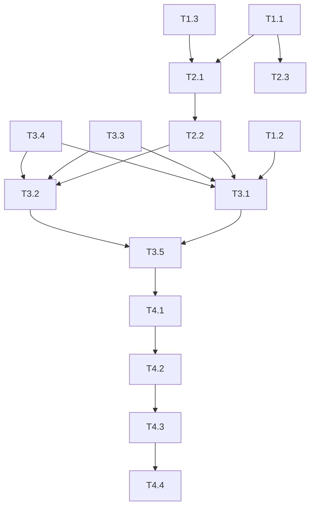

# 砺安题库 - 试卷/题目管理优化实施计划

**版本**: 1.0  
**日期**: 2025-08-23  
**基于规格**: `spec_exam_question_optimization.md`  
**工作目录**: `D:\砺安题库\砺安题库` (当前目录，非worktree)

---

## 任务分解与执行顺序

### 约定
- ✅ = 已完成
- 🔄 = 进行中
- ⏳ = 待开始
- 🔴 = 阻塞/风险

---

## Phase 1: 基础设施 (Week 1)

### T1.1 数据库迁移脚本 ⏳
**文件**: `backend/alembic/versions/`
- [ ] `20250823_001_add_paper_fields.py` - papers表新增字段
- [ ] `20250823_002_add_question_fields.py` - questions表新增字段+数据清洗
- [ ] `20250823_003_add_operation_log.py` - operation_logs新表
**验收**: `alembic upgrade head` 成功，`alembic downgrade -1` 可回滚

### T1.2 VTJ版本同步自动化 ⏳
**文件**: 
- `scripts/vtj_version_sync.py` - 核心同步脚本
- `.pre-commit-config.yaml` - pre-commit钩子配置
- `.vscode/tasks.json` - VS Code任务
- `.github/workflows/vtj-version-check.yml` - CI检查
**验收**: 修改.vue提交时自动同步JSON版本号，CI门禁生效

### T1.3 核心算法单元测试 ⏳
**文件**: `backend/tests/unit/`
- [ ] `test_exam_detector.py` - 标题解析、科目识别 (8用例)
- [ ] `test_question_classifier.py` - 题型分类 (8用例)
- [ ] `test_explanation_extractor.py` - 解析提取 (6用例)
- [ ] `frontend/tests/unit/test_question_filter.js` - 前端过滤 (6用例)
**验收**: `pytest tests/unit -v --cov=backend.services` 覆盖率达标

---

## Phase 2: 后端服务与API (Week 2-3)

### T2.1 核心服务实现 ⏳
**文件**: `backend/services/`
- [ ] `exam_detector.py` - 试卷检测服务
- [ ] `question_classifier.py` - 题型分类服务
- [ ] `explanation_extractor.py` - 解析提取服务
- [ ] `question_stats.py` - 统一统计服务
- [ ] `exam_service.py` - 考试业务服务

### T2.2 路由/API实现 ⏳
**文件**: `backend/routers/`
- [ ] `papers.py` - 新增: DELETE `/api/papers/{id}`、GET `/api/papers/{id}/preview`、GET `/api/papers/stats`、POST `/api/papers/import/confirm`
- [ ] `exams.py` - 新增: POST `/api/exams/start`、POST `/api/exams/{id}/submit`、PUT `/api/exams/{id}/progress`
- [ ] `questions.py` - 新增: PATCH `/api/questions/{id}/type`、PATCH `/api/questions/batch-type`、PATCH `/api/questions/{id}/explanation`、POST `/api/questions/batch-explanation`

### T2.3 模型更新 ⏳
**文件**: `backend/models/`
- [ ] `paper.py` - 新增4字段
- [ ] `question.py` - 新增3字段
- [ ] `operation_log.py` - 新建模型

---

## Phase 3: 前端页面与组件 (Week 3-4)

### T3.1 VTJ页面修改 ⏳
**文件**: `.vtj/vue/` (修改后必须同步 `.vtj/files/`)

| 页面 | 任务 | 关键修改 |
|------|------|----------|
| `questionImport.vue` | 导入确认对话框 | 新增 `ExamConfirmDialog` 组件引用、科目下拉、置信度进度条 |
| `paperManage.vue` | 删除功能 | 操作列新增删除按钮、引入 `DeleteConfirmDialog`、统计口径显示 |
| `questionManage.vue` | 过滤+批量操作 | 题目内容用 `QuestionContentFilter` 组件、批量修改题型/解析按钮 |

### T3.2 新建学生端页面 ⏳
**文件**: `.vtj/vue/` (新建需配置路由)

| 页面 | 路由 | 核心功能 |
|------|------|----------|
| `examPreview.vue` | `/exam/preview/:paperId` | 题目列表(无答案)、分页/导航、返回按钮 |
| `examStart.vue` | `/exam/start/:paperId` | 计时器、答题卡、进度保存、提交确认 |

### T3.3 通用组件 ⏳
**文件**: `.vtj/vue/` 或 `src/components/`
- [ ] `ExamConfirmDialog.vue` - 试卷导入确认
- [ ] `DeleteConfirmDialog.vue` - 删除确认(已发布警告)
- [ ] `BatchEditTypeDialog.vue` - 批量修改题型
- [ ] `ExplanationEditDialog.vue` - 编辑解析
- [ ] `QuestionContentFilter.vue` - 题目内容过滤显示

### T3.4 工具函数 ⏳
**文件**: `src/utils/questionFilter.js`
- [ ] `filterQuestionContent(content)` 导出函数

### T3.5 路由注册 ⏳
**文件**: `src/router/index.ts`
- [ ] 新增 `/exam/preview/:paperId` → `$vtj/vue/examPreview.vue`
- [ ] 新增 `/exam/start/:paperId` → `$vtj/vue/examStart.vue`

---

## Phase 4: 集成验证与部署 (Week 5)

### T4.1 功能自测 ⏳
- [ ] 试卷导入全流程：上传→检测→确认→入库→管理列表显示
- [ ] 试卷删除：未发布/已发布均可删，权限控制正确
- [ ] 统计口径：教师/管理员/学生三端数据一致且标注清晰
- [ ] 学生预览：无答案、可翻页、题型分值显示正确
- [ ] 学生考试：计时准确、进度保存、提交成功、可继续未完成
- [ ] 题目显示：UTBxxx过滤干净、内容完整
- [ ] 题型分类：准确率>95%、低置信度标记明显
- [ ] 解析功能：提取正确、可手工编辑、批量操作可用

### T4.2 VTJ版本一致性验证 ⏳
- [ ] 所有修改的 `.vtj/vue/*.vue` 对应 `.vtj/files/*.json` 版本号一致
- [ ] `useProvider({version})` 与 JSON `__VERSION__` 完全匹配
- [ ] `raw: true` 页面未被设计器覆盖

### T4.3 性能与压力测试 ⏳
- [ ] 912题目列表加载 < 2秒 (虚拟滚动/分页)
- [ ] 考试并发 50 用户无明显延迟
- [ ] 数据库查询无全表扫描 (EXPLAIN验证索引生效)

### T4.4 部署准备 ⏳
- [ ] 生产环境迁移脚本执行顺序确认
- [ ] 回滚方案文档化
- [ ] 环境变量/配置检查

---

## 执行依赖关系

---

## 当前执行状态

| 阶段 | 任务 | 状态 | 备注 |
|------|------|------|------|
| Phase 1 | T1.1 迁移脚本 | ⏳ | 优先执行 |
| Phase 1 | T1.2 VTJ同步 | ⏳ | 并行可做 |
| Phase 1 | T1.3 单测 | ⏳ | 并行可做 |
| Phase 2 | T2.1 核心服务 | ⏳ | 依赖T1.1 |
| Phase 2 | T2.2 API路由 | ⏳ | 依赖T2.1 |
| Phase 2 | T2.3 模型 | ⏳ | 依赖T1.1 |
| Phase 3 | T3.1 VTJ页面 | ⏳ | 依赖T1.2, T2.2 |
| Phase 3 | T3.2 新建页面 | ⏳ | 依赖T2.2 |
| Phase 3 | T3.3 组件 | ⏳ | 依赖T2.2 |
| Phase 3 | T3.4 工具函数 | ⏳ | 独立 |
| Phase 3 | T3.5 路由 | ⏳ | 依赖T3.1/T3.2 |
| Phase 4 | T4.1 功能测试 | ⏳ | 全部完成后 |
| Phase 4 | T4.2 VTJ验证 | ⏳ | 依赖T3.1 |
| Phase 4 | T4.3 性能测试 | ⏳ | 依赖T4.1 |
| Phase 4 | T4.4 部署准备 | ⏳ | 最后 |

---

## 启动指令

开始执行 **T1.1 数据库迁移脚本**：

1. 检查 `backend/alembic/` 目录结构
2. 创建3个迁移脚本文件
3. 在测试数据库运行 `alembic upgrade head` 验证
4. 执行 `alembic downgrade -1` 验证回滚
5. 提交迁移脚本到git

---

**下一步**: 开始编写 `backend/alembic/versions/20250823_001_add_paper_fields.py`