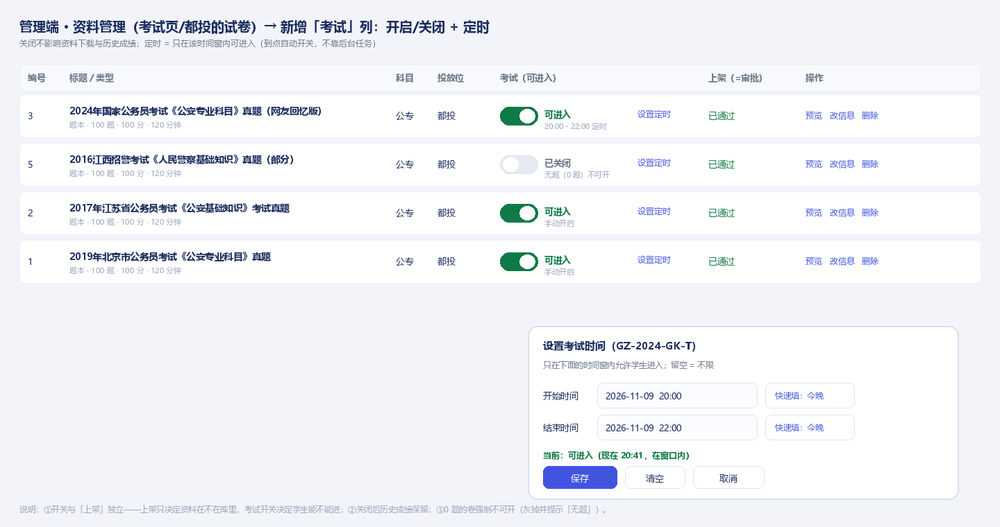

# 上传即建卷 / 上传即导题 / 考试开关与定时 方案 v1

> 需求（你 2026-11-09 的原话，已逐条落成决策）：
> ① 上传试卷时选「考试页 / 都投」→ **自动建卷**（只在考试相关投放位建，卷名=文件名）→ 见 §2
> ② 上传试卷时**自动读取 Word/PDF 里的题目**并存进题库；先只传题目，答案另走接口；**先出"待确认"清单，我点一次"确认入库"** → 见 §3
> ③ 列表里对「考试页/都投」的试卷加 **考试开启/关闭** 按钮，**支持定时**（如今晚 20:00 开、22:00 关）；关闭时**历史成绩保留**；开关与**资料上架互相独立**；范围＝**4 套已有试卷** → 见 §4
>
> 状态：**📋 待你批准**（未写代码；#128 的数据修复已按你授权执行完毕，见 §7）
> 规则：方案先审 → 批准后按 §8 分批实施 → 每批报"下一步+预期效果" → 归档+索引 → 不合并、不碰 main

---

## 0. 九条决策（你已拍板，本文全部按此执行）

| # | 决策 | 落地方式 |
|---|---|---|
| 1 | 自动建卷只在「仅考试页 / 都投」 | 上传时判断 `placement ∈ {exam, both}` 才建；`library` 不建 |
| 2 | 卷名用文件名（去扩展名） | `paper_name = stem` |
| 3 | #128 一起处理 | ✅ 已做：编号 `GZ-2016-JX-T` + 卷 #5（DRAFT、0 题） |
| 4 | 导题要先"待确认"清单再入库 | 解析 → 草稿（题号/题干/选项/图片对照）→ 你点「确认入库」 |
| 5 | 答案先不入库，保留上传接口 | 先只解析题目；答案走独立上传（§3.3 附"最稳格式"） |
| 6 | 考试开关要能定时 | `exam_open` + `open_at/close_at`，**按时间窗计算**（不依赖定时任务） |
| 7 | 关闭后历史成绩保留 | 只关"能否再进"，`exam_record` 一概不动 |
| 8 | 开关与资料上架独立 | 新字段控制考试；`status`/`paper_type` 语义不变 |
| 9 | 范围＝4 套卷 | 2019BJ / 2017JS / 2024GK / 2016JX 都显示开关 |

---

## 1. 现状与差距（实测）

| 事实 | 影响 |
|---|---|
| 上传试卷只做「原件留档 + 建资料」，**不解析题目** | 需求②要新增解析链路 |
| 编号只能从文件名解析，且**必须能解析出科目** | 你那份"人民警察基础知识"解析不出科目 → 编号为空 → 建卷入口消失（#128 就是因为这个） |
| 「建卷」要手动点，且建完是 DRAFT；发布靠 P5 上架联动 | 需求①要自动化；需求③要把"发布"与"放考"拆开 |
| 学生能否考 = `paper_type=PUBLISHED`（7 处判据） | 需求③要在这些判据上叠加"开关 + 时间窗" |

---

## 2. 上传即建卷（P1）

**触发**：`type=paper` 且 `placement ∈ {exam, both}`。

**编号怎么来**（这是关键，也是 #128 的教训）：

```
编号 = 科目(取上传弹窗里选的科目) + 年份(文件名) + 地区(文件名) + 卷别(文件名)
例：表单选"公专" + 2016江西招警….docx → GZ-2016-JX-T
```

- 文件名缺年份/地区 → **不建卷**，上传成功但提示「未识别出年份/地区，请改信息补全后点建卷」；
- 同编号已有卷 → 复用，不新建（幂等）。

**结果**：资料落库（未上架）+ 卷（DRAFT，0 题）同时生成；你只需"导题 → 上架"。

---

## 3. 上传即导题（P2/P3）

### 3.1 链路

```
上传试卷(docx/pdf)
  → 服务端解析：拆题号/题干/选项/题型/图片（Word 用 python-docx，PDF 复用已跑通的坐标法）
  → 生成「解析草稿」：N 题 + 图片 + 待补的答案
  → 管理端列表出现「待确认（N 题）」→ 点开对照页
      · 逐题：题号 / 题干 / 选项 / 图片缩略图 / 题型判定
      · 可改：题号、题型、删掉误拆的"题"
      · 缺答案的会标红
  → 你点「确认入库」→ 题目入库并挂到该卷（paper_code 归卷）
  → 卷 question_count 更新；此时才可打开考试开关
```

**为什么要"待确认"**：我们的 PDF 拆题在 2024 国考那套上验过（100 题、28 图、0 处答案冲突），但**不同来源的排版差异很大**；自动直入一旦错位，学生做到的就是错题。确认页把风险留在管理员这一侧。

### 3.2 图片

- Word：抽取 docx 内嵌图，按段落位置归到"它上方最近的题"；
- PDF：复用 `_run` 里已验证的**版面坐标归属**（图 → 上方最近的题/情境段）；
- 落盘到 `static/questions/{qid}/`，与现有题目图片同一目录，前端零改动。

### 3.3 答案：先留接口，后补（你问的"什么格式最稳"）

**最稳（推荐用这个）：Excel，一行一题**

| 题号 | 答案 | 解析（可选） |
|---|---|---|
| 1 | A | 本题考查… |
| 41 | ABCD | … |

- 题号连续 1..N，答案用大写字母，多选连写（`AB`/`ABD`），不要逗号；
- 解析列可空；有空解析时前端只显示答案。

**次稳：纯文本，一行一题**

```
1 A
2 C
41 ABCD
```

**不推荐（会明显提高出错率）**

| 格式 | 问题 |
|---|---|
| `1-10 ABCCDABBCD` 压缩串 | 长度一对不上就整体错位 |
| 答案写在题目正文末尾 | 与题干混排，拆题时会被当成题干 |
| 答案在图片里 / 扫描件 | 需 OCR，识别错就是错答案 |
| "第1题选A" 这类中文句式 | 可用但规则脆，容易漏 |

**校验规则**（上传答案时立刻报错，不静默）：
行数 = 卷题数；题号无缺口；单选恰好 1 个字母、多选 ≥2；字母只在 A–D；重复题号直接拒绝。

**接口**：`POST /api/materials/admin/papers/{paper_id}/answers`（xlsx/docx/纯文本），返回逐题匹配结果；冲突（已有答案不同）标红让你选"覆盖/保留"。

### 3.4 技术落点

| 层 | 内容 |
|---|---|
| 新服务 | `services/paper_ingest/`（docx 拆题、pdf 拆题、图片归属、统一输出结构） |
| 新表 | `paper_parse_draft`（material_id、paper_id、status、items JSON、images_dir、created_by） |
| 端点 | 解析在上传时自动触发（后台任务）；`GET /admin/parse-drafts/{id}`（对照页数据）、`POST .../confirm`（入库）、`PUT .../items`（改题号等）、`POST .../answers`（补答案） |
| 入库 | 内部复用 `batch_import_parsed` 的落库逻辑（带 `paper_code`），保证与手动导入同一套去重/校验 |

---

## 4. 考试开关与定时（P4）

### 4.1 字段（`exam_paper`）

```python
exam_open      = Column(Integer, default=1)      # 手动总闸：1 开 / 0 关
exam_open_at   = Column(DateTime, nullable=True) # 定时开始（空=不限）
exam_close_at  = Column(DateTime, nullable=True) # 定时结束（空=不限）
```

### 4.2 判定（关键：不靠定时任务）

```
可进入 = paper_type == 'PUBLISHED'          # 上架联动（现有）
        且 exam_open == 1                    # 手动总闸
        且 (now >= exam_open_at  或 未设)     # 时间窗开始
        且 (now <  exam_close_at 或 未设)     # 时间窗结束
        且 question_count > 0                # 0 题不可进（#128 的坑）
```

- **为什么不用 cron**：按"读取时计算"判定，到点自然开关，进程重启/漏跑都不影响；
- 关闭时 `exam_open=0` 立即生效；定时窗口保留但被总闸压住；
- 学生端：`/api/papers/list` 过滤 + `/api/exams/start` 校验（两处都走同一个 `is_open_now()`，收敛在 `exam/contract.py`）。

### 4.3 管理端 UI



- 列表新增「考试（可进入）」列：开关 + 状态文案（可进入/已关闭）+ 定时摘要（`20:00-22:00 定时` / `手动开启` / `无题（0 题）不可开`）；
- 只有 `placement ∈ {exam, both}` 的试卷显示开关（仅资料页的不显示）；
- 点「设置定时」弹层：开始/结束时间 + 「快速填：今晚 20:00–22:00」+ 当前状态提示；
- 0 题的卷开关**灰掉**并提示「无题不可开」。

### 4.4 成绩与历史

`exam_record` / `exam_answer_detail` **一律不动**；关闭考试只影响"能否新进入"，学生"我的考试记录"照常可看分数。

---

## 5. 影响面五步

| 步 | 内容 |
|---|---|
| 表 | `exam_paper` +3 列（启动期自动 ALTER，沿用 `publish_target` 先例）；新增 `paper_parse_draft` 一表 |
| 端点 | 新增：解析草稿 4 个（列表/改/确认/答案）、考试开关 2 个（切开关、设定时）。**均在管理端**，学生端接口形状不变（只多一层过滤）→ API 面 343 → 约 350，需按 R11「只登记不重算基线」登记 |
| 服务 | 新 `services/paper_ingest/`（解析）；`exam/contract.py` 增加 `is_open_now()`；`material_paper_link` 复用 |
| 页面 | 管理端 `materials.vue`（考试列 + 定时弹层 + 待确认入口 + 解析草稿抽屉）；学生端只改"能不能考"的判据，不新增页面 |
| 门禁 | L4 边界：解析服务放 `services/`，不跨域写 `exam_paper`（经 contract）；L6/L7 路由不变；L1-G 仍红（既有语料） |

---

## 6. 测试计划（约 30 例）

| 组 | 用例 |
|---|---|
| 自动建卷（6） | exam/both 建卷、library 不建、编号缺年份/地区不建、同编号复用、卷名=文件名、0 题保护 |
| 考试开关（10） | 开/关对学生可见性、时间窗内/外、只设开始、只设结束、窗口已过期、0 题不可开、关闭后历史成绩仍在、开关不影响资料下载、仅资料页无开关 |
| 解析拆题（10） | docx 单/多选混合、选项跨行、图片归属、PDF 复用既有样本、题型误判标红、空文件、加密/损坏 |
| 答案导入（6） | xlsx 正常、题号缺口报错、多选字母数校验、覆盖/保留、重复题号拒绝、行数不匹配 |

手工验收：4 套卷各点一次开关；2024 国考复跑解析对照（应 100 题）；答案 xlsx 用 §3.3 模板。

---

## 7. #128 处理结果（已完成，按你授权）

```
编号：GZ-2016-JX-T（2016 + 江西 JX + 题本 T，科目取表单里选"公专"）
可作答卷：#5 GZ-2016-JX-T，DRAFT，0 题
资料：#128 保持已上架、投放位=都投
学生端：仍只看到 3 套（#5 未发布 → 学生看不到，避免点进 0 题空卷）
```

> 待"上传即导题"做完拿到题目后，再打开考试开关 → 学生第 4 套卷即可考。

---

## 8. 分批与工期

| 批 | 内容 | 工期 |
|---|---|---|
| **P1** 自动建卷 + 0 题保护 | 上传时按投放位建卷、编号合成、幂等 | 0.3d |
| **P2** 考试开关 + 定时 | 字段/契约/列表开关/定时弹层/学生判据收敛 | 1.0–1.2d |
| **P3** 自动导题（Word/PDF 解析 + 待确认清单 + 确认入库） | 最主要的一批；docx 拆题是新写，PDF 复用 | 2.0–2.5d |
| **P4** 答案上传接口 + 校验 + 模板下载 | §3.3 的接口与校验 | 0.5d |
| 合计 | | **3.8–4.5d** |

**建议顺序**：P1 → P2（你马上能"定时放考"，用现有 3 套卷验证）→ P3 → P4。P2 做完就能解你"定时考试"的燃眉之急；P3/P4 解决"传上来就有题"。

---

## 9. 回滚

1. `exam_open` 三列可留空（NULL/1 视为开）→ 代码回退后行为等于"没有开关"；
2. 解析草稿表独立，删表即可；不影响已有题目；
3. 自动建卷可关：上传时只留档（把触发条件置空）；
4. 整批 `git revert` + 动手前快照（R10 `sqlite3.backup()`）。

---

## 10. 待你最后确认（3 件小事）

| # | 问题 | 建议 |
|---|---|---|
| S1 | 定时用的时区/时间基准 | 服务器本地时间（与"上传时间"一致），界面显示"本地时间" |
| S2 | 关闭考试后，学生**正在作答中**的那一场怎么处理 | 允许交卷（不强制中断），只是不能再开新的一场 |
| S3 | 解析草稿保留多久 | 保留 30 天，之后仅保留"已入库"记录（省磁盘） |

你把 S1–S3 回一句，或直接说「就按建议」，我就按 **P1→P2→P3→P4** 开工。
