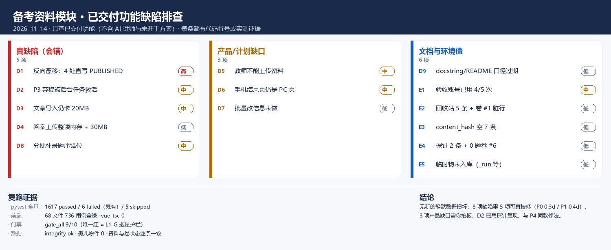
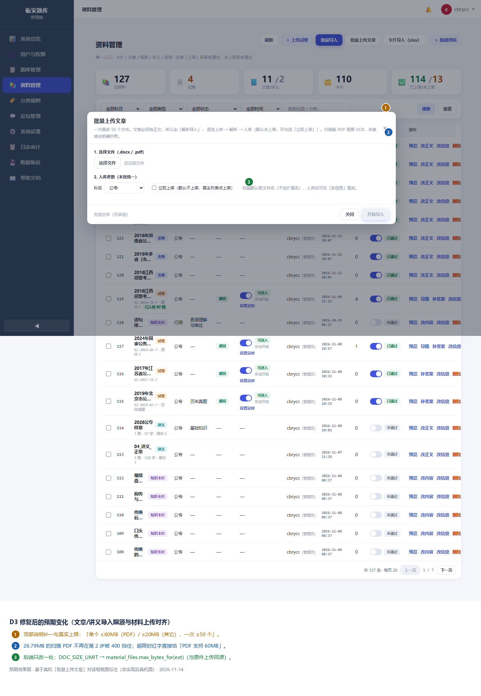

# 备考资料模块 · 已交付功能缺陷全面排查 v1

> 排查时间：**2026-11-14 上午**（后端 8001 / 前端 9527 都在跑，库为当前生产库）
> 范围：**只查已交付的功能**（卡片/文章/讲义/试卷、上传、导入、OCR P1–P4、答案、考试开关、三端展示），
> **不含 AI 讲师**、不含"还没开工的方案"。每条都附代码行号或真机/DB 证据，可复跑。

---

## 0. 一句话结论

**有 8 项未解决缺陷**（其中 **1 项是数据一致性的真缺陷**、**1 项是今天用探针复现的草稿复活**、1 项限额不一致、1 项性能/口径不一致、1 项产品缺口、1 项端适配缺口、1 项计划缺口、1 项题序缺陷），另有 **1 类文档口径漂移**与 **5 类环境/数据债**。

**没有发现新的静默数据损坏**：`integrity ok`、孤儿原件 **0**、4 套已发布卷与资料状态**逐条一致**、`question_bank=397` 未变。
**今天新增 2 项**（D2 弃稿复活、D3 文章导入限额没跟上），其余为 11-12 那份复盘的既有条目，本轮逐条在当前代码上重新验过（行号已更新）。

---

## 1. 排查方法（可复跑）

| 手段 | 做了什么 |
|---|---|
| 代码逐点核对 | 对 11-12 复盘里的每个"仍开放"条目，在当前代码里重新定位行号（不引用旧行号） |
| 单元/全量回归 | `cd backend && pytest tests -q` → **1617 passed / 6 failed / 5 skipped**（6 条为既有环境失败，清单见 §3.3） |
| 前端 | `npx vitest run` → **68 文件 / 736 用例全绿**；`vue-tsc` → **0** |
| 门禁 | `gate_all` → **9/10**（唯一红 = L1-G 题量护栏，数据量不是代码） |
| 数据快照 | `_run/audit_snapshot.py`（只读）：资料 134（−1:5 / 0:15 / 1:114）、卷 6、草稿、回收站、考试次数、孤儿、一致性 |
| 缺陷复现 | 临时探针 `backend/tests/test_tmp_resurrect_probe.py`（**跑完即删**）证明 P3 弃稿会被救活 |
| 真机 | 本轮还实测了 57MB 上传（0.9s）、41 页整卷 OCR（240.6s）、43 页答案件（0.4s 返回 / 冷 240.9s / 热 144.9s） |

---

## 2. 缺陷清单（按严重度）

### 2.1 真缺陷（会造成错误状态或错误行为）

| # | 缺陷 | 证据（当前代码/实测） | 影响 | 建议 |
|---|---|---|---|---|
| **D1** | **反向漂移：4 处直写 `paper_type="PUBLISHED"`**，资料侧不知情 | `catalog/papers.py:450`、`catalog/paper_generation.py:771`、`platform/admin_approval.py:245`、`platform/teacher.py:1383`（本轮逐个 grep 确认仍在） | 会出现「资料显示未上架、学生却能考」；P5 只做单向同步，堵不住反方向 | 过渡期先加**一致性巡检**（已有 `scripts/check_material_paper_drift.py`，可接进 gate/日常）；根治走《试卷管理收敛》P0–P4（需另批准） |
| **D2** | **P3 导题：用户「放弃草稿」后，跑完的后台任务会把草稿救活成 `pending`**（今天复现） | `services/paper_ingest/service.py:171` 无条件 `draft.status="pending"`；探针实测：放弃后 `fill_draft` 结束 → `pending`、`item_count=1`，断言失败（`缺陷复现：草稿被救活成 pending`）。同批 P4 已修（`answer_ingest/service.py:290` 早退） | 弃稿语义失效：列表里冒出"幽灵草稿"，管理员以为没点成功 | **3 行加固**（`if draft.status == "discarded": return draft`）+ 1 例回归；与 P4 同款口径 |
| **D3** | **文章/讲义导入仍卡 20MB**，与新上限（PDF 60MB）不一致 | `materials.py:3492 DOC_SIZE_LIMIT = 20MB`、`:3509` 校验；材料上传已改 `material_files.max_bytes_for()`（PDF 60MB） | 26.79MB 的扫描答案/扫描讲义走「批量上传文章」仍会 400「文件超过 20MB」 | 一行改 `max_bytes_for(ext)`（按扩展名），错误文案同步；1 例测试 |
| **D4** | **答案上传仍是"整读内存 + 30MB 硬上限"** | `materials.py:2487 raw = file.file.read()`、`:2490` 30MB 判定 | 30MB 答案件 = 30MB 峰值内存；且上限与材料（PDF 60MB）不一致（今天那份 26.79MB 恰好能过） | 与材料上传同款流式落盘（>8MB 走 `_spool_upload`），上限改 `max_bytes_for("pdf")`；低优先 |
| **D8** | **分批补录会让题序错位** | `catalog/question_import.py:1588 order_base = next_question_order(...)` 为"追加"模型；11-12 实证 60/100 条错位 | 补录第二批后题号与卷内顺序对不上，需跑 `fix_relation_order.py` 事后修 | 改排序口径（优先用题号）属热路径，**需你批准**再做；过渡期先文档标注"整卷一次性导入" |

### 2.2 产品/计划缺口（不是 bug，是"该有但没做"，需你拍板）

| # | 缺口 | 证据 | 影响 |
|---|---|---|---|
| **D5** | **教师不能上传资料** | `materials.py` 内 `_require_admin` 39 处；上传端点同判据（教师只能**看**未上架） | 教师无法参与建库；验收表 B4 一直挂着 |
| **D6** | **手机考试结果页仍是 PC 页** | `src/views/student/mobile/mobile_answer.vue:805` → `router.replace('/paper-result?…')`；路由指向 `$vtj/vue/paper_result.vue`（PC 版），**无 mobile 结果页文件** | 手机交卷后跳 PC 版面（R3 禁改 `.vtj` 模板 → 只能新建手写页 + 路由 104→105 双改点） |
| **D7** | **批量改信息未做**（A8） | 无 `batch-meta` 端点（只有 batch-delete / batch-create / batch-image）；弹窗一次一条 | 170+ 套卷补元数据只能一条条改 |

### 2.3 文档口径漂移（文档债）

| # | 现象 | 证据 | 处置 |
|---|---|---|---|
| **D9** | ①`admin_upload_file` docstring 仍写「只守单文件上限 20MB」；②`docs/README.md` 索引里 **39 行**状态过期（如"待你确认"其实已交付：资料多格式导入、扫描件 OCR P3 等）；③11-12 复盘里的 8 项没有回写"哪些已修" | `materials.py:2847`；`docs/README.md` 索引 | 本轮一并改：docstring 改 60MB 口径；README 只改**与本次结论冲突**的行；复盘文档加"2026-11-14 复核"表 |

---

## 3. 已知边界（**不是缺陷**，先说清，免得验收误判）

| 项 | 说明 |
|---|---|
| 41 页整卷只拆出 114 题、四选项齐全 63% | OCR 能力边界，P3 设计前提就是"草稿 + 人工核对"；改进建议见 §6 |
| 扫描件上传后不自动导题 | P3 有意：扫描件 OCR 要几分钟，上传请求里跑会超时；提示回列表点「导题」 |
| `gate_all` 9/10 | L1-G 是题量护栏（397 < 3085/3632），属数据量，不是代码缺陷 |
| 后端 6 条测试失败 | 既有环境失败，清单见 §3.3，本轮**未新增** |
| 上传的试卷资料 `content_hash` 为空 | 上传按文件 sha256 去重；`_find_duplicate_material_id` 有 NULL 兜底，行为正确 |

### 3.3 后端 6 条既有失败（与本次改动无关）

1. `test_root_endpoint_serves_spa`（SPA 静态未构建）
2. `test_get_endpoint_metrics`
3. `test_checkin_routes_are_registered`（新版 FastAPI 路由内省）
4. `test_media_api::test_get_full_and_head`（HEAD 缺 content-length）
5. `test_router_registration::test_critical_routes_are_registered`
6. `test_practice_unified::TestMixedSources::test_recent_records_all_sources_and_jumps`

> 同一清单在 2026-11-09 已用 `git worktree` 在旧提交上复现过（见 `上传即建卷_考试开关与定时_P1P2_交付记录_v1.md` §7），非本轮引入。

---

## 3.4 一页总览（数字均来自本轮实测）

---

## 4. 环境与数据债（不影响学生，但会绊验收）

| # | 项 | 实测 | 处置建议 |
|---|---|---|---|
| E1 | 验收账号考试次数 | `user_id=3 × paper_id=5` 已用 **4/5** | 再验 1 次前先清 `exam_record`（备份后） |
| E2 | 回收站 5 条 + 卷 #1 脏行 | 回收站 #16/#20/#25/#47/#129；卷 #1 `ENDED`、0 题、100 分 | 一句话授权即可清 |
| E3 | `content_hash` 为空 7 条 | 5 条无正文老资料 + 2 条探针（探针清了回 5） | 与 E4 一起清 |
| E4 | 探针 2 条 + 自动建的 0 题卷 | material 138（41 页）/139（5 页）+ 卷 #6 `GZ-2025-LK` DRAFT | **等你验完**再清（见 §8） |
| E5 | 未入库的临时物 | `_run/`（30+ 探针脚本）、`docs/plans/assets/2024国考公专解析冒烟/{contact_sheet,images_all,images_scenario8}`、`扫描件OCR_P2/04_SB_*.png` | 你说清我就清，否则留着当证据 |

---

## 5. 建议修复批次（需你批准，未动代码）

| 批次 | 内容 | 估时 | 风险 |
|---|---|---|---|
| **P0（建议立刻）** | D2 弃稿复活（3 行 + 1 测）、D3 限额对齐（1 行 + 1 测 + 文案）、D9 文档口径（只改文档） | **0.3d** | 极低：D2 与 P4 同款、D3 与材料上传同款 |
| **P1（建议本轮）** | D1 过渡护栏：把 `check_material_paper_drift.py` 接进门禁/日报 + 列表页「资料与卷状态不一致」提示 | 0.4d | 低：只加巡检与提示，不动 4 处写入口 |
| **P2（需拍板）** | D5 教师上传+审核闭环 / D6 手机结果页 / D7 批量改信息 / D8 题序根治 | 0.5d–2d/项 | 中高：D6 要新增路由（L6 104→105 双改点）、D8 动热路径 |

> 规则：**未经你批准不写代码**。P0/P1 我可以先出方案与效果图（D3 有可见文案变化，图见下），你点头再动手。

---

## 6. 41 页整卷质量的改进建议（未批准，供决策）

| 建议 | 预计效果 | 量级 |
|---|---|---|
| 题号识别专项（三位数 `101.`、题号与正文粘连） | 缺号 32 → 个位数 | 0.5d |
| 跨页/跨栏选项合并 | 四选项齐全 63% → 预计 85%+ | 0.5d |
| 卷内声明题数校验（125 题只拆 114 → 点名缺哪几题） | 减少人工对照 | 0.2d |

---

## 7. 除 AI 讲师外，备考资料模块"已定但未推进"的任务（回答第 3 问）

> 判定口径：**有方案/计划文档、但代码或验收没做完**；已实施完成的（含今天 P4）不在列。

| # | 任务 | 现状（实测） | 卡点 | 估时 |
|---|---|---|---|---|
| 1 | **试卷管理收敛 P0–P5**（单一入口 + 上架即审批） | **页面层已收敛**（审批页下线、`/admin/papers` redirect）；**接口层未收敛**：4 处仍直写 `PUBLISHED`（=D1） | 需拍板是否删/改这 4 个旧入口 | 0.5–1d |
| 2 | **教师上传 + 审核闭环** | `_require_admin` 全拦；教师只能看 | 产品决策：开放到什么程度 | 0.5–1d |
| 3 | **按班级/学生下发资料** | `material_target` 表**不存在**（grep 无）；方案 v1 待批；且 `banji` 表 0 行、`sys_user.class_name` 30/30 为空 | 先要有班级数据 | 2–3d |
| 4 | **资料内容格式与分类规范 v2 + 机检校验器** | 文档是草案；卡片有 E001–E010 校验，**讲义/试卷无校验器、无模板、无预检接口** | 需拍板规范 v2 | 1.5–2d |
| 5 | **手机端考试结果页** | 无 mobile 结果页（=D6） | 要新增路由（L6 104→105） | 1–1.5d |
| 6 | **批量改信息**（A8） | 无端点（=D7） | 无 | 0.5d |
| 7 | **分批补录题序根治** | 追加模型（=D8） | 动热路径，需批准 | 0.5d |
| 8 | **管理端画风统一 E1–E5** | 方案「待你拍板 E1–E5」，未写代码 | 需拍板 | 2–3d |
| 9 | **教师端「待审稿」徽标** | 已批准效果图里标"落点未拍板" | 需定落点 | 0.2d |

**已裁定不做 / 不算任务**：视频分片上传（D2=A）、回收站彻底删除（A6 撤销）、旧版页再搬（S2/S3/S4 已完成）。
**验收类（不是开发任务）**：学生端模块化 P3 手工验收、三端一致性 RT-10 手工验收、P3 扫描件界面验收（今天这份清单）。

---

## 8. 那两个探针是干嘛的（回答第 2 问）

| 探针 | 干什么用 | 现状 |
|---|---|---|
| `41页整卷探针_2025多省联考公安`（material **138**，卷 #6） | 用**真实 41 页扫描试卷**（56.97MB）验证 P3：上传上限、异步导题、进度、整卷拆题质量 | **今早已有一份 `pending` 草稿：114 题**（draft 5，08:09 创建、08:16 完成 —— 是本机 08:09 的一次「导题」点击，不是我昨晚跑的那次；昨晚那次已放弃）。你可以直接打开看 114 题的真实质量，也可以放弃它、再点「导题」看实时 `OCR x/41 页` 进度 |
| `验收探针_扫描5页_请勿上架`（material **139**） | 5 页子集，专门给界面验收：一打开就有 **19 题 + 4 条体检提示**，方便你 3 分钟核对 | `pending` 草稿 19 题（draft 4） |

**现在需要你做什么**：只有一件事——按 `docs/plans/P3扫描件导题_界面验收清单_v1.md` 走 4 步（约 3 分钟）：
①搜「探针」看到两行 → ②41 页那行点「导题」看进度（或直接开现有 114 题草稿）→ ③5 页那行点「待确认」看 19 题 + 4 条警告 → ④抽查后点「放弃草稿」（零写库）。
**不做也行**：探针不影响学生（都未上架、卷是 DRAFT）；你验完说一声，我把两条探针 + 卷 #6 一起清掉。

---

## 9. 归档

| 物 | 位置 |
|---|---|
| 本报告 | `docs/plans/备考资料模块_已交付功能缺陷排查_v1.md` |
| 缺陷分级图 / 限额文案预期图 | `docs/plans/assets/备考资料缺陷排查/01_缺陷分级总览.png`、`02_预期效果_文章导入限额对齐.png` |
| 数据快照脚本 | `_run/audit_snapshot.py`（只读） |
| 复活复现探针 | 临时文件已删（证据见 §2.1 D2 的 pytest 输出） |
