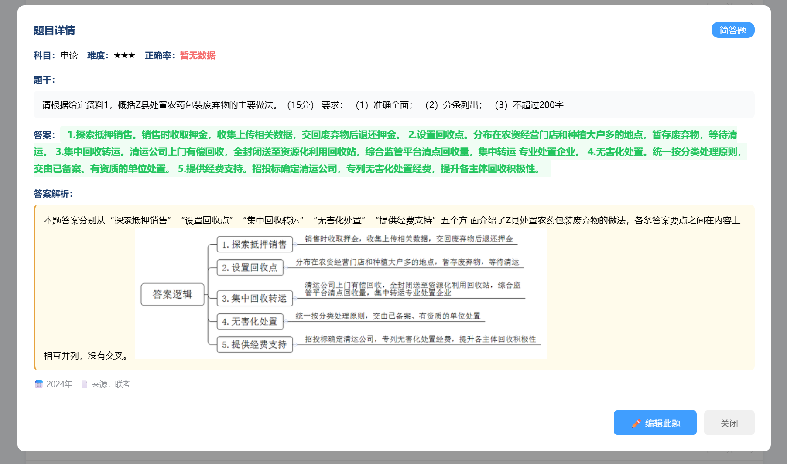
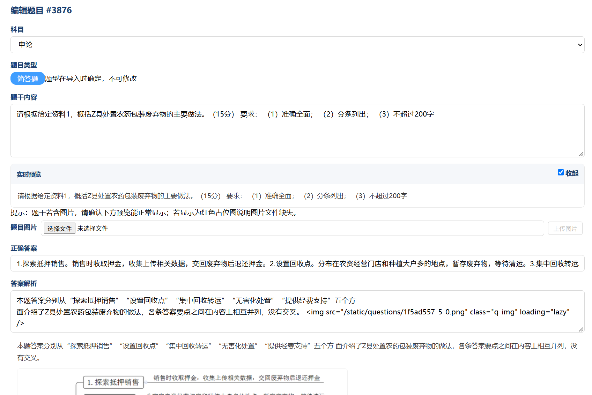

### 一、学生端问题反映
# 1.在快速练习功能模块中，申论题目、行测和公专题目的数量完全不对标教师端中和管理员中的题目数量；请务必实现教师端、、学生端和管理员端的通信机制顺畅、数据流保持一致

# 2.在快速练习中，申论的答题卡页面设计完全不达标，如图所示，请务必将学生端的申论题目的答题卡页面展示处理得体、美观、分段清晰（针对材料内容），考虑使用富文本展示可以将所有格式的内容展示；同时处理妥当学生端中行测和公专的复合题目的展示（不能出现题目缺失断层、导致用户无法了解题目内容得到情况）

# 3.在快速练习中，行测的考点分类出现严重问题，如图所示、 、 、 、 、 、。现要求考点分类只下钻到公安联考中主要考察的部分，千万不能过度分类导致出现如图显示的情况；其余的均分类只“其他”，公专和申论也是如此，不要出现重复的“其他”考点的分类

### 二、教师端问题反映
# 1.题目管理模块中，出现进行申论题目预览和编辑，材料内容缺失如图所示、，将内容展示和编辑设计成富文本编辑支持所有内容展示与编辑，不要再出现这种材料被吞没的问题

# 2.题目管理模块中，系统对公专、行测中的复合题目处理严重不合理--会将复合题目的题干材料切分错误甚至不显示（也是考虑设计成富文本编辑展示），复合题目中子题目被切割展示，但是实际的关联不强或者不明显，导致可能出现在学生端答题时子题目展示却缺失了相应的材料内容的情况

# 3.题目导入模块中，进行复合题目的识别和导入匹配依旧存在严重问题--会将复合题目的材料错误切分到上一道复合题目的最后一道题目题干中或者答案解析中
