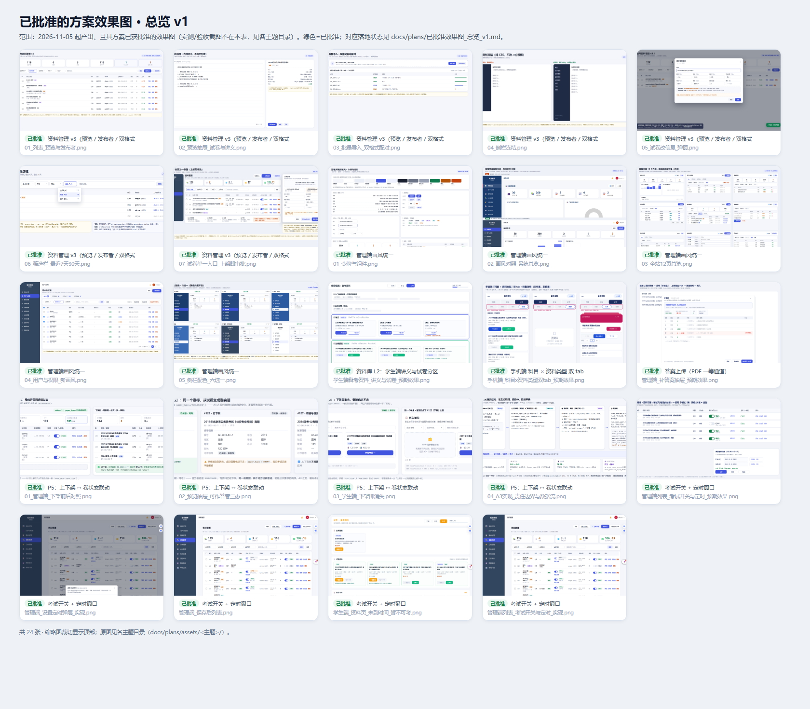
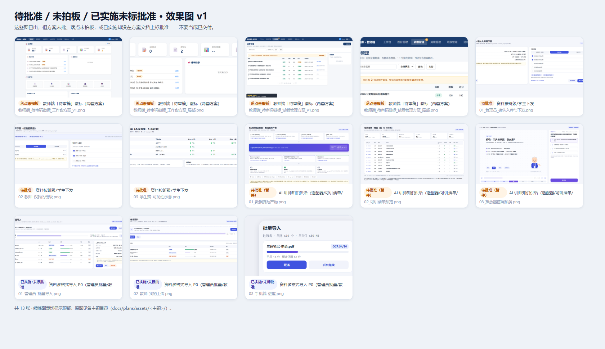

# 已批准效果图 · 总览 v1

> 日期：2026-11-12　｜　分支：`feat/material-multi-format-import`（main 未动）
> 起因：你要求「把所有批准的效果图整理一下」。本文是一张**可核对的总表** + 两张**拼图**，把 11-05 以来所有方案期效果图按「批准 / 未批准」分开，并标明落地状态。
> 拼图（真实渲染，非手绘）：[`assets/效果图总览/01_已批准的方案效果图.png`](assets/效果图总览/01_已批准的方案效果图.png)　｜　[`assets/效果图总览/02_待批准与未拍板.png`](assets/效果图总览/02_待批准与未拍板.png)



---

## 0. 口径（先说清"批准"与"效果图"怎么算）

| 词 | 本文的定义 |
|---|---|
| **效果图** | **方案阶段产出**的界面预演（用于拍板"要做成什么样"）。**实测/验收截图不算**——那些是"做完长什么样"，另有目录（见 §3）。 |
| **已批准** | 满足其一：①方案文档标题/状态标 **✅ 已批准**；②有**裁定记录**（如 `待决策裁定结果_v1.md`、A0 交付记录里的 E1–E5）；③已按该方案交付并验收（交付记录可查）。 |
| **范围** | **2026-11-05 起** 产出或与 11-05 后方案配套的效果图。11-05 之前的「备考资料_*」等历史轮次不在本表（§4 给目录，要一并整理再说）。 |

**统计**：`docs/plans/assets/` 下共 **55 个主题目录 / 382 张图 / 79 MB**；其中**方案效果图 37 张**（已批准 24 + 未批准 13），其余 345 张是实测/验收/证据/模板图。

---

## 1. 已批准并已落地（7 个主题 / 24 张）

| # | 主题 | 张数 | 方案 / 批准依据 | 落地状态 | 目录 |
|---|---|---|---|---|---|
| 1 | **资料管理 v3**（预览 / 发布者 / 双格式 / 上架即审批） | 7 | `资料管理v3_预览发布者类型双格式试卷讲义_方案_v1.md`；**19 条待决策全部裁定**（`待决策裁定结果_v1.md`），方案冻结 v3.1 | ✅ 已落地：A/B/C 批全部交付（同目录另有 A4/B1/B2/C1/C2/C3 等实现截图） | `assets/资料管理v3/` |
| 2 | **管理端画风统一**（令牌 / 12 页 / 侧栏配色） | 5 | `管理端画风统一_方案_v1.md`；E1–E5 裁定（E1=A / E2=A / E3=C 保留 emoji / E4=B / E5=A，见 A0 交付记录） | ✅ 已落地：A0 基座 + A3 预览抽屉 + A5 侧栏冻结（06/A0/A3/A5 为实现图） | `assets/管理端画风/` |
| 3 | **资料库 L2**：学生端讲义与试卷分区 | 1 | `资料库_讲义与试卷展示及投放位_方案_v1.md`（✅ 已批准，L1+L2 已交付） | ✅ 已落地：`资料库L2实际效果/` 有真机图 | `assets/资料库L2预期效果/` |
| 4 | **手机端 科目 × 资料类型 双 tab** | 1 | `手机端资料类型双tab_方案_v1.md`（✅ 已批准） | ✅ 已落地：`手机端双tab实际效果/` 有真机图 | `assets/手机端双tab预期效果/` |
| 5 | **答案上传**（PDF 一等通道） | 1 | `答案上传_PDF与Excel多通道_方案_v1.md`（✅ 已批准，P4 已交付） | ✅ 已落地：`答案上传_实际效果/` | `assets/答案上传_预期效果/` |
| 6 | **P5 上下架 ↔ 卷状态联动** | 4 | `P5_上下架联动_方案对比_v1.md`（A3 方案已批准并交付） | ✅ 已落地：单向同步 + 漂移巡检（实测 0 条漂移） | `assets/P5联动预期/` |
| 7 | **考试开关 + 定时窗口** | 5 | `上传即建卷_上传即导题_考试开关与定时_方案_v1.md`（✅ 已批准，P2 已交付） | ✅ 已落地：后 4 张为「实现/实测」图；11-12 又修了开关回包缺陷 | `assets/考试开关与定时预期效果/` |

---

## 2. 未批准：别当成已交付（4 个主题 / 13 张）

| # | 主题 | 张数 | 当前状态 | 缺什么 / 下一步 | 目录 |
|---|---|---|---|---|---|
| 1 | **教师端「待审稿」徽标**（工作台版 / 试卷管理版） | 4 | 🟠 **落点未拍板**（两套方案都出了图，未写码） | 只需你一句「放工作台」或「放试卷管理页」 | `assets/教师端待审稿徽标/` |
| 2 | **资料按班级/学生下发** | 3 | 📋 **待审核批准**（`资料上传与下发_管理员教师端_方案_v1.md`，未写业务代码） | 待拍 D10–D16（下发粒度/权限/回执等） | `assets/资料下发/` |
| 3 | **AI 讲师知识供给**（适配器 / 可讲清单 / 播放器首屏） | 3 | 🟡 **待审批 + 暂停中**（`AI讲师_知识供给适配器与播放器衔接_方案_v1.md`） | 待拍 D1–D6；恢复后按 T0–T10 排 | `assets/AI讲师_知识供给/` |
| 4 | **资料多格式导入 P0**（管理员批量 / 教师上传 / 手机进度） | 3 | 🔵 **已实施，但方案文档仍标「待你最后确认后开工」**（流程缺口） | ①文档状态需回填为已批准；②图里"教师上传""手机端进度"两块**未做**（教师上传见盘点 §3-2） | `assets/资料导入_P0/` |



> 第 4 项特别说明：这三张图当时被当作 P0 计划的界面依据，**代码确实按它做了**（上传页/批量导入已上线），但**方案文档从未把状态从"待批准"改过来**。这是文档流程缺口，不是功能缺口；已在此登记，等你确认后我把文档状态补齐。

---

## 3. 不在本表：实测 / 验收 / 证据图（345 张）

这些是"做完之后拍的"，按主题列一下（要看图直接进目录）：

| 类别 | 目录（示例） |
|---|---|
| 考试链路实测 | `手机考试与列表状态/`、`考试结果口径修复/`、`考试开关修复/`、`交卷用时与满分修复/`、`三端验收/` |
| 资料管理实现 | `资料管理v3/`（A4/B1/B2/C1/C2/C3 等实现截图）、`资料库L2实际效果/`、`资料库L3手机端/`、`资料库L4投放位与文章批量/`、`手机端双tab实际效果/`、`答案上传_实际效果/`、`文章批量上架/` |
| 题库真卷 | `2024国考公专解析冒烟/`（81 张：抽图/题序/冒烟） |
| 页面细节修复 | `导航高亮跟随路由/`、`备考资料返回首页/` |
| 测试素材/模板 | `测试上传数据/`、`资料模板/`、`资料导入_P0/`（同上，已计入效果图） |
| 11-05 之前的历史轮次 | `备考资料_*/`（约 27 个目录、150+ 张，覆盖卡片 v4/v5、三端、平板、徽章等） |

---

## 4. 复核方式（可复跑）

```powershell
# 目录与图片统计
python _run/list_assets.py          # 55 目录 / 382 图 / 79 MB
# 重新渲染两张拼图（需要 9333 端口的 headless Edge）
python _run/build_gallery.py
node _run/cdp_shot.cjs <file:///...gallery_approved.html> docs/plans/assets/效果图总览/01_已批准的方案效果图.png 1680 1470 1
node _run/cdp_shot.cjs <file:///...gallery_pending.html>  docs/plans/assets/效果图总览/02_待批准与未拍板.png 1680 970 1
```

- 拼图里的缩略图**按顶部裁切**（`object-fit: cover; object-position: top`），所以长截图只露上半部分；看全图请进对应目录。
- 状态判定没有"猜"：每条都对着方案文档标题/状态行或裁定记录写；第 2 节第 4 项的"流程缺口"是这次核对时才发现的（文档标待批、代码已按它实施）。

---

## 5. 更新记录

| 日期 | 变更 |
|---|---|
| 2026-11-12 | 首版：37 张方案效果图分为「已批准 24 / 未批准 13」；两张拼图；把「资料多格式导入 P0 已实施但文档未标批准」登记为流程缺口 |
