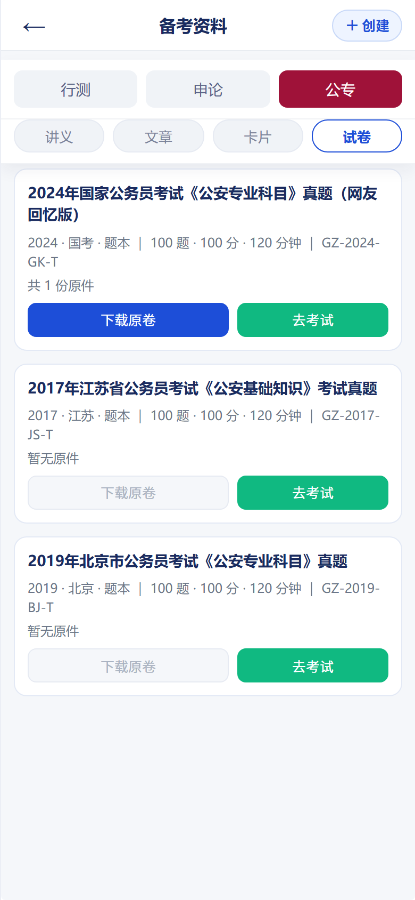
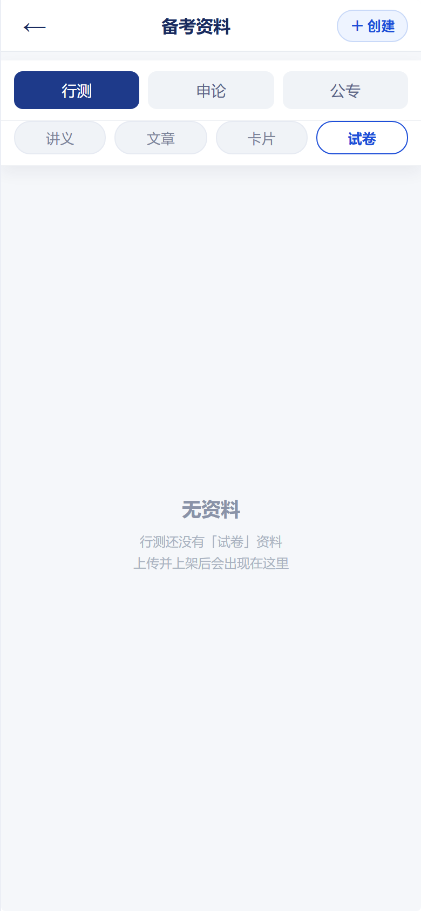
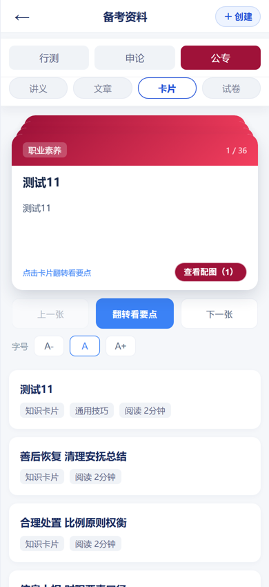

# 手机端「科目 × 资料类型」双 tab 交付记录 v1

> 需求（你的原话）：「在手机端『行测/申论/公专』这个 tab 下再加一个资料类型的 tab，先分四类：**讲义、文章、卡片、试卷**……没有上传过资料的科目-类型界面就显示『无资料』。」
> 方案：`docs/plans/手机端资料类型双tab_方案_v1.md`（2026-11-09 你已批准「可以」）
> 状态：**✅ 已完成并实测**

---

## 0. 一页结论

| 项 | 结果 |
|---|---|
| 二级 tab | ✅ 科目行下方新增 `讲义 / 文章 / 卡片 / 试卷`，顺序与你给的一致 |
| 两级过滤 | ✅ `GET /api/materials?subject=&type=`（后端零改动，L1 的投放位过滤自动生效） |
| 每类渲染 | ✅ 讲义=在线阅读+下载原件；试卷=元数据+下载原卷+去考试（不可考置灰+原因）；卡片=3D 栈+列表；文章=列表+点开读正文 |
| 空态 | ✅ 大字「无资料」+「{科目}还没有『{类型}』资料」+「上传并上架后会出现在这里」，**垂直居中** |
| 深链 | ✅ `?subject=&type=` 可直达（非法值回落默认，不白屏） |
| 默认 tab | ✅ 卡片（37/26/36 条，不会一进来就空） |
| L3 横滑区 | ✅ 已移除（避免同资料出现两次），卡片 3D 栈保留 |
| PC 端 | ✅ 未改动 |
| 测试 | ✅ `vitest` **58 文件 / 647 用例全绿**（新增 3 例）；`vue-tsc` 0 错误 |

---

## 1. 实现要点

| 文件 | 改动 |
|---|---|
| `src/utils/materialShelf.ts` | 新增 `MOBILE_TYPE_TABS`（四类顺序）、`DEFAULT_MOBILE_TYPE='card'`、`normalizeTypeTab()`（深链归一化）、`emptyTextOf(subject,type)`（空态文案）。原 `groupShelfItems()` 保留（PC/其它地方仍可用） |
| `src/views/student/mobile/mobile_materials.vue` | ①两级 tab（外层 `.tabbar` 一起 sticky，避免第二行被第一行压住）；②`activeType` 状态 + `switchType()`（切类型关弹层、重置卡片栈）；③`library.load({subject,type})`；④内容区按类型分支；⑤空态居中；⑥列表仅在 `materials.length` 时渲染（空态才能占满剩余高度） |
| `src/utils/__tests__/materialShelf.spec.ts` | +3 例：tab 顺序、深链归一化（非法/空回落）、空态文案（三科目×类型） |

**零后端改动**：`GET /api/materials` 早已支持 `type`；`status=1 + placement∈{library,both}` 的过滤在 L1 已生效。

---

## 2. 过程中修掉的两个界面问题（如实记录）

| # | 现象 | 原因 | 处理 |
|---|---|---|---|
| 1 | 类型 tab 的**上半截被科目 tab 压掉** | 旧样式把 `position: sticky; top: 56px; z-index: 30` 写在 `.tabs`（科目行）上；新增第二行后它滚动时会盖住第二行 | 把两级 tab 包进 `.tabbar`，sticky 移到 `.tabbar`，`.tabs` 恢复 `static` |
| 2 | 空态文案**贴在屏幕最底部** | `main.list` 是 `flex:1`，即使没数据也占满高度，把空态挤到底部 | `main.list` 加 `v-if="materials.length"`；空态加 `.empty-page { flex:1; justify-content:center }` |

---

## 3. 真机尺寸截图（CDP 390×844@2，非示意图）

截图里的真实数据：公专试卷 3 条（2024 可下载可考；2017/2019 无原件故「下载原卷」置灰）、卡片 36 张；行测试卷 0 条 → 空态。

---

## 4. 验收对照（你提的 8 条）

| # | 操作 | 结果 |
|---|---|---|
| 1 | 公专 + 试卷 | ✅ 3 条，含下载/去考试 |
| 2 | 行测 + 试卷 | ✅ 无资料（"行测还没有『试卷』资料"） |
| 3 | 公专 + 讲义 | ✅ 无资料（2 条讲义未上架；上架即现） |
| 4 | 行测 + 文章 | ✅ 1 条，可读正文 |
| 5 | 公专 + 卡片 | ✅ 3D 栈 + 列表 |
| 6 | 切科目保类型 | ✅ 行测→公专仍停在「试卷」；反向亦然 |
| 7 | 深链 | ✅ `?subject=gongzhuan&type=paper` 直达 |
| 8 | 390 宽 | ✅ 四个类型 tab 一行放得下，无横向滚动 |

---

## 5. 已知边界

| # | 事项 | 说明 |
|---|---|---|
| 1 | 视频没有 tab | 全库 0 条；将来有内容时往 `MOBILE_TYPE_TABS` 加一项 + 一个渲染分支即可 |
| 2 | 手机端"在线阅读"仍是弹层 | 与 PC 阅读器非同一实现（样式各端适配），正文来源同一接口 |
| 3 | 类型 tab 不显示数量 | 按 D-T4 决定；要显示需额外 3 次请求 |
| 4 | 切科目不重置类型 | 按方案：保持用户所选类型（若该类型无数据则显示空态） |

---

## 6. 回滚

- 纯前端：`git revert` 本批即可；
- 只想回退 tab：删掉 `.type-tabs` 块 + `type: activeType.value` 一处参数，即回到"一次拉全部"的 L3 形态（横滑区代码已删，回滚需连 L3 一起 revert）。

---

## 7. 下一步

**L4（方案最后一批）**：上传试卷时选投放位（仅考试/仅资料/都投）+ 管理端「投放位」列 + **文章批量上传**（解析链路）。
完成后 W1 闭环，进 W2 一致性收口（`POST /admin` 默认未上架、教师可预览待审、上传即上架开关、创建通道去重）。
