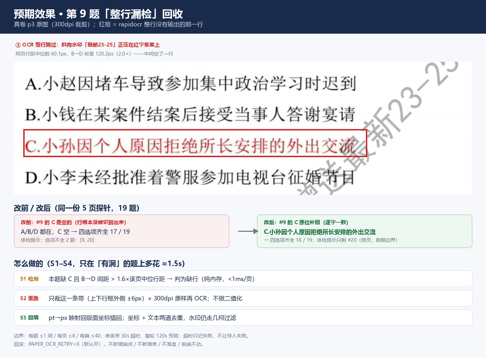
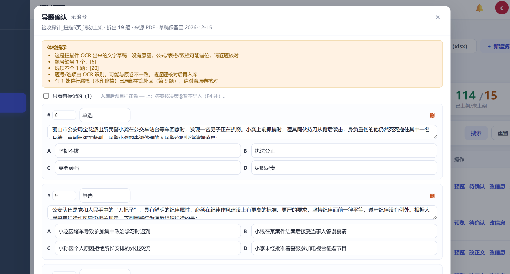

# 扫描件缺行恢复（OCR 整行漏检）· 方案 v1

> **状态**：✅ 已批准（2026-11-14「按建议，严格遵守全局规则」）· 交付记录见 **§9**
> **分支**：`feat/material-multi-format-import`（`main` 未动，未合并）
> **前序**：`扫描件选项与水印加固_方案_v1.md`（T1 坐标透传 / T2 水印几何过滤 / T3 缩进补标签 / T4 选项结构校验）

---

## 1. 触发与症状

同一份 5 页探针（`验收探针_扫描5页_请勿上架`，material 139）重新导题后 **draft #6**：

| 指标 | 结果 |
|---|---|
| 题数 | 19 |
| 四选项齐全 | **17 / 19** |
| 缺 / 空选项 | **`[9, 20]`** |

- **#20**：探针只裁了真卷 p1–p5，该题选项落在 **p6** → **数据边界**（不是识别问题，本轮不处理）；
- **#9**：**C 选项为空**，且它的空不是"标签丢了"，而是**整行没被 OCR 输出**。

## 2. 坐标级证据（真机，可复跑）

`rapidocr` 200dpi、`with_layout=True`，第 3 页 34 个正文框按 y 排序（`_run/q9_ocr_items.json`）：

| 行 | y(px) | x(px) | h(px) | 与上一行的间距 |
|---|---|---|---|---|
| 9.题干首行 | 749.8 | 264.3 | 35.4 | 58.4 |
| 9.题干二行 | 811.7 | 199.7 | 34.2 | 61.9 |
| 9.题干三行 | 871.2 | 200.9 | 30.7 | 59.5 |
| **A** | 932.5 | 266.7 | 30.7 | 61.3 |
| **B** | 991.5 | 265.5 | 30.7 | 59.0 |
| **（缺失行）** | — | — | — | — |
| **D** | 1111.7 | 265.5 | 33.0 | **120.2** |

- 该页**行间距中位数 = 60.1px**（34 行样本，min 1.8 / max 184.5）；
- **B → D = 120.2px = 2.0× 中位数** → 中间**正好缺一行**；
- 把该页按 **200dpi、300dpi 各整页跑一遍**：两次**都没有任何框包含「小孙」** → 不是标签丢失；
- 原图放大可见：斜向水印「最新23…」**正压在这一行上**（红字答案 + 水印重叠）→ 行检测被水印干扰，**整行跳过**；
- **可行性实验**（`_run/exp_q9_recover.py`，6 种变体只读 PDF）：把该行所在条带**按 300dpi 原样裁剪**再 OCR → 逐字回收到
  `C.小孙因个人原因拒绝所长安排的外出交流`。二值化（阈值 120/150）与 400dpi **反而退化**（「孙→料」「安排→安非」），
  **所以重跑一律用「原样 + 300dpi」，不做任何预处理**。

## 3. 为什么 T1–T4 修不了

| 已有手段 | 适用缺陷 | 对 #9 无效的原因 |
|---|---|---|
| T1 坐标透传 | 拿到每个框的位置 | 只暴露了"缺"，本身不产出文字 |
| T2 水印几何过滤 | 水印框混进正文流（`五星好`、`X`） | 被剔除的是**水印框**；被跳过的**正文行**不会因此出现 |
| T3 缩进补标签 | 行在、只是 `C.` 标签被吃（#3） | #9 **行根本不在**，没有行可补 |
| T4 选项结构校验 | 标"可能粘连" | 只加提示，不改文字 |

→ 必须新增一步：**先判断"本题少了一行" → 再到那个带重跑 → 把行插回去**。

## 4. 方案（S1–S5）

新增模块 `backend/app/services/paper_ingest/ocr_retry.py`（纯函数 + 一处 sidecar 调用），
`readers.read_pdf_ocr()` 里插一行；worker 与 sidecar 各加一个"只识别一个矩形"的能力。

### S1 缺行检测（纯函数，零 IO）

```python
find_holes(rows, *, gap_ratio=1.6, min_extra=20.0) -> list[dict]
```

1. 按题号把行分块（与 `splitter` 同口径；页首无题号的续块跳过，不能归属就不动）；
2. 用 `splitter.split_options` 算出本题**缺哪些选项字母**：`missing` 必须满足 **1 ≤ |missing| ≤ 3**
   （四个全缺 = 整题没选项，无法定位，跳过；不缺 = 不是缺行）；
3. 块内按页取相邻两行的 y 间距，与**该页行距中位数**比：
   **`gap ≥ 1.6 × 中位数` 且 `gap − 中位数 ≥ 20px`**；
4. 每题**只取最大的那一个洞**；每页 ≤ 8、每篇 ≤ 40；
5. 洞 = `{page, qno, missing, y0, y1, x0, x1, gap}`，`y0/y1` 取上下两行框的**外侧边界 ±6px 容差**
   （不把邻行的字切进来，又不至于把缺行的上下沿切掉）。

> 为什么先检测后补标签：`repair_option_tags` 会把"有字没标签"的行补成 `C.`；
> 检测若排在它之后，#3 那种"行在、只是缺标签"的题会被误判成缺行。检测**必须**排在补标签之前。

### S2 定向重跑（worker `crop` + sidecar `read_region_text`）

- `rapidocr_worker.py` 新增命令：
  `{"cmd":"crop","path":..., "page":n, "rect":[x0,y0,x1,y1]（单位 pt）, "dpi":300}`
  → `page.get_pixmap(dpi=300, clip=Rect(...))` → `ocr_page(..., with_layout=True)`
  → 回 `{"t":"crop","page":n,"lines":[{text,x,y,w,h,score}]}`，**坐标换回 pt**（`pt = px × 72/dpi + 原点`）；
- `ocr_sidecar.py` 新增 `read_region_text(abs_path, *, page, rect, dpi=300, timeout=30)`：
  daemon 模式发一条命令、读一条 `crop` 事件；oneshot 模式起 `--serve` 单命令同款；
- 一律 **300dpi + 原样**（§2 实测：二值化/400dpi 会掉字）；
- 单条带 30s 超时、整轮 120s 预算；超时/异常**只记失败数，不让整份导入失败**。

### S3 回填与去重

- 回收行的 `y` 从 pt 映射回版面 px（`px = pt × layout_dpi / 72`），按 `(page, y, x)` 合并排序；
- **去重两道**（实验里同一带重跑会多吐一条残缺的 D：`D小杰去级批准差敬服参加中视台征婚书`，必须挡住）：
  1. **坐标**：与同页已有行 `|Δy| < 0.5 × 行高中位数` → 丢；
  2. **文本**：`SequenceMatcher ≥ 0.8` 且 `Δy < 1.2 × 行高中位数` → 丢；
- **水印/噪声**：回收行同样过 T2 的几何（框高 > 2.5×页行高中位数）+ 短水印词表，再过 `strip_inline_noise`；
- 回填后**照旧**走 `repair_option_tags → strip_inline_noise → drop_noise → split_questions`（链路不新增分支）。

### S4 开关与观测

- `PAPER_OCR_RETRY=0/off/false` 关闭（默认开）；关闭时**零调用、零耗时**；
- `read_pdf_ocr` 的 `meta["ocr_retry"] = {holes, recovered, rows, failed, qnos, seconds, skipped}`；
- 有补回时，草稿体检里加一条：`有 N 处整行漏检已局部重跑补回（第 9 题）` —— 让人知道"这行是补的"。

### S5 回归与验收

见 §7。

## 5. 参数与边界

| 参数 | 取值 | 依据 |
|---|---|---|
| `GAP_RATIO` | **1.6×** 中位行距 | 实测缺行 = 2.0×，正常最大 1.03×，留足余量 |
| `MIN_EXTRA` | **20px** | 防止中位数极小（稀疏页）时比例失真 |
| 洞/题 | **1** | 一题两处缺行的概率极低，且两处会连成一片 |
| 洞/页 | **8** | 41 页最坏 8×40 条带也有预算兜底 |
| 洞/篇 | **40** | 与上面配合，硬顶 |
| 重跑 DPI | **300** | 实验唯一逐字正确的组合 |
| 预处理 | **无**（原样） | 阈值 120/150、400dpi 全部掉字（§2） |
| 单条带超时 | **30s** | 实测单条带 1–2s |
| 整轮预算 | **120s** | 超出即停止补行，只记 `failed` |
| 容差 `PAD` | **6px** | 邻行字高 30–35px，6px 只碰到笔画出头 |

## 6. 影响面与风险

| 项 | 判断 |
|---|---|
| 文字版 PDF / docx | 不进 `read_pdf_ocr`，**零影响** |
| 41 页整卷 | 检测是内存计算（<1ms/页）；**有洞才重跑**，单洞 ≈1.5s；最坏 40 洞 ≈60s（原 240s → ≤300s） |
| 老 worker / 老 sidecar | 新命令是**追加**的；旧 worker 收到 `crop` 会回 `{"t":"error"}` → 记 `failed`，不崩 |
| API / 表 / 端点 | **不新增**（守 R11）、**不落盘**（不写页图）、**不改库结构** |
| 误检（空白带重跑） | 多花 ≈1.5s，回收 0 行，结果不变 |
| 重复行 | 坐标 + 文本两道去重（§4 S3） |
| 水印残片 | 回收行同样过 T2 几何与词表 |
| 回滚 | `PAPER_OCR_RETRY=0` 一行；或 revert 提交（新命令不被调用即无副作用） |

## 7. 验收口径

| 项 | 判据 |
|---|---|
| 5 页探针 #9 | **C = `小孙因个人原因拒绝所长安排的外出交流`**（逐字） |
| 5 页探针整体 | 四选项齐全 **17/19 → 18/19**（#20 仍是数据边界） |
| 41 页整卷 | 题数 / 四选项齐全数**不退化**；记录洞数、补回数、额外耗时 |
| 单元测试 | 新增 ≥8 例（检测 3 / 去重与水印 2 / 端到端 2 / 开关 1） |
| 回归 | `cd backend && pytest tests -k "ocr or paper or splitter"` 全绿 |
| 门禁 | `gate_all` **9/10**（唯一红仍是既有 L1-G） |
| 前端 | 本轮无前端改动（`vue-tsc` / `vitest` 不受影响） |
| 真机 | 重新导题一次，肉眼核对 #9 与体检提示 |

## 8. 预期效果（图）



## 9. 实施结果

### 9.1 落地内容（S1–S4 全部完成，`main` 未动、未合并）

| 文件 | 改动 |
|---|---|
| `backend/app/services/paper_ingest/ocr_retry.py` | **新增**：`find_holes()`（S1 检测，纯内存）、`merge()`（S3 两道去重）、`recover_into()`（S2 驱动 + 统计）、`enabled()`（S4 开关） |
| `backend/scripts/ocr/rapidocr_worker.py` | 新增 `crop_event()` + 常驻命令 `{"cmd":"crop"}` + 一次性 `--page/--clip`：只渲染并识别一页里的一个 pt 矩形，坐标换回 pt |
| `backend/app/services/ocr_sidecar.py` | 新增 `read_region_text()`（daemon/oneshot 两条路径）+ `OcrTimeout` + `REGION_DPI=300` / `REGION_TIMEOUT=30s` |
| `backend/app/services/paper_ingest/readers.py` | `read_pdf_ocr` 在补标签**之前**调 `recover_into`，`meta["ocr_retry"]` 回传统计；把 T2 的水印判定抽成 `base_height()` / `is_watermark_row()` 两处共用 |
| `backend/app/services/paper_ingest/service.py` | `fill_draft` 在有补回时加一条体检：`有 N 处整行漏检（水印遮挡）已局部重跑补回（第 9 题），请对着原卷核对` |
| `backend/tests/test_ocr_missing_rows.py` | **新增 18 例** |

### 9.2 5 页探针复验（真机，直跑 `readers.read_pdf_ocr`，不动库）

| 指标 | 关闭补行（基线） | 开启补行 | 变化 |
|---|---|---|---|
| 题数 | 19 | 19 | — |
| **四选项齐全** | **17 / 19** | **18 / 19** | **+1** |
| 缺/空 | `[9, 20]` | **`[20]`** | #9 修好 |
| #9 的 C | 空 | **`小孙因个人原因拒绝所长安排的外出交流`** | 逐字一致 ✅ |
| #9 flags | `选项不全(C)` | `[]` | — |
| 洞 / 补回 | — | `holes=1, recovered=1, rows=1, failed=0` | 只判到第 9 题这一处 |
| 补行耗时 | 0 | **2.4–2.7s**（3 次实测） | 单条带 |
| 行数 | 151 | 152 | +1（**没有多吐半截 D**，去重生效） |

#### 9.2.1 界面真机（2026-11-15 13:10–13:12，draft #7，material 139）

- `POST /api/materials/admin/139/parse` → draft #7 `parsing` → **119s** 后 `pending`、**19 题**、**四选项齐全 18/19**；
- 抽屉里第 9 题 **A/B/C/D 齐全、没有「选项不全(C)」标签**，体检多一条
  「有 1 处整行漏检（水印遮挡）已局部重跑补回（第 9 题），请对着原卷核对」；
- ⚠️ **旧草稿不会自动变好**：draft #6 是 11:05（这版代码上线前）生成的**快照**，
  即使换了代码，它里面的 19 条仍然是旧的 → 必须**重新导题**（或手工补那一格）。
  这也是「代码已修但界面还是空」的唯一原因。



### 9.3 41 页整卷（不退化）

下面这张表用**同一份 41 页真卷、同一台机器、同一个常驻 OCR 进程**跑两遍（关闭 / 开启），连跑 3 轮结论一致：

| 指标 | 关闭补行 | 开启补行 |
|---|---|---|
| 题数 / 不同题号 | **113 / 93** | **113 / 93** |
| 四选项齐全 | **84** | **88** |
| 缺项题数 | 29 | 25 |
| 判到的洞 / 补回 | — | **14 / 10**（`rows=11`，`failed=0`） |
| 补行耗时 | 0 | **25.9s**（整卷 OCR 124s 之外） |
| 墙钟总时长 | 246.2s | 150.2s |

> 墙钟那一行**不能当"补行更快"读**：第一遍含常驻进程冷启动（模型加载 ≈25s）与 57MB 文件的冷读盘，
> 第二遍是热进程 + 页缓存。补行的真实开销看 `ocr_retry.seconds` = **25.9s**（14 个洞 ≈1.9s/洞）。

#### 9.3.1 逐题差异（只列有变化的题）

| 序 | 题号 | 改前缺 | 改后缺 | 说明 |
|---|---|---|---|---|
| 8 | **9** | `C` | — | 补回 `C.小孙因个人原因拒绝所长安排的外出交流`（与 5 页探针同一处）|
| 67 | **56** | `A` | — | 补回 `A.忠城`（"忠诚"OCR 错字，但选项确实回来了）|
| 73 | **63** | `C` | — | 补回 `C.市政协委员马某受邀视察…并提出工作建`（+下一行"议"）|
| 84 | **73** | `A` | — | 补回真正的 `A.赵X（45周岁）…从重处罚`，同时**去掉**了材料行上误加的 `A.` |

**除这 4 题外，其余题目的"缺项判定"一字未变**（29 → 25 就是这 4 条），题数、题号分布完全一致。

#### 9.3.2 那 11 行新增是什么（逐行看过）

| 类型 | 行数 | 内容 |
|---|---|---|
| 真题选项/题干行 | 7 | `C.小孙…`、`A.忠城`、`C.市政协委员…`、`A.现场被困人员及伤亡情况B.现场道路及周边危险情况`（出现 2 次，41 页原文就有重复题）、`A.赵X（45周岁）…`、`D.刷单返利类诈骗中36-45岁…` |
| 图表/示意图碎片 | 3 | `淮江市公安局城区扒窃犯罪时空分布状况示意图`、`华口下`、`55（）56-6品（%）` |
| 被文本去噪过滤 | 1 | 并入行序、但最终没进正文（`rows=11` 而 `lines` 只多 10 行，差额就是它） |

另有 **8 行**因 T3「按缩进补标签」的锚点变化而改前缀（多见于材料题：真题选项行补回来后，
材料行上被误加的 `A./D.` 会挪位或去掉）——逐条看过，**没有把选项文字改坏**，
其中 2 处是**去掉**误加标签（纠错方向）。

### 9.4 测试与门禁

| 项 | 命令 / 结果 |
|---|---|
| 新增测试 | `backend/tests/test_ocr_missing_rows.py` → **18 passed** |
| 相关回归 | `cd backend && pytest tests -k "ocr or paper or splitter or material or upload or answer"` → **642 passed / 0 failed**（6:16） |
| 门禁 | `gate_all` → **9/10**（唯一红仍是既有 L1-G：公专 397 < 3085 / 总数 397 < 3632，与本轮无关） |
| 前端 | 本轮**无前端改动**（`vue-tsc` / `vitest` 不受影响） |
| 服务 | 后端已重启加载新代码（8001 健康、OpenAPI 460 端点），前端未重启 |

### 9.5 边界与已知限制（如实）

- **#20 仍然空**：探针只裁了真卷 p1–p5，该题选项在 p6 —— **数据边界**，不是识别问题；
- **只补"缺选项字母"的题**：题干被漏检（四选项齐全但那行是题干）不补，也不该补——没有可判据；
- **一题最多补一处**、每页 ≤8、每篇 ≤40，整轮 120s 封顶：超出就停，只记失败；
- **41 页里 10 处补回、只有 4 处让题目变完整**：另外 6 处补回来的是**图表碎片**（`华口下`、`55（）56-6品（%）`）、
  **重复题的第二份**（41 页原文就有重复题号）、或本题**还缺别的字母**（补一个仍不全）——
  统计里就体现为 `recovered(10) > 缺项减少(4)`，这是如实的，不是"补了就算成功"；
- **页首续块不参与检测**：题目从上一页续过来、又恰好在这一页漏了一行时，无法归属题号 → 不动（宁可漏补，不猜）。

### 9.6 回滚

- `PAPER_OCR_RETRY=0` 一行关掉（默认开），或 revert 提交；新命令只有本模块调用，不被调用即无副作用。

## 10. 交付清单

| 项 | 位置 |
|---|---|
| 方案 | `docs/plans/扫描件缺行恢复_方案_v1.md`（本文件） |
| 预期效果图 | `assets/扫描件选项与水印加固/04_预期效果_第9题缺行回收.png` |
| 界面真机图 | `assets/扫描件缺行恢复/05_真机_第9题C已补回_抽屉.png`（draft #7） |
| 代码 | `ocr_retry.py`(新) / `rapidocr_worker.py` / `ocr_sidecar.py` / `readers.py` / `service.py` |
| 测试 | `backend/tests/test_ocr_missing_rows.py`（18 例） |
| 验证脚本（未跟踪） | `_run/verify_q9_recovery.py`、`_run/verify_41p_retry.py` |

