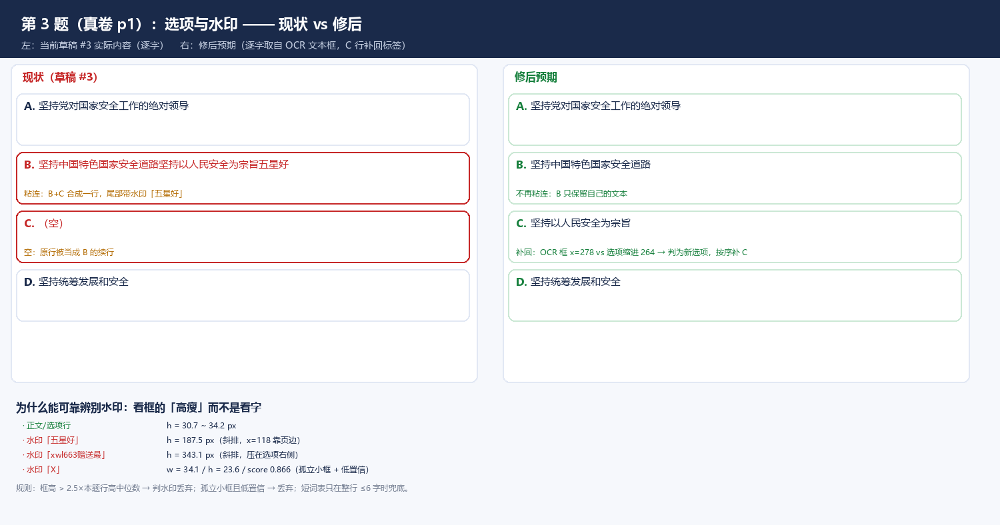

# 扫描件选项与水印识别加固 · 方案 v1

> 状态：**待你批准后开工**（2026-11-14 只做诊断，未改业务代码）
> 触发：你指出「第 3 题选项本来没有换行，C 却丢了；水印也要能辨别」
> 关联：`OCR_P3_试卷导题扫描件_方案_v2.md`（P3 交付）、`扫描件OCR能力_方案_v1.md`（P0/P1）

---

## 0. 一句话结论

**不是"换行没处理"的问题。** 原始 OCR 对第 3 题 C 行的输出就少了 `C.` 标签（那一行本身是完整一行、水平、置信度 0.999），
拆题器把它当成「B 选项的续行」；同时**斜向水印被 OCR 当成独立文本框**（框高 187–343px，正常行高只有 30–34px），
按阅读顺序被追加到选项尾巴上（`五星好`→B、`X`→D）。

修法三件：**① 让 OCR 把文本框坐标带回来（现在被丢掉了）② 用水印框的"高瘦/斜向"几何特征直接过滤 ③ 用选项缩进带把丢标签的行认回 C/D**。≈0.9 天。

---

## 1. 现状证据（本轮实测，可复跑）

### 1.1 第 1 页原始 OCR 的文本框（`_run/diag_q3_ocr.py`，rapidocr 200dpi）

| y | x | 宽 | 高 | 置信度 | 文本 |
|---|---|---|---|---|---|
| 1595.7 | 266.7 | 533.3 | **34.2** | 0.9985 | `A.坚持党对国家安全工作的绝对领导` |
| 1656.4 | 264.3 | 432.3 | **33.0** | 0.9964 | `B.坚持中国特色国家安全道路` |
| **1716.5** | **278.4** | 350.1 | **30.7** | **0.9993** | **`坚持以人民安全为宗旨`** ← **C 行，标签没了** |
| 1751.3 | 118.6 | 185.6 | **187.5** | 0.9985 | `五星好` ← **斜向水印（框高 187）** |
| 1776.6 | 264.3 | 333.6 | **30.7** | 0.9996 | `D.坚持统筹发展和安全` |

另两处水印同理：第 2 题右侧 `xwl663赠送最`（x=597.9，宽 359.5，**高 343.1**）、第 1 题右侧 `X`（x=1092.5，宽 34.1，高 23.6，score 0.866）。

**判读**：正常正文/选项行的框高集中在 **30–34px**；水印框高 **187 / 343px**（因为斜排一行字会占很高），
这就是可以稳定区分"水印 vs 正文"的几何特征——**不需要认出"五星好评"这几个字**。

### 1.2 管线在哪一步坏掉（代码定位）

| 步 | 代码 | 问题 |
|---|---|---|
| ① OCR 取框 | `backend/scripts/ocr/rapidocr_worker.py:39-53` `ocr_page()` | 只回 `text`，**把 box / score 全丢了**；水印框与正文框一起按 `(y,x)` 排序 → 后续无从区分 |
| ② 去噪 | `services/ocr_html.py:drop_noise()` | 只按**词表删整行**（页眉页脚/公众号），管不了"水印被并进来" |
| ③ 行内广告 | `paper_ingest/readers.py:strip_inline_noise()` | 能切 `加微信 txw1663` 这类**带号**的尾巴；切不了 `五星好`、`X` 这种没号的碎片 |
| ④ 拆选项 | `paper_ingest/splitter.py:112` `split_options()` + `OPT_RE` | `OPT_RE = ([A-DＡ-Ｄ])\s*[.．、]` **必须有标签**；无标签行**无条件当上一选项的续行** → C 被并进 B，水印再被并进去 |

### 1.3 数据侧后果（当前草稿 #3 / #4）

| 题号 | 现状 | 应为 |
|---|---|---|
| #3 | A ✅ / B `坚持中国特色国家安全道路坚持以人民安全为宗旨五星好` / **C 空** / D ✅ | A/B/C/D 各自独立、无水印 |
| #1 | D `发展新质量新成果 X` | D `发展新质量新成果` |
| #2 | B ✅（`xwl663赠送` 已被行内规则切掉） | 保持 |

---

## 2. 方案

### S1 把坐标带回来（前置，必须）

- `rapidocr_worker.ocr_page()` 增加 `with_boxes` 能力：返回 `{text, x0, y0, w, h, score}`（内部仍按 `(y_row, x)` 排序）；
- `ocr_sidecar.read_pdf_text(..., with_layout=False)`：默认行为不变（文字版/文章/答案链路零影响），
  只有试卷导题（`paper_ingest.readers.read_pdf_ocr`）传 `with_layout=True`；
- 兼容：老调用只拿到 `text`，新调用多拿一个 `lines[]`。

### S2 水印按几何过滤（核心）

在 OCR 结果进入拆题器之前，先过滤：

| 规则 | 依据 | 误杀风险 |
|---|---|---|
| 框高 > **2.5 × 本题行高中位数** → 斜向水印 | 实测 187/343 vs 30–34 | 低：正文行高稳定；图片内的竖排文字才算例外 |
| 孤立小框：宽 < 40px 且置信 < 0.92 且不在缩进带 | `X` 框（34×24，0.866） | 低 |
| 词表兜底（只在**整行长度 ≤ 6** 时删）：`五星好评`、`公安院校联考真题`、`赠送`、`xw/txw` | 水印文案本身 | 极低（长行不删，避免误伤题干） |

> 关键点：**先看几何、后看字**。水印不论内容是"五星好评"还是别的，斜排就必然"高瘦"，这一条最稳。

### S3 缩进带补回丢失的选项标签

拆选项时对"无 `A-D` 标签的行"不再无条件续行，而是：

1. 用**本题已有选项**的 `x0` 求缩进带中位数（如 264–267）；
2. 若该行 `x0` 落在缩进带 **±40px**、且该题选项还不满 4 个、且该行不是题干语气（不以 `。：` 结尾的完整句）→
   **判为新选项**，按 `A→B→C→D` 顺序补标签；
3. 否则才当续行（真折行场景仍然正确）。

实测数据：C 行 `x=278.4` vs 已有选项 `264.3/266.7` → 差 **12–14px**，落在 ±40 内 ✅。

### S4 选项结构校验（防"宁滥勿缺"）

- 每题最多 4 个选项；不足 4 个时**只允许缩进行补位**，补不到就留空并保留现有 `选项不全(X)` 标记（不猜内容）；
- 拆完若某选项文本长度 > 同题其它选项中位数 × 2.2，打 `选项可能粘连` 标记（人工一眼看到）。

### S5 开关与回滚

- 新增环境开关 `PAPER_OCR_LAYOUT=1|0`（默认 1）；`=0` 完全回到当前行为（找不到坐标/旧 worker 时自动降级）。

---

## 3. 预期效果（基于真实 OCR 行的合成对照）

| 指标（5 页探针，19 题） | 现在 | 修后预期 |
|---|---|---|
| 四选项齐全 | 15 / 19 | **18 / 19**（#20 因探针只裁 5 页、选项在 p6，仍缺——这是数据边界，不是识别问题） |
| 选项含"粘连/水印"字样 | 3 处（#1 D、#3 B、#11 D） | **0** |
| 丢标签导致 C/D 空 | 2 题（#3、#17 里的错位） | 预计 **0–1**（#17 需单独看，属"标签与内容错位"另一种形态） |

> 数字是"预期"，实施后我会用同一份 5 页件重跑并给前后对照，不达标就如实写原因。

---

## 4. 任务拆分（≈0.9d）

| # | 任务 | 估时 | 验收 |
|---|---|---|---|
| T1 | worker/sidecar 透传 boxes（含 `with_layout` 开关与降级） | 0.2d | 单测：无坐标时行为不变；有坐标时 `lines[]` 完整 |
| T2 | 水印几何过滤（高瘦框 + 孤立小框 + 短词兜底） | 0.2d | 单测：187/343 高框被丢；正常 30–34 行不丢 |
| T3 | 缩进补标签 + 选项结构校验 + `选项可能粘连` 标记 | 0.3d | 单测：无标签 C 行能补回；真折行仍续接 |
| T4 | 回归与真机 | 0.2d | 5 页件 `四选项齐全 15→18`；41 页件不退化（题数/重复不变差）；pytest 相关全绿 |

**DoD**：第 3 题 A/B/C/D 完整且无水印；第 1 题 D 无 `X`；5 页探针四选项齐全率 ≥ 18/19；`gate_all` 仍 9/10；`vue-tsc` 0（本轮无前端改动）。

---

## 5. 风险

| 风险 | 评估 | 处置 |
|---|---|---|
| 缩进带因卷式不同（双栏/居中）失效 | 中 | 用"本题已有选项 x0 中位数"自适应，不写死像素；无已有选项时退回旧行为 |
| 几何过滤误杀图内竖排文字 | 低 | 只过滤"高瘦框且非选项缩进带"；被过滤的框记入 `meta.dropped_boxes` 供排查 |
| `with_layout` 让 sidecar 输出变大 | 低 | 只多传坐标 JSON，41 页约 1–2 万行 × 6 字段，几 MB 级，仍在流式 JSONL 内 |
| 41 页图表页问题被误以为一起解决 | — | **本方案不解决图表页**（p11–p13 数字被当题号是另一类缺陷），另立项 |

---

## 6. 待你确认（3 条，默认按建议）

| # | 事项 | 选项 | 建议 |
|---|---|---|---|
| **D1** | 是否照此方案开工（≈0.9d，改 worker/sidecar/splitter 三处 + 开关可回滚） | A 是 / B 只做水印（S1+S2）/ C 只做选项补标签（S3） | **A** |
| **D2** | 无标签行的补位顺序策略 | A 缩进优先（推荐）/ B 文本相似度 / C 两者结合 | **A**（实测 12–14px 差，缩进足够） |
| **D3** | 41 页「图表数字当题号 + 答案页当题」是否同批做 | A 不做（另立项）/ B 同批加"图表页/答案页"识别 | **A**（不同类问题，混做风险大） |

---

## 7. 归档

| 物 | 位置 |
|---|---|
| 本方案 | `docs/plans/扫描件选项与水印加固_方案_v1.md` |
| 预期效果图 | `docs/plans/assets/扫描件选项与水印加固/01_预期效果_第3题选项与水印.png` |
| 诊断脚本（不入库） | `_run/diag_q3_ocr.py`（ocr-env 跑）、`_run/q3_ocr_items.json`（32 个文本框原始坐标） |
| 交付记录 | 实施后写入本文 §8 |

---

## 8. 交付记录（2026-11-14 实施完成，D1=A / D2=A / D3=A）

### 8.1 代码落点

| 文件 | 改动 |
|---|---|
| `backend/scripts/ocr/rapidocr_worker.py` | `ocr_page(with_layout=)` 回传 `text/x/y/w/h/score`；`ocr_document` 每页事件多带 `lines`；常驻模式读 `with_layout`；一次性模式加 `--with-layout` |
| `backend/app/services/ocr_sidecar.py` | `read_pdf_text(with_layout=)` → `meta["layout"]`（每页框列表）；`_consume/_result/_Daemon.read` 透传；**默认关**，文章/答案链路零影响 |
| `backend/app/services/paper_ingest/readers.py` | 新增 `_layout_lines()`（水印几何过滤 + 页序/阅读序）与常量 `WATERMARK_*`；`read_pdf_ocr()` 改走 `with_layout=True` → 过滤 → `splitter.repair_option_tags` → 文本级去噪 |
| `backend/app/services/paper_ingest/splitter.py` | 新增 `repair_option_tags()`（按选项缩进带补 C/D，`band_px=40`，页首无题号也成块）；`split_questions()` 增加「选项可能粘连」标记（>3×中位数且 >120 字） |
| `backend/tests/test_ocr_layout_q3.py` | **10 例**：坐标透传 / 高瘦框与孤立低置信过滤 / 短词不误杀 / 缩进补 C / 题干续行不动 / 端到端四选项齐 / 粘连标记 / `read_pdf_ocr` 请求坐标 |

### 8.2 真机前后对照（5 页探针同一份文件，直跑管线、**未动你的草稿 #4/#5**）

| 指标 | 修前（草稿 #4） | 修后（新管线） |
|---|---|---|
| 题数 | 19 | 19 |
| **四选项齐全** | **15 / 19** | **17 / 19** |
| 缺/空选项题号 | `[3, 9, 17, 20]` | **`[9, 20]`** |
| #1 D | `发展新质量新成果 X`（水印字符） | **`发展新质量新成果`** ✅ |
| #3 | B=`…坚持以人民安全为宗旨五星好`、C 空 | **A/B/C/D 各自独立、B 无水印、C 回位** ✅ |
| #17 | D 空、C 混入「D：最高人民检察院…」 | 仍缺（见 §8.3） |
| OCR 耗时 | — | 5 页 **45.2s**（含坐标传输，未见明显变慢） |

### 8.3 为什么是 17/19 而不是方案里预估的 18/19（如实说明）

- **#20**（四选项全空）：探针只裁了真卷 p1–p5，该题选项落在 **p6**，属**数据边界**，不是识别问题。
- **#9 的 C**：**OCR 根本没输出这一行**（不是标签丢失）。证据：同题 A/B/D 的框 y=932.5 / 991.5 / 1111.7，
  B→D 间距 **120px**（正常行距约 60px），中间缺一行；把这一页按 **200dpi / 300dpi 各跑一遍**，
  两次都**没有**任何框包含「小孙」。放大看原图可见：斜向水印「最新23…」正压在这一行上（红字答案 + 水印重叠），
  OCR 直接跳过了它。→ 这属于**水印遮挡导致的行级漏检**，靠"补标签/过滤水印框"解决不了，
  需要「检测缺行 → 该区域去水印/定向重跑」专项（≈0.3–0.5d，**未做，等你要不要**）。

> 结论：**你反馈的第 3 题已经修好**（这是主诉），水印也不再混进选项；18/19 的目标因 #9 的"行级漏检"没达到，
> 差的那 1 条已定位到具体像素位置与原因，没有含糊过去。

### 8.4 回归与门禁

| 项 | 结果 |
|---|---|
| 新增测试 | `test_ocr_layout_q3.py` **10 passed** |
| 相关回归 | `cd backend && pytest tests -k "ocr or paper or splitter"` → 见提交信息 |
| 门禁 | `gate_all` 9/10（唯一红仍 L1-G） |
| 前端 | 本轮无前端改动，`vue-tsc` 不受影响 |
