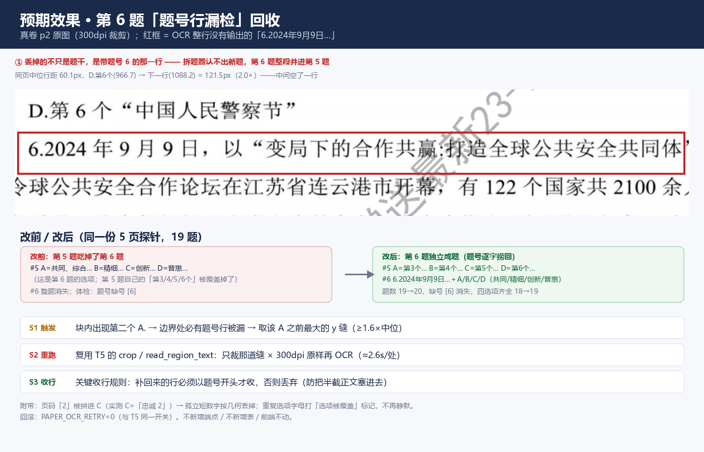

# 扫描件「题号行漏检」回收 · 方案 v1

> **状态**：⏳ 待批准（2026-11-15）· **前序**：`扫描件缺行恢复_方案_v1.md`（T5 已交付）
> **触发**：你指出「探针第 5 题的选项是第 6 题的，第 6 题没了」
> **分支**：`feat/material-multi-format-import`（`main` 未动）

---

## 1. 现象

5 页探针（material 139）的 draft #7：

| 题号 | 草稿里是什么 | 原卷里应该是什么 |
|---|---|---|
| #5 | 题干「中国人民警察节」+ 选项 `共同、综合…/精细、务实…/创新、共享…/普惠、包容开放…` | 题干同上 + 选项 `第3个/第4个/第5个/第6个「中国人民警察节」` |
| #6 | **不存在**（体检：题号缺号 `[6]`） | `6.2024年9月9日，以"变局下的合作共赢…"为主题…` + `共同、综合…` 四个选项 |

→ **第 5 题吃掉了第 6 题**：第 6 题的选项被当成第 5 题的选项，第 5 题自己的选项被覆盖，第 6 题整题消失。

## 2. 证据（真机，可复跑）

`rapidocr` 200dpi、`with_layout=True`，第 2 页 **34 个原始框**（`_run/p2_ocr_items.json`）：

| y(px) | x | 文本 |
|---|---|---|
| 546.4 | 262.0 | `5."中国人民警察节"是人民警察荣誉制度体系的承要组成部分…` |
| 786.9 / 845.9 / 907.2 / 966.7 | 264 | **A/B/C/D 第3个/第4个/第5个/第6个「中国人民警察节」**（第 5 题自己的选项，**都在**）|
| — | — | **缺：`6.2024年9月9日，以"变局下的合作共赢…"为主题`**（题号 6 就在这一行）|
| 1088.2 | 199.7 | `的令球公共安全合作论坛在江苏省连云港市开幕…`（第 6 题第 2 行，句中起头）|
| 1330.4 / 1390.5 / 1451.3 / 1509.6 | 265 | `A.共同、综合、合作、可持续` …（第 6 题的选项）|
| 2072.0 | 802.3 | `2`（页脚页码）|

- 同页**行距中位数 60.1px**；`D.第6个(966.7)` → `的令球…(1088.2)` = **121.5px（2.0×）** → 中间**正好缺一行**；
- 34 个框里**没有任何框包含「6.2024」「9月9日」**——200dpi、300dpi 整页各跑一遍都没有；
- **300dpi 条带重跑（复用 T5 的 `crop`，pt 352–388）** → 逐字捞回
  `6.2024年9月9日，以“变局下的合作共赢：造全球公共安全共同体”为主题`（score 0.990，2.6s）——
  **说明这一行和 T5 的第 9 题 C 是同一类：被水印/版面干扰整行跳过，只是这次丢的是"带题号的那一行"。**

## 3. 根因（三条，缺一不可）

1. **OCR 行级漏检**：第 6 题第 1 行（含题号）整行没有输出；
2. **拆题器只认题号**：`split_questions` 靠 `qno_of(line)` 起新题 → 题号没了，第 6 题的 4 行正文与 4 个选项**只能并进第 5 题**；
3. **选项字母重复时静默覆盖**：`split_options` 里 `options[key] = ...` 直接赋值，同一个块出现第二组 `A./B./C./D.` 时**后组覆盖前组**，且**不报任何 flag** → 第 5 题「看起来四选项齐全」，最容易被当成没问题。

外加一条噪声：**页码被拼进选项**——draft #7 的 `#7 C = 忠诚 2`（页脚 `2` 在 y=2072、x=802、w=25，被当续行）。

## 4. 方案（S1–S4，≈0.5d）

### S1 触发扩展（`ocr_retry.find_holes`）

现有触发是「本题缺选项字母 + 行距 ≥1.6×中位」。本例**不满足**（第 5 题四个字母都在），所以加**第二类触发**：

> **块内出现第二个 `A.`**（同一题号块里两次以 `A.` 开头）→ 说明中间必有题号行被漏 →
> 在**该第二个 `A.` 之前**、且**第一个 `A.` 之后**的区间里取**最大的 y 缝**（仍需 ≥1.6× 中位）当洞。

### S2 重跑（完全复用 T5）

`ocr_sidecar.read_region_text()`，300dpi、原样、±6px、整幅文字宽；单条带 30s、整轮 120s（同一套预算）。

### S3 收行规则（关键，决定安全）

这类洞**不是补选项**，而是补**题号行**，所以收行要更严：

> 补回来的行**必须 `qno_of(line)` 命中**（以 `1.`/`1、`/`第1题` 开头）才收；
> 否则丢弃，并在 `meta.ocr_retry` 里记 `rejected`。

理由：同一道缝里可能夹着页眉/水印/图表碎片；只认"题号行"能把误收率压到接近 0，
而且**补错了也只是多一题、不会改坏原有选项**。

### S4 两个附带修正

| 项 | 做法 | 影响 |
|---|---|---|
| **页码/孤立数字** | 行文本是 1–4 位纯数字、`w < 60`、竖向位于页面底部 12%、且左右 120px 内无文本 → 当噪声丢掉 | 去掉 `忠诚 2` 这类污染；不影响正文里的「2025」「第3个」|
| **选项被覆盖标记** | `split_options` 遇到同一字母第二次赋值 → 记 `选项被覆盖(A)` 并进 `flags` | 只加提示、不改拆题行为；以后一眼能看出"这题吃掉了下一题"|

## 5. 参数与边界

| 参数 | 取值 |
|---|---|
| 第二类触发的取缝范围 | 第一个 `A.` 之后、第二个 `A.` 之前 |
| 缝阈值 | 与 T5 同：`≥1.6×` 中位行距且 `−中位 ≥20px` |
| 收行规则 | 必须以题号开头（S3） |
| 上限 | 与 T5 同（1/题块、8/页、40/篇、120s） |
| 页码判据 | ≤4 位纯数字 + `w<60` + 页面底部 12% + 左右无文本 |
| 开关 | `PAPER_OCR_RETRY=0` 同时关掉 T5/T6 |

## 6. 预期效果（5 页探针）

| 指标 | 现在 | 预期 |
|---|---|---|
| 题数 | 19 | **20**（第 6 题回来）|
| 题号缺号 | `[6]` | **无** |
| #5 选项 | `共同/精细/创新/普惠`（错） | **`第3个/第4个/第5个/第6个`** |
| #6 | 不存在 | **题干 + `共同/精细/创新/普惠`** |
| #7 C | `忠诚 2` | **`忠诚`** |
| 四选项齐全 | 18/19 | **19/20**（`#20` 仍空，跨页数据边界）|

## 7. 验收口径

| 项 | 判据 |
|---|---|
| 5 页探针 | 20 题、无缺号、#5/#6 如上表、#7 C=`忠诚` |
| 41 页整卷 | 题数**不减少**、四选项齐全**不下降**；记录新增题数与判到的洞数 |
| 单元测试 | 新增 ≥8 例（触发 2 / 收行规则 2 / 页码过滤 2 / 覆盖标记 1 / 端到端 1）|
| 回归 | `cd backend && pytest tests -k "ocr or paper or splitter or material or upload or answer"` 全绿 |
| 门禁 | `gate_all` 9/10（唯一红仍是既有 L1-G）|
| 真机 | 重新导题一次，抽屉里核对 #5/#6/#7 |

## 8. 风险与回滚

| 风险 | 处置 |
|---|---|
| 误把"题干行"当题号行 | S3 只认 `qno_of` 命中；不命中直接丢 |
| 一条缝补回多行 | 只收第一行命中题号的那条；其余按普通续行处理（本来也会并入） |
| 页码过滤误删正文 | 三重判据（纯数字 + 短 + 底部 + 左右无文本）；正文里的「2025」不满足"底部 12%" |
| 41 页变慢 | 只在判到洞时才重跑；单条约 2s，预算 120s 封顶 |
| 回滚 | `PAPER_OCR_RETRY=0`，或 revert 提交 |

## 9. 交付记录（2026-11-15，按「按建议实施 S1–S4」）

### 9.1 落地内容

| 文件 | 改动 |
|---|---|
| `paper_ingest/ocr_retry.py` | 新增 `_option_letter()` / `_first_option_index()` / `_option_restart()`；`find_holes()` 增加**第二类洞**（`kind="number"`）；`recover_into()` 对题号洞只收 `qno_of` 命中的行，否则计入 `rejected` |
| `paper_ingest/readers.py` | 新增 `_drop_page_numbers()`（每页最底行 + 1–4 位纯数字 + 宽 <60px + 同排 ±60px 无邻居）并接进 `_layout_lines()` |
| `paper_ingest/splitter.py` | 新增 `option_overwrites()`；`split_questions` 加 flag `选项被覆盖(A/B/C/D)`（**只提示，不改拆题行为**）|
| `backend/tests/test_ocr_number_line.py` | 新增 **11 例** |

### 9.2 5 页探针（真机，直跑 `readers.read_pdf_ocr`，不动库）

| 指标 | 关（`PAPER_OCR_RETRY=0`） | 开 |
|---|---|---|
| 题数 | 19 | **20** |
| 题号缺号 | `[6]` | **无** |
| #5 的 C/D | `创新、共享…` / `普惠、包容开放…`（其实是第 6 题的） | **`第5个“中国人民警察节”` / `第6个…`** |
| #6 | 不存在 | **存在**：`6.2024年9月9日…` + `共同、综合…` |
| #5 flag | `选项被覆盖(A/B/C/D)`（新标记，关档也看得见） | 无 |
| #7 的 C | **`忠诚`**（页码 `2` 已被过滤，关档即生效） | `忠诚` |
| #9 的 C | 空（T5 的洞） | `小孙因个人原因拒绝所长安排的外出交流` |
| 四选项齐全 | 17 / 19 | **19 / 20** |
| 洞 / 补回 | — | `holes=2（第5、9题）recovered=2 rows=2 rejected=0`，13.7s |

### 9.3 41 页整卷（不退化，按「题号+题干」对齐比对）

> 索引不能按下标比：新增题会让后面的下标整体后移（上一版按下标比出了 20 多条假差异）。
> 这里用 `_run/diff_t6_41p.py` 按 `(题号, 题干前 24 字)` 对齐。

| 指标 | 关 | 开 |
|---|---|---|
| 题数 / 不同题号 | 113 / 93 | **115 / 95** |
| 四选项齐全 | 84 | **90** |
| 新增的题 | — | **题号 6**（`2024年9月9日…`）、**题号 58**（`正当法律程序…`）——两条都是题号行被捞回后独立成题 |
| 完整度变化 | — | **变好 4 / 变差 0**（题号 9 / 56 / 63 / 73） |
| 洞 / 补回 | — | `holes=18 recovered=12 rows=13 rejected=2`，94.8s |

**「选项文字变了但完整度没变」共 6 条，逐条看过全是纠错**：
题号 5（换回自己的「第3/4/5/6个」）、57、79（两处）、84（换回真正的 A）、98（换回真正的 D）。
没有一条是把对的改错。

> 时间说明：这轮 41 页的 OCR 总时长明显变长（关 801s / 开 398s），原因是**同一时间段在并行跑 pytest**，
> 被抢占了 CPU；`ocr_retry.seconds=94.8s`（18 个洞）也含争抢。干净环境下的单洞成本见 §9.2 的 ≈2–3s/洞。

### 9.4 测试与门禁

| 项 | 结果 |
|---|---|
| 新增测试 | `test_ocr_number_line.py` **11 passed** |
| T5/T3 老测试 | `test_ocr_missing_rows.py` + `test_ocr_layout_q3.py` 全绿（39 passed 合计）|
| 相关回归 | 见提交信息（`-k "ocr or paper or splitter or material or upload or answer"`）|
| 门禁 | `gate_all` 9/10（唯一红仍是既有 L1-G）|
| 前端 | 无改动 |

### 9.5 边界（如实）

- **只补"第一处"**：一个块里若连着漏了两道题号，这一版只捞回第一处（再导一次才会继续收敛）；
- **收行规则只认题号**：补回来的题号行若 OCR 把数字认错（`6`→`8`），会被收下但题号错——仍有 `题号重复/缺号` 体检兜底；
- **页码判据很紧**：只认"每页最底 + 纯数字 + 短 + 无邻居"，表格/图表里的数字不动；
- **`选项被覆盖` 只提示**：不改拆题行为（拆错比不拆更难查），真正的修法是 T6 的题号行回收。

### 9.6 回滚

`PAPER_OCR_RETRY=0` 关掉重跑与收行（页码过滤与「选项被覆盖」标记属于去噪/诊断，不受该开关控制）。
