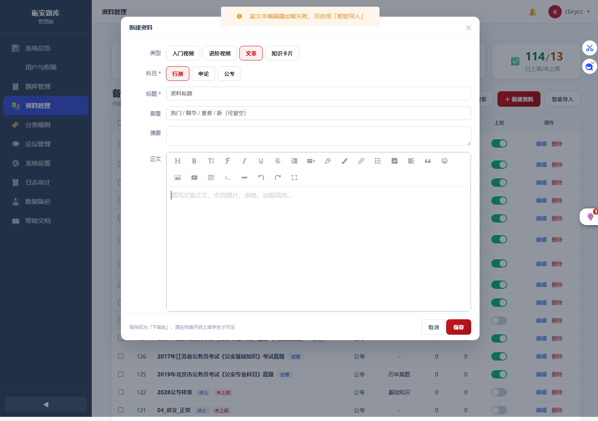
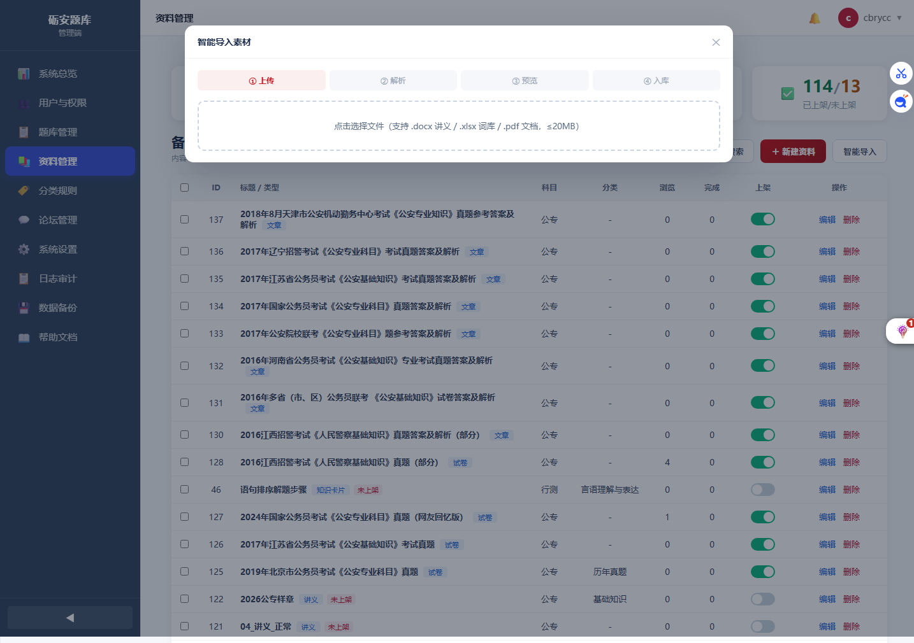

# 旧版资料页：覆盖度审计与清理方案 v1（待批准）

> 日期：2026-11-12　｜　分支：`feat/material-multi-format-import`（**不动 main**）
> 你的问题：旧版界面和程序功能**是否已被新版覆盖**；覆盖了的话**能否清除旧版界面、接口和程序**。
> 结论先说：**没有完全覆盖**——旧版还有 **4 项新版没有的能力**；而且按项目红线，**`.vtj` 页面不能删、API 不能删**。
> 所以"清除"只能做到**下线入口（必要时连路由一起摘）**；要真正退役，得先把那 4 项能力搬进新版。

---

## 1. 审计方法（可复核）

| 项 | 做法 |
|---|---|
| 旧版是什么 | 路由 `/admin/materials/legacy` → `component: () => import('$vtj/vue/admin_materials.vue')`（`src/router/index.ts:295-297`） |
| 新版是什么 | `src/views/admin/materials.vue`（手写页，A4 起替换旧页；`资料管理` 顶部有「旧版（临时）」入口） |
| 怎么比对 | ①旧版页面里出现的按钮/弹窗关键词（新建/智能导入/富文本/视频/图片）；②两边实际调用的 API；③新版组件目录里有没有对应实现 |
| 证据 | 旧版页面 34KB，含「＋ 新建资料」「智能导入」「富文本编辑器」「视频」等控件；新版页面 **0 处** 新建/编辑正文/图片/视频 |

---

## 2. 功能矩阵（能不能覆盖，一眼看清）

| 能力 | 旧版 | 新版 | 判定 |
|---|---|---|---|
| 列表 / 筛选 / 搜索 / 分页 / 统计 | ✅ | ✅ | 新版覆盖，且更强（5 格统计、时间范围、发布者、投放位） |
| 上架·下架（=审批）/ 批量上下架 | ✅ | ✅ | 新版覆盖（含批量） |
| 删除（软删）/ 回收站 / 恢复 | ✅ | ✅ | 新版覆盖 |
| 预览抽屉（卡片/文章/讲义/试卷/原件下载） | 部分 | ✅ | 新版覆盖 |
| 改信息（试卷元数据） | ❌ | ✅ | 新版独有（C2b） |
| 上传试卷 / 自动建卷 / 投放位 | ❌ | ✅ | 新版独有（P1/L4） |
| 导题（原件拆题→确认入库） | ❌ | ✅ | 新版独有（P3） |
| 补答案（PDF 答案解析） | ❌ | ✅ | 新版独有（P4） |
| 考试开关 / 定时窗口 | ❌ | ✅ | 新版独有（P2） |
| 批量导入原件（docx/pdf/xlsx 留档） | 部分 | ✅ | 新版覆盖（B2 队列 + 双格式配对） |
| 文章批量上传（解析正文） | ❌ | ✅ | 新版独有（L4） |
| **卡片 xlsx 智能导入（列映射）** | ✅ | **❌** | **旧版独有** |
| **＋ 新建资料（富文本正文 / 封面配图 / 视频）** | ✅ | **❌** | **旧版独有** |
| 视频分片上传（`/api/video/upload/chunk`） | ✅ | **❌** | **旧版独有**（且全库视频 0 条） |
| 卡片图片上传（`/admin/upload/image`） | ✅ | **❌**（该接口仍被 `admin_profile` 头像使用） | **旧版独有** |
| 单条建卡（学生/教师/管理员） | — | ✅ `/materials/upload`（`material_upload.vue`，roles 三角色） | 新版有"建卡"，但**不是管理员新建文章/讲义** |

**结论**：管理面（列表/审批/试卷/考试/答案）新版全面超过旧版；**内容生产面**（新建富文本、xlsx 批量建卡、封面图、视频）旧版仍是唯一入口。

---

## 3. 红线约束（决定"能不能删"）

| 红线 | 内容 | 对本任务的影响 |
|---|---|---|
| **R1** | `.vtj/` **禁止移动、改名、删除** | `admin_materials.vue` **不能删**；只能"不挂入口/不挂路由" |
| **R3** | `.vtj` 页面 `<template>` 禁改 | 旧页连"加弃用提示"都只能改 `<script>`（或加在页外） |
| **R11** | API 路径冻结（343 端点基线） | `POST /admin`、`/admin/upload/image`、`/admin/import/upload`、`/api/video/upload/chunk` **不能删** |
| **L6 + test_route_roles** | 动态 import 计数 **105** 是双改点 | 若删 `/admin/materials/legacy` 路由 → 105→104，两处必须同改，否则门禁红 |
| **qbdm 台账** | `scripts/qbdm/gen_module_ledger.py` 的页面映射里有 `admin_materials` | 删路由后需跑 `gen_module_ledger.py --check` 并同步 |
| **VTJ 版本一致性** | `vtj_version_sync.py --check` 按文件比 | 文件保留即通过；删文件才会破（所以不删） |

**一句话**：**"界面/程序"不能物理删（R1/R11/R3）；"接口"不能删；能删的只有"入口"和"路由"。**

---

## 4. 三个方案（按"能删多少 / 风险 / 代价"排序）

### 方案 A：只摘入口（最小、零风险）

- 删新版页顶部的「旧版（临时）」按钮（`router-link` 一行）；
- 旧页仍可通过 URL `/admin/materials/legacy` 打开；
- 不改路由、不改门禁、台账不动。
- **代价**：0；**效果**：普通用户看不到旧版，但"懂地址的人"还能进。
- 估时：**10 分钟**。

### 方案 B：摘入口 + 删路由（"看起来清除"）

- 删按钮 + 删 `src/router/index.ts` 的 `materials/legacy` 路由；
- 必须同步：`EXPECTED_DYNAMIC_IMPORTS` **105 → 104**、`test_route_roles.py` 的 104/105 断言、`gen_module_ledger.py --check`；
- `.vtj` 文件按 R1 **保留**（成为"死文件"，设计器里仍可见）。
- **代价**：暂时失去 4 项能力（见 §2），且改门禁数字；
- 估时：**0.5 小时**（含门禁复跑）。
- 风险：中低；回滚 = 加回路由 + 数字改回。

### 方案 C：先搬迁，再下线（"真正退役"，推荐）

1. **P1 新建资料搬进新版**（0.5–1d）：一个 `MaterialCreateDialog`（类型/科目/分类 + 富文本正文 + 封面图 + 视频字段）；复用 `POST /admin`、`/admin/upload/image`；**视频上传按需**（P1-可选）。
2. **P2 xlsx 卡片智能导入搬进新版**（1d）：复用后端 `import/upload + preview + confirm`（列映射），UI 照旧版逻辑重排；完成后"批量导入"支持 xlsx 卡片。
3. **P3 下线**：摘入口 + 删路由（同 B），并把旧页在文档里标 `deprecated`（文件保留）。
- **代价**：2–2.5 天；**效果**：4 项能力都在新版，旧版真正可退役（只留死文件）。
- 风险：中；每一步都可独立回滚。

| 对比 | A | B | C |
|---|---|---|---|
| 用户还看得到旧版吗 | 入口看不到、URL 可进 | 入口/URL 都进不去 | 同 B |
| 会丢能力吗 | 不丢 | **丢 4 项** | 不丢 |
| 改门禁 | 否 | 是（双改点） | 是 |
| 工期 | 10 分钟 | 0.5h | 2–2.5d |
| 建议 | 想立刻"眼不见" | 能接受暂时丢能力 | **推荐** |

---

## 5. 推荐路线与每一步的验收

| 步骤 | 动作 | 验收 |
|---|---|---|
| S1 | 先做 **A**（摘入口，保路由） | 新版顶部无「旧版」按钮；`gate_all` 9/10 不变；旧页 URL 仍可打开（回滚容易） |
| S2 | 搬"新建资料"到新版（含富文本/封面；视频可延后） | 新版能建一条文章/卡片并能预览正文；旧版同一功能仍可用（双跑） |
| S3 | 搬"xlsx 卡片智能导入" | 新版能用 xlsx 批量建卡（列映射、重复拦截、进度） |
| S4 | 做 **B**（删路由 + 门禁双改点） | `/admin/materials/legacy` 404；`gate_all` 9/10；`test_route_roles` 绿 |
| S5 | 文档标 deprecated，旧页文件保留 | `docs/README.md` 索引 + 交付记录 |
| （可选） | 视频上传 | 若确定不做视频，明确写"视频不做，旧页不再提供" |

---

## 6. 影响面 / 风险 / 回滚

| 项 | 评估 |
|---|---|
| 影响页面 | 仅管理端资料页与其入口；学生端/考试链路零影响 |
| 影响接口 | **零删除**；`/admin`、`/upload/image`、`/import/*`、`/video/upload/chunk` 全部保留 |
| 门禁 | 仅 B/C 的"删路由"会动 105→104 双改点，其它不动 |
| 风险 | ①搬漏功能（用"双跑"规避：搬迁期间旧页仍可用）；②门禁数字改错（双改点 + 复跑）；③用户习惯（发一条说明/保留直达 URL 一段时间） |
| 回滚 | A：加回一行按钮；B：加回路由 + 数字改回；C：逐项 revert，旧页从未删除 |

---

## 7. 需要你拍板（4 条）

| # | 事项 | 选项 | 我的建议 |
|---|---|---|---|
| D1 | 先做哪个 | A 只摘入口 / B 摘入口+删路由 / **C 先搬后下线** | **C**（但可先执行 A 立刻"眼不见"） |
| D2 | **视频**还要不要 | A 不要（全库 0 条） / B 要（搬上传能力） | **A**（先不做，明确写进文档） |
| D3 | 新建资料要哪些字段 | A 富文本+封面 / B 再加视频 / C 只纯文本 | **A** |
| D4 | 旧页文件怎么处理 | A 保留死文件（合 R1） / B 想办法删（需改红线） | **A**（R1 不允许删） |

> 批准方式：回「按 C 走，先 A」即可；我先摘入口（10 分钟、可秒回滚），再排 S2/S3。

---

## 8. 执行记录（2026-11-12）

你选定：**A 先摘入口，再按方案 C（先搬迁后下线）走**。A 已执行完毕。

| 项 | 结果 |
|---|---|
| 改动文件 | `src/views/admin/materials.vue` —— 页头那行 `<router-link to="/admin/materials/legacy">旧版（临时）</router-link>` 已删（原 ~L9），附近注释同步改成"旧版入口已下线，路由保留可直达"（~L376） |
| 路由 | **未删**（105 条不变）→ L6 `EXPECTED_DYNAMIC_IMPORTS=105` 与 `test_route_roles` **无需双改**，零门禁影响 |
| 旧页 | 仍可用，直接访问 `#/admin/materials/legacy` 可达（**合 R1**：`.vtj` 文件一个没动） |
| 实测 | CDP 打开 `#/admin/materials` 取 DOM：`hasLegacyLink: false`（脚本 `_run/check_legacy_entry_gone.js`）；`vue-tsc` **0 error** |
| 截图 | `assets/旧版入口摘除/01_新版页不再有旧版入口.png`（真机渲染，页头只剩「刷新」） |
| 回滚 | 把那一行 `<router-link>` 加回去即可，10 秒 |
| 附带影响 | "批量与智能导入走旧版页"的提示文案仍在（新版页底部），只是不再有可点的旧版链接 —— 这是有意的：S2/S3 搬完再一起清文案 |

**未做（等你批）**：

| 步 | 内容 | 估时 |
|---|---|---|
| S2 | 把「＋新建资料」（富文本正文 + 封面，视频按 D2=A 不做）搬进新版页 | 0.5–1d |
| S3 | 把「xlsx 卡片智能导入」搬进新版页 | 0.5d |
| S4 | 才做 B：删 `/admin/materials/legacy` 路由 + 双改点（105→104 + `test_route_roles`） | 0.5h |

> 现状一句话：**入口已摘（眼不见），能力一项没丢（旧页直达可用），门禁数字一个没动。**

---

## 9. S2 / S3 到底做什么（2026-11-12 追加：你问"是要干嘛"）

S2/S3 **不是新功能**，是把旧页独有、新版没有的两件手工活搬进新版页；搬完才敢做 S4（删路由）。下面全部是读代码 + 真机截图核过的现状。

### 9.1 S2 = 把「手写一条资料」搬进新版

| 旧页表单字段 | 后端 | 新版页有吗 |
|---|---|---|
| 类型：入门视频 / 深度拓展视频 / 文章 / 知识卡片 | `POST /api/materials/admin`（新建）、`PUT /api/materials/admin/{id}`（改）——**端点都在** | ❌ 新版只能按上传文件的类型定 |
| 科目 / 标题 / 摘要 / 分类 / 标号 | 同上 | 🟡 改信息能改 科目/标题/分类/标号（`MaterialMetaDialog`），**摘要在新版改不了** |
| **正文（富文本：图片、表格、加粗）** | `wangeditor 4.7.15`；插图走 `/api/materials/admin/upload/image` | ❌ **完全没有** |
| 卡片正面 / 背面 | card 专用 | ❌ |
| 封面图 | `/upload/image` | ❌ |
| 视频（分片上传） | `/api/video/upload/init|chunk|complete` | ❌ 按 D2=A **不做**，文档写明"视频不做" |
| 保存结果 | 一律 **下架态**，再去列表上架 | 一致 |

**为什么非搬不可**：库里 3 篇科目说明就是富文本正文；新版「改信息」只能改元数据，**改不了正文、改不了封面**。也就是说今天想新写一篇"通知/说明/口诀合集"，只能先写成 docx 再上传——短文章反而更麻烦。

**代价**：新组件 `MaterialEditorDialog.vue` 约 350–450 行 + 2 个入口（新建 / 改正文）；`wangeditor` 已是依赖（`package.json: wangeditor 4.7.15`）；**零后端改动**。估 0.5–1d。

**顺手要修的旧 bug（实测）**：打开对话框就弹「富文本编辑器加载失败，可改用『智能导入』」（图 01 顶部），但编辑器其实能用（DOM 里 `.w-e-toolbar`、`.w-e-text-container` 都在）。实测警告原文：`[AdminMaterials] editor load failed: 初始化节点已存在编辑器实例，无法重复创建编辑器`。推断根因：`editDlg` 与 `form.type` 两个 watcher 都调 `mountEditor()`（`.vtj/vue/admin_materials.vue:629-641`），而它的去重判断 `if (this.state.editor) return` 在 `await import('wangeditor')` **之前**（同文件 `471-487`）→ 两个并发调用都通过判断，第二次 `create()` 抛错。搬的时候必须加 pending 锁、只由 `editDlg` 触发，否则把这个误报一起搬过去。

### 9.2 S3 = 把「xlsx 批量建卡」搬进新版

旧页的完整链路（4 步，全部端点现成）：

| 步 | 端点 | 关键点 |
|---|---|---|
| ①上传 | `POST /api/materials/admin/import/upload` | 只收 `.docx/.xlsx/.pdf`；xlsx **5MB**、docx/pdf 20MB；同文件 sha256 去重 |
| ②解析 | `GET /api/materials/admin/import/{id}/status` | 扫描 PDF 走异步（就是报"OCR 未就绪"那条） |
| ③预览 | `GET /api/materials/admin/import/{id}/preview` | 回表头 + **前 200 行**，用户点选"哪列是正面/背面/分类/考点/封面" |
| ④入库 | `POST /api/materials/admin/import/{id}/confirm` + `column_mapping` | `build_cards` 建 N 张卡；行级校验跳过空行/超长/重复；上限 **500 行**；落**下架态** |

**新版为什么做不了**：批量导入组件的文件框里**确实列了 `.xlsx`**（`MaterialBatchUpload.vue:27`），但它上传走的是 `POST /api/materials/admin/files/upload`（只允许 `article/lecture/paper`，`materials.py:2616`）→ xlsx 只会变成某条资料的**附件**；"一张表 → N 张卡"必须走 `import/upload` → `confirm{column_mapping}`，而新版没有列映射 UI，硬调也会 400「列映射不完整（正面列/背面列必填）」（`materials.py:3607`）。

**代价**：新组件 `CardXlsxImportDialog.vue`（选文件 → 预览表头 → 选列 → 确认），**零后端改动**，估 0.5d。

**顺手要修的文案不符**：旧页写「≤20MB」，后端 xlsx 实际限 **5MB**（`XLSX_SIZE_LIMIT`，`materials.py:3187`），超了报「文件超过 5MB 上限」；卡上限 500 行、预览只回前 200 行，界面上也没写。

**现实价值**：`备考资料/` 有 **30 个 xlsx / 1277 卡**，库里目前只有 **115 卡**；现在的绕路是拿**学生账号**走 `#/materials/upload?tab=excel`（`POST /api/materials/my/upload`），落成"待审/未上架"再由管理员上架——管理员自己不好用。

### 9.3 做与不做，差在哪

| 选择 | 结果 |
|---|---|
| 不做 S2/S3 | 旧页只能手输 URL 进；一旦做 S4 删路由，这两件事**是真没了**（不是藏起来） |
| 只做 S3 | 卡片数据入口回新版；"手写正文"仍只能进旧页 → S4 不能做 |
| S2+S3 都做 | 才能走 S4：删路由 + 门禁双改点（105→104 + `test_route_roles`） |

### 9.4 可选方案（等你一句话）

| 方案 | 内容 | 估时 | 代价 |
|---|---|---|---|
| **A** | 只做 S3 | 0.5d | 卡片入口回新版；S2 仍留旧页 |
| **B（推荐）** | S3 → S2 → S4 | 1–1.5d + 0.5h | 旧页可彻底下线 |
| C | 都不做，旧页永久保留（URL 直达） | 0 | 文档写清"这两件事只能手输 URL 做"，S4 取消 |
| D | S3 + 精简 S2（只支持上传 docx 正文，不搬富文本） | 0.5–0.7d | 省 0.5d，但短文章体验差 |

**我的建议**：先 **S3**（数据入口、0 后端、风险低），**S2 单独批**（最大件，且要顺手修富文本重复挂载那个误报）。视频按 D2=A 不做。

---

## 10. S3 交付记录（2026-11-12，方案 B 第一步）

你选 **方案 B**：S3 → S2 → S4。S3 已完成。

### 10.1 做了什么

| 文件 | 类型 | 内容 |
|---|---|---|
| `src/utils/cardXlsx.ts` | 新增 | 列映射纯函数：`guessXlsxMapping`（按关键词猜、同列不重复占坑）、`isMappingReady`（正背面必选且不同列）、`mappingPayload`、`mappingSummary` |
| `src/utils/__tests__/cardXlsx.spec.ts` | 新增 | **8 例**：五列表头、带空格/英文、旧表头（题干/答案）、同列不重复、认不出不瞎猜、就绪判定、payload 只带已填、摘要文案 |
| `src/components/admin/CardXlsxImportDialog.vue` | 新增 | 四步：选 xlsx（≤5MB 前端先拦）→ 解析预览（表头 + 前 5 行，正面列绿、背面列蓝）→ 列映射（自动猜 + 可改）→ 入库参数（科目/兜底分类/立即上架）→ 结果面板（创建数 / 跳过行 / 无效行 / 分类考点回退警告） |
| `src/modules/library/api.ts` | 改 | 新增 `fetchMaterialImportPreview`；`confirmMaterialImport` 支持 `type:'card'` + `column_mapping`；结果类型补 `skipped / invalid_rows / warnings`（两种警告形状都认） |
| `src/components/admin/index.ts` | 改 | 导出新组件 |
| `src/views/admin/materials.vue` | 改 | 页头加「卡片导入（xlsx）」按钮 + 挂载对话框；`onCardsImported` 只刷新列表、**不关窗**（否则结果面板看不见） |

**零后端改动**：`import/upload` → `status` → `preview` → `confirm{column_mapping}` 四个端点本来就是旧页在用的。

### 10.2 真机验证（CDP 全链路，截图见 `assets/旧版页S2S3说明/`）

| 步 | 实测 |
|---|---|
| 打开 | 点「卡片导入（xlsx）」→ 对话框出现 |
| 选文件 | 用 2 行测试表（正面/背面/分类/考点）驱动真实 `change` 事件（DataTransfer 造 File）→ 上传成功、`import_id` 返回 |
| 预览 | `table: 2 行`、表头 4 列、正面列绿/背面列蓝 |
| 自动映射 | `front=0, back=1, category=2, point=3, cover=空`；摘要「正面=第1列「正面」 · 背面=第2列「背面」…」；确认按钮可用 |
| 入库 | 点「确认入库」→ **已创建 2 张卡片（未上架）**；警告如实显示「第 1 行：考点「传唤」不在考点表内，将由系统自动分类」 |
| 库核对 | `study_material` 出现 2 条 `type=card, status=0`；验证后**连探针带导入记录一起删干净**（删除前 `sqlite3.backup()`，`integrity ok`），库恢复 132 行 / 上架 114 / 未上架 13 / 回收 5 |

### 10.3 踩到并修掉的三个坑

| 坑 | 现象 | 处理 |
|---|---|---|
| 警告文案显示「undefined」 | 结果面板出现「考点「undefined」不存在」 | 后端有两套 warning 形状：入库回退是 `{kind,value,replaced_by}`、格式校验器是 `{code,message}`。前端改为**两种都认**，实测文案恢复正常 |
| 确认后对话框立刻消失 | 用户看不到"创建几张 / 跳过哪些行" | 父组件 `onCardsImported` 不再自动关窗，只刷新列表；用户看完再关 |
| 开发代理指向 8000 | 上传报「请求的资源不存在」 | `proxy.config.ts` 默认目标是 `127.0.0.1:8000`（Docker），本机后端在 **8001** → 起 dev server 必须带 `DEV_BACKEND_ORIGIN=http://127.0.0.1:8001`。**这是本机验证的固定前置条件**，不是代码问题 |

### 10.4 验收

- `vue-tsc` **0 error**；`cardXlsx.spec.ts` **8 passed**；全量 vitest 见提交说明；
- 门禁不受影响（未动路由，L6 仍 105）；
- 旧页同一功能仍可用（双跑），符合"搬迁期间不制造功能真空"。

> 下一步：**S2**（把「＋新建资料」的富文本正文/摘要/封面搬进新版，并修掉旧页"编辑器加载失败"误报）。
