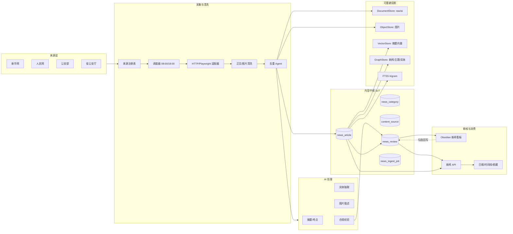
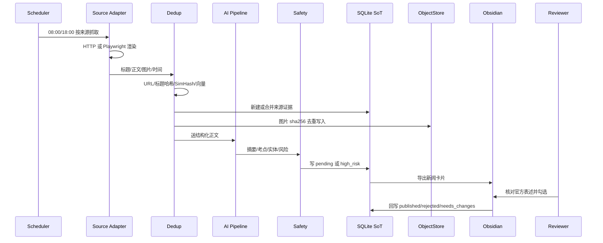
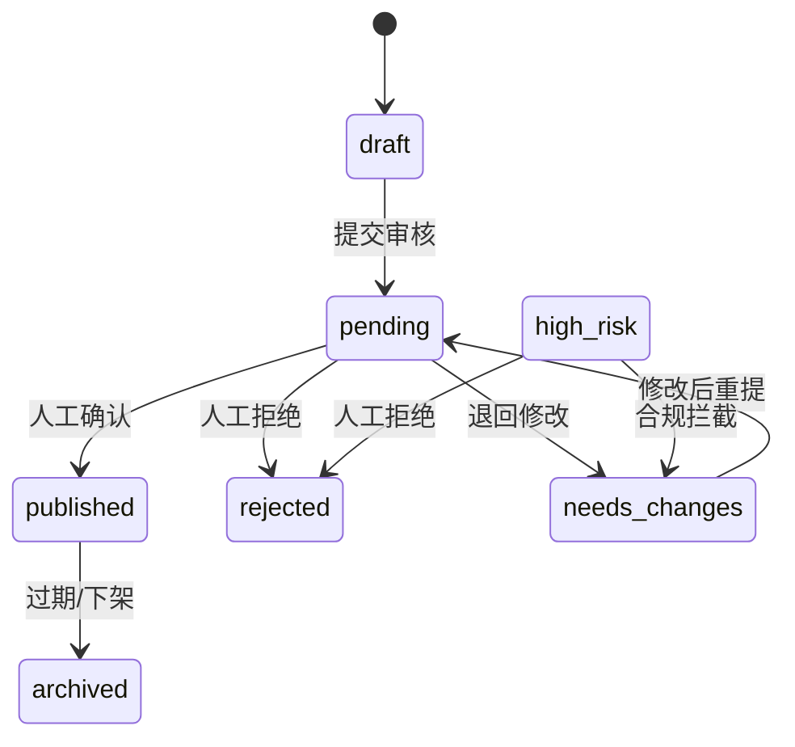

# 每日新闻模块总体设计方案 v1

> 状态：**草案，待用户批准；未实施**
> 主角色：ARCH；协作：DATA / BE / API / FE / SEC / QA / DOC
> 依据：`AGENTS.md`、`docs/plans/内容知识中枢设计方案_v3.0.md`、F1–F6 四库底座、现有 `news_scraper.py` / `media_service.py` / `obsidian_export.py`
> 归档位置：`docs/plans/每日新闻模块总体设计方案_v1.md`

---

## 0. 先给结论（10 条）

1. **不重建一套“五库并列”系统**。保留 SQLite 为唯一事实源（SoT），文档/对象/向量/图作为可重建投影；全部通过适配器接 F3–F6 已有能力，默认 local，MinIO/Mongo/Neo4j/Milvus 按环境开关启用。
2. **新闻是一等内容实体**，复用 `news_article`、`content_source`、`kg_edge`、`topic`、`media_assets`，不另建一套分类和正文表。
3. **采集不是“全网爬虫”**：只做来源白名单、授权页面、可配置频率；Playwright 只解决 JS 渲染，不绕过验证码/登录/反爬策略。
4. **去重必须“保留证据、合并展示”**：URL 规范化 + 标题哈希 + SimHash + 可选向量相似度；重复新闻不物理删除，保留来源副本。
5. **AI 只生成“候选结构化结果”**：摘要、申论考点、实体、官方表述、风险标记、置信度；**新闻永不自动发布**，必须人工确认。
6. **合规校验前置**：领导人称谓、政治术语、官方表述、错别字、敏感词、PII 由规则库先拦截；高风险进入退回池。
7. **四库一致用 Outbox + 投影游标 + 对账**，不做业务层双写；对象按 sha256 不可变，向量和图可全量重建。
8. **图谱先薄后厚**：一期只扩展 `news → topic/source/media/evidence`；人物/机构/政策/地域节点作为二期，需单独批准，避免破坏 v3.0 已冻结的 8 类节点。
9. **Obsidian 是审核工作台，不是事实源**：卡片含原文、摘要、考点、实体、标签、图片；人工勾选后同步 `review_status`，冲突不覆盖人工修改。
10. **先交付 R2.0 数据/检索底座，再逐段接采集、AI、看板、图谱、用户端**；本方案批准前不改代码。

---

## 1. 现状基线与差距

### 1.1 已有能力（实测）

| 能力 | 现状 |
|---|---|
| 新闻表 | `news_article` 11 条；字段 title/url/source/category/publish_date/summary/content/status |
| 新闻图片 | `news_image`（news_id/image_path/image_order） |
| 采集 | `backend/app/services/news_scraper.py` 已用 Playwright + BeautifulSoup，支持人民网/公安报；有正文清洗、图片 `[[IMG:n]]` 提取 |
| 调度 | `scheduler.py` APScheduler，当前新闻每日 **00:00** 抓取 |
| 新闻 API | `GET /api/news` 支持 source/category/limit，无 q/page、无分类字典；R2 分支已先落 LIKE 分页与 `/categories` |
| 四库底座 | F3 ObjectStore（local/MinIO）、F4 DocumentStore（local/Mongo）、F5 GraphStore（local/Neo4j）、F6 VectorStore（local/Milvus）+ EmbeddingPort |
| AI | `llm_client.py`，根 `.env` 支持 LLM_API_URL/KEY/MODEL；已有 DeepSeek 调用链 |
| 审核/投影 | `obsidian_export.py`、审核看板/同步、`content_source`、`kg_edge` 已可复用 |

### 1.2 关键差距

1. 来源只覆盖人民网/公安报，缺少新华网、公安部、省公安厅白名单。
2. 当前 00:00 单次抓取，不符合“早 8 / 晚 6”时效要求。
3. 无来源注册表、抓取游标、失败重试、死信和观测。
4. 无内容哈希/SimHash/向量去重；重复新闻只能靠标题唯一约束兜底。
5. AI 摘要/考点/实体/图片描述未落结构化字段；无 prompt 版本与成本记录。
6. 新闻审核没有独立状态机和高风险池；Obsidian 无新闻时效性看板。
7. `news_article` 每条列表返回全文，缺少 FTS trigram、分页和摘要字段，性能与体验均不达标。
8. 文档/对象/向量/图投影尚未接新闻域；新闻人物/机构/政策/地域没有 canonical 实体。

---

## 2. 范围与非目标

### 2.1 目标

- 每天 08:00、18:00 自动采集白名单来源，产出可审核的新闻卡片。
- 自动生成 100 字内摘要、申论考点、官方表述、人物/机构/政策/地域实体和图片描述。
- 内容可去重、可检索、可追溯、可回滚；新闻、主题、人物、时间线可联动。
- 人工在 Obsidian 中按“时效性看板”审核，勾选后状态同步数据库。
- 学生端可消费“每日时政速览 / 专项时间线 / 一键收藏”。

### 2.2 非目标（本期不做）

- 不做全网无授权爬取，不绕过登录、验证码、付费墙、robots 限制。
- 不做新闻自动发布；高风险内容不得由模型直接放行。
- 不在本期强制引入 MongoDB/Neo4j/Milvus/MinIO 生产集群；默认 local，外部服务是可选 profile。
- 不重写 v3.0 已冻结的 8 类图谱节点；新增人物/机构节点需另立变更。
- 不做面向学生的完整前端页面；前端模板需 VTJ 设计器配合，先交付 API 与 Obsidian 工作台。

### 2.3 设计原则

1. **单一事实源**：SQLite 保存新闻元数据、审核状态、AI 版本引用；其余库是投影。
2. **先证据、后结论**：AI 输出必须带原文 span、来源链接、模型/prompt 版本。
3. **默认关闭、显式开启**：MinIO/Mongo/Neo4j/Milvus、向量检索、自动摘要均可配置开关。
4. **可重放**：原始 HTML、AI JSON、图片对象保留，任何投影可从 SoT 重建。
5. **人工最后拍板**：模型只建议，审核员确认官方表述与政治合规。
6. **失败可降级**：AI/外部库不可用时，新闻仍可入库、可人工摘要、可搜索。

---

## 3. 事件与数据流

### 3.1 总体架构



### 3.1 一次新闻的生命周期



---

### 3.2 事件契约

| 事件 | 触发 | 消费者 |
|---|---|---|
| `news.ingested` | 新新闻入库/合并来源 | 文档投影、对象登记 |
| `news.ai.completed` | AI 结果落库 | FTS、向量、图投影 |
| `news.review.changed` | 审核状态变化 | Obsidian 导出/API 缓存 |
| `news.published` | 发布 | 日报、时间线、WS `data-changed` |

所有事件走 F1 Outbox 同事务，消费者幂等；投影失败进入重试/死信，不回滚 SoT。

## 4. 模块设计

### 4.1 来源注册与调度

新增 `news_source` 注册表（不硬编码来源）：

| 字段 | 说明 |
|---|---|
| source_code | `xinhua` / `people` / `mps` / `province_<code>` |
| name / base_url | 展示名与入口 |
| adapter | `http` / `playwright` |
| cron | 默认 `0 8,18 * * *`，可按来源覆盖 |
| trust_level | 官方/权威/地方 |
| enabled | 总开关 |
| rate_limit / timeout | 限速与超时 |
| robots_note | 授权/使用说明，人工确认 |
| last_cursor / last_success_at | 增量游标与健康状态 |

调度仍用 APScheduler，但不再把新闻写死 00:00：

- 08:00、18:00 各一次，带 0–10 分钟随机抖动；
- 单来源失败不阻塞其他来源；
- 任务幂等键 `(source_code, business_date, slot)`；
- 失败重试 3 次，死信记录 `news_ingest_job`；
- 任务跑完发一次 `news.updated` 事件，复用现有 WS `data-changed`，不新增前端轮询。

### 4.2 采集适配器

- `HttpAdapter`：静态页面、政府公开页、RSS/JSON。
- `PlaywrightAdapter`：JS 渲染、懒加载页面；**不做反爬绕过**，遵守页面条款与 robots。
- 适配器只输出统一 `RawNews`：
  `title/url/published_at/source_code/html/text/images/author/region`。
- 正文提取沿用 `news_scraper.py` 的正文容器与图片过滤规则，抽出 `[[IMG:n]]` 顺序证据。
- 图片先经 `media_service` 写 ObjectStore（sha256），再写 `news_image` 映射；不把大图塞进 SQLite。
- 抓取只读、限速、UA 可配置、失败记录状态码；禁止把异常页面当正文。

### 4.3 去重 Agent

四级判定，命中即停止：

1. **URL canonical**：去 tracking 参数、统一协议/尾斜杠；
2. **标题归一化哈希**：去空白/标点/来源前缀，sha256；
3. **正文 SimHash**：汉明距离 ≤3 判重；
4. **摘要向量余弦**：≥0.92 判重（仅在 `EMBEDDING_ENABLED` 时启用）。

处理策略：

- 完全重复：不新建 `news_article`，追加 `content_source` 来源证据；
- 同事件不同来源：保留主记录 + 多来源列表，展示“来源数”；
- 疑似重复：进入 `needs_review`，不自动合并；
- 所有去重结果写 `news_dedup_log`，可回溯。

### 4.4 AI 处理流水线

统一输出 JSON（Pydantic 校验）：

```json
{
  "summary": "100 字内摘要",
  "exam_points": ["坚持和发展新时代枫桥经验"],
  "official_phrases": [{"text": "...", "span": [start, end]}],
  "entities": [
    {"type": "person|organization|policy|region", "name": "...", "canonical_id": null, "confidence": 0.0}
  ],
  "risk_flags": [],
  "confidence": 0.0,
  "model": "...",
  "prompt_version": "news-v1"
}
```

处理顺序：

1. 清洗 HTML → 纯文本 + 图片顺序；
2. 规则摘要（首段/导语）作为降级结果；
3. 大模型生成摘要/考点/实体/官方表述；
4. 合规规则库校验（领导人称谓、政治术语、错别字、PII、广告）；
5. 图片视觉模型生成 caption（可选，失败保留 alt/空）；
6. 写入 `news_ai_run`（输入哈希、模型、prompt 版本、token/成本、状态、结果 JSON）；
7. 高风险字段进入 `high_risk` 池，禁止自动发布。

**模型路由**：

- 小模型/规则：短讯、格式化来源、降级；
- 大模型：长文、复杂政策、需要提炼官方表述；
- 视觉模型：仅对入库图片生成描述；
- 云边协同：本地先做清洗/规则/缓存，云端只做大模型推理；所有调用可关闭。

**成本控制**：正文截断上限、按内容哈希缓存、批量请求、每篇成本上限、每日预算、失败不重试无限。

### 4.5 合规安全阀

规则库分三层：

1. **硬拦截**：领导人称谓、国家机构名称、政治敏感词、涉密、PII、广告；
2. **需人工**：官方表述不确定、AI 置信度低、图片含人物/敏感场景；
3. **可自动通过**：白名单官方来源 + 低风险 + 置信度≥阈值（新闻本期仍**不自动发布**，只预填建议）。

所有校验结果写 `news_review.risk_json`，人工看板按风险等级排序。

### 4.6 审核状态机



规则：

- 新闻发布必须人工确认；模型只能给建议；
- `high_risk` 不进自动流程；
- 每次迁移写 `news_review` 审计（前后状态、审核人、理由、风险 JSON）；
- 支持批量审核，但每篇仍记录独立审阅结论。

### 4.7 Obsidian 新闻看板

导出结构：

```text
00-收件箱/新闻/
├── 2026-11-01/
│   ├── news_000123.md
│   └── news_000124.md
├── 时效性看板.md
└── 分类索引.md
```

卡片 frontmatter：

```yaml
news_id: 123
uid: news_000123
type: news
status: pending
publish_date: 2026-11-01
source: 公安部
category: 公安要闻
topics: ["忠诚教育"]
risk: low
ai_summary: "..."
exam_points: ["..."]
source_url: "https://..."
```

正文区块：原文链接、AI 摘要、申论考点、实体、图片、风险提示、审核勾选。

同步规则：

- 只同步 `status/review_note`，不覆盖人工修改的摘要/标签；
- 冲突文件进入 `00-收件箱/新闻/冲突`；
- 勾选后由 `sync_news_review` 写 `news_review`，并触发投影；
- Dataview 时效性看板：今日新增、待审超 24h、高风险、来源失败。

### 4.8 用户端价值

1. **备考日报**：按日聚合已发布新闻，输出《警校生时政速览》；
2. **专项时间线**：按会议/政策/英模/地域筛选，`event_date` 排序；
3. **一键收藏**：复用 `NewsFavorite`，扩展“加入个人素材库”时写文档投影，不复制正文；
4. **语义搜索**：先 FTS trigram，后可选向量召回；前端展示“为什么命中”的来源与片段。

---

## 5. 数据模型

### 5.1 关系库（SoT）

新增/扩展表：

| 表 | 关键字段 |
|---|---|
| `news_category` | category_code, name, sort, enabled |
| `news_source` | source_code, name, base_url, adapter, cron, trust_level, enabled, robot_note, last_cursor |
| `news_article` 扩展 | category_code, content_hash, dedup_group, ai_summary, ai_exam_points, review_status, review_note, quality_score, event_date, region_code, ai_run_id, source_id, published_at, deleted_at |
| `news_entity` | news_id, entity_type, name, canonical_id, confidence, span_start, span_end |
| `news_ai_run` | news_id, input_hash, model, prompt_version, status, result_json, tokens, cost, created_at |
| `news_dedup_log` | news_id, duplicate_of, method, score, source_url |
| `news_review` | news_id, action, from_status, to_status, reviewer_id, reason, risk_json, created_at |
| `news_ingest_job` | job_key, source_code, slot, status, started_at, finished_at, error, cursor |
| `news_fts` | FTS5 trigram(title, summary, content) |

### 5.2 文档库（DocumentStore）

集合：

- `news_raw`：原始 HTML、清洗文本、抓取元数据、图片顺序；
- `news_ai`：AI 完整 JSON、prompt、模型、证据 span；
- `news_review_snapshots`：审核快照，支持重放。

默认 local；Mongo 只是可选 profile。

### 5.3 对象库（ObjectStore）

- 路径：`news/images/{sha256}.{ext}`；
- 接入现有 `media_assets`（新增 kind `news_image`）；
- 存原图、缩略图、视觉描述 JSON（描述可放 `news_ai`，对象只存字节）；
- 默认 local；MinIO 可选；对象不可变，删除走 tombstone。

### 5.4 向量库（VectorStore）

- collection：`news_summary`；
- id：`news:{news_id}:{ai_run_id}`；
- 内容：摘要向量；可选标题+考点联合向量；
- 默认 `VECTOR_BACKEND=off`；开通后仅做语义召回，FTS 仍是主检索。

### 5.5 图投影（GraphStore）

一期只允许：

```text
news --has_topic--> topic
news --derived_from--> source
news --has_evidence--> media
news --related_to--> news
```

二期（需批准）才新增 `person/organization/policy/event/region` 节点与 `mentions/about/scheduled_as` 边；避免破坏 v3.0 已冻结的 8 类节点。

---

## 6. API 与前端契约

### 6.1 公众 API

| 方法 | 路径 | 说明 |
|---|---|---|
| GET | `/api/news` | q/category/source/page/page_size/date_from/date_to；返回 total/page/has_more |
| GET | `/api/news/categories` | 分类字典 + 计数 |
| GET | `/api/news/today` | 今日已发布 |
| GET | `/api/news/{id}` | 详情 + 摘要 + 考点 + 实体 + 图片 |
| GET | `/api/news/timeline` | 按事件日期/分类聚合 |
| GET | `/api/news/search/semantic` | 可选向量检索，失败回退 FTS |
| POST | `/api/news/{id}/favorite` | 复用现有收藏 |

### 6.2 管理 API

| 方法 | 路径 | 说明 |
|---|---|---|
| GET/POST | `/api/admin/news/sources` | 来源白名单 CRUD |
| POST | `/api/admin/news/ingest` | 手动触发指定来源 |
| GET | `/api/admin/news/jobs` | 任务/失败/游标 |
| GET | `/api/admin/news/pending` | 待审列表，按风险/时效排序 |
| POST | `/api/admin/news/{id}/review` | publish/reject/needs_changes |
| POST | `/api/admin/news/{id}/reprocess` | 指定 AI/prompt 重跑 |
| GET | `/api/admin/news/{id}/runs` | AI 调用/成本/版本 |

权限：管理员或授权审核员；所有写操作审计；禁止普通用户触发采集与重处理。

---

### 6.3 前端契约

- 列表接口统一返回 `{total, page, page_size, has_more, items[]}`；`items` 至少含 `id/title/summary/category/topics/publish_date/source/is_read/is_favorited`。
- 详情返回 `ai_summary/exam_points/entities/official_phrases/images/risk_flags`；字段缺失时前端降级为空数组，不报整页错误。
- 筛选栏数据来自 `/api/news/categories`；搜索输入 300ms 防抖；翻页用 `page`，不重复拉全量。
- VTJ 0.16.35：`<template>` 必须由设计器修改；AI 只改 `<script>`，且先 dryRun；三端（PC/平板/手机）复用同一响应式组件，不复制页面。
- 空态、加载态、错误态、无权限态必须显式；错误提示不展示堆栈/源站内容。

## 7. 非功能与验收

| 项 | 目标 |
|---|---|
| 检索 | FTS trigram 黄金查询召回 ≥90%，p95 ≤300ms |
| 去重 | 已知重复集精确率 ≥95%，跨来源合并可追溯 |
| 采集 | 每来源任务成功率 ≥99%（单次失败重试后） |
| AI | 摘要可用率 ≥90%（人工抽检）；JSON 校验通过率 ≥99% |
| 审核 | 100% 新闻人工确认后发布；高风险 0 自动发布 |
| 一致性 | SoT 与四库对账 drift=0；投影可全量重建 |
| 成本 | 单篇 AI 成本上限可配；超预算降级规则摘要 |
| 安全 | 密钥不入库；无 PII 外泄；审计 100% |

---

## 8. 分阶段落地

| 阶段 | 内容 | 退出条件 |
|---|---|---|
| R2.0 | 新闻表扩展、分类字典、来源注册表、FTS trigram、分页/搜索、测试 | 黄金查询达标；无 API 破坏 |
| R2.1 | 08/18 调度、HTTP/Playwright 适配器、图片对象化、任务/游标/重试 | 2 个来源连续 3 天稳定 |
| R2.2 | 摘要/考点/实体/官方表述、合规规则库、AI 运行记录 | JSON 校验≥99%，高风险可拦截 |
| R2.3 | 新闻审核状态机、Obsidian 时效性看板、勾选回写 | 审核闭环可用，冲突不丢 |
| R2.4 | 文档/向量/图投影、时间线、语义搜索（可选） | 对账 drift=0，可重建 |
| R2.5 | 日报、时间线、一键收藏、前端页面（设计器） | 用户端验收通过 |

**当前优先**：R2.0 → R2.1，先让“来源可控、去重可追溯、检索可用”，再接 AI。

---

## 10. 角色与交付物

| 角色 | 职责 |
|---|---|
| ARCH | 边界、四库一致性、图谱扩展决策 |
| PM | 来源白名单、审核 SLA、阶段验收 |
| DATA | 数据模型、去重阈值、FTS/向量口径 |
| BE | 采集/处理/状态机/投影 |
| API | 新闻与审核 API 契约 |
| FE | 新闻筛选/搜索/日报/时间线（VTJ 模板由设计器完成） |
| SEC | 来源合规、政治用语、PII、RBAC/审计 |
| QA | 黄金查询、去重集、投影对账、审核回归 |
| DOC | 本方案、运维手册、验收报告 |

---

## 11. 测试计划

| 层 | 用例 | 证据 |
|---|---|---|
| 单元 | URL 规范化、SimHash、去重阈值、风险词、JSON Schema | 纯函数测试，固定 fixture |
| API | q/category/page/date_from/date_to、分类字典、详情、权限 | FastAPI TestClient |
| 采集 | 2 个静态页 + 1 个 JS 页 fixture；失败重试；图片去重 | mock HTTP/Playwright |
| AI | 合法 JSON、缺字段、越界、prompt 注入、超时/401/429 | fake client + 真实 smoke |
| 审核 | draft→pending→published/rejected/needs_changes、高风险 | 状态机参数化测试 |
| 投影 | 文档/对象/向量/图回填、二次 apply 幂等、对账 drift=0 | 投影测试 + 对账脚本 |
| 回归 | 20 条黄金查询召回、p95、搜索不返回全文 | 基准脚本 |
| 安全 | 越权、XSS、PII、密钥泄露、源站内容注入 | 安全测试 + L0 |

## 12. 可观测与运维

- 指标：`news_ingest_total/success/fail`、`news_dedupe_hit`、`news_ai_latency/cost`、`news_pending_age`、`news_projection_lag`、`news_source_health`。
- 日志：job_key/source/news_id/ai_run_id 贯穿；禁止记录密钥、完整敏感正文、PII。
- 告警：连续 3 次来源失败、待审超 24h、AI 成本超日预算、投影 drift、L0 失败。
- 备份：SQLite `sqlite3.backup()`；对象按 sha256；文档/向量/图可重建，不纳入唯一备份。
- 回滚：关闭 `NEWS_AI_ENABLED`/`NEWS_INGEST_ENABLED` 即回到只读/人工模式；投影重建脚本可回填；数据库迁移先备份。

## 13. 风险与回滚

| 风险 | 缓解 | 回滚 |
|---|---|---|
| 来源条款/robots 不允许 | 白名单人工确认；只抓授权页；限速 | 关闭 source，保留已入库证据 |
| Playwright 被反爬拦截 | 不绕过；降级 HTTP/RSS；人工补录 | 关闭该 source adapter |
| AI 错漏官方表述 | 规则库 + 人工审核；高风险池 | 关闭 AI，保留原文/人工摘要 |
| LLM 成本/超时 | 截断、缓存、预算、批量、降级 | 关闭 AI，规则摘要 |
| 四库投影不一致 | Outbox + 幂等 + 对账 | 从 SoT 全量重建 |
| 图节点扩展破坏 v3.0 | 一期只挂 topic/source/media；二期另批 | 不启用新节点类型 |
| 个人信息/版权 | PII 扫描、只存必要片段、保留链接 | 下架并删除对象 |

## 14. Token 预算

- 本方案文档预算：≤12k tokens；单次加载只读本文件，不重复读全库。
- 实施任务按模块切分：R2.0 ≤3 个后端文件/次；R2.1 采集与 R2.2 AI 分开；每次提交跑目标测试。
- LLM 运行预算按篇/日配置，不在代码中硬编码；超预算自动降级规则摘要。

## 15. 需用户拍板的决策

1. **来源白名单**：新华网/人民网/公安部/哪几个省厅先接？是否有授权/转载限制？
2. **存储模式**：一期用 local（推荐），还是直接启用 MinIO/Mongo/Neo4j/Milvus？
3. **AI 供应商与预算**：DeepSeek/其他；单篇/每日成本上限。
4. **是否允许二期新增人物/机构/政策/地域图节点**（会扩展 v3.0 的 8 类节点）。
5. **新闻是否允许“白名单自动发布”**；本方案建议始终人工确认。
6. **前端范围**：只做 API + Obsidian，还是同时排期 VTJ 新闻筛选/日报页面？
7. **数据保留**：原文/图片/AI JSON/审核快照保留多久。

---

## 16. 归档

- 本方案：`docs/plans/每日新闻模块总体设计方案_v1.md`
- 批准后才进入实施；实施计划另立 `docs/plans/每日新闻模块_R2_实施计划_v1.md`
- 本轮不修改代码、不建表、不抓取、不写生产数据。
