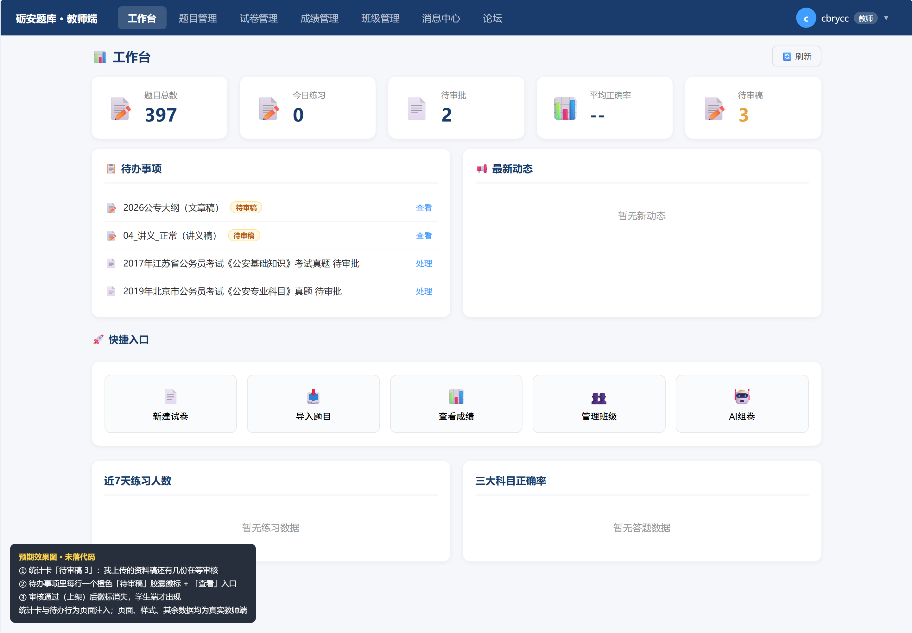
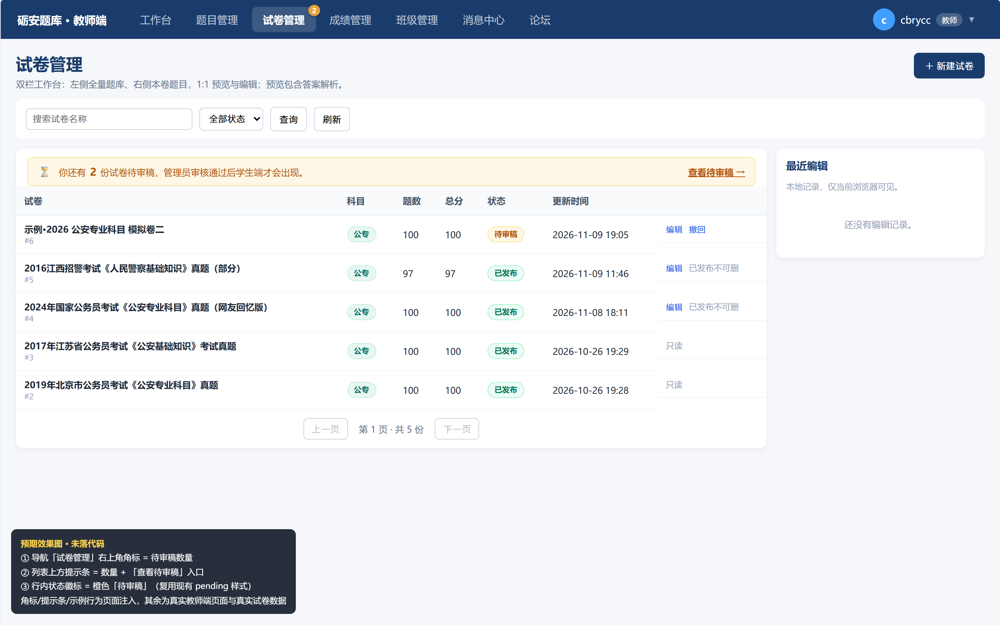

# 考试评分口径 `is_scored` 统一 · 方案 v1（✅ 已批准并交付）

> 触发：你 2026-11-09 点的两项之一 ——「`is_scored` 口径统一（`scored_count=97` 而 `questions=2` 时算 0 的问题）」。
> **2026-11-09 你已拍板三条**：①语义选 **A**；②三个派生字段**要加**；③数据回填**现在做**。
> 落地结果见 [`考试评分口径_is_scored统一_交付记录_v1.md`](./考试评分口径_is_scored统一_交付记录_v1.md)。
> 关联文档：`交卷用时与满分_缺陷修复记录_v1.md`（§7 第 3 项就是本项）。

---

## 1. 先纠正我自己的说法

我在 `交卷用时与满分_缺陷修复记录_v1.md` §7 写的是「本次 `scored_count=97`、`questions=2` 时算 0」。
**这句话与代码不符，是我记错了**，按实测更正如下：

| 我当时的说法 | 实测（`backend/app/api/v1/exam/exams.py:361-422`） |
|---|---|
| 97 题只答 2 题 → `scored_count=97 ≠ len(questions)=2` → 算 0 | `question_ids = list(answers.keys())`，`questions` 就是**提交上来的那批题**；循环里 `scored_count` 也在同一批上加一 → `scored_count == len(questions)` **恒成立** |

也就是说：这条老端点的 `is_scored = 1 if scored_count == len(questions) else 0`
实际是一个**恒真式**（只有"提交的 question_id 在题库里查不到"这种数据漂移才会 0）。
真正的问题不是"算错"，而是 **这个字段不表达任何信息，而且三处写入点三种口径**。

---

## 2. 现状实测（2026-11-09）

### 2.1 写入点 3 处，口径 3 套

| # | 位置 | 代码 | 实际含义 |
|---|---|---|---|
| 1 | `POST /api/exams/{record_id}/submit`（学生答题卡走这条） | `app/api/v1/exam/exams.py:422` `1 if scored_count == len(questions) else 0` | **恒为 1**（恒真式，见 §1） |
| 2 | `smart_exam`（智能练习/组卷交卷） | `app/api/v1/exam/smart_exam.py:1039` `is_scored=1` | **建记录时就写 1**（未评分也已标"已评分"） |
| 3 | `ExamService.submit_exam` | `app/services/exam_service.py:368` `record.is_scored = 1` | **无条件 1**；且该方法**没有任何调用方**（全仓 `submit_exam(` 仅 1 处定义、0 处调用 = 死代码） |

另外 `exam_service.py:85` 建记录时写 `is_scored=0`（未交卷态），这一处与语义一致。

### 2.2 读点 2 处

| 位置 | 用法 | 影响 |
|---|---|---|
| `app/services/agent_router.py:470` | `ExamRecord.is_scored == 1` + `is_completed == 1` → 取最近 3 条「模考成绩」拼进 AI 学情 | 唯一的业务读点 |
| `app/schemas/schemas.py:693` | `ExamRecordResponse.is_scored: bool`（开始/交卷回包里带） | 前端**一处都没用**（`.vtj/vue` 与 `src/` 全仓 grep `is_scored` = 0 命中） |

其余成绩相关模块（`teacher.py` 7 处、`exam_records.py` 10 处）**只按 `is_completed == 1` 过滤，不看 `is_scored`**。

### 2.3 库里真实数据

```
exam_record: 只有 1 行 → record_id=1, paper_id=5, is_completed=1, is_scored=1
exam_answer_detail: 97 行，其中 student_answer 为空 95 行、is_correct 为 NULL 的 0 行
question_bank: 397 题，全部客观题（单选 291 + 多选 106，question_type.is_objective 全 = 1）
```

结论：**现状下 `is_scored` 恒为 1，没有任何区分能力**；一旦将来上申论/主观题（`is_objective=0` → `is_correct` 留 NULL 等人工评分），它也无法表达"这卷分数还没定"。

---

## 3. 三种候选语义

| 方案 | `is_scored` 的含义 | 优点 | 缺点 |
|---|---|---|---|
| **A**（推荐） | **分数已完全确定**：`is_completed=1` 且不存在 `is_correct IS NULL` 的明细 | 名实相符；主观题待人工评分时天然为 0；学情统计能自动排除"分还没定"的卷 | 需要一次统一改写点 + 数据回填 |
| **B** | 提交即已评分（= 现在的实际行为） | 零风险 | 与 `is_completed` 完全同义，等于一个恒 1 的冗余列，等于没定义 |
| **C** | `is_scored` 保持现状，另加 `manual_pending_count` 列 | 不动老字段 | 老字段的三种口径仍混在一起，读方还是不敢用 |

**推荐 A + 补三个派生字段**（都是**只增不改**，不破坏 R11 的 357 条 API 面）：

| 新字段 | 含义 | 来源 |
|---|---|---|
| `manual_pending_count` | 待人工评分的题数 | `COUNT(detail WHERE is_correct IS NULL)` |
| `answered_count` | 实际作答（非空）题数 | `COUNT(detail WHERE student_answer <> '')` |
| `question_total` | 本卷题数 | `exam_paper.question_count`（已由 `sync_total_score` 同源维护） |

> `answered_count / question_total` 正好是结果页「0 / 97 题」那个分母口径，前端要用随时能取，不用再算。

---

## 4. 落地步骤（三批，可各自停）

### P-A 统一写入（约 0.3 天）

1. 新增 `app/services/exam_scoring.py`：

```python
def finalize_record(record, details, paper, now):
    """唯一写点：交卷后统一算 is_scored 与三个派生字段。"""
    manual_pending = sum(1 for d in details if d.is_correct is None)
    answered = sum(1 for d in details if (d.student_answer or "").strip())
    record.is_completed = 1
    record.is_scored = 0 if manual_pending else 1     # ← A 口径
    record.manual_pending_count = manual_pending
    record.answered_count = answered
    record.question_total = paper.question_count or len(details)
```

2. 三处写点全部改成调用它：`exams.py` 交卷、`smart_exam.py` 交卷、`exam_service.submit_exam`（顺手决定是否保留这段死代码）。
3. `schemas.ExamRecordResponse` 增 3 个可选字段（默认 0/None，老调用方不受影响）。

### P-B 数据回填（可选，要你点头；约 10 分钟）

- 脚本先**空跑**打印"将要改的行"，再改；`sqlite3.backup()` 备份（R10）；
- SQL 口径：`is_scored = CASE WHEN is_completed=1 AND NOT EXISTS(NULL 明细) THEN 1 ELSE 0 END`；
- 今天实测预计 **0 行变更**（唯一那条 `is_scored` 已经是 1 且无 NULL 明细）。

### P-C 读点对齐（可选）

- `agent_router.py` 的过滤保持 `is_scored == 1` 即可（A 口径下它正好等于"分数已定"）；
- 若你希望"有分就进学情"，则改成 `is_completed == 1`。**二选一，需要你定**。

---

## 5. 影响面与风险

| 项 | 影响 |
|---|---|
| API 路径 | **0 改动**（不新增/不改路径，只加响应字段），R11 的 357 条面不变 |
| 前端 | 0 改动（全仓无人读 `is_scored`）；若不显式展示，新增字段纯备用 |
| 成绩模块 | **0 影响**：`teacher.py` / `exam_records.py` 只按 `is_completed` 过滤 |
| 学情（AI 助教） | 唯一行为变化点：将来有主观题且未人工评分时，该卷不进"模考成绩"（这正是 A 口径想要的） |
| 当前数据 | 397 题全客观题 → **今天的行为一行都不会变** |

风险：唯一的真实风险是 `smart_exam` 现在"建记录即 1"，改成交卷时才算 —— 若有别的模块在**交卷前**依赖 `is_scored=1`，会受影响。已实测：全仓只有 `agent_router` 读它，且同时要求 `is_completed=1`，**不受影响**。

---

## 6. 测试计划

| 类型 | 用例 | 期望 |
|---|---|---|
| 新 | 全客观卷、全答对交卷 | `is_scored=1`、`manual_pending_count=0`、`answered_count = 题数` |
| 新 | 全客观卷、只答 2 题交卷 | `is_scored=1`、`answered_count=2`（**部分作答也算已评分**，这正是你说的那个口径） |
| 新 | 人为造一道 `is_objective=0` 的题并作答 | `is_scored=0`、`manual_pending_count=1` |
| 回归 | `pytest -k "exam or paper"` | 192 例保持通过（现基线） |
| 回归 | `gate_all.py` | 9/10（唯一红=既有 L1-G 题量护栏） |

---

## 7. 回滚

单文件回滚：`exam_scoring.py` 删除 + 三处调用点 revert + schema 字段 revert（新字段为可选项，不删列也不影响旧代码）。数据回填脚本自带 `--dry-run`，回填前的备份可直接顶回。

---

## 8. 要你拍板的三件事

1. **语义选 A 还是 C**（推荐 A：`is_scored` = 分数已完全确定）；
2. **三个派生字段要不要**（`manual_pending_count` / `answered_count` / `question_total`，推荐要，尤其结果页/成绩单要用）；
3. **数据回填现在做还是等下一次一起做**（今天预计 0 行变更，做与不做等价）。

---

## 9. 附录：教师端「待审稿」徽标预期效果图

> 这一项是**预期效果图**，未落代码。落点时受 R3 约束（`.vtj/vue/teacher_dashboard.vue` 的 `<template>` 不能由 AI 改），
> 三条可行路径见 9.3。

### 9.1 主方案：教师工作台（资料稿待审）



- ① 统计区新增第 5 张卡「待审稿 **3**」（数字用琥珀色 `#E6A23C`，与「待审批」的蓝色区分开：蓝色=等人审我的卷，琥珀=我的稿子在等审）；
- ② 「待办事项」里每行一个琥珀胶囊徽标 `待审稿`（`#FFF7E6` 底 / `#FDE68A` 边 / `#B45309` 字，圆角 999px，11px）+「查看」入口；
- ③ 审核通过（上架）后徽标消失、学生端才出现。
- 局部：`assets/教师端待审稿徽标/教师端_待审稿徽标_工作台方案_局部.png`

### 9.2 备选方案：试卷管理（如果你说的是"我出的卷待审"）



- 导航「试卷管理」右上角琥珀角标（数量=待审稿数）+ 列表上方提示条 + 行内橙色「待审稿」徽标。
- ⚠️ 实测这套东西**已经有了**：`TeacherPaperEditor.vue:1065` 状态映射里 `PENDING → 待审批`，样式 `pw-badge--pending` 就是琥珀色；`GET /api/teacher/papers/stats` 也已返回 `pending` 计数。所以试卷侧缺的只是**导航角标**，不是徽标本身。

### 9.3 落点三条路径（受 R3 约束）

| 路径 | 做法 | 代价 / 风险 |
|---|---|---|
| 设计器改 | 你在 `http://localhost:9527/__vtj__/` 拖两张卡进工作台 | 最干净，但要你动手 |
| 手写页替换 | 新建 `src/views/teacher/pc/TeacherDashboard.vue`，路由换 component（`.vtj` 原页保留可回滚） | 一次性成本高，但一劳永逸（与 A4 学生资料页同一套路） |
| DOM 注入 | 像 A1 批那样用脚本注入卡片，单例幂等、离开页面移除 | 最快，但属于补丁层 |

### 9.4 数据从哪来（实测可用）

```
待审稿数 = SELECT COUNT(*) FROM study_material WHERE status=0 AND creator_id=<当前用户>
```
今天实测：`status=0` 共 13 条，**全部是 admin（user 2）上传**，教师（user 1）0 条 → 图上「3」是示例数。
另注：教师目前**没有资料上传入口**（上传端点 `POST /api/materials/admin/files/upload` 仅管理员），
所以这条徽标真正有意义的前提是**先给教师开上传**（或开放 `/materials/my/upload` 的角色）。
