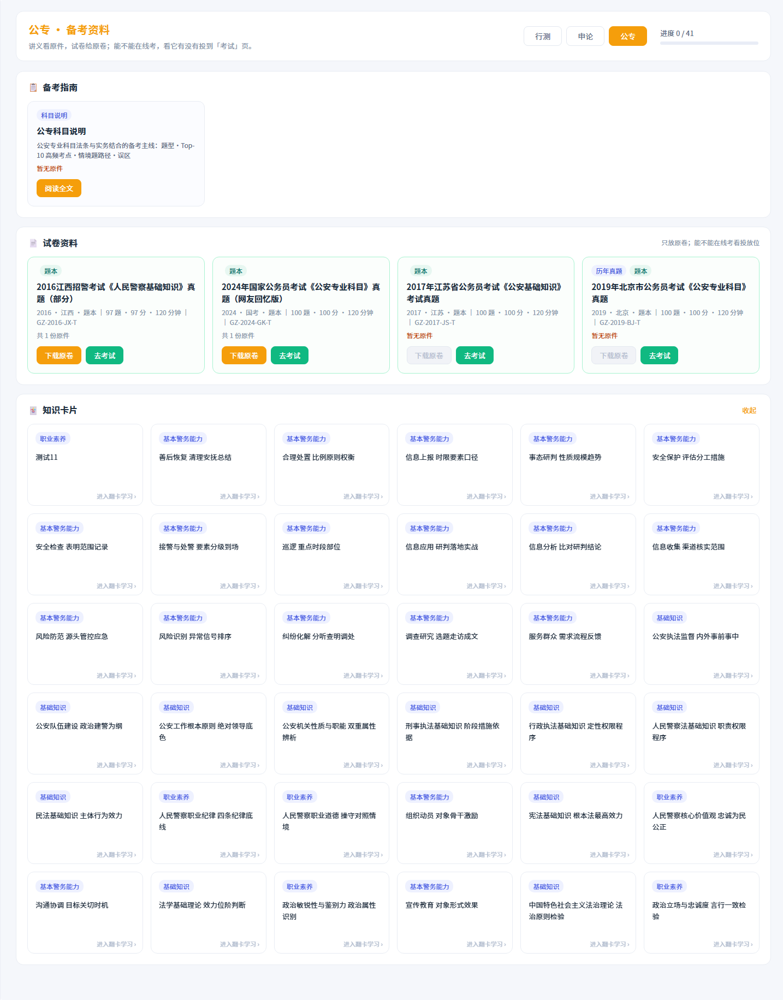
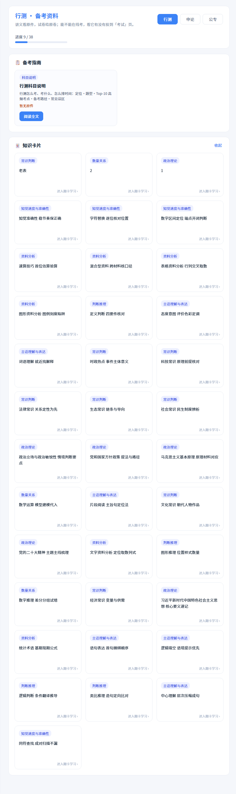
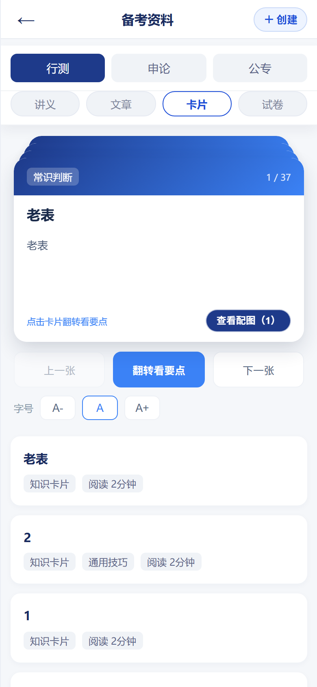
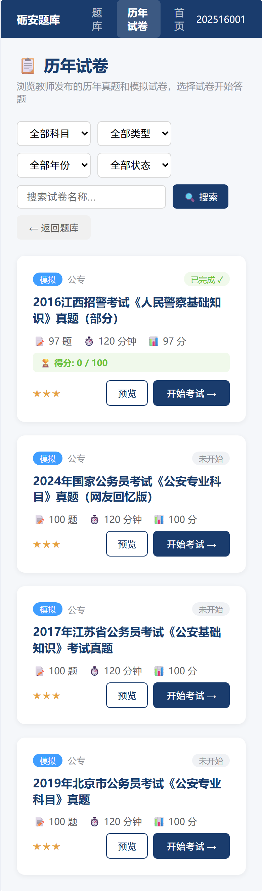

# 备考资料「上传 → 上架 → 学生三端」人工验收清单 v1

> 生成时间 2026-11-09 20:1x ｜ 分支 `feat/material-multi-format-import` ｜ main 未动
> 本文回答三个问题：①管理员端上传/上架是否完善；②上架后学生三端能不能"看"和"考"；③怎么完整人工验收。
> 所有"已完成"的判断都附实测命令或截图，凡是没验的会写"未验"。

---

## 0. 三句话结论

| 问题 | 结论 | 依据 |
|---|---|---|
| 上传/上架机制完善吗？ | **比较完善**（22 个管理端点 + 内容去重 + 默认未上架 + 上传即建卷/导题 + 答案上传 + 考试开关与定时 + 满分题量同步），但有 **6 个已知边界**（§6） | §2 端点清单、§4 截图、历史交付记录 |
| 上架后学生能看吗？ | **能**。PC 最好；平板复用 PC 页（820 实测可用）；手机有专门页 | §4 图 01/02/03 |
| 上架后学生能考吗？ | **PC 完整闭环**；平板可用（跳 PC 答题页）；**手机不理想**——点「去考试」落到 PC 试卷页，`mobile_answer` 目前只支持练题 | §4 图 04/06、§6 B1 |

---

## 1. 前置条件

### 1.1 服务与账号

```powershell
# 后端（8001；8000 被 Docker 占用）
cd backend; python -m uvicorn app.main:app --host 0.0.0.0 --port 8001
# 前端（9527）
cmd /c "npx vite --port 9527 --host 127.0.0.1"
```

| 角色 | 账号 | 密码 | 用途 |
|---|---|---|---|
| 管理员 | `cbrycc` | `cbrycc` | 上传 / 上架 / 开关 / 导题 / 补答案 |
| 学生 | `202516001` | `test123456` | 三端查看与考试 |
| 教师 | `ycc5678` | **未知（401）** | 教师侧本期不纳入人工验收（由 pytest `teacher_headers` 覆盖） |

### 1.2 数据基线（实测 2026-11-09 20:08）

| 表 | 现状 |
|---|---|
| `study_material` | **123**（`-1` 下架 4 / `0` 未上架 13 / `1` 已上架 **106**） |
| `exam_paper` | **5**：#1 ENDED（0 题）、#2 2019北京 100 题/100 分、#3 2017江苏 100/100、#4 2024国考 100/100、#5 2016江西 **97/97**，全部 PUBLISHED、`exam_open=1`、无定时窗口 |
| `question_bank` | **397**（全客观题：单选 291 + 多选 106） |
| `exam_record` | **1**（学生已交卷，得分 0/97、用时 9 秒、`answered_count=2`） |
| 学生可见资料 | 行测 **38**（37 卡片 + 1 文章）、申论 **27**、公专 **41**（36 卡片 + 1 文章 + **4 试卷**） |
| 学生可见试卷 | **4** 套（`GET /api/exams/list` → total=4） |

> 复核命令（只读）：
> ```powershell
> python _run/probe_student_three_ends.py   # 学生视角：资料/试卷/取题
> ```

---

## 2. 上传与上架机制现状（按动作）

### 2.1 管理端能力清单（22 个端点）

| 动作 | 入口（接口） | 关键行为 | 验收要点 |
|---|---|---|---|
| 单文件上传建资料 | `POST /admin/files/upload` | 建 `study_material(status=0 未上架)` + 原件作 `primary`；`auto_parse=1` 同步建导题草稿；**考试/双投放位自动建卷** | 上传后列表出现、状态「未上架」、有原件、有「待确认」chip |
| 批量上传 | 管理页「批量上传」弹层（逐文件调上面同一端点） | 一次 ≤50 文件 / ≤2GB；同名 docx+pdf 合并一条；`publish` 勾选即上架 | 队列进度、重复跳过、失败原因可读 |
| 立即上架 | `POST /admin/files/upload` 的 `publish=1` | 走 **P5 联动**：把对应 `exam_paper` 同步 PUBLISHED | 上架后学生端能看见、能考 |
| 上架/下架 | `PUT /admin/{id}/status` | `1` 上架 / `0` 未上架 / `-1` 软删 | 学生端立刻可见/不可见 |
| 创建资料（无文件） | `POST /admin` | **默认 status=0**（W2 改的口径，防止"建好即上线"） | 建完仍是未上架 |
| 批量创建 | `POST /admin/batch` | 默认未上架 + 同内容 `skipped_duplicates` | 重复内容不重复建 |
| 编辑资料 | `PUT /admin/{id}` | 类型/科目/分类/标题等 | 改完学生端同步 |
| 内容去重 | 建/传/批 三处 | `content_hash` 相同 → 单条 409 回已有 id、批量 skip | 同内容第二次上传被拦 |
| 导题 | `POST /admin/{id}/parse` → 草稿 → `confirm` | 解析 docx/pdf 成题 → **待确认列表** → 确认入库（补 `question_count` / `total_score` / 反查挂卷） | 未确认不入库；确认后学生能考 |
| 补答案 | `POST /admin/papers/{pid}/answers/parse` → `apply` | PDF/Excel 抽答案 → 逐题核对 → 只写 `answer`/`answer_analysis` | 已有答案默认保留（`overwrite` 才覆盖） |
| 考试开关 | `PUT /admin/{id}/exam-open` | 手动开/关；关闭保留历史成绩 | 关掉后学生「暂不可考」+原因 |
| 考试定时 | `PUT /admin/{id}/exam-window` | `exam_open_at` / `exam_close_at`（**服务器本地时间**） | 未到时间/已过期文案正确 |
| 建可作答卷 | `POST /admin/{id}/ensure-paper` | 给历史资料补卷 | 老资料也能开考 |
| 补录试卷资料 | `POST /admin/papers/backfill` | 已发布卷 → 补一份 `type=paper` 资料 | 资料页与考试页对齐 |
| 原件管理 | `DELETE /admin/{id}/files/{fid}` | 删单份原件（不删资料） | 删完 `file_count` 变化 |
| 删除/回收站 | `DELETE /admin/{id}`、`/admin/batch` | 软删 `status=-1`，不物理删除 | 回收站可见、可恢复 |
| 分类规则 | `POST/PUT /admin/rules` | 自动分类规则维护 | 新增资料按规则落类 |
| 配图/封面 | `POST /admin/upload/image`、`/admin/cards/batch-image` | 图片入 `static` | 卡片与文章封面正常 |
| 素材导入（旧通道） | `POST /admin/import/upload` → `confirm` | 表格/文档批量导入，入库固定 `status=0` | 与主通道不冲突 |

### 2.2 上架 ≠ 能考：两道闸

```
资料 status=1（上架，学生端可见）
        └─ 学生「资料页」能看到这张卷、能下载原卷
exam_paper.paper_type=PUBLISHED  +  exam_open=1  +  有题  +  在定时窗口内
        └─ 「去考试」按钮可点、能进答题页
```

判据集中在 `backend/app/api/v1/exam/contract.py::exam_ready()`，前端只读后端给的
`paper.exam{open,ready,reason}` 与 `exam_hint`（`src/utils/materialShelf.ts::canExam/examHint`）。
实测 4 套卷当前都是 `open=true, ready=true, reason="ready", exam_hint=""`。

---

## 3. 完整人工验收剧本（照抄即可）

### A. 上传（约 8 分钟）

| # | 操作 | 预期 | 判定 |
|---|---|---|---|
| A1 | 管理端 → 资料管理 →「上传资料」，选一个 **docx 讲义**，投放位「仅资料页」，`auto_parse` 开，**不勾**「立即上架」 | 列表新增一行，状态「未上架」，类型「讲义」，有「待确认」chip | 状态=未上架 |
| A2 | 同一文件再传一次 | 提示重复（409 / 跳过），**不新增行** | 行数不变 |
| A3 | 传一个**试卷**（docx 或 pdf），投放位「资料页+考试页」，不勾上架 | 新增 `type=paper` 资料 **且自动建卷**，考试列出现「未开放」 | 两张表各一行 |
| A4 | 点该行「导题」 | 抽屉列出解析出的题（题号/题型/题干），统计 N 题 | 题数与原卷一致 |
| A5 | 抽屉里改一题的选项文本 →「确认入库」 | 提示入库 N 题；资料状态仍「未上架」；卷 `question_count` = N、`total_score` = N（每题 1 分时） | 无需刷新即更新 |
| A6 | 对另一套已上架的卷点「补答案」，上传答案 PDF | 抽屉显示「识别 N / 题号覆盖 N / 冲突 / 空」四数字 | 覆盖 = 卷题数 |
| A7 | 逐题抽 3 题核对 →「写入答案解析」 | 提示 filled / overwritten / kept 数；题目详情能看到答案与解析 | 答案与原卷一致 |
| A8 | 删除刚传的测试资料 | 变「已删除（回收站）」，学生端看不到 | 软删，不物理删 |

### B. 上架 + 考试开关（约 6 分钟）

| # | 操作 | 预期 | 判定 |
|---|---|---|---|
| B1 | 对 A3 的资料点「上架」 | 状态「已上架」；学生端资料页立刻出现；**对应卷 `paper_type` 变 PUBLISHED** | 学生可见 |
| B2 | 学生端资料页点「去考试」 | 跳试卷页/答题页；若 A3 未导题 →「暂不可考」+原因「还没有题目」 | 有原因文案 |
| B3 | 管理端考试列**关闭**该卷开关 | 学生端按钮变「暂不可考」，title/说明 = 「考试已关闭…」 | 文案非空 |
| B4 | 重开，并设**定时窗口**（开始 5 分钟后） | 学生端立刻显示「未到开始时间」；到点后自动可考（刷新页面） | 服务器本地时间 |
| B5 | 设已过期的窗口 | 显示「已结束」；**历史成绩仍可查** | 结果页可进 |
| B6 | 关闭「有题但 0 分」的卷（把卷题量清空再试） | 不可开考，原因「题目/分值异常」 | 不出现空白卷 |

### C. PC 端（1440×900，约 6 分钟）

| # | 操作 | 预期 | 判定 |
|---|---|---|---|
| C1 | 学生 `202516001` 登录 → 公专 → 资料页 | 4 张试卷卡片，每张有「下载原卷」「去考试」与元数据（年份/地区/题本/题量/分值/时长/编号） | 与图 01 一致 |
| C2 | 点「下载原卷」 | 下载 docx，大小与原文件一致 | 字节一致 |
| C3 | 点「去考试」→ 试卷页 | 4 套卷卡片，含「已完成/未开始」、题量、时长、满分 | 与图 07 一致 |
| C4 | 点「开始考试」→ 答题 | 题目逐题渲染（题干/选项/题图），可标记、可跳题、有答题卡 | 无裂图 |
| C5 | 只答 2 题即交卷 | 结果页：得分 `0 / N 分`、正确/错误 `0 / N 题`、用时秒级、完成后能看解析 | 与图 07 的「0 / 97」同口径 |
| C6 | 「查看错题集」 | 错题已自动收录 | 条数与答错数一致 |

### D. 平板端（820×1180 横竖各一次，约 4 分钟）

| # | 操作 | 预期 | 判定 |
|---|---|---|---|
| D1 | 打开 `/#/tablet/materials` | **重定向到 PC 资料页** `/materials/xingce`，三列卡片栅格不溢出 | 与图 02 一致 |
| D2 | 切到「公专」→ 试卷资料区 | 4 张卷卡片，按钮不换行不遮挡 | 可点 |
| D3 | 打开 `/#/tablet/student-papers` | 沿用手机版列表（复用组件），卡片撑满屏宽 | 与图 05 一致 |
| D4 | 点一套卷 → 开考 | 跳到 `/answer`（PC 答题页），820 宽可用但两侧留白多 | 能答能交 |

### E. 手机端（390×844，约 4 分钟）

| # | 操作 | 预期 | 判定 |
|---|---|---|---|
| E1 | 打开 `/#/mobile/materials` | 顶部科目 3 tab + 类型 4 tab（讲义/文章/卡片/试卷），卡片可翻面、字号可调 | 与图 03 一致 |
| E2 | 切「试卷」tab | 每张卷有「去考试 / 暂不可考」+ 原因 | 与 PC 同源 |
| E3 | 点「去考试」 | **跳到 PC 试卷页** `/student/papers`（手机上渲染 PC 卡片，能用但偏挤） | 与图 06 一致 |
| E4 | 打开 `/#/mobile/student-papers` | 手机专用列表，只有题量/时长/类型，**无考试状态** | 与图 04 一致 |
| E5 | 点其中一套卷 | 跳 `/answer`（PC 答题页）——**移动答题页尚未接卷** | 见 §6 B1 |

### F. 联动与异常（约 5 分钟）

| # | 操作 | 预期 |
|---|---|---|
| F1 | 上架后立刻看学生端（不刷新） | 列表自动刷新或下次进入即见 |
| F2 | 有学生在考时把卷**下架/关考试** | 已开考的仍能交卷（是设计：交卷不阻断） |
| F3 | 同一套卷连续交两次 | 第二次 400「考试已提交，不能重复提交」 |
| F4 | 传一个**损坏的 docx** | 400 且提示可读，不入库 |
| F5 | 传一个 **>20MB** 文件 | 前端拦或后端 413/400，不入库 |
| F6 | 传一个**扫描版 PDF**（无文字层） | 走异步解析，草稿为 0 题；不产出空卷 |

### G. 回执格式

```
验收人 / 时间 / 分支 commit：
A1-A8：通过 8 / 失败 0（或写具体失败项与截图）
B1-B6：…
C1-C6：…
D1-D4：…
E1-E5：…
F1-F6：…
总体：可上线 / 有阻塞项（列出）
```

---

## 4. 本轮实测截图（真实登录、真实数据）

| 图 | 内容 | 看什么 |
|---|---|---|
| 01 | PC 1440 公专资料页 | 4 张试卷卡片 + 「下载原卷 / 去考试」+ 36 张知识卡片 |
| 02 | 平板 820 资料页 | 由 `/tablet/materials` 重定向到 PC 页，三列栅格不溢出 |
| 03 | 手机 390 资料页 | 科目/类型 tab + 翻卡交互 |
| 04 | 手机 390 历年试卷 | 手机专用列表，只有题量/时长/类型 |
| 05 | 平板 820 历年试卷 | 复用手机列表组件 |
| 06 | 手机 390 点「去考试」后 | 落到 **PC 试卷页**（`/student/papers`），能用但偏挤 |
| 07 | PC 历年试卷（修复后） | 「得分: 0 / **97**」正确 |











### 4.1 本轮顺手修掉的一个残余缺陷

**现象**：历年试卷卡片上，97 分的卷显示「🏆 得分: 0 / **100**」。

**根因**（`.vtj/vue/student_papers.vue:209`，只改 `<script>`，守 R3）：

```js
// 改前：data 是**列表响应体**（{total,page,page_size,data:[]}），根本没有 max_score → 永远退 100
maxScore: data.max_score || 100,
// 改后：取单条记录的 max_score；缺失时由模板 `|| p.total_score` 兜底到试卷自己的满分
maxScore: r.max_score,
```

**验证**：修复后卡片为「得分: 0 / **97**」（图 07；修复前见图 06）。

---

## 5. 覆盖度自评（5 分制）

| 维度 | 分 | 说明 |
|---|---|---|
| 上传/去重/原件留档 | 4.5 | 单文件/批量/去重/原件下载齐；缺 `force` 重建、文章批量不能一键上架 |
| 导题（卷→可考） | 4.0 | docx/pdf 解析 + 待确认 + 把关照齐全；扫描件需人工核对（已知） |
| 答案与解析 | 4.5 | PDF/Excel 四层抽取 + 冲突保留 + 只写两列 |
| 上架与考试闸 | 4.5 | 手动开关 + 定时窗口 + 0 题不可考 + 关闭保留历史 |
| PC 端查看/考试 | 4.5 | 全链路闭环 |
| 平板端 | 3.5 | 资料页=PC 页（能用但非专属布局），试卷/答题复用手机件 |
| 手机端 | 3.0 | 查看好；**考试走 PC 页面**，与"三端体验一致"的目标尚有距离 |

---

## 6. 已知边界（这些会在验收里被判"不通过"，提前说明）

| # | 边界 | 证据 | 建议 |
|---|---|---|---|
| B1 | **手机端没有整卷考试页**：`mobile_answer.vue` 只支持练题（`/api/quick-practice/questions`），`mobile_student_papers.vue:58` 注释自认"移动端答题页尚未开放，先跳 PC 端答题" | 代码行注释 + 图 06 | 单独立项：给 `mobile_answer` 加 `paper_id` 模式（开考/交卷/结果三接口已有） |
| B2 | 手机/平板「历年试卷」列表**没有考试状态**（未开放/定时未到），只有资料页卡片有 | 图 04/05 无状态角标；`/api/exams/list` 不返回 `exam` 块 | 让 `/api/exams/list` 复用 `contract.exam_state()` |
| B3 | 平板资料页 = PC 页（R12 复用，非专属布局） | 图 02 | 可接受；若要专属需新设计 |
| B4 | 教师**不能上传**资料（上传端点仅管理员） | `materials.py` 权限 | 待开教师上传 + 审核闭环 |
| B5 | 文章/讲义批量导入**固定未上架**，无批量上架开关 | W2 记录 | 加批量上架动作即可 |
| B6 | 无 `force` 重建（同内容只能保留一份） | 409 去重 | 需要时加参数 |

---

## 7. 一句话给验收人

> 先按 §1 对基线数字（123 / 5 / 397 / 106 / 4），再过 A→B→C，C 全绿即可认为"管理员上传上架 + PC 学生闭环"达标；
> D 全绿 = 平板可用；E1/E2 绿、E3/E5 记录为已知边界（B1）即可。
