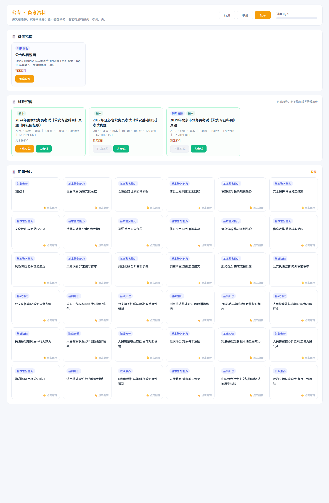
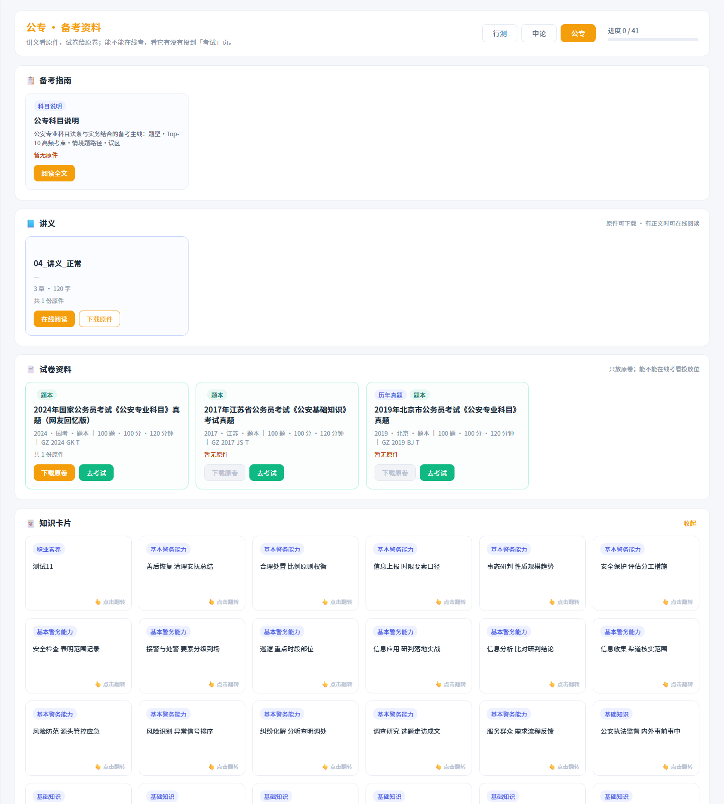

# 资料库 L2 学生端「备考资料」新页 交付记录 v1

> 所属方案：《资料库_讲义与试卷展示及投放位_方案_v1.md》→ **L2 批**
> 本批范围：学生端 PC/平板「备考资料」换新页，新增 **讲义** 与 **试卷资料** 两个分区；手机端留 L3。

---

## 0. 一页结论

| 项 | 结果 |
|---|---|
| 新页 | `src/views/student/materials.vue`（手写，普通 Vue 组件，**不是** `.vtj` 页） |
| 路由 | 三条既有路由（`/materials/xingce|shenlun|gongzhuan`）component 改为新页；**路由条数不变**（L6/L7 105），旧 `.vtj` 页保留 → 回滚一行 |
| 分区 | 视频×2 / 备考指南（文章）/ **讲义** / **试卷资料** / 知识卡片（共 6 区） |
| 讲义卡 | 标题 + 摘要 + 「N 章 · M 字」+ 「共 N 份原件」+〔在线阅读〕〔下载原件〕；无正文时阅读器明确提示"只有原件" |
| 试卷卡 | `2024 · 国考 · 题本 ｜ 100 题 · 100 分 · 120 分钟 ｜ GZ-2024-GK-T` +〔下载原卷〕〔去考试〕；不可考时置灰并给出**具体原因**（未建卷 / 卷里没题 / 未发布 / 投放位=仅资料页） |
| 纯函数单测 | `src/utils/materialShelf.ts` + `materialShelf.spec.ts` **12 例全绿**（L3 手机端复用同一口径） |
| 类型检查 | `vue-tsc --noEmit` **0 错误** |
| 前端全量 | `vitest` **58 文件 / 641 用例全绿**（原 57/629，+1 文件 +12 例） |
| 真实编译 | dev server（9527）对 `materials.vue` transform **HTTP 200 / 82,357 bytes**，已确认引用到 `materialShelf` |
| 后端 | 列表接口补 `paper` 区块与 `chapter_count/word_count`（**只加字段，端点不变**，API 面仍 343） |

---

## 1. 为什么这样写（多角度自检）

| 问题 | 回答 |
|---|---|
| 为什么新建页而不改 `.vtj` | R3 禁止 AI 改 `.vtj` 页 `<template>`；且实测 `.vtj/files/materials_gongzhuan.json` 的 DSL 只有标题 div，与 `.vtj/vue` 真实模板不同步 → 改模板会被设计器回存覆盖。仓库已有先例（管理端 `src/views/admin/materials.vue` 就是这么换的） |
| 为什么不新增路由 | 三条路由条数不变 → L6/L7 的 105 不用改、也不用重算基线；旧页面还在仓库，出问题改回 component 即可 |
| 为什么列表就返回试卷元数据 | 试卷卡上要显示年份/地区/卷别/题量/分值/时长/编号。若逐条拉详情，一屏 3~10 张卡就变成 3~10 个额外请求；每科只有几套卷，逐行一次 `paper_block` 可接受（列表页对 paper 行才查） |
| 为什么把文案/判定抽到 `utils/materialShelf.ts` | ①能被单测覆盖（12 例）；②L3 手机端要复用**同一套**"可考/不可考原因"口径，避免双份实现说两套话（项目里 `materialBatch.ts` 同一先例） |
| 安全性 | 正文一律 `sanitizeHtml` 后再 `v-html`；原件下载走 `downloadMaterialFile()`（带 token 打鉴权端点），不用裸 `<a href>`；`placement=exam` 的资料 L1 已在接口层挡住，前端拿不到 |
| 运维/可维护 | 页面只依赖 `/api/materials` 两个端点；分区表 `SECTIONS` 一处定义；折叠/展开、空态、骨架屏齐备；手机端留独立文件，不动本页 |
| 文件放对没 | 页面 `src/views/student/`（学生端）、纯函数 `src/utils/`、类型与请求 `src/modules/library/api.ts`（既有模块）、路由 `src/router/index.ts`（既有三条） |
| 前端能渲染吗 | dev server 实测 transform 200；`vue-tsc` 0 错误；`vitest` 全绿 |
| 后端字段够吗 | `placement/has_files/file_count/chapter_count/word_count/paper`（列表） + `files/doc_meta/content`（详情）——全部由既有模型派生，无新表 |
| VTJ 版本一致性 | 未新增/升级任何 `@vtj/*`；未改 `.vtj` 目录（0.16.35 / 0.12.19 原样） |

---

## 2. 改了什么（5 个文件）

| 文件 | 改动 |
|---|---|
| `src/views/student/materials.vue` | **新增**：六分区页面、阅读器（文章/讲义）、视频弹窗、卡片翻转、下载、"去考试"、标记学完、空态/骨架、响应式（≤768px 单列） |
| `src/utils/materialShelf.ts` | **新增**：`lectureMetaLine / paperMetaLine / canExam / examHint / fmtDuration / visibleItems / COLLAPSED` |
| `src/utils/__tests__/materialShelf.spec.ts` | **新增**：12 例单测 |
| `src/modules/library/api.ts` | 类型补 `placement / has_files / file_count / chapter_count / word_count / paper / files / doc_meta / card_back`（形状与后端一致） |
| `src/router/index.ts` | 三条 `/materials/*` 的 component 指向新页（附注释说明 R3 与回滚方式） |
| `backend/app/api/v1/library/materials.py` | 列表：paper 行附 `paper` 区块（`paper_registry.paper_block`，异常不拖垮列表）；brief 补 `chapter_count/word_count` |
| `vite.config.ts` | `devRuntimeSafety` 的 `remember()` 加空值守卫（socket 为 null 时不再 `WeakMap.set` 抛错；见 §4.1-②） |

---

## 3. 界面行为（验收口径）

| 场景 | 期望 |
|---|---|
| 有正文的讲义 | 〔在线阅读〕可用，阅读器里渲染正文 + 原件列表 +〔标记已学完〕 |
| 只有原件的讲义 | 〔在线阅读〕仍可点（进去提示"只有原件"并给原件清单），〔下载原件〕可用 |
| 试卷（已发布） | 卡上显示完整元数据；〔下载原卷〕（有原件时）、〔去考试〕可点 → 进 `/student/papers` |
| 试卷（未发布/未建卷/卷里没题/仅资料页） | 〔去考试〕置灰，卡片底部给出**具体原因**；〔下载原卷〕仍可用（资料页语义） |
| 无原件 | 〔下载原件/原卷〕置灰，卡片标「暂无原件」（红字提示） |
| 空科目 | 整页空态 + 返回首页/去看行测 |
| 窄屏（≤768） | 卡片单列，头部换行，不横向滚动 |

**"去考试"为什么不直接开考**：开考会在学生账号里留一条"进行中"记录（`exam_record`），且 L4/考试页已有「开始考试/继续考试」入口；资料页只负责把人送到考试页，避免重复实现开考逻辑（`student_papers.vue` 已是唯一入口）。

---

## 4. 验证记录（实测输出）

```text
vue-tsc --noEmit                 → 0 错误
vitest run                       → 58 文件 / 641 用例 全绿（+12 新例）
gate_all                         → 9/10（唯一红=既有 L1-G 语料下限；L6/L7 PASS ⇒ 路由数仍 105）
dev server transform             → GET /src/views/student/materials.vue → 200 / 82,357 bytes
```

**真实页面截图**（无头 Edge + 预置登录态，1440×2200；非示意图）：





> 第二张是为了验收讲义区，临时把 `#121 04_讲义_正常` 上架后拍的，**拍完已复原为未上架**（`status=0`）。
> 截图里能看到的真实数据：文章 1 条、试卷 3 套（2024 有原件可下载，2017/2019 无原件故「下载原卷」置灰）、卡片 36 张、进度 0/40。

```text
学生端列表（真实库）
xingce:   total=38  {card:37, article:1}
shenlun:  total=27  {card:26, article:1}
gongzhuan:total=40  {paper:3, card:36, article:1}

试卷行（现在就能渲染出完整卡片）
#127 2024国考 | placement=both | files=1 | 可考=True | 2024 国考 题本 | 100题 100分 120分钟 | GZ-2024-GK-T
#126 2017江苏 | placement=both | files=0 | 可考=True | 2017 江苏 题本 | 100题 100分 120分钟 | GZ-2017-JS-T
#125 2019北京 | placement=both | files=0 | 可考=True | 2019 北京 题本 | 100题 100分 120分钟 | GZ-2019-BJ-T

讲义行（管理端口径）
#121 04_讲义_正常  chapter_count=3 word_count=120 placement=library
#122 2026公专样章  chapter_count=1 word_count=57  placement=library
```

### 4.1 过程中抓到并修掉的两个问题（如实记录）

| # | 问题 | 现象 | 处理 |
|---|---|---|---|
| 1 | **`el-dialog` 在本项目不可用** | 本项目 Element Plus 只按需 import（`main.ts` 没有 `app.use(ElementPlus)`），`<el-dialog>` 退化成未知元素，把插槽内容**直接摊在页面底部**（截图第一版就看到"这篇资料只有原件…""该视频暂时无法播放"两段裸文本） | 改成自绘弹层（`Teleport` + mask + panel，约 40 行 CSS），与手写管理端抽屉风格一致；不引入全局注册（避免影响其它页面） |
| 2 | **dev server 会被一次请求打断** | `npm run dev` 两次自己退出（exit 1）：一次是 `vite.config.ts` 的 `devRuntimeSafety` 插件 `WeakMap.set(response.socket)` 在 socket 已断开时为 `null` → `TypeError: Invalid value used as weak map key`；另一次是我把无头浏览器的 `--user-data-dir` 放进了仓库，Vite 去 watch `Cookies` 文件触发 `EBUSY` | ①给 `remember()` 加空值守卫（2 行，失败时只是少记一次路由）；②无头浏览器 profile 改放 `%TEMP%`，仓库内不再出现 |

> 第 2 条的守卫改动在 `vite.config.ts`（开发期诊断插件），不参与产物构建；不加的话本机 `npm run dev` 会被任意一个 abort 的请求打断，属于"验证过程顺手修的阻塞问题"。

---

## 5. 已知边界（不藏）

| # | 事项 | 说明 |
|---|---|---|
| 1 | **现在学生端看不到讲义** | 库里 2 条讲义都是 `status=0`（未上架）。上架后才出现（这正符合"上架=审批"的口径） |
| 2 | #125/#126 没有原件 | 历史数据只有编号+卷，没有 PDF 原件 → 这两张卡〔下载原卷〕置灰。补原件走上传/挂附件即可 |
| 3 | 手机端仍是旧页 | L3 处理；手机页目前会把讲义/试卷混进列表且详情空白（审计 §8.1 已记录） |
| 4 | 「去考试」跳考试页 | 不直接开考（原因见 §3） |
| 5 | 阅读器的"标记已学完" | 沿用旧页 `POST /materials/progress`（UPSERT 幂等），学习进度会 +1 |

---

## 6. 回滚

1. `src/router/index.ts` 三条路由改回 `$vtj/vue/materials_*.vue`（旧页一直在仓库里）；
2. 后端列表新增字段可留可删（前端不强依赖，缺字段时卡片显示"—/元数据待补"）；
3. 前端整批 `git revert`（无 DDL）。

---

## 7. 下一步：L3（手机端）预期效果

**预期效果**：手机 `/mobile/materials` 增加「讲义」「试卷资料」两个横滑区（与 PC 同口径），讲义可在线阅读/下载原件，试卷显示元数据并能〔下载原卷〕，可考时给〔去考试〕；`typeName()` 补上"讲义/试卷"中文名（不再显示"资料"）；顶部分区不再把讲义/试卷混进卡片流。

**验收**：375 宽不横向滚动；三端同一份数据、同一套"可不可考"原因文案（复用 `materialShelf.ts`）；`vitest` 全绿。

---

## 8. 下一批（L4，备查）

上传弹窗投放位三选一、管理端列表"投放位"列、**文章批量上传**（解析链路）、改信息可改投放位。
