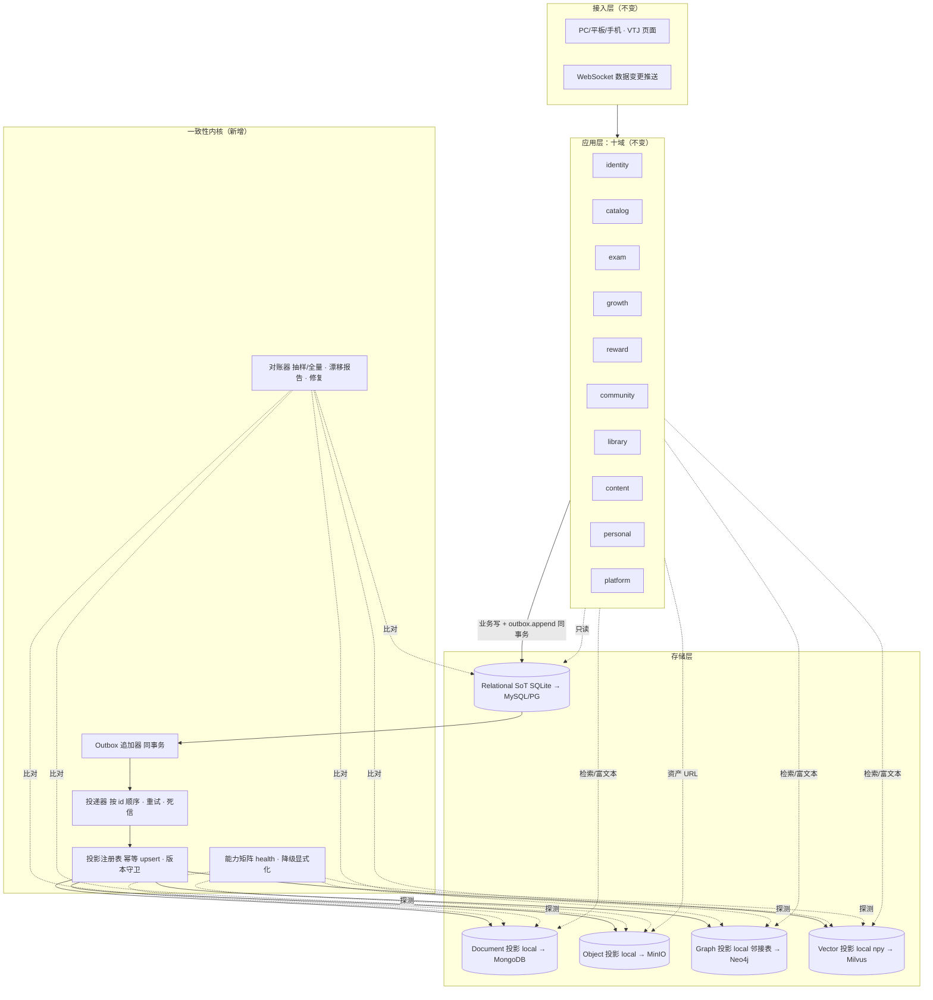

# 砺安题库终态总体架构与主干落地设计方案 v2.0（实测适配版）

> **方案状态**：待审批（设计阶段，未改动任何代码）
> **版本**：v2.0（对草案 v1.0 做实测校正后的替代版，v1.0 作废）
> **日期**：2026-10-26
> **代码基线**：`main` @ `d813bc7`（工作树有 2 处已暂存改动，见 §9.1）
> **本方案范围**：终态架构底座 + 多库一致性与同步。**不含**业务功能模块设计（由后续合作伙伴负责）
> **权威归档**：`docs/superpowers/specs/砺安题库终态总体架构_v2.0.md`
> **审批门**：本方案经用户批准后，才进入 F0 实施；未批准前不写代码、不建库、不迁移数据

---

## 0. 一页摘要

把草案的「五库并列融合 + 新老库双写」改为：

> **一个事实源（Relational SoT）＋ 四类可重建投影（文档/对象/图/向量）＋ 事务性 Outbox ＋ 幂等投影 ＋ 对账修复**

| 项 | 终态决定 |
|---|---|
| 事实源 | SQLite（当前 303.2 MB / 74 表）继续做唯一事实源；`DB_TYPE` 已预留 MySQL 出口，PG 作为后续独立迁移项，不在本方案强推 |
| 其余四库 | 文档、对象、图、向量全部是**投影**，不参与业务事务，可从事实源重建 |
| 一致性机制 | 业务写与 `foundation_outbox` 同事务提交；投递器按序派生；消费者幂等；每日对账；偏差可重放/重建 |
| 双写 | **禁止**。草案的「新老库双写」改为「回填 + 影子读 + 开关切换」 |
| 部署 | 开发机零新增服务即可跑；Redis/对象存储/图/向量用 Docker Compose **profile** 按需启用，不绑定日常开发 |
| 主干策略 | 直接在 `main` 小步提交，每阶段一个可回滚提交 + 一个 tag；不建长期分支（用户明示） |
| 前端 | 本方案零 `<template>` 改动、零 `.vtj/` 文件改动、零 `/api/v1` 端点改动 |
| 门禁 | 现有 L0–L6 全保留；新增 L7「底座一致性门禁」 |
| 角色 | 对齐 QBDM 九角色；Lead 只调度不写码；5 个 Teammate 按帽子工作 |
| 端 × 角色 | 3 角色 × 3 设备共 9 种组合，现状存在 5 种（学生三端 + 教师/管理员 PC）；一致性锚定 SoT，端只做呈现，新增端**不加表**（§15） |
| 空库处置 | 0 个库被 Git 跟踪；主树无 0 字节库；备份受 R8 保护不删；只加只读审计脚本（§16） |

**一句话验收**：杀掉进程、断掉 Redis、重复投递 10 次，投影结果仍与事实源一致；对账能发现人为注入的偏差并给出修复路径。

---

## 1. 实测基线（先测量，再设计）

> 本节所有数字均可复现。命令在仓库根或 `backend/` 下执行；路径相对仓库根。

| 事实 | 实测值 | 证据 |
|---|---|---|
| 当前分支 / HEAD | `main` / `d813bc7` | `git rev-parse --abbrev-ref HEAD`、`git log -3 --oneline` |
| 工作树 | 2 处已暂存改动：`backend/scripts/admin/seed.py`、`docs/plans/学生端模块化设计方案_v1.md` | `git status --short` |
| 后端形态 | 单一 FastAPI 单体，39 处 `include_router` | `backend/app/main.py` |
| API 版本 | 仅 `api/v1`，10 个域目录、50 个 `.py`、37 个路由模块 | `backend/app/api/v1/**` |
| 端点基线 | 343 个 `/api/v1/*`，冻结（R11） | `backend/data/refactor_baseline/api_surface.json`、AGENTS.md |
| 数据库 | SQLite WAL，`backend/data/question_bank.db` = 303.2 MB | 文件实测 |
| 库表 | 74 张表（含 `sqlite_sequence`，业务表 73） | `sqlite_master` 实测 |
| ORM | `backend/app/models/models.py` 非空 1689 行、72 个 `Base` 子类 | 实测；AGENTS 所称「已拆 models/ 目录」与现状不符，目录内仍只有 `models.py` |
| 事件总线 | `backend/app/core/events.py` 249 行，11 个事件名；Redis Stream 优先、List 兜底、缺席即 no-op | 源码 |
| 事件消费 | `backend/app/services/event_consumer.py`，只有 `user.action.v1` 与试卷发布两个订阅；无消费者组、无 ack、从 `0-0` 重复读 | 源码 209 行 |
| 调用点 | `record_user_action` 分布于 13 处 API；`events.publish` 仅试卷发布 2 处 | `grep` |
| 持久化事件 | **无** outbox / inbox / 投影游标 / 对账表 | 74 表清单中不存在 |
| 多库依赖 | requirements 无 psycopg / pymongo / neo4j / milvus / 向量库 | `backend/requirements.txt` |
| Redis | 依赖存在、`redis_client.py` 存在，但 `docker-compose.yml` 只有 backend/parser/nginx，**没有 redis 服务** | 实测 compose |
| 备份 | `sqlite3.backup()` 脚本存在；41 份 `data/*.bak*`（R8） | `backend/scripts/admin/backup_db.py` |
| 迁移 | 6 个 SQL + 若干 Python 脚本，**无 Alembic、无 schema_migrations 表** | `backend/migrations/` |
| 门禁 | L0 / L1-G / L1 / L1-H / L2 / L3 / L4 / L5 / L6，`gate_all.py` 编排 | `backend/scripts/gates/` |
| 大件 | `题库/` 662 MB、`backend/app/static/` 4.3 GB、`backend/uploads/` 约 0.8 GB | R6/R7、docs/README |
| P3B 状态 | **已合入 main**：`src/views/<role>/<device>/`、`backend/app/api/v1/<域>/`、`docs/{design,plans,ops,archive}/` 均已落地 | 目录实测；与草案「P3B 阻断」不符 |
| 运行时 | Python 3.13.5；Docker 与 redis-cli 命令存在；本机未验证 Redis 服务常驻 | 实测 |
| 标签 | 无 `foundation-v1`；现有标签为 `archive/*`、`data-2026-10-21`、`recruit-fix-baseline` | `git tag` |

### 1.1 由基线直接推出的三条硬约束

1. **不能把一个 303 MB、343 端点、无 Alembic 的 SQLite 单体，一次性换成 PostgreSQL + MongoDB + Neo4j + Milvus。** 迁移成本与回滚风险远超收益；且现有门禁 L1-G/L3/L4 全部锚定当前库。
2. **现有事件总线不可作为多库同步的底座。** 它是「提交后发布、失败即丢、无重放、从 `0-0` 重复读」的加速器，不是可靠传输。多库同步必须补持久化与幂等，不能只加订阅者。
3. **不能让开发机被五个数据库绑死。** 本机是 Windows + 单机 Python，日常开发必须零新增服务可运行；重服务只能按 profile 在服务器启用。

---

## 2. 对草案的 10 处硬修正

| # | 草案 v1.0 主张 | 实测 | 本方案决定 | 理由 |
|---|---|---|---|---|
| 1 | PostgreSQL 作核心事实源 | 现为 SQLite 303 MB，`DB_TYPE` 预留 MySQL | SQLite 继续做 SoT；MySQL/PG 作为**可切换方言**，不列为前置条件 | R10/R11、L4 契约、41 份备份都锚定 SQLite；换库是独立项目 |
| 2 | 五库并列「融合」，跨库业务写 | 无任何多库代码；事件总线不可靠 | **1 SoT + 4 投影**，禁止跨库事务、禁止双写 | 分布式事务在本项目不可维护 |
| 3 | P3B 未合并前严禁改动 | 已合入 main | 删除阻断；直接在 main 小步实施 | 避免基于过期事实做决策 |
| 4 | 新建 Outbox 表即可 | `events.py` 已存在但无持久化 | **复用事件契约，补持久化 Outbox/Inbox/游标/对账**，不另造第二套事件名 | 减少概念重复，保护成就模块 |
| 5 | MinIO 承接 4.3 GB 题图 | 题图在 `backend/app/static/`（R7） | 存量**原地只读**；对象存储只接**新增**资产 | 移动 4.3 GB 会破坏全站图片 URL 与 R7 |
| 6 | 默认有 Redis 可用 | compose 无 redis | F1 不依赖 Redis；F2 再加 redis 服务与消费者组 | 让一致性内核先在没有中间件时成立 |
| 7 | 新老库双写、双读验证 | 无实现 | 回填 + 影子读 + 开关切换；**永不双写** | 双写必然产生不可对账的分叉 |
| 8 | 343 端点冻结 + 新建 `/api/v2/` | 现状一致 | 底座**不新增任何 `/api/v1` 或 `/api/v2` 业务端点**；仅加运维只读端点 `/health/foundation` | 避免契约膨胀；v2 等业务模块真正需要时单独立项 |
| 9 | 6 个 Agent 角色 | QBDM 已有九角色 | 角色映射到 QBDM 九帽子；Lead 只调度；AI-Engine 在 F1 休眠 | 防止两套角色体系冲突 |
| 10 | 端侧小模型、数字人、DKT、3D 徽章 | 无相关代码/依赖 | 只保留**端口与事件缝**，不实现、不排期 | 用户已明示功能模块由合作伙伴设计 |

---

## 3. 范围与非目标

### 3.1 本方案要交付（In Scope）

- 终态逻辑架构与存储分层（1 SoT + 4 投影）。
- 多库一致性内核：事务性 Outbox、按序投递、幂等投影、失败重试/死信、对账与修复。
- 适配器契约与开关（local/off 默认，生产可切 mongo/minio/neo4j/milvus）。
- 迁移执行器（版本化、幂等、备份先行）、回填/影子读/切换/回滚流程。
- 部署拓扑与资源边界（开发机 / 学校服务器 / 生产）。
- dsh Agent 团队协作规约与门禁矩阵。
- 主干实施路线 F0–F6，每阶段可独立回滚。
- 新增 L7 底座门禁。

### 3.2 本方案不做（Out of Scope）

- 任何业务功能模块的界面/流程/算法设计（画像、学习计划、三维错题调度、论坛审核、数字人、3D 徽章、金币定价等）。
- `.vtj/` 任何文件、`<template>`、路由、页面改动。
- `/api/v1` 入参/出参/路径改动；`/api/v2` 业务端点。
- 把 `backend/app/static/`、`题库/`、`backend/data/*.bak*` 搬走或清理。
- 在开发机安装并常驻 MongoDB/Neo4j/Milvus。
- 模型训练、Embedding 模型选型与大规模向量化（F6 只做端口与最小闭环）。
- 改动成就/签到/金币等既有业务语义。

---

## 4. 终态逻辑架构

### 4.1 分层图



### 4.2 四条不可协商的架构规则

1. **单一事实源**：只有 Relational 存储参与业务事务。任何「两库同时成功才算成功」的写法一律拒绝。
2. **投影可重建**：文档/对象/图/向量四类存储中的任何一条，都必须能由 SoT + Outbox 重建；不能重建的数据不得放入投影库。
3. **读路径 SoT 优先**：用户可见的计数、状态、权限、详情默认读 SoT；投影只服务检索、推荐、富文本与资产。这样「最终一致」不会变成「用户看到旧数据」。
4. **降级必须显式**：任何后端不可用都必须写日志、置 `degraded` 标志、在 `/health/foundation` 可见；禁止 `except: pass` 式静默回落（吸取 2026-10-25 连错库事故教训）。

---

## 5. 存储分层与适配器

### 5.1 数据归属与可重建矩阵

| 存储 | 当前引擎 | 终态可选引擎 | 权威数据（Owns） | 派生数据（Derived） | 可重建 |
|---|---|---|---|---|---|
| Relational | SQLite WAL | MySQL / PostgreSQL | 73 张业务表 + 底座 6 张表 | 无 | 否（唯一事实源） |
| Document | `local`（文件） | MongoDB | `exam_resources`、`import_snapshots`、`forum_contents`、`agent_sessions` | 由业务 id + version 投影 | 是 |
| Object | `local`（内容寻址目录） | MinIO | 图片/音视频/徽章/头像的**字节**；元数据在 `media_assets`（Relational） | 由 `media_assets` + 文件重建 | 是 |
| Graph | `local`（SQLite 邻接表） | Neo4j | 节点/边只作为投影；知识点权威字段仍在 SoT（`knowledge_point`、`question_knowledge`） | `PREREQUISITE_OF`、`PARALLEL_WITH`、`INSTANCE_OF` | 是 |
| Vector | `local`（npy + 元数据） | Milvus | 无；只存向量与过滤元数据 | `text_questions`、`image_questions`、`knowledge_chunks`、`user_mistakes` | 是（重新 Embedding） |

> 关键：**「五库」不是五个平级数据库，而是「一个事实源 + 四类可重建投影」。**
> 这决定了故障处理方式：投影坏了就重建，事实源坏了才需要恢复备份。

### 5.2 适配器契约（Python Protocol，只定义，不在本阶段实现远端）

```python
# backend/app/foundation/stores/base.py（示意）
class StoreHealth(NamedTuple):
    backend: str          # local | mongo | minio | neo4j | milvus | off
    ok: bool
    degraded: bool
    detail: str = ""

class DocumentStore(Protocol):
    def upsert(self, collection: str, key: str, doc: dict, *, version: int) -> None: ...
    def get(self, collection: str, key: str) -> dict | None: ...
    def delete(self, collection: str, key: str) -> None: ...
    def health(self) -> StoreHealth: ...

class ObjectStore(Protocol):
    def put(self, key: str, data: BinaryIO, content_type: str, *, sha256: str) -> str: ...
    def open(self, key: str) -> BinaryIO: ...
    def exists(self, key: str) -> bool: ...
    def signed_url(self, key: str, ttl_s: int = 300) -> str: ...
    def health(self) -> StoreHealth: ...

class GraphStore(Protocol):
    def upsert_node(self, label: str, key: str, props: dict, *, version: int) -> None: ...
    def upsert_edge(self, rel: str, src: tuple[str, str], dst: tuple[str, str], props: dict) -> None: ...
    def neighbors(self, label: str, key: str, rel: str, depth: int = 1) -> list[dict]: ...
    def health(self) -> StoreHealth: ...

class VectorStore(Protocol):
    def upsert(self, collection: str, id: str, vector: list[float], meta: dict) -> None: ...
    def search(self, collection: str, vector: list[float], top_k: int, where: dict | None = None) -> list[dict]: ...
    def delete(self, collection: str, id: str) -> None: ...
    def health(self) -> StoreHealth: ...
```

**local 实现的最低能力**（保证开发机可跑、可测试）：

| 适配器 | local 实现 | 明确不支持 |
|---|---|---|
| Document | `backend/data/foundation/docs/<collection>/<key>.json`，按 key 读写 | 不做全文检索/聚合查询；查询走 SoT |
| Object | `backend/data/foundation/objects/<sha[:2]>/<sha>` 内容寻址 | 不做分布式/多副本 |
| Graph | SQLite 表 `foundation_graph_node/edge` + 递归 CTE 遍历 | 不做 Cypher |
| Vector | `backend/data/foundation/vectors/<collection>.npy` + `ids.json`，余弦 top-k | 超过阈值（建议 5 万条/集合或 1 GB）必须切 Milvus |

### 5.3 开关与「禁止静默降级」

```ini
# 统一前缀，默认值保证开发机行为不变
FOUNDATION_ENABLED=true
FOUNDATION_DISPATCH_BATCH=200
FOUNDATION_OUTBOX_RETENTION_DAYS=30
FOUNDATION_RECONCILE_CRON=0 3 * * *
FOUNDATION_STRICT_BACKENDS=0          # 生产建议 1：后端不可用即启动失败
DOC_STORE_BACKEND=off                 # off | local | mongo
OBJECT_STORE_BACKEND=local            # local | minio
GRAPH_BACKEND=off                     # off | local | neo4j
VECTOR_BACKEND=off                    # off | local | milvus
```

规则：

- `off` = 不写不读该投影，事件仍入 Outbox，后续开启后可**补投影**。
- `local` = 本地实现，允许功能受限，但必须在能力矩阵标注 `degraded=true`。
- `mongo/minio/neo4j/milvus` = 远端，连接失败时：
  - `FOUNDATION_STRICT_BACKENDS=0` → 该投影置 `degraded`，事件留在 Outbox 等待重试，**不丢**；
  - `FOUNDATION_STRICT_BACKENDS=1` → 启动失败并打印缺失项，**绝不回落 local**（除非显式 `*_ALLOW_FALLBACK=1`，生产禁止）。
- 能力矩阵在启动时打印一次，并由 `GET /health/foundation` 暴露（不鉴权、只返回后端名/ok/degraded/待处理事件数，不含任何密钥）。

---

## 6. 一致性内核（本方案核心）

### 6.1 现有事件总线为什么不够

| 现状 | 后果 |
|---|---|
| 业务 `db.commit()` 之后才 `events.publish()` | 进程崩溃/Redis 故障时事件永久丢失，投影无法补 |
| Redis 缺席时 `publish` 返回 `False`，多数调用点不处理 | 跨域副作用静默消失 |
| `subscribe` 从 `0-0` 读、无消费者组、无 ack | 每次重启重复消费；多实例重复处理 |
| `STREAM_MAXLEN=1000` 近似裁剪 | 历史事件不可重放，无法重建投影 |
| 事件名在 `Event.from_stream` 中白名单过滤 | 新增事件在旧消费者侧被静默丢弃，无法前向兼容 |
| 无 inbox/游标 | 投影重复写、乱序覆盖 |

**结论**：保留 `events.py` 作为「传输/契约」层，新增「持久化与幂等」层；不是替换，是补齐。

### 6.2 新增 6 张表（仅新增，不改任何既有表）

```sql
-- 1) 事务性发件箱：与业务写同事务
CREATE TABLE IF NOT EXISTS foundation_outbox (
  id              INTEGER PRIMARY KEY AUTOINCREMENT,  -- 全局单调序
  event_id        VARCHAR(32)  NOT NULL UNIQUE,       -- uuid4().hex
  event_name      VARCHAR(64)  NOT NULL,              -- 复用 events.py 的 11 个名字
  schema_version  INTEGER      NOT NULL DEFAULT 1,
  aggregate_type  VARCHAR(64)  NOT NULL,              -- question/paper/user/...
  aggregate_id    VARCHAR(64)  NOT NULL,
  aggregate_ver   INTEGER      NOT NULL DEFAULT 0,    -- 同一聚合的写版本，单调递增
  dedupe_key      VARCHAR(128),                        -- 可空；同键只入一次
  payload         TEXT         NOT NULL,              -- JSON；字段只增不删
  producer        VARCHAR(64)  NOT NULL,
  trace_id        VARCHAR(64),
  occurred_at     DATETIME     NOT NULL,
  status          VARCHAR(16)  NOT NULL DEFAULT 'pending', -- pending|dispatched|dead
  attempts        INTEGER      NOT NULL DEFAULT 0,
  next_retry_at   DATETIME,
  dispatched_at   DATETIME,
  last_error      TEXT
);
CREATE UNIQUE INDEX IF NOT EXISTS ux_outbox_dedupe
  ON foundation_outbox(dedupe_key) WHERE dedupe_key IS NOT NULL;
CREATE INDEX IF NOT EXISTS ix_outbox_status_id ON foundation_outbox(status, id);
CREATE INDEX IF NOT EXISTS ix_outbox_aggregate
  ON foundation_outbox(aggregate_type, aggregate_id, aggregate_ver);

-- 2) 投影游标：每个投影消费到哪一条
CREATE TABLE IF NOT EXISTS foundation_projection_cursor (
  projection      VARCHAR(64) NOT NULL,
  last_outbox_id  INTEGER     NOT NULL DEFAULT 0,
  updated_at      DATETIME    NOT NULL,
  status          VARCHAR(16) NOT NULL DEFAULT 'idle', -- idle|running|degraded
  lag_seconds     INTEGER     NOT NULL DEFAULT 0,
  PRIMARY KEY (projection)
);

-- 3) 已处理事件：跨进程/多实例去重（F2 起启用）
CREATE TABLE IF NOT EXISTS foundation_inbox (
  consumer      VARCHAR(64) NOT NULL,
  event_id      VARCHAR(32) NOT NULL,
  event_name    VARCHAR(64) NOT NULL,
  processed_at  DATETIME    NOT NULL,
  PRIMARY KEY (consumer, event_id)
);

-- 4) 投影状态：按聚合记录已投影版本与校验和
CREATE TABLE IF NOT EXISTS foundation_projection_state (
  projection      VARCHAR(64) NOT NULL,
  aggregate_type  VARCHAR(64) NOT NULL,
  aggregate_id    VARCHAR(64) NOT NULL,
  source_version  INTEGER     NOT NULL,
  checksum        VARCHAR(64),
  updated_at      DATETIME    NOT NULL,
  PRIMARY KEY (projection, aggregate_type, aggregate_id)
);

-- 5) 对账运行记录
CREATE TABLE IF NOT EXISTS foundation_reconcile_run (
  run_id       VARCHAR(32) PRIMARY KEY,
  scope        VARCHAR(64) NOT NULL,
  mode         VARCHAR(16) NOT NULL,      -- sample|full|incremental
  started_at   DATETIME    NOT NULL,
  finished_at  DATETIME,
  checked      INTEGER     NOT NULL DEFAULT 0,
  drifted      INTEGER     NOT NULL DEFAULT 0,
  repaired     INTEGER     NOT NULL DEFAULT 0,
  report_path  VARCHAR(255),
  status       VARCHAR(16) NOT NULL DEFAULT 'running' -- running|ok|drift|failed
);

-- 6) 回填断点：可续跑、可 dry-run
CREATE TABLE IF NOT EXISTS foundation_backfill_state (
  source      VARCHAR(64) NOT NULL,
  cursor      VARCHAR(128) NOT NULL DEFAULT '',
  total       INTEGER     NOT NULL DEFAULT 0,
  done        INTEGER     NOT NULL DEFAULT 0,
  updated_at  DATETIME    NOT NULL,
  PRIMARY KEY (source)
);
```

> 兼容性：以上 DDL 用 SQLite 语法；MySQL/PG 变体由迁移执行器按 `DB_TYPE` 选择（`AUTOINCREMENT`→`AUTO_INCREMENT`/`BIGSERIAL`，`DATETIME`→`TIMESTAMP`）。F1 只交付 SQLite 版。

### 6.3 事件信封（对既有 `Event` 的扩展，字段只增不删）

```json
{
  "event_id": "9f2c…",
  "event_name": "catalog.question.imported",
  "schema_version": 1,
  "aggregate": {"type": "question", "id": "1042", "version": 7},
  "occurred_at": "2026-10-26T19:00:00+08:00",
  "producer": "catalog.question_import",
  "trace_id": "req-…",
  "payload": {}
}
```

约定：

- `payload` **只增不删**；删除语义用 `deleted=true` 墓碑，不物理删字段。
- 消费者必须忽略未知字段、未知 `schema_version` 时降级并告警，**不得因未知字段失败**。
- `aggregate.version` 是投影的「最后写入者」依据：仅当 `incoming.version > stored.version` 才覆盖；相等时比较 `checksum`，不同则告警不覆盖。

### 6.4 写路径（请求内，强事务）

```python
# 业务代码的唯一正确写法
with db.begin():                       # 已有事务
    q = Question(...); db.add(q); db.flush()
    outbox.append(db, Event(
        name=EV_QUESTION_IMPORTED,
        aggregate=("question", str(q.question_id), next_version),
        payload={"question_id": q.question_id, "subject_id": q.subject_id},
        producer="catalog.question_import",
        dedupe_key=f"question:{q.question_id}:v{next_version}",
    ))
# 提交后：请求立即返回；投影由后台投递器完成
```

关键点：

- `outbox.append` 只做 `db.add`/`flush`，**不提交**；提交由业务事务负责。
- 请求路径不等待投影完成，P95 只增加一次 INSERT（目标 < 2 ms）。
- 若业务事务回滚，Outbox 行一并回滚——这是 Outbox 模式相对「提交后 publish」的根本优势。

### 6.5 投递器状态机（后台单协程，F1 单实例）

```
pending --claim--> running --全部投影成功--> dispatched
                         ├─ 可重试错误 --> pending（指数退避，attempts+1）
                         └─ 超过 8 次 --> dead（写 last_error，告警，不阻塞后续）
dead --人工/脚本 replay--> pending
```

实现要点：

- 按 `id ASC` 批量取 `status='pending' AND (next_retry_at IS NULL OR next_retry_at<=now)`。
- 同一批内**按 id 串行**应用，保证全局顺序；跨批继续按 id。
- 每个投影成功后更新 `foundation_projection_state` 与 `foundation_projection_cursor`。
- 一个事件涉及多个投影时：全部成功才 `dispatched`；部分失败时已成功的投影靠幂等 upsert 重放，不产生副作用。
- 每批结束 `db.commit()`；进程被杀最多重放一批，靠幂等兜底。
- `FOUNDATION_ENABLED=false` 时投递器不启动，Outbox 只增不投，恢复后自动续投。

### 6.6 幂等投影

投影实现必须满足：

1. **按 key upsert**，不依赖「事件只来一次」。
2. **版本守卫**：`incoming_version <= stored_version` 时直接跳过（记录指标）。
3. **可重入**：同一事件重放 10 次，结果字节级一致（测试断言）。
4. **删除用墓碑**：`op=delete` 时写 `deleted=true, version=n`，不物理删除（便于对账与恢复）。

### 6.7 顺序、版本与删除

| 场景 | 处理 |
|---|---|
| 同一题目连续两次编辑 | `aggregate_ver` 递增；旧事件后到也不会覆盖新值 |
| 多实例并发投递（F2 起） | Redis Stream 消费者组 + `foundation_inbox` 去重；顺序只保证**同一聚合**，不保证全局 |
| 删除题目 | 发 `catalog.question.deleted` 墓碑；投影标删；SoT 可按既有逻辑软删 |
| 重放旧事件 | 版本守卫拒绝覆盖，只补缺失 |
| 事件名新增 | `events.ALL_EVENTS` 末尾追加；旧消费者忽略未知名，不崩 |

### 6.8 重试、死信与告警

| 参数 | 默认 | 说明 |
|---|---|---|
| 批大小 | 200 | 单批上限，避免长事务 |
| 最大尝试 | 8 | 退避 2s/4s/8s/…/256s |
| 死信阈值 | 8 | 转 `dead`，保留 payload 供人工重放 |
| 告警 | pending>1000 或 dead>0 或 lag>60s | 写 `logs/foundation.log` + `/health/foundation` 返回 `alert=true` |

### 6.9 对账（Reconciliation）

三种模式：

| 模式 | 频率 | 范围 | 用途 |
|---|---|---|---|
| incremental | 每 5 分钟 | 只比 `cursor` 与 `outbox` 高水位 | 发现「卡住」 |
| sample | 每日 03:00 | 每个聚合随机 N=1000 | 日常体检 |
| full | 每周/发版前 | 全量 | 上线验收、事故后 |

对账算法（每个投影）：

```
src = SoT.compute(aggregate)            # 计数/校验和/关键字段
dst = projection.read(aggregate)
if dst is None:                      drift = missing
elif dst.version < src.version:      drift = stale
elif dst.version > src.version:      drift = orphan
elif dst.checksum != src.checksum:   drift = mismatch
```

输出：

- `backend/data/reconcile/<run_id>.json`：逐条漂移（聚合、版本、期望/实际校验和、建议动作）。
- `backend/data/reconcile/latest.json`：最近一次摘要，供 `/health/foundation` 读取。
- 修复动作三选一：`replay`（从 Outbox 重放）、`rebuild`（从 SoT 重建该聚合）、`quarantine`（标记漂移，读路径回退 SoT）。

**对账不是可选功能**：没有对账的多库同步等于没有同步。

### 6.10 一致性等级（写进接口注释与评审清单）

| 等级 | 含义 | 适用 |
|---|---|---|
| C0 强一致 | 同一 SQLite 事务 | 用户/题目/试卷/金币/订单等业务写 |
| C1 读己之写 | 写完立即读 SoT 能看到 | 所有用户可见状态 |
| C2 有界最终一致 | 投影延迟 P95 < 5s，>60s 告警 | 检索、推荐、富文本、图遍历 |
| C3 最终一致 | 可重建，允许分钟级 | 向量索引、离线分析 |

> **禁止**把 C2/C3 的数据用于「权限判断、计数展示、支付/金币结算」。

### 6.11 保留、归档与容量

- `dispatched` 保留 30 天，之后导出 `backend/data/outbox_archive/YYYYMM.jsonl.gz` 并删除，控制 SQLite 体积。
- `dead` 永不自动删除，必须人工处理。
- 估算：13 个用户行为调用点 + 试卷发布，日增约 1 万条、payload 约 300 B → 约 3 MB/天；30 天约 90 MB。上线后以实测为准，超过 200 MB 提前调小保留天数。
- 备份：Outbox 在同一个 SQLite 内，`sqlite3.backup()` 天然覆盖；外部投影库各自备份，且都必须能由 SoT 重建，备份只用于加速恢复。

---

## 7. 部署拓扑与资源边界

### 7.1 三种运行形态

| 形态 | 启用服务 | 后端开关 | 适用 |
|---|---|---|---|
| 开发（默认） | 无新增；仅 backend + vite | 全部 `local/off` | 日常编码、单测、门禁 |
| 学校/演示服务器 | + redis（profile `foundation`） | `FOUNDATION_ENABLED=true`，投影 `local` | 多人访问、事件可靠投递 |
| 生产/重服务 | + redis + minio + mongo + neo4j + milvus（profile `ai`） | 远端后端，`STRICT_BACKENDS=1` | 检索/图谱/向量能力上线后 |

### 7.2 Compose 设计（不破坏现有启动方式）

- 现有 `backend/parser/nginx` 保持默认 profile，`docker compose up -d` 行为不变。
- 新增服务全部挂 profile：
  - `foundation`：`redis:7-alpine`（AOF everysec，仅内网，不暴露端口）
  - `storage`：`minio`（内网 9000/9001，控制台只绑 127.0.0.1）
  - `ai`：`mongo:7`、`neo4j:5-community`、`milvus`（含 etcd + 内部 minio）
- 资源预算（估算，需在目标机实测）：redis < 100 MB；minio < 500 MB；mongo < 1 GB；neo4j 堆 512 MB–1 GB；milvus standalone ≥ 4 GB。**8 GB 内存的笔记本不要开 `ai` profile。**
- 所有管理端口只绑 `127.0.0.1`；对外只经 nginx。
- 凭据从 `deploy/.env.*` 注入，仓库只留 `.env.example`；本方案不写任何真实密钥。

### 7.3 Windows 现实约束

- 本机 Docker 命令存在，但 `ai` profile 的 WSL2 内存/磁盘开销大；F1–F2 不要求启动任何容器。
- 本地适配器目录统一放 `backend/data/foundation/`（已在 `.gitignore` 的 `data/` 下），不污染 Git。
- 所有路径解析沿用 `db_guard.resolve_sqlite_path` 的相对 `backend/` 规则，禁止依赖进程 cwd。

---

## 8. 迁移、回填与回滚

### 8.1 迁移执行器（补上缺失的版本管理）

新增 `backend/scripts/migrate/apply.py`：

```
python scripts/migrate/apply.py --list
python scripts/migrate/apply.py --dry-run
python scripts/migrate/apply.py --apply
python scripts/migrate/apply.py --verify
```

规则：

1. 迁移文件命名 `YYYYMMDD_NNN_<slug>.sql`，按文件名排序。
2. `schema_migrations(version PK, checksum, applied_at, applied_by, execution_ms)` 记录已应用。
3. 已应用文件的 checksum 变化 → 拒绝执行并报错（防止偷偷改历史迁移）。
4. `--apply` 前自动 `sqlite3.backup()` 到 `backend/data/backups/pre_foundation_<ts>.db`，并做 `PRAGMA integrity_check`。
5. 磁盘剩余 < 2 GB 或备份失败 → 拒绝执行。
6. 迁移文件内只允许 `CREATE TABLE/INDEX IF NOT EXISTS`、`INSERT OR IGNORE`；**禁止**在 F1 修改既有表。
7. 文件锁 `backend/data/foundation.migrate.lock`，防并发执行；遗留锁需人工确认后删除。

### 8.2 存量数据回填（F3 起，先对象/文档，后图/向量）

- 回填脚本：`backend/scripts/foundation/backfill_<store>.py`。
- 必须支持：`--dry-run`、`--limit`、`--since`、`--resume`、`--verify`。
- 断点写 `foundation_backfill_state`；每批 500；失败不推进游标。
- 回填只读 SoT，不写 SoT；写投影前先查 `foundation_projection_state`，版本相同则跳过。
- 回填完成后必须跑一次 `full` 对账，drift=0 才能切换读路径。

### 8.3 切换与影子读

1. 写入：始终只写 SoT + Outbox（不双写）。
2. 投影：先 `off` → `local` 回填 → 对账 → 再切远端。
3. 读：新读路径先「影子读」——同时读 SoT 与投影，比较结果只记日志、不改变返回；连续 24h 无差异后再用开关切换。
4. 任一步失败：开关回 `off`，读路径回 SoT；投影数据保留待修。

### 8.4 回滚矩阵

| 阶段 | 回滚动作 | 数据影响 | 时间 |
|---|---|---|---|
| F0 | 撤销文档/标签 | 无 | 秒级 |
| F1 | `FOUNDATION_ENABLED=false` + 删除 6 张新表（或恢复迁移前备份） | 仅丢失未投递事件 | 分钟级 |
| F2 | 关闭 redis profile，回到 F1 | 事件退回 Outbox | 分钟级 |
| F3–F6 | 投影开关回 `off`；读路径回 SoT | 投影数据可丢（可重建） | 分钟级 |
| 任何阶段 | 恢复 `pre_foundation_<ts>.db` | 回到迁移前 | 分钟级，需停服 |

> 铁律：**回滚不得依赖「反向迁移脚本」**；只依赖备份 + 开关 + 投影可重建。

---

## 9. 主干实施路线（F0–F6）

> 用户已明示：**不建分支，直接在 main 扩容**。因此每阶段必须满足「单提交可回滚、默认关闭、门禁通过」。
> 例外：单阶段改动 > 40 个文件或需要两人并行改同一批文件时，才开短分支 `foundation/fN-<slug>`，合并后立即删除。

### 9.1 F0 基线冻结（0.5 天）

| 项 | 内容 |
|---|---|
| 目标 | 让「改之前」可复现、可回退 |
| 动作 | ① 处理工作树 2 处已暂存改动（提交或经用户确认暂存）；② 打 tag `foundation-v1`；③ 记录 `gate_all --quick` 结果、`sqlite3.backup()` 一份；④ 落盘能力矩阵占位文档 |
| 验收 | `git status` 干净；tag 存在；备份文件可打开；`gate_all --quick` 全 PASS |
| 回滚 | 删除 tag；不动数据 |

> 注意：当前 `main` 工作树并非干净（`seed.py` 与一份 docs 已暂存）。F0 必须先与用户确认这两处改动归属，不得擅自提交或丢弃。

### 9.2 F1 一致性内核（2–3 天，本方案最高优先级）

| 项 | 内容 |
|---|---|
| 目标 | 在没有 Redis、没有任何新服务的情况下，让 Outbox → 投递 → 投影 → 对账 跑通 |
| 新增 | `backend/app/foundation/{config,schema,outbox,dispatcher,projection,reconcile,health}.py`；`stores/{base,local_document,local_object,local_graph,local_vector}.py`；`backend/migrations/20261027_001_foundation_core.sql`；`backend/scripts/migrate/apply.py`；`backend/scripts/foundation/{outbox_probe,reconcile}.py`；`backend/tests/test_foundation_*.py` |
| 修改 | `backend/app/main.py`（lifespan 启停投递器、注册 `/health/foundation`）；`backend/app/core/config.py`（新增开关）；`backend/scripts/gates/gate_all.py`（接入 L7） |
| **不动** | `api/v1/**`、`models/models.py`、`.vtj/**`、`src/**`、`static/**`、`题库/**`、既有表结构 |
| 交付 | 6 张表 + 投递器 + 空投影注册表 + 对账骨架 + L7 门禁 + 单测 |
| 验收 | 见 §9.2.1 |
| 回滚 | 开关关闭 + 删 6 表 / 恢复备份 |

#### 9.2.1 F1 可量化验收

1. 迁移连跑两次，`--verify` 均通过，表结构无变化。
2. 事务测试：业务写后抛异常 → Outbox 与业务行**同时回滚**，计数为 0。
3. 崩溃测试：投递器处理到第 50 条时 `kill -9` → 重启后从游标续跑，投影不重复、不丢失。
4. 重放测试：同一事件投递 10 次 → 投影行数与内容不变（幂等）。
5. 顺序测试：同一聚合 v1/v2 乱序投递 → 最终为 v2（版本守卫）。
6. 对账测试：人为改坏 1 条投影 → `sample` 对账报 `mismatch`，`rebuild` 后 drift=0。
7. 门禁：L0–L7 全 PASS；`gate_all --quick` 不回归。
8. 性能：200 次业务写冒烟，API P95 相对 F0 增幅 ≤ 5%；1000 条事件使库增长 ≤ 2 MB。
9. 关闭开关：`FOUNDATION_ENABLED=false` 时，除 `main.py` 外无行为差异；接口返回与 F0 一致。

### 9.3 F2 事件可靠化与调用点迁移（1 天）

| 项 | 内容 |
|---|---|
| 目标 | 让现有 13 个 `record_user_action` 与 2 个 `events.publish` 走 Outbox；启用 Redis 消费者组 |
| 动作 | compose 加 `redis`（profile `foundation`）；`events.py` 增加 `xgroup/xreadgroup/xack` 路径；`event_consumer` 改为从 Outbox 消费；13 个调用点改为「事务内 append」（逐个提交、逐个测试） |
| 验收 | 断 Redis 后业务写不失败、事件积压可观测；恢复后自动追平；成就发放不重复、不遗漏（复用现有 `test_achievement_judge` 与 `test_cross_domain_flows`） |
| 回滚 | 关 redis profile；`EVENT_CONSUMER_ENABLED=false`；回到 F1 的本地投递 |

> F2 只做「迁移调用点」，不改任何事件语义与 `trigger_type` 字符串（add-only）。

### 9.4 F3 对象存储（1–2 天）

| 项 | 内容 |
|---|---|
| 目标 | 新增图片/视频/徽章/头像走对象存储；存量 `static/` 不动 |
| 动作 | `media_assets` 表（SoT）；`ObjectStore` local/minio；导入与上传的新写路径切到 `put()`；读取用鉴权 URL/本地路径映射 |
| 验收 | 新上传资产可读写、sha256 去重；旧图片 URL 100% 不变（R7 回归）；断 MinIO 时新上传明确失败并提示，不静默写坏 |
| 回滚 | 开关回 `local`；新资产仍在本地目录；旧资产从未被触碰 |

### 9.5 F4 文档存储（2 天）

| 项 | 内容 |
|---|---|
| 目标 | `ExamRes` JSON-LD、导入快照、论坛富文本进入文档投影 |
| 动作 | `DocumentStore` local/mongo；`exam_resources`/`import_snapshots` 先回填历史、再双读验证（只记日志）；管理员导入流程写新集合 |
| 验收 | 抽样 500 条，字段与 SoT 一致；文档库不可用时导入仍成功（投影降级，Outbox 积压） |
| 回滚 | `DOC_STORE_BACKEND=off`；读路径回 SoT |

### 9.6 F5 图投影（2 天）

| 项 | 内容 |
|---|---|
| 目标 | 知识点先修/并行/实例化关系进入图投影，供检索与后续 Agent 使用 |
| 动作 | `GraphStore` local/neo4j；从 `knowledge_point`/`question_knowledge` 回填；提供只读遍历接口（内部函数，暂不暴露 HTTP） |
| 验收 | 节点数/边数与 SoT 计数一致；递归 CTE 与 Neo4j 查询结果一致（抽样 100）；对账 drift=0 |
| 回滚 | `GRAPH_BACKEND=off`；删除图投影即可重建 |

### 9.7 F6 向量投影与 AI 端口（2–3 天，可延后）

| 项 | 内容 |
|---|---|
| 目标 | 只做最小闭环：Embedding 端口 + 向量投影 + 一个检索函数；不接业务页面 |
| 动作 | `VectorStore` local/milvus；`EmbeddingPort`（默认关闭，需用户提供模型服务地址）；先对 1 万道题做离线索引验证 |
| 验收 | 同一 query 的 top-k 在 local 与远端一致率 ≥ 95%（抽样 100）；索引可全量重建；`VECTOR_BACKEND=off` 时零影响 |
| 回滚 | 关闭开关，删除索引；无业务影响 |

> **F7 及以后**（API v2 读模型、画像/计划/诊断/论坛审核/数字人/3D 徽章）**不在本方案**，由合作伙伴按本方案的端口与事件缝设计，单独审批。

### 9.8 阶段依赖与总工期

```
F0 ──► F1 ──► F2
             ├──► F3 ──► F4
             └──► F5 ──► F6
```

- F1 是唯一硬前置；F3/F4/F5 可并行（不同投影），但**同一时间只做一条**以控制风险。
- 估算合计 10–13 人日（规划参考，不是承诺）；每阶段结束必须跑完整门禁并更新本索引。

---

## 10. dsh Agent 团队与协作规约

### 10.1 拓扑（Lead 中立，5 个 Teammate）

```
Lead（调度/裁决/合并权，不写业务代码）
├── Data-KG      DATA 帽：Schema、适配器、回填、对账
├── Backend-Core BE/API 帽：Outbox、投递器、迁移执行器、健康端点
├── Frontend-VTJ FE 帽：仅 F2 之后如涉及 WS 契约；必须走 vtj-mcp-server
├── AI-Engine    F1–F5 休眠；F6 起负责 Embedding 端口与检索评估
└── QA-Guardian  QA/SEC 帽：测试、L0–L7 门禁、对账审计、红线扫描
DOC 帽：由 Lead 或 QA 在收尾时临时戴上，不单设 Agent
```

> 与用户草案的差异：不再单列「架构师/总设计师」为独立执行角色。Lead 只在做决策时戴 ARCH/PM 帽，且**一次只戴一顶**（QBDM 纪律）。

### 10.2 职责边界（F1 视角）

| Agent | 可写 | 只读 | 明令禁止 | 交付证据 |
|---|---|---|---|---|
| Lead | 计划、DAG、合并、tag | 全部 | 写业务代码；跳过审批 | 审批记录、合并提交、tag |
| Data-KG | `foundation/schema.py`、`stores/`、回填/对账脚本、迁移 SQL | 既有表结构、`models.py` | 改既有表；读 662 MB/4.3 GB 进上下文 | 迁移 `--verify` 输出、对账报告 |
| Backend-Core | `outbox.py`、`dispatcher.py`、`main.py` 装配、`config.py` | 事件契约、既有调用点 | 改 `/api/v1` 契约；改 `models.py` | 单测输出、门禁输出 |
| Frontend-VTJ | `.vtj/vue/*.vue` 的 `<script>`（仅必要时） | 页面、路由 | 改 `<template>`、`.vtj/files`、`raw` 页同步 | `dryRun` 结果、一致性检查 |
| AI-Engine | `foundation/ports/ai.py`、评估脚本（F6） | 向量/图接口 | 在 F1–F5 写业务代码 | 评估指标、可复现命令 |
| QA-Guardian | `backend/tests/test_foundation_*.py`、`gate_l7_foundation.py` | 全部 | 修改被测代码来「让测试过」 | 测试/门禁原始输出、漂移审计 |

### 10.3 协作机制

- **共享 Task DAG**：Lead 建 DAG，节点含 `id / owner / inputs / outputs / acceptance / rollback`；未写验收命令的节点不得开工。
- **Handoff 记录**（换帽/交接必填）：

```
FROM → TO：
已定（含证据）：
未定：
风险：
影响文件：
下一步验收命令：
```

- **peer inbox**：Backend 把事件契约给 Data-KG；Data-KG 把表结构给 Backend；QA 把失败用例给对应 owner。禁止跨层直接改对方文件。

### 10.4 CTC（代码编写前置思考链）十问

每次动代码前必须逐条回答，缺一不许提交：

1. 目标文件路径是否正确？是否在 F 阶段白名单内？
2. 改动是否触碰 R1–R12 任一条？
3. 新增字段/表是否只增不改？是否需要迁移？
4. 路由是否已注册？是否影响 343 端点基线？
5. 事件 payload 是否只增不删？消费者能否忽略未知字段？
6. 失败路径是否显式（不静默降级）？是否有回滚开关？
7. 是否有对应测试？测试命令是什么？
8. 是否读取了不必要的大文件（题库/static/备份）？
9. 是否会产生跨域直接调用（应走事件/契约）？
10. 本步 token 预算是否在 T1/T2 内？超了如何裁剪？

### 10.5 Token 控制矩阵

| Agent | 模式 | 上下文装载 | 输出策略 |
|---|---|---|---|
| Lead | 标准 | 只读计划、DAG、门禁摘要 | 决策与验收，不复述代码 |
| Data-KG | PTC/沙箱批量 | 只读 schema 与统计，不读语料 | 脚本 + 摘要 + 报告路径 |
| Backend-Core | 标准 | `context-minimal-loader` 单文件 | 小而完整补丁 + 测试输出 |
| Frontend-VTJ | 标准 + vtj-mcp | 单页单文件 | `dryRun` 差异 |
| AI-Engine | 创造模式 | 只读端口与评估集 | 结果归档 `docs/specs/` |
| QA-Guardian | 脚本优先 | 只读失败用例与门禁输出 | 原始命令输出，不转述 |

---

## 11. 门禁与验收

### 11.1 现有门禁保持不变

| 层 | 守护 | 本方案影响 |
|---|---|---|
| L0 | 6 条静态红线（解析器函数体/模板/版本/凭据） | 不改 |
| L1-G | 公专 2583 题逐字段指纹 | 不改 |
| L1 / L1-H | 解析器、复合题材料 | 不改 |
| L2 | 匹配 | 不改 |
| L3 | 入库 | 不改 |
| L4 | 343 端点契约 | F1 不得新增 `/api` 路由 |
| L5 | 前端契约 | 不改前端 |
| L6 | VTJ 版本 / 92 处动态 import / 跨域 import | 新增 `foundation` 包不得被 `api/v1` 跨域误用 |

### 11.2 新增 L7「底座一致性门禁」

新增 `backend/scripts/gates/gate_l7_foundation.py`，纳入 `gate_all.py`（`--quick` 不含，全量含；耗时目标 < 10s）：

| # | 检查 | 失败含义 |
|---|---|---|
| 1 | 6 张 `foundation_*` 表存在且索引齐全 | 迁移未执行/被回滚 |
| 2 | `events.ALL_EVENTS` 与 `trigger_types.ALL_TRIGGER_TYPES` 只增（与基线哈希比对） | 有人改了历史事件名 |
| 3 | `api/v1/**` 不直接 import `app.foundation.stores.*` | 业务层绕过投影注册表 |
| 4 | `foundation` 包内无 `except: pass` / 裸 `except` 静默吞异常 | 静默降级风险 |
| 5 | 迁移文件序号连续、checksum 与 `schema_migrations` 一致 | 历史迁移被篡改 |
| 6 | `/health/foundation` 返回的后端与实际开关一致 | 配置漂移 |
| 7 | 最近一次对账报告存在且 `status` 非 `failed` | 对账链路失效 |
| 8 | 每条路由要么声明 `meta.roles`，要么在公共路由白名单内 | 角色越权/端归属不清（现状 57 条未声明） |
| 9 | 新增表名不含 `_mobile/_tablet/_pc/_teacher/_admin` 等端/角色后缀 | 有人为端复制数据 |
| 10 | `db_inventory.py` 审计无 0 字节库、无未被引用的库（备份/快照除外） | 空库/孤儿库混入 |

> L7 不是「跑一次就永久绿」：检查 6–10 会随环境与代码演进变化，因此失败分 `FAIL`（1–5）与 `WARN`（6–10），WARN 不阻断但写入 `last_run.json` 并在 `/health/foundation` 暴露。检查 8 在 F1 落地时先以 WARN 起步（补全 57 条路由的 `meta.roles` 需要逐页确认），补全后升级为 FAIL。

### 11.3 总验收标准（本方案完成）

1. F0–F2 完成，F3–F6 至少完成其中两条（由用户按优先级选择；默认顺序 F3→F4→F5→F6）。
2. 任意时刻断开任一投影后端，业务写不失败、不丢事件；恢复后自动追平。
3. 人为注入 10 类偏差（缺失/过期/孤儿/校验和不符/重复/乱序/墓碑丢失/编码差异/空值/时间戳漂移），对账全部识别，`rebuild` 后全部归零。
4. 同一事件重放 10 次，投影结果与重放 1 次完全一致。
5. L0–L7 全绿；`/api/v1` 端点数量与 `api_surface.json` 一致（343）。
6. 现有测试基线不下降，`known_broken` 不新增。
7. 备份/回滚演练通过：从 `pre_foundation_<ts>.db` 恢复到可用，耗时 ≤ 10 分钟。
8. 文档齐全：本方案、F1 实施计划、运维手册、对账报告，且 `docs/README.md` 索引更新。
9. 端×角色：9 种组合的页面→路由→端点→表映射表落盘；学生 ⊆ 教师 ⊆ 管理员 的可见性关系有自动化测试；任一端的写经 WS 失效后 5s 内其余在线端可见。
10. 数据库：`db_inventory.py --check` 通过；主树无 0 字节库；R8 备份数量不减少。

---

## 12. 风险登记

| # | 风险 | 概率 | 影响 | 缓解 | 责任 |
|---|---|---|---|---|---|
| R-01 | Outbox 插入加剧 SQLite 写锁 | 中 | 中 | 同事务单条 INSERT；WAL 已开；监控 `database is locked` 率；超 1% 评估 MySQL | Backend |
| R-02 | 开发机误开 `ai` profile 导致卡死 | 中 | 中 | profile 隔离；文档标注内存门槛；默认不启动 | Lead |
| R-03 | 远端投影不可用被静默跳过 | 中 | 高 | `STRICT_BACKENDS` + 能力矩阵 + L7 检查 6 | QA |
| R-04 | 事件乱序导致旧值覆盖新值 | 中 | 高 | `aggregate_version` 守卫 + 乱序测试 | Data-KG |
| R-05 | Outbox 膨胀拖慢库 | 中 | 中 | 30 天归档；pending/dead 指标告警；容量实测 | Backend |
| R-06 | 回填读大表影响线上 | 中 | 中 | 分批 500、限速、低峰执行、断点续跑 | Data-KG |
| R-07 | 有人把静态题图搬进对象存储 | 低 | 高 | R7 写进评审清单；F3 明确「只接新增」 | Lead |
| R-08 | 业务模块提前依赖投影读，破坏 C1 | 中 | 高 | 规则「用户可见读 SoT」；评审卡点 | ARCH |
| R-09 | 迁移脚本被改历史 checksum | 低 | 高 | L7 检查 5；迁移只增不改 | QA |
| R-10 | 双写诱惑（为了「快」） | 中 | 高 | 本方案明令禁止；评审拒绝 | Lead |
| R-11 | 测试基线被新表/新后台任务污染 | 中 | 中 | 后台任务默认关闭；测试用内存库/临时目录 | QA |
| R-12 | 用户工作树已有改动被误提交 | 中 | 中 | F0 先确认；不擅自 `git add`/`checkout` | Lead |

---

## 13. 与业务模块的接口缝（只定义，不设计模块）

后续合作伙伴设计功能模块时，只允许通过以下缝接入，不得直连投影库：

| 能力 | 缝 | 说明 |
|---|---|---|
| 写业务数据 | 既有 Service + `outbox.append` | 不新增跨库写 |
| 读用户可见状态 | 既有 `/api/v1` + SoT | 保证 C1 |
| 检索/推荐 | `foundation.retrieval`（F6 提供） | 内部函数，返回 id 列表；模块自行组装 |
| 图关系 | `GraphStore.neighbors` | 只读；写只经投影 |
| 富文本/资料 | `DocumentStore.get` | 只读；写经投影 |
| 资产 | `ObjectStore.signed_url` | 不暴露物理路径 |
| 异步副作用 | 事件（add-only） | 不直接调用其他域 |
| 新 HTTP 能力 | 单独立项 `/api/v2` | 本方案不预设 |

---

## 14. 审批请求（请逐条确认）

| # | 决策点 | 推荐 | 备选 |
|---|---|---|---|
| D1 | 采用「1 SoT + 4 可重建投影」，放弃五库并列/双写 | ✅ 推荐 | 坚持五库并列（不推荐，无法保证一致性） |
| D2 | F1 先做 Outbox/投递/对账，不先装 PG/Neo4j/Milvus | ✅ 推荐 | 先装库后补一致性（风险高） |
| D3 | 直接在 `main` 小步实施，每阶段单提交 + tag；仅 >40 文件时开短分支 | ✅ 推荐 | 全程 feature 分支（与用户明示冲突） |
| D4 | 新增 L7 底座门禁，WARN 不阻断 | ✅ 推荐 | 只做单测，不进 gate_all |
| D5 | F1 不迁移 13 个 `record_user_action` 调用点，留到 F2 | ✅ 推荐 | F1 一并迁移（范围变大） |
| D6 | F1 增加只读 `/health/foundation`（不在 `/api` 下） | ✅ 推荐 | 不加运维端点 |
| D7 | F3 才决定是否把 MinIO 加入 compose | ✅ 推荐 | F1 就加（无必要） |
| D8 | `.worktrees` 下 8 个 0 字节库：保持现状，不清理 | ✅ 推荐 | 删除（需用户确认，属其他工作树） |
| D9 | 303 MB 守卫快照 `question_bank_guard_snapshot_20261025_112956.db` 保留 | ✅ 推荐 | 确认用途后归档/删除 |
| D10 | 教师/管理员移动端不在本方案范围，留待业务模块阶段按 R12 复用 | ✅ 推荐 | 本方案补移动端页面 |
| D11 | 把「WS 失效通知」纳入 F2（与事件迁移同批），不在 F1 | ✅ 推荐 | F1 一并做（范围变大） |

**批准后的第一步**：只做 F0（干净工作树 + `foundation-v1` tag + 备份 + 门禁基线），并把 F1 拆成可逐条验收的原子任务计划，再交用户确认后才开始写代码。

**未获批准前**：不创建表、不安装依赖、不改 `main.py`、不写任何迁移脚本。

---

## 15. 端 × 角色一致性（手机/平板/PC × 学生/教师/管理员）

> 本节回答一个必须回答的问题：**底座是否覆盖了全部端与角色？**
> 结论先说：**覆盖，但覆盖点在「事实源与域事件」，不在「为每个端各建一套数据」。**
> 数据一致性由 SoT + 事件 + 定向失效保证；端与角色只决定「页面、路由、可见性过滤」，不产生第二份业务数据。

### 15.1 实测矩阵（2026-10-26）

| 维度 | 实测值 | 证据 |
|---|---|---|
| 路由总数 | 92 条（对应 92 处动态 import，与 R1 一致） | `src/router/index.ts` |
| 按设备前缀 | PC/无前缀 44 · `/mobile/*` 27 · `/tablet/*` 21 | 路由前缀统计 |
| VTJ 页面 | 75 = PC 61 · mobile 7 · tablet 7 | `.vtj/vue/*.vue` |
| 角色页归属 | 教师 8 页、管理 11 页**全部在 PC**；学生 1 页 + 41 个通用/公共页 | 文件名前缀统计 |
| 平板复用 | `/tablet/*` 21 条中 **14 条直接复用 `mobile_*.vue`**，仅 7 条用 `tablet_*.vue` | 路由组件目标统计（符合 R12） |
| 角色声明 | 仅 35 条路由带 `meta.roles`（admin-only 12、三端通用 11、teacher+admin 9、student 3） | 路由 meta 统计 |
| 分层视图 | `src/views`：student 25 个 .vue、system 2 个；teacher/admin 目录为空（页面仍在 `.vtj/vue`） | 目录实测 |
| 后端接口 | 343 端点全部**域级**，无 `/mobile`、`/tablet`、`/teacher` 分叉 | api_surface.json |
| 实时失效 | 仅 1 处调用 `publish_data_changed`（试卷发布，domain=exam） | `services/event_consumer.py:84` |

**关键判断**：后端没有任何「按端/按角色分表或分接口」的设计，这是正确的；一致性风险不在端，而在**实时失效覆盖太窄**与**角色声明不完整**。

### 15.2 六种组合的读/写/失效路径

| 组合 | 入口 | 页面来源 | 写 | 读 | 实时失效 | 现状 |
|---|---|---|---|---|---|---|
| 学生 · PC | `/`、`/home` 等无前缀路由 | VTJ 61 页中的学生页 | `/api/v1/*`（SoT 事务 + Outbox） | 同左，读 SoT | WS 定向 `data-changed` | ✅ 完整 |
| 学生 · 手机 | `/mobile/*` 27 条 | 7 个 `mobile_*.vue` + `src/views/student/mobile` | 同上（同一端点） | 同上 | 同上 | ✅ 完整 |
| 学生 · 平板 | `/tablet/*` 21 条 | 14 复用 mobile + 7 `tablet_*` | 同上 | 同上 | 同上 | ✅ 完整（R12 复用） |
| 教师 · PC | 无前缀 + `teacher_*` 8 页 | VTJ | 同上 | 同上 + 教师可见性（`my_total`） | 同上 | ✅ 有页面 |
| 管理员 · PC | 无前缀 + `admin_*` 11 页 | VTJ | 同上 | 同上 + `include_offline/include_pending` | 同上 | ✅ 有页面 |
| 教师/管理员 · 移动端 | **无专属路由** | 无 | — | — | — | ⚠️ 现状不支持；若要做，**按 R12 复用 mobile 页 + `meta.platform`**，禁止复制 |

> 因此「六端全覆盖」的正确表述是：**3 角色 × 3 设备 = 9 种入口中，当前实际存在 5 种（学生三端 + 教师/管理员 PC）**。
> 这不是本方案的缺陷，而是现状；本方案保证的是：**新增任何端都不需要新增数据表或新事实源**。

### 15.3 跨端跨角色一致性七条铁律

1. **端不拥有数据**：禁止出现 `*_mobile`、`*_tablet`、`*_teacher` 业务表；L7-9 静态扫描新表名。
2. **可见性在 SoT 查询层统一**：沿用 `QuestionStatsService.visible_query` 等既有口径；端不得自行过滤后展示计数（沿用三端数据流一致性 v2 的结论）。
3. **WS 只做失效通知**：只发 `{domain, type, id}` + 定向 `user_ids`，客户端回源 SoT；禁止在推送里携带业务字段（现有实现已如此，保持）。
4. **改同一实体走同一聚合**：跨端并发写由 `aggregate_ver` 守卫，旧版本不覆盖新版本（§6.7）。
5. **角色差异只允许三种**：路由守卫（`meta.roles`）、查询参数白名单（`include_offline` 等）、字段级脱敏；禁止复制端点。
6. **新端接入清单**：路由 + 页面 + `meta.roles` + 复用声明（若复用他端页面）+ 一条跨端一致性测试；**不加表、不加迁移**。
7. **未知端降级**：识别不到设备时回落 PC 路由（现有 `device.ts` 已实现），不得白屏。

### 15.4 现状差距与对应动作

| # | 差距（实测） | 风险 | 动作 | 阶段 |
|---|---|---|---|---|
| G-1 | `publish_data_changed` 仅 1 处调用，342 个端点的变更无法实时通知 | 端上看到旧数据，误以为写入失败 | 把「失效通知」纳入 Outbox 投影：每个域的写事件派生 `data-changed`，按角色可见性定向 | F2（与事件迁移同批） |
| G-2 | 92 条路由中仅 35 条声明 `roles` | 越权访问/角色错配无法静态发现 | 补全 `meta.roles`，公共路由进显式白名单；L7-8 校验 | F1（只加 meta，不改页面） |
| G-3 | `src/views/{teacher,admin}` 为空，教师/管理页只在 `.vtj/vue` | 后续手写页入口缺失，易复制出双份 | 仅登记为已知现状，不在本方案改动；新页先进 `src/views/<role>/<device>` | 后续业务模块 |
| G-4 | 教师/管理员无移动端 | 现场用手机无法管理 | 需产品确认；若做，按 R12 复用，不新建数据 | 后续业务模块 |
| G-5 | 跨端一致性无自动化测试 | 回归靠人工 | 新增 `test_cross_device_consistency.py`：同一实体经 3 个角色查询，计数/可见性/字段一致 | F1 测试清单 |

### 15.5 本节验收

- 9 种端×角色组合的「页面→路由→端点→表」映射表落盘（可由脚本生成，不手写）。
- 同一题目分别以学生/教师/管理员身份读取，返回的 `id` 集合关系符合可见性口径（学生 ⊆ 教师 ⊆ 管理员），且计数与 SoT 一致。
- 任一端的写操作，经 WS 失效后其余在线端在 5s 内回源看到新值。
- 新增一条路由但未声明 `roles`：L7-8 WARN 并列出。

---

## 16. 数据库文件清单与空库处置（实测审计）

> 用户问题：项目中的空数据库/无用数据库是否要过滤或删除？
> 结论：**不需要删除任何库；「过滤」已经由 `.gitignore` 完成；只建议清理 `.worktrees` 下 8 个 0 字节残留文件（可选），并新增一个只读审计脚本。**

### 16.1 审计结果（2026-10-26）

| 项 | 实测 | 结论 |
|---|---|---|
| 被 Git 跟踪的 `.db/.sqlite` | **0 个**（`git ls-files` 为空） | 不会污染仓库；无需新增忽略规则 |
| `.gitignore` 覆盖 | `*.db`、`*.sqlite`、`*.sqlite3`、`*.db-wal/shm/journal`、`backend/data/*`、`.worktrees/` | 已完整覆盖 |
| 主工作树内 0 字节库 | **0 个** | 无需处理 |
| 0 字节库（全部在 .worktrees） | 8 个：`badge-engine-v4/backend/{question_bank,题库,police_exam,questions}.db`、`badge-engine-v4/backend/scripts/题库.db`、`teacher-optimization/backend/data/example_db.sqlite` 等 | 属其他工作树，已被忽略；不影响 main |
| 真库 | `backend/data/question_bank.db` 303.2 MB | 唯一事实源，禁止动 |
| 备份/快照 | 41+ 份（67 MB–303 MB），含 `bak_pre_wipe_20261004_102517` | **R8 保护，禁止清理** |
| 守卫快照 | `question_bank_guard_snapshot_20261025_112956.db` 303.2 MB | 用途待确认（疑似 db_guard 事故取证副本），**不删**，登记待用户裁定 |
| 默认库路径 | `SQLITE_PATH=./data/question_bank.db`（config 与 .env.example 一致） | 无“回落空库”风险；db_guard 已加启动校验 |

### 16.2 处置决定

| 对象 | 动作 | 理由 |
|---|---|---|
| 主树数据库 | 不动 | 唯一事实源；R8 |
| 备份/快照 | 不动 | R8；唯一行测副本 |
| `.worktrees` 下 0 字节库 | **建议清理，但需用户确认**（属于其他工作树，非本方案范围） | 无数据、仅噪声；删除不影响 main |
| 空库“过滤” | 无需新增规则 | 已由 `.gitignore` 覆盖 |
| 新增审计 | F1 加 `backend/scripts/audit/db_inventory.py`（只读） | 输出每个库的路径/大小/表数/行数/是否被配置引用，写入 `backend/data/reports/db_inventory.json`；L7-10 WARN |

### 16.3 空库审计脚本规格（F1 交付，只读）

```text
python backend/scripts/audit/db_inventory.py            # 打印表格 + 写 json
python backend/scripts/audit/db_inventory.py --check    # 有 0 字节库/未被引用的库时退出码 1（供 CI 用）
```

判定规则：

1. 大小 0 字节 → `empty`。
2. 可打开但 `sqlite_master` 无业务表 → `no_tables`。
3. 路径等于 `SQLITE_PATH` → `active`（永不判为无用）。
4. 位于 `backend/data/{backups,snapshots}` 或文件名含 `bak` → `protected`（R8，永不建议删除）。
5. 其余 → `orphan`，只报告不删除。

> 该脚本**默认只读、绝不删除**；删除动作必须由用户人工执行。这与 R8/R10 的“备份只能加不能减”一致。

---

## 附录 A：F1 文件清单（预告，不是现在执行）

```
新增
  backend/migrations/20261027_001_foundation_core.sql
  backend/scripts/migrate/apply.py
  backend/scripts/gates/gate_l7_foundation.py
  backend/scripts/foundation/outbox_probe.py
  backend/scripts/foundation/reconcile.py
  backend/scripts/audit/db_inventory.py
  backend/app/foundation/__init__.py
  backend/app/foundation/config.py
  backend/app/foundation/schema.py
  backend/app/foundation/outbox.py
  backend/app/foundation/dispatcher.py
  backend/app/foundation/projection.py
  backend/app/foundation/reconcile.py
  backend/app/foundation/health.py
  backend/app/foundation/stores/__init__.py
  backend/app/foundation/stores/base.py
  backend/app/foundation/stores/local_document.py
  backend/app/foundation/stores/local_object.py
  backend/app/foundation/stores/local_graph.py
  backend/app/foundation/stores/local_vector.py
  backend/tests/test_foundation_schema.py
  backend/tests/test_foundation_outbox.py
  backend/tests/test_foundation_dispatcher.py
  backend/tests/test_foundation_reconcile.py
  backend/tests/test_cross_device_consistency.py
修改
  backend/app/main.py          # 启停投递器 + /health/foundation
  backend/app/core/config.py   # 新增 FOUNDATION_* 开关
  backend/scripts/gates/gate_all.py  # 接入 L7
不修改
  backend/app/api/v1/**  backend/app/models/models.py
  src/**  .vtj/**  backend/app/static/**  题库/**
```

## 附录 B：术语表

| 术语 | 含义 |
|---|---|
| SoT | Source of Truth，唯一事实源，本方案指 Relational 存储 |
| 投影 | 由 SoT 派生、可重建的存储视图（文档/对象/图/向量） |
| Outbox | 事务性发件箱，业务写与事件同事务落库 |
| Inbox | 消费端去重表，按 `(consumer,event_id)` 唯一 |
| 聚合版本 | 同一业务实体的单调写版本，用于乱序保护 |
| 对账 | 比对 SoT 与投影的计数/校验和/版本，输出漂移并修复 |
| 墓碑 | 用 `deleted=true` 表达删除，不物理删字段 |
| C1/C2/C3 | 读己之写 / 有界最终一致 / 最终一致 |
| degraded | 投影后端不可用但业务可继续的显式降级状态 |
