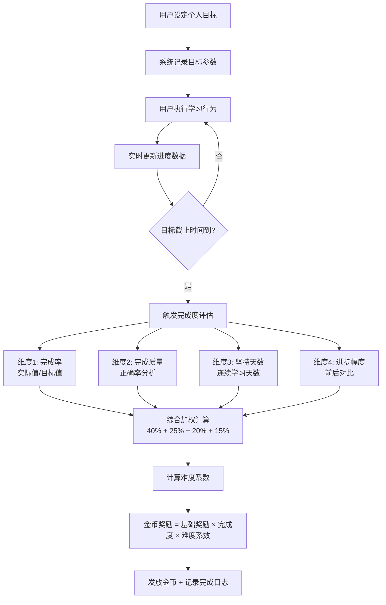

# “金币购”功能模块设计方案


## 文档说明

- **文档版本**：v1.0
- **编写日期**：2026年9月
- **编写目的**：针对砺安题库系统学生端“金币购”功能模块进行从零到一的完整设计，涵盖虚拟货币转换机制、任务系统、算法设计、前端展示等全方位方案。
- **适用对象**：前后端开发人员、产品设计师、运营人员


## 一、功能定位与设计理念

### 1.1 功能定位

“金币购”是砺安题库系统**学习激励与用户留存**的核心模块，通过虚拟金币与实物/虚拟奖励的结合，构建“学习→赚取金币→兑换奖励”的正向循环，提升用户学习动力和平台粘性。

### 1.2 设计理念

| 理念 | 说明 |
|------|------|
| **学有所得** | 让学习行为产生即时、可视化的价值反馈 |
| **游戏化激励** | 借鉴多邻国等优秀产品的经验，通过任务化设计引导持续学习 |
| **公平可持续** | 虚拟货币体系设计科学合理，确保经济系统长期稳定 |
| **合规安全** | 严格遵守虚拟货币相关法规，杜绝非法变现风险 |


## 二、虚拟货币体系设计

### 2.1 货币名称与单位

| 项目 | 内容 |
|------|------|
| **货币名称** | 砺安币（LiAn Coin） |
| **货币符号** | 🪙 / LA |
| **最小单位** | 1 砺安币（不设小数） |
| **存储方式** | 数据库整数字段，精确到个位 |

### 2.2 人民币→砺安币转换机制

#### 2.2.1 转换汇率设计

| 充值档位 | 人民币（元） | 砺安币（个） | 赠送比例 | 实际汇率 |
|---------|-------------|-------------|---------|---------|
| 新手档 | 6 | 60 | 0% | 1:10 |
| 基础档 | 30 | 330 | +10% | 1:11 |
| 进阶档 | 68 | 816 | +20% | 1:12 |
| 高级档 | 128 | 1,664 | +30% | 1:13 |
| 尊享档 | 328 | 4,592 | +40% | 1:14 |
| 至尊档 | 648 | 9,720 | +50% | 1:15 |

**设计原则**：
- 基础汇率为 **1元 = 10砺安币**（参考行业通用标准）
- 充值越多，赠送比例越高，激励大额充值
- 所有档位均为固定金额，不设自定义充值（防止合规风险）

#### 2.2.2 转换算法

```python
# backend/app/services/coin_service.py

RECHARGE_TIERS = [
    {"rmb": 6, "coins": 60, "bonus_rate": 0.00},
    {"rmb": 30, "coins": 330, "bonus_rate": 0.10},
    {"rmb": 68, "coins": 816, "bonus_rate": 0.20},
    {"rmb": 128, "coins": 1664, "bonus_rate": 0.30},
    {"rmb": 328, "coins": 4592, "bonus_rate": 0.40},
    {"rmb": 648, "coins": 9720, "bonus_rate": 0.50},
]

def calculate_recharge_coins(rmb_amount: int) -> dict:
    """计算充值所得砺安币"""
    tier = next((t for t in RECHARGE_TIERS if t["rmb"] == rmb_amount), None)
    if not tier:
        raise ValueError("不支持的充值金额")
    
    base_coins = tier["coins"]
    bonus_coins = int(base_coins * tier["bonus_rate"])
    total_coins = base_coins + bonus_coins
    
    return {
        "base_coins": base_coins,
        "bonus_coins": bonus_coins,
        "total_coins": total_coins,
        "tier_name": f"{rmb_amount}元档"
    }
```

### 2.3 合规性保障

根据《网络游戏管理暂行办法》第十九条规定：

| 合规要求 | 本系统实现方式 |
|---------|---------------|
| 虚拟货币仅限兑换自身产品和服务 | 砺安币仅可兑换题库内的备考资料、虚拟徽章、学习工具等 |
| 不得用于支付、购买实物 | 实物商品（如文具、书籍）仅支持“金币+现金”混合支付，现金部分走正常电商流程 |
| 不得恶意占用预付资金 | 充值金币永久有效，用户可随时查询余额和消费记录 |
| 提供反向兑换通道 | 用户注销账号时，未消耗的金币可按比例退还 |

**⚠️ 重要合规红线**：
- **禁止“金币→人民币”直接提现**（违反虚拟货币管理规定）
- **禁止金币购买实物**（仅限虚拟服务，实物需混合支付）
- **禁止金币交易**（用户之间不可转让金币）


## 三、任务系统设计

### 3.1 任务分类总览

| 任务类型 | 频率 | 数量 | 奖励范围 | 设计目的 |
|---------|------|------|---------|---------|
| **每日签到** | 每日 | 1项 | 5-30金币 | 培养每日登录习惯 |
| **学习任务** | 每日 | 5项 | 10-50金币 | 驱动核心学习行为 |
| **个人目标** | 用户自定 | 不限 | 50-500金币 | 个性化激励，长期坚持 |
| **随机任务** | 每日刷新 | 3项 | 15-80金币 | 增加惊喜感，提升兴趣 |
| **周常任务** | 每周 | 15项 | 20-100金币 | 稳定长期活跃 |
| **成就任务** | 一次性 | 不限 | 100-1000金币 | 里程碑奖励 |

### 3.2 每日签到任务

最简单的入门级任务，培养用户每日打开APP的习惯：

| 签到天数 | 奖励金币 | 特殊奖励 |
|---------|---------|---------|
| 第1天 | 5 | — |
| 第2天 | 6 | — |
| 第3天 | 7 | — |
| 第4天 | 8 | — |
| 第5天 | 10 | — |
| 第6天 | 12 | — |
| 第7天（满勤） | 20 | ✨ 7日连胜勋章 |

**签到规则**：
- 每日仅可签到1次
- 连续签到7天为一周期，第8天重置为5金币
- 中断签到则重置为第1天

### 3.3 每日学习任务

基于用户学习行为的日常驱动任务：

| 任务名称 | 完成条件 | 奖励金币 | 难度系数 |
|---------|---------|---------|---------|
| 初露锋芒 | 完成10道题目 | 10 | 1.0 |
| 小试牛刀 | 完成30道题目 | 20 | 1.2 |
| 勤学苦练 | 完成50道题目 | 35 | 1.5 |
| 博学多闻 | 完成80道题目 | 50 | 2.0 |
| 正确率挑战 | 正确率≥85%（≥20题） | 30 | 1.8 |
| 连续答题 | 连续答对15题 | 25 | 1.6 |
| 多科目练习 | 完成3个不同科目各10题 | 40 | 2.2 |
| 错题复习 | 完成10道错题重练 | 25 | 1.5 |
| 阅读金句 | 阅读3条每日金句 | 10 | 0.5 |
| 浏览新闻 | 阅读2条招考新闻 | 10 | 0.5 |

### 3.4 个人目标任务（核心算法一）

#### 3.4.1 设计原理

个人目标任务的核心理念是：**用户自主设定目标，系统根据目标难度、完成质量、坚持天数等多维度因素，精准评估并给予差异化金币奖励**。

参考多邻国的“每日目标”机制，用户设定每天的学习目标（如“每日30题”），完成目标后获得相应奖励，通过即时反馈不断强化学习动机。

#### 3.4.2 目标类型

| 目标类型 | 示例 | 基础奖励 | 难度系数范围 |
|---------|------|---------|-------------|
| 每日做题目标 | “每日完成30题” | 20金币 | 1.0 - 3.0 |
| 每周做题目标 | “本周完成200题” | 80金币 | 1.5 - 4.0 |
| 正确率目标 | “本周正确率≥80%” | 60金币 | 1.5 - 3.5 |
| 连续学习目标 | “连续学习7天” | 50金币 | 1.0 - 2.5 |
| 专项突破目标 | “完成资料分析50题” | 40金币 | 1.2 - 2.8 |

#### 3.4.3 目标完成度精准判定算法

```python
# backend/app/services/goal_service.py
import math
from datetime import datetime, timedelta
from typing import Dict, Any

class GoalCompletionEvaluator:
    """
    个人目标完成度精准判定算法
    基于多维度加权计算，精准评估用户目标完成情况
    """
    
    def evaluate_goal_completion(self, user_id: int, goal: Dict[str, Any]) -> Dict[str, Any]:
        """
        评估用户个人目标的完成度
        返回: { "completion_rate": float, "quality_score": float, "reward_coins": int }
        """
        # 维度1：完成率（基础维度，权重40%）
        completion_rate = self._calc_completion_rate(user_id, goal)
        
        # 维度2：完成质量（权重25%）
        quality_score = self._calc_quality_score(user_id, goal)
        
        # 维度3：坚持天数（权重20%）
        persistence_score = self._calc_persistence_score(user_id, goal)
        
        # 维度4：进步幅度（权重15%）
        improvement_score = self._calc_improvement_score(user_id, goal)
        
        # 综合完成度评分（0-1之间）
        overall_completion = (
            completion_rate * 0.40 +
            quality_score * 0.25 +
            persistence_score * 0.20 +
            improvement_score * 0.15
        )
        
        # 目标难度系数（根据目标类型和具体数值计算）
        difficulty_factor = self._calc_difficulty_factor(goal)
        
        # 基础奖励 × 完成度 × 难度系数
        base_reward = goal.get("base_reward", 50)
        reward_coins = int(base_reward * overall_completion * difficulty_factor)
        
        return {
            "completion_rate": completion_rate,
            "quality_score": quality_score,
            "persistence_score": persistence_score,
            "improvement_score": improvement_score,
            "overall_completion": overall_completion,
            "difficulty_factor": difficulty_factor,
            "reward_coins": max(reward_coins, 10)  # 最低保底10金币
        }
    
    def _calc_completion_rate(self, user_id: int, goal: Dict) -> float:
        """计算完成率"""
        target = goal.get("target_value", 0)
        actual = self._get_user_actual_progress(user_id, goal)
        if target == 0:
            return 0.0
        return min(actual / target, 1.0)  # 上限为1
    
    def _calc_quality_score(self, user_id: int, goal: Dict) -> float:
        """计算完成质量（正确率、效率等）"""
        # 获取用户在该目标范围内的答题正确率
        accuracy = self._get_user_accuracy_in_scope(user_id, goal)
        # 正确率85%以上为高质量
        if accuracy >= 0.85:
            return 1.0
        elif accuracy >= 0.70:
            return 0.7
        elif accuracy >= 0.60:
            return 0.5
        else:
            return 0.3
    
    def _calc_persistence_score(self, user_id: int, goal: Dict) -> float:
        """计算坚持天数得分"""
        consecutive_days = self._get_consecutive_days(user_id, goal)
        if consecutive_days >= 30:
            return 1.0
        elif consecutive_days >= 21:
            return 0.9
        elif consecutive_days >= 14:
            return 0.75
        elif consecutive_days >= 7:
            return 0.6
        elif consecutive_days >= 3:
            return 0.4
        else:
            return 0.2
    
    def _calc_improvement_score(self, user_id: int, goal: Dict) -> float:
        """计算进步幅度"""
        # 对比用户设定目标前后的学习数据变化
        before = self._get_user_performance_before(user_id, goal)
        after = self._get_user_performance_during(user_id, goal)
        improvement = (after - before) / max(before, 1)
        return min(max(improvement, 0), 1.0)  # 限制在0-1之间
    
    def _calc_difficulty_factor(self, goal: Dict) -> float:
        """计算目标难度系数"""
        target_value = goal.get("target_value", 0)
        goal_type = goal.get("goal_type", "")
        
        # 基础难度系数
        base_factors = {
            "daily_questions": 1.0 + (target_value / 100) * 0.5,
            "weekly_questions": 1.0 + (target_value / 500) * 0.5,
            "accuracy_goal": 1.0 + (target_value - 0.6) * 2.5,
            "continuous_learning": 1.0 + (target_value / 30) * 0.5,
            "special_breakthrough": 1.2 + (target_value / 100) * 0.3,
        }
        factor = base_factors.get(goal_type, 1.0)
        return min(factor, 3.0)  # 最高难度系数不超过3.0
```

#### 3.4.4 目标完成度判定流程图



### 3.5 随机任务系统

为提升用户做题兴趣和获得金币的欲望，设计每日随机任务池：

| 随机任务 | 完成条件 | 奖励金币 | 出现概率 |
|---------|---------|---------|---------|
| 🎯 精准打击 | 连续答对20题 | 50 | 15% |
| ⚡ 速度之星 | 10分钟内完成30题 | 40 | 12% |
| 🏆 全能选手 | 完成5个不同知识点的练习 | 60 | 10% |
| 📚 深度阅读 | 阅读3篇备考资料文章 | 30 | 15% |
| 🔥 烈火雄心 | 完成50道困难难度题目 | 80 | 8% |
| 💪 坚持到底 | 连续学习45分钟 | 35 | 15% |
| 🎨 百花齐放 | 完成行测/申论/公专各20题 | 55 | 10% |
| 🌟 星光璀璨 | 获得3次“完美答题”（全对） | 45 | 10% |
| 📝 笔记达人 | 添加5条学习笔记 | 25 | 5% |

**随机任务刷新规则**：
- 每日0点自动刷新3个随机任务
- 用户可免费刷新1次/天（消耗5金币可额外刷新）
- 未完成的随机任务次日自动消失

### 3.6 周常任务（15项固定任务池）

每周提供**15个固定金币任务**，覆盖不同难度层级：

| 编号 | 任务名称 | 完成条件 | 奖励金币 |
|------|---------|---------|---------|
| 1 | 每日签到全勤 | 本周7天全部签到 | 100 |
| 2 | 做题达人 | 本周完成300题 | 80 |
| 3 | 正确率之星 | 本周正确率≥85%（≥100题） | 70 |
| 4 | 多面手 | 完成行测/申论/公专各50题 | 90 |
| 5 | 错题终结者 | 完成50道错题重练 | 60 |
| 6 | 资料狂人 | 阅读5篇备考资料 | 50 |
| 7 | 金句收集者 | 收藏10条金句 | 40 |
| 8 | 论坛活跃者 | 发布3条帖子或评论 | 45 |
| 9 | 早起鸟 | 3天在8:00前完成首次学习 | 55 |
| 10 | 夜猫子 | 3天在22:00后完成学习 | 55 |
| 11 | 连续学习 | 连续7天每天学习≥20分钟 | 75 |
| 12 | 专项突破 | 完成任一知识点全部题目 | 65 |
| 13 | 模拟考达人 | 完成2次模拟考试 | 70 |
| 14 | 分享达人 | 分享学习成果2次 | 35 |
| 15 | 终极挑战 | 完成所有周常任务 | 200 |


## 四、金币展示与消费模块

### 4.1 “我的金币”模块设计

在“我的”页面和头像下拉菜单中展示：

```
┌─────────────────────────────────────────────────────────────────────────────┐
│  👤 我的                                                                   │
├─────────────────────────────────────────────────────────────────────────────┤
│  ┌──────────────────────────────────────────────────────────────────────┐  │
│  │  [头像]  张三                                                       │  │
│  │  刑侦2201班 · 学号：2024001                                        │  │
│  │  🪙 我的金币：1,286                                                │  │
│  │  [充值] [明细] [兑换商城]                                           │  │
│  └──────────────────────────────────────────────────────────────────────┘  │
│                                                                             │
│  ┌──────────────────────────────────────────────────────────────────────┐  │
│  │  📊 金币概况                                                        │  │
│  │  本月获得：+520  |  本月消耗：-180  |  当前持有：1,286            │  │
│  └──────────────────────────────────────────────────────────────────────┘  │
│                                                                             │
│  ┌──────────────────────────────────────────────────────────────────────┐  │
│  │  📋 最近金币记录                                                    │  │
│  │  09-07  完成“每日30题”目标          +35  🪙                      │  │
│  │  09-07  连续签到第5天                +10  🪙                      │  │
│  │  09-06  兑换“行测高频考点集”         -80  🪙                      │  │
│  │  [查看全部 →]                                                       │  │
│  └──────────────────────────────────────────────────────────────────────┘  │
└─────────────────────────────────────────────────────────────────────────────┘
```

### 4.2 金币明细页面

```
┌─────────────────────────────────────────────────────────────────────────────┐
│  ← 返回    金币明细                                                        │
├─────────────────────────────────────────────────────────────────────────────┤
│  [全部] [收入] [支出] [充值]                                               │
├─────────────────────────────────────────────────────────────────────────────┤
│  ┌──────────────────────────────────────────────────────────────────────┐  │
│  │  +35  完成“每日30题”目标                    09-07 14:32           │  │
│  │  +10  连续签到第5天                          09-07 08:15           │  │
│  │  -80  兑换“行测高频考点集”                   09-06 20:10           │  │
│  │  +50  完成“精准打击”随机任务                 09-06 19:45           │  │
│  │  +128 充值68元档（含赠送）                   09-05 10:00           │  │
│  └──────────────────────────────────────────────────────────────────────┘  │
│  共 156 条记录                                                            │
└─────────────────────────────────────────────────────────────────────────────┘
```

### 4.3 金币商城设计

#### 4.3.1 可兑换商品分类

| 分类 | 商品示例 | 兑换方式 | 价格区间 |
|------|---------|---------|---------|
| **备考资料** | 高频考点集、真题解析、冲刺讲义 | 纯金币兑换 | 50-500金币 |
| **虚拟权益** | VIP体验卡、专属头像框、答题皮肤 | 纯金币兑换 | 30-300金币 |
| **学习工具** | 错题导出、智能组卷次数、模拟考次数 | 纯金币兑换 | 20-200金币 |
| **实物商品** | 备考书籍、文具套装、周边产品 | ⚠️ 金币+现金混合支付 | 100金币+现金 |

**⚠️ 重要说明**：
- 实物商品采用“金币+现金”混合支付模式
- 现金部分走正常支付流程（微信/支付宝）
- 金币部分作为折扣抵扣，不涉及“金币直接购买实物”

#### 4.3.2 商城页面设计

```
┌─────────────────────────────────────────────────────────────────────────────┐
│  ← 返回    🪙 金币商城                    持有：1,286 🪙                │
├─────────────────────────────────────────────────────────────────────────────┤
│  [备考资料] [虚拟权益] [学习工具] [实物专区]                               │
├─────────────────────────────────────────────────────────────────────────────┤
│  ┌────────────────────────┐ ┌────────────────────────┐                    │
│  │  📘 行测高频考点集      │ │  📗 申论素材宝典      │                    │
│  │  精选500个必背考点     │ │  100个热点素材库      │                    │
│  │  🪙 80 金币            │ │  🪙 60 金币           │                    │
│  │  [立即兑换]            │ │  [立即兑换]           │                    │
│  └────────────────────────┘ └────────────────────────┘                    │
│  ┌────────────────────────┐ ┌────────────────────────┐                    │
│  │  ⭐ VIP体验卡（7天）   │ │  🎨 专属头像框       │                    │
│  │  解锁全部资料权限      │ │  限量版警徽边框       │                    │
│  │  🪙 150 金币           │ │  🪙 50 金币           │                    │
│  │  [立即兑换]            │ │  [立即兑换]           │                    │
│  └────────────────────────┘ └────────────────────────┘                    │
│                                                                             │
│  ⚠️ 实物商品需金币+现金混合支付                                            │
│  ┌────────────────────────┐ ┌────────────────────────┐                    │
│  │  📖 公安联考真题集     │ │  ✏️ 备考文具套装      │                    │
│  │  2026版 官方指定       │ │  笔记本+笔+帆布袋     │                    │
│  │  🪙 100 + ¥29.9       │ │  🪙 80 + ¥19.9        │                    │
│  │  [立即购买]            │ │  [立即购买]           │                    │
│  └────────────────────────┘ └────────────────────────┘                    │
└─────────────────────────────────────────────────────────────────────────────┘
```


## 五、数据库设计

### 5.1 用户金币表 (`user_coins`)

| 字段 | 类型 | 描述 |
|------|------|------|
| `id` | BIGINT PK | |
| `user_id` | INT UNIQUE | 用户ID（一对一） |
| `total_coins` | INT DEFAULT 0 | 总获得金币（累计） |
| `available_coins` | INT DEFAULT 0 | 可用金币 |
| `frozen_coins` | INT DEFAULT 0 | 冻结金币（退款/争议） |
| `total_spent` | INT DEFAULT 0 | 累计消费 |
| `updated_at` | DATETIME | |

### 5.2 金币流水表 (`coin_transactions`)

| 字段 | 类型 | 描述 |
|------|------|------|
| `id` | BIGINT PK | |
| `user_id` | INT | 用户ID |
| `type` | VARCHAR(20) | income / expense / refund |
| `source` | VARCHAR(50) | recharge / task / goal / sign_in / random_task / weekly_task / achievement / exchange |
| `source_id` | INT | 来源ID（任务ID/充值订单ID等） |
| `amount` | INT | 变动数量（正=收入，负=支出） |
| `balance_after` | INT | 变动后余额 |
| `description` | VARCHAR(200) | 描述 |
| `created_at` | DATETIME | |

### 5.3 任务记录表 (`user_tasks`)

| 字段 | 类型 | 描述 |
|------|------|------|
| `id` | BIGINT PK | |
| `user_id` | INT | 用户ID |
| `task_type` | VARCHAR(30) | daily / goal / random / weekly / achievement |
| `task_id` | INT | 任务配置ID |
| `task_name` | VARCHAR(100) | 任务名称 |
| `target_value` | INT | 目标值 |
| `current_value` | INT | 当前进度 |
| `reward_coins` | INT | 奖励金币 |
| `status` | VARCHAR(20) | pending / completed / failed / expired |
| `started_at` | DATETIME | |
| `completed_at` | DATETIME | |
| `expired_at` | DATETIME | |

### 5.4 个人目标表 (`user_goals`)

| 字段 | 类型 | 描述 |
|------|------|------|
| `id` | BIGINT PK | |
| `user_id` | INT | 用户ID |
| `goal_type` | VARCHAR(30) | daily_questions / weekly_questions / accuracy_goal / continuous_learning / special_breakthrough |
| `target_value` | DECIMAL(10,2) | 目标值 |
| `actual_value` | DECIMAL(10,2) | 实际完成值 |
| `base_reward` | INT | 基础奖励金币 |
| `difficulty_factor` | DECIMAL(3,2) | 难度系数 |
| `completion_rate` | DECIMAL(3,2) | 完成度（0-1） |
| `quality_score` | DECIMAL(3,2) | 质量得分（0-1） |
| `persistence_score` | DECIMAL(3,2) | 坚持得分（0-1） |
| `improvement_score` | DECIMAL(3,2) | 进步得分（0-1） |
| `final_reward` | INT | 最终奖励金币 |
| `status` | VARCHAR(20) | active / completed / failed |
| `started_at` | DATETIME | |
| `completed_at` | DATETIME | |
| `deadline` | DATETIME | |

### 5.5 金币兑换记录表 (`coin_exchanges`)

| 字段 | 类型 | 描述 |
|------|------|------|
| `id` | BIGINT PK | |
| `user_id` | INT | 用户ID |
| `product_id` | INT | 商品ID |
| `product_name` | VARCHAR(200) | 商品名称 |
| `product_type` | VARCHAR(20) | material / virtual / tool / physical |
| `coin_cost` | INT | 消耗金币 |
| `cash_cost` | DECIMAL(10,2) | 现金支付（实物商品） |
| `status` | VARCHAR(20) | pending / completed / refunded |
| `created_at` | DATETIME | |
| `completed_at` | DATETIME | |


## 六、API接口设计

### 6.1 金币核心接口

| 接口 | 方法 | 路径 | 描述 |
|------|------|------|------|
| 获取金币概况 | GET | `/api/coins/overview` | 获取用户金币总数、本月获得/消耗 |
| 获取金币明细 | GET | `/api/coins/transactions` | 分页获取金币流水 |
| 充值金币 | POST | `/api/coins/recharge` | 人民币充值砺安币 |
| 获取充值档位 | GET | `/api/coins/tiers` | 获取所有充值档位 |

### 6.2 任务接口

| 接口 | 方法 | 路径 | 描述 |
|------|------|------|------|
| 获取今日任务 | GET | `/api/tasks/daily` | 获取每日签到+学习任务+随机任务 |
| 获取周常任务 | GET | `/api/tasks/weekly` | 获取15项周常任务及进度 |
| 获取个人目标 | GET | `/api/tasks/goals` | 获取用户活跃的个人目标 |
| 创建个人目标 | POST | `/api/tasks/goals` | 用户设定新的个人目标 |
| 领取任务奖励 | POST | `/api/tasks/{task_id}/claim` | 完成任务后领取金币 |

### 6.3 商城接口

| 接口 | 方法 | 路径 | 描述 |
|------|------|------|------|
| 获取商品列表 | GET | `/api/shop/products` | 按分类获取可兑换商品 |
| 金币兑换 | POST | `/api/shop/exchange` | 纯金币兑换虚拟商品 |
| 混合购买 | POST | `/api/shop/purchase` | 金币+现金混合购买实物 |


## 七、防刷与风控机制

### 7.1 防刷策略

| 风险场景 | 防控措施 |
|---------|---------|
| 批量注册刷金币 | 手机号实名认证 + 设备指纹绑定 |
| 脚本自动完成任务 | 行为验证（滑动验证码）+ 异常行为检测 |
| 任务重复领取 | 任务状态机 + 唯一索引防重 |
| 恶意刷题领金币 | 答题时间合理性校验（每题最少3秒） |
| 充值欺诈 | 支付回调验证 + 订单状态机 |

### 7.2 异常监控告警

| 监控指标 | 阈值 | 告警动作 |
|---------|------|---------|
| 单用户日获得金币 | > 500 | 人工审核 |
| 单IP日注册数 | > 10 | 自动限流 |
| 单任务完成时间 | < 1秒 | 标记异常 |
| 充值退款率 | > 5% | 告警管理员 |


## 八、用户体验增强设计

### 8.1 金币获取动画反馈

| 场景 | 动画效果 |
|------|---------|
| 完成任务获得金币 | 🪙 金币飞入钱包的动画 + 数字跳动 |
| 连续签到 | 火焰特效 + 连击数显示 |
| 达成个人目标 | 🎉 庆祝动画 + 成就徽章弹出 |
| 商城兑换成功 | ✅ 成功弹窗 + 商品卡片展示 |

### 8.2 进度可视化

- 每个任务卡片显示进度条（当前值/目标值）
- 周常任务显示“已完成 X/15”
- 个人目标显示剩余天数倒计时
- 签到页面显示7天周期进度

### 8.3 社交激励

| 功能 | 说明 |
|------|------|
| 好友排行 | 按金币总量/周获得排行 |
| 分享得金币 | 分享学习成果可获得额外金币 |
| 组队任务 | 与好友组队完成共同目标 |


## 九、实施优先级

| 优先级 | 功能 | 说明 |
|--------|------|------|
| **P0** | 金币数据库设计 + 基础API | 基础设施 |
| **P0** | 每日签到功能 | 最简单的入门任务 |
| **P0** | 每日学习任务（5项） | 核心驱动 |
| **P0** | “我的金币”展示模块 | 前端展示 |
| **P1** | 个人目标系统 + 完成度算法 | 核心算法 |
| **P1** | 随机任务系统（3项/日） | 提升趣味性 |
| **P1** | 金币商城（虚拟商品） | 消费闭环 |
| **P2** | 周常任务（15项） | 长期活跃 |
| **P2** | 充值系统 | 商业化 |
| **P3** | 实物商品混合支付 | 扩展功能 |
| **P3** | 社交激励（排行/分享） | 增强功能 |


## 十、总结

本方案围绕砺安题库“金币购”功能模块，完成了以下核心设计：

| 设计维度 | 核心内容 |
|---------|---------|
| **虚拟货币体系** | 1元=10砺安币，6档充值梯度，严格合规 |
| **任务系统** | 签到+每日任务+个人目标+随机任务+周常任务（15项） |
| **核心算法一** | 人民币→金币转换（含赠送比例，最高+50%） |
| **核心算法二** | 个人目标完成度判定（4维度加权：完成率40%+质量25%+坚持20%+进步15%） |
| **金币展示** | “我的金币”模块 + 明细页面 + 商城 |
| **合规保障** | 虚拟货币仅限兑换虚拟服务，实物混合支付 |

通过以上设计，砺安题库系统将构建起“**学习→赚取金币→兑换奖励**”的完整正向激励闭环，有效提升用户学习动力和平台粘性。